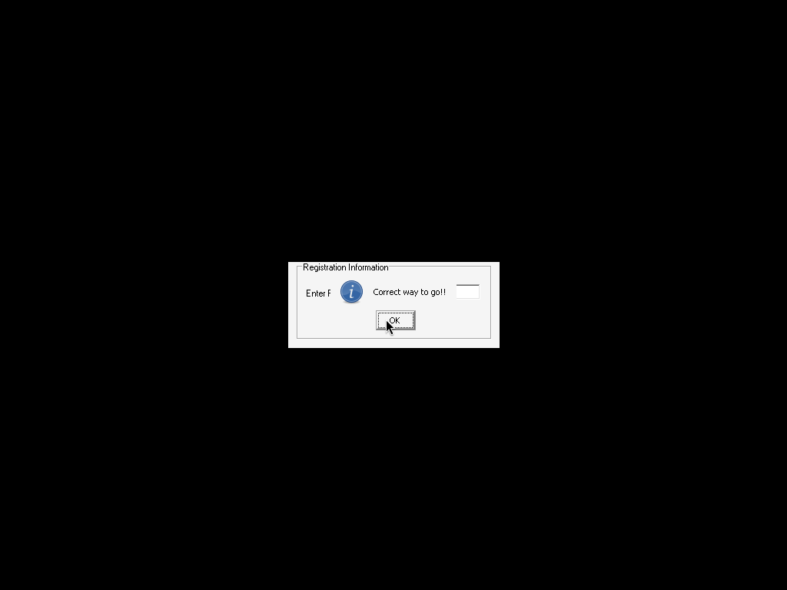

# cyclops — crackmes.de / cyclops

- Origine : [ORIGIN.yml](ORIGIN.yml) · [crackmes.one](https://crackmes.one/crackme/5ab77f5433c5d40ad448c149)
- Auteur : cyclops (réimport crackmes.de, publié sur crackmes.one le 2018-03-25)
- Plateforme : Windows PE32 GUI, MSVC 6 + MFC 4.2 · difficulté 1.0

## Fichiers

| Fichier | Rôle |
|---|---|
| `original/cyclops.zip` | archive d’origine (`cyclops.exe`, `readme.txt` : « find serial ») |
| `tools/crackmes-de-cyclops-solve.py` | extrait le serial directement de `.data` |

## Réponse

**Serial : `<BrD-SoB>`** (pas de nom : un seul champ « Registration Number »).

```bash
python3 tools/crackmes-de-cyclops-solve.py   # → <BrD-SoB>
```

## Premier regard

```text
cyclops.exe: PE32 executable (GUI) Intel i386 — DIE : MSVC 6.0, MFC 4.2
```

Imports : `MFC42.DLL` (par ordinaux), `KERNEL32!lstrcmpA`, `lstrlenA`. Pas de packer.
Les chaînes de `.data` disent tout :

```text
403020  <BrD-SoB>
403034  Enter Registration Number
403058  Correct way to go!!
403074  Incorrect try again!!
```

## Comment on trouve

1. `lstrcmpA` (IAT `0x402000`) n’est appelé qu’une fois : `0x40158d`.
2. On remonte le handler du bouton (`objdump -d -M intel`) :

```asm
40152d  mov edx,[0x403020]        ; copie "<BrD-SoB>\0" (4+4+2 octets) sur la pile
...     mov [ebp-0x1c],edx ...    ; → référence locale ebp-0x1c
401549  push 0xa                  ; max 10 caractères
40154b  lea edx,[ebp-0xc] / push  ; buffer saisie
40154f  push 0x3e8                ; ID du contrôle edit
401557  call CWnd::GetDlgItemText
401560  call lstrlenA             ; vide → "Enter Registration Number"
40158d  call lstrcmpA(saisie, "<BrD-SoB>")
401595  jne  → "Incorrect try again!!"
         sinon → "Correct way to go!!"
```

Le prédicat est donc une simple égalité avec la constante `<BrD-SoB>` (9 caractères, tient dans le buffer de 10).

## Vérification

Live sous wine (après `winetricks -q mfc42`, MFC42.DLL n’étant pas fourni par wine) :

```bash
xvfb-run -a wine original/cyclops.exe   # (extrait du zip)  → saisir <BrD-SoB> → Check
```



## Résumé

Serial codé en dur, copié de `.data` vers la pile puis comparé par `lstrcmpA` : `<BrD-SoB>`.
