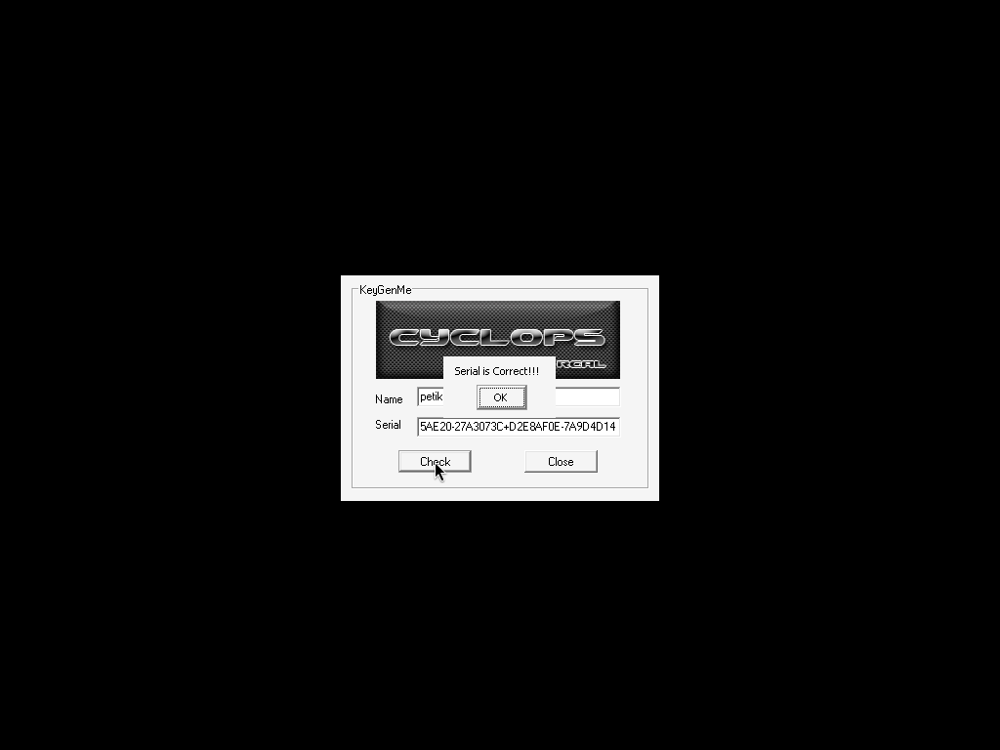

# nts_crackme5 — crackmes.de / cyclops

- Origine : [ORIGIN.yml](ORIGIN.yml) · [crackmes.one](https://crackmes.one/crackme/5ab77f5433c5d40ad448c14b)
- Auteur : cyclops (série « NTS — Newbie Training Series », réimport crackmes.de, publié 2018-03-25)
- Plateforme : Windows PE32 GUI, MSVC 6 + MFC 4.2 · difficulté 1.0 · consigne : *keygen*

## Fichiers

| Fichier | Rôle |
|---|---|
| `original/*.zip` | `Crackme5.exe` + readmes |
| `tools/crackmes-de-nts_crackme5-solve.py` | keygen (réimplémentation exacte des deux hachages) |
| `analysis/live-wine-petikvx.png` | « Serial is Correct!!! » sous wine |

## Réponse

Keygen : **serial = `f1(nom) + "+" + f2(nom)`**, chaque partie au format `%08X-%08X`. Nom ≥ 7 caractères
(`petik` seul est trop court, d’où l’exemple `petikvx`) :

```text
nom    : petikvx
serial : 8E15AE20-27A3073C+D2E8AF0E-7A9D4D14
```

```bash
python3 tools/crackmes-de-nts_crackme5-solve.py petikvx
```

## Premier regard

`file` : PE32 GUI i386 ; DIE : MSVC 6, MFC 4.2. Imports CRT intéressants : `sprintf`, `sscanf`.
Chaînes : `%08X-%08X`, `%[^+]+%s`, `Serial is Correct!!!` — on devine déjà le format `XXXXXXXX-XXXXXXXX+XXXXXXXX-XXXXXXXX`.

## Comment on trouve

On suit les xrefs de `%[^+]+%s` (`0x403044`) → handler du bouton `Check` à `0x4014e0` :

```asm
GetDlgItemText(0x3e8, nom, 0x20)    → edi = len(nom)
GetDlgItemText(0x3e9, serial, 0x28) → eax = len(serial)
cmp edi,6 / jle fail                ; nom ≥ 7
cmp eax,0x20 / jle fail             ; serial ≥ 33
sscanf(serial, "%[^+]+%s", p1, p2)  ; coupe au '+'
call 0x401320(nom, p1) ; test eax / je fail
call 0x4013e0(nom, p2) ; test eax / je fail
MessageBox("Serial is Correct!!!")
```

Les deux fonctions calculent deux accumulateurs 32 bits sur les caractères (signés, `movsx`) du nom,
font `sprintf(buf, "%08X-%08X", a, b)` puis un `strcmp` inline avec la partie correspondante.

**`0x401320`** (ecx=0, edx=1) — pour chaque `c` :

```text
esi = c ^ 0x32142001 ; ecx += esi
t   = (c*edx) | ecx
ecx *= (t % 7) + 2
edx  = ((ecx % 5) + 3) * t
→ sprintf("%08X-%08X", ecx, edx)
```

**`0x4013e0`** (ecx=1, esi=0, edi=0) — pour chaque `c` :

```text
e    = c*ecx ; esi -= c | 0xF001F001
edi += e + esi ; ecx = e | esi
ecx  = ecx*((edi % 7) + 3) + edi
esi  = ((edi % 11) + 2)*esi + edi
→ sprintf("%08X-%08X", esi, ecx)
```

(attention à l’ordre des `push` : `push edx / push ecx` → `ecx` est le premier `%08X` dans f1 ;
`push ecx / push esi` → `esi` en premier dans f2.) Les `div` sont non signés, tout est modulo 2³².

## Vérification

`MFC42.DLL` n’est pas fourni par wine : `winetricks -q mfc42`, puis sous Xvfb :

```bash
wine Crackme5.exe   # Name = petikvx, Serial = 8E15AE20-27A3073C+D2E8AF0E-7A9D4D14 → Check
```

Saisie pilotée par `xdotool`, capture `ffmpeg -f x11grab` :



## Résumé

Keygen à deux hachages indépendants du nom, concaténés par `+` ; réimplémentés en Python et validés live.
