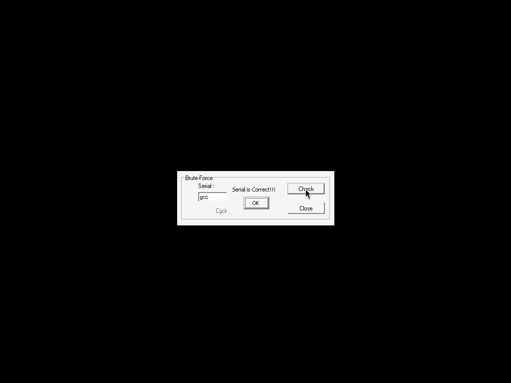

# nts_crackme4 — crackmes.de / cyclops

- Origine : [ORIGIN.yml](ORIGIN.yml) · [crackmes.one](https://crackmes.one/crackme/5ab77f5433c5d40ad448c14d)
- Auteur : cyclops (série NTS, réimport crackmes.de, publié 2018-03-25)
- Plateforme : Windows PE32 GUI, MSVC 6 + MFC 4.2 · difficulté 1.0
- Consigne (`Readme4.txt`) : *« Fish the serial by brute-forcing the routine. (Rip the Code and brute force) »*

## Fichiers

| Fichier | Rôle |
|---|---|
| `original/*.zip` | `Crackme4.exe` + readmes |
| `tools/crackmes-de-nts_crackme4-solve.py` | rip Python des 3 hachages + brute force len ≤ 4 (< 1 s) |
| `tools/crackmes-de-nts_crackme4-bf.c` | même chose en C/OpenMP (`gcc -O3 -fopenmp`, `./bf <len>`) |
| `analysis/live-wine-ycc.png` | « Serial is Correct!!! » sous wine |

## Réponse

**Serial : `ycc`**

```bash
python3 tools/crackmes-de-nts_crackme4-solve.py   # → serial : ycc
```

## Premier regard

PE32 GUI MSVC6/MFC42, un seul champ « Serial ». Dans `.data` :

```text
403020  Serial is Correct!!!
403038  0CEAC848-A1F55297-18B3DD62     ← hash attendu
403054  %08X-%08X-%08X
```

## Comment on trouve

Xref de `%08X-%08X-%08X` → handler `Check` à `0x401400` :

```asm
GetDlgItemText(0x3e8, buf, 8)    ; ≤ 7 caractères, vide → rien
esi = call 0x401320(buf)         ; f1
edi = call 0x401360(buf)         ; f2
eax = call 0x4013c0(buf)         ; f3
push edi / push eax / push esi   ; ⚠ ordre : f1, f3, f2
sprintf(out, "%08X-%08X-%08X", f1, f3, f2)
strcmp inline(out, "0CEAC848-A1F55297-18B3DD62") → MessageBox succès
```

Les trois fonctions (acc = 0, `c` = octet signé) :

```text
f1 : e = ~(((c ^ 0xBAD0BEEF) + acc) | (c & 0xFEFEFEFE)) ; acc = e * (c % 13)
f2 : e = ((c ^ 0xB00BFACE) + acc) & (c | 0xFEFEFEFE) ; e += (c*3492) % 17 ; acc = e * (c%5 + 5)
f3 : e = ((c ^ 0xBAD0BEEF) + acc) ^ (c | 0xDEADC0DE) ; acc = e * c
```

(`c*3492` vient de `lea eax,[ecx+ecx*2] / shl 5 / add ecx / lea [eax+eax*8] / shl 2` = c·97·36.)

Comme demandé, on « rippe » ces routines et on brute-force les ASCII imprimables par longueur croissante,
en testant d’abord f3 (le moins cher). Piège rencontré : un premier essai qui comparait dans l’ordre
f1/f2/f3 ne trouvait rien — l’ordre des `push` place f3 au milieu. Avec le bon ordre, **`ycc`** tombe à la longueur 3.

## Vérification

`winetricks -q mfc42` (MFC42.DLL absent de wine), puis sous Xvfb `wine Crackme4.exe`, saisie `ycc` via `xdotool` :



## Résumé

Trois hachages 32 bits du serial comparés à une constante ; brute force imprimable → `ycc`.
