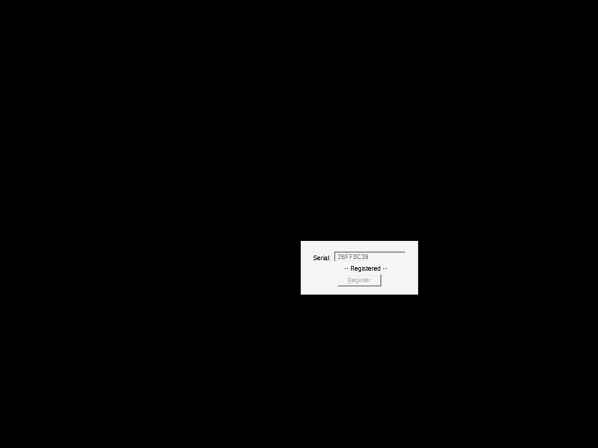
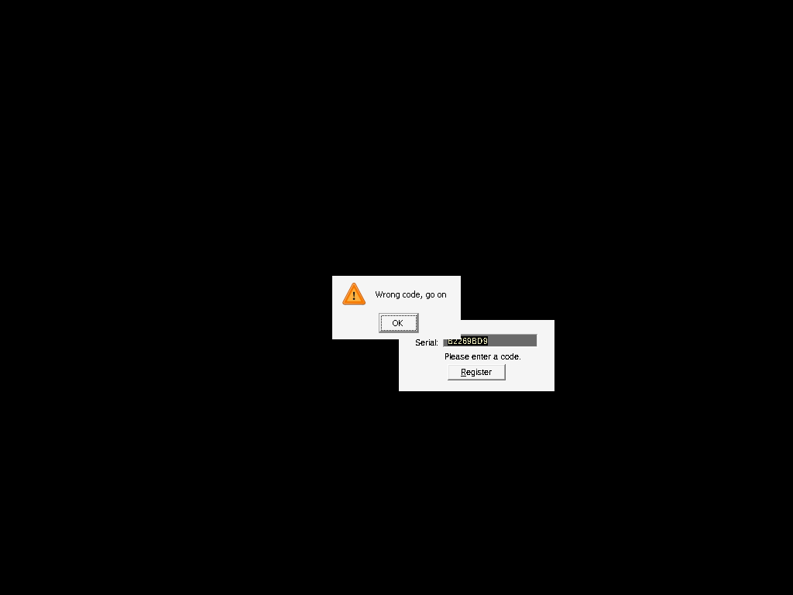

# a_small_crackme by bswap

| | |
|---|---|
| **ID** | [`5ab77f5533c5d40ad448c216`](https://crackmes.one/crackme/5ab77f5533c5d40ad448c216) · [ORIGIN](ORIGIN.yml) |
| **Auteur** | bswap (réimport crackmes.de, local `crackmes-de`) |
| **Publié** | 2018-03-25 (crackme de 2003) |
| **Plateforme** | Unspecified/other → Windows PE32 GUI (dialogue), MASM32, packé **FSG** |
| **Difficulté** | 2.0 |
| **SHA-256 zip** | `85bad000042ce2f24584413ba74f5f62afac8520dabaaa125f7f5c5a45efcae1` |
| **SHA-256 `Small.exe`** | `4f217e930d5c6cdd6e0b504449a9f14004f2c09780de2102d4371fdd29775693` |

## Fichiers

| Fichier | Rôle |
|---|---|
| `original/small.zip`, `original/Small.exe`, `original/Info.txt` | archive + binaire d'origine (non patché) + notice |
| `analysis/Small-unfsg.bin` | image mémoire à `0x400000` après décompression FSG (Unicorn) |
| `analysis/registered-petik.png` / `analysis/ko-petik.png` | captures Xvfb OK / KO |
| `tools/unpack-unicorn.py` | émule le stub FSG jusqu'à l'OEP `0x401000`, dumpe l'image + imports |
| `tools/small-solve.py` | **keygen** (nom d'utilisateur Windows → code) + `--check` |
| `tools/int68-loader.c` | mini-debugger Win32 : saute le `int 68h` anti-SoftICE qui crashe sous NT/wine |
| `tools/dlgdrive.c`, `tools/verify-wine.sh` | pilote du dialogue + preuve live wine/Xvfb |

## Réponse

Keygen-me : il n'y a **pas de champ nom**. Le nom est celui de la **session Windows** (`GetUserNameA`), seul le code est saisi.

| Utilisateur Windows | Code |
|---|---|
| **`petik`** | **`2BFF8C39`** |
| `box` | `B2269BD9` |

```bash
python3 tools/small-solve.py               # petik -> 2BFF8C39
python3 tools/small-solve.py --user box -q # B2269BD9
python3 tools/small-solve.py --user petik --check 2BFF8C39   # OK
tools/verify-wine.sh petik 2BFF8C39        # preuve live
```

Formule :

```
u0 = int32 signé(nom[0..3]), u1 = int32 signé(nom[4..7])   (zéro-padding)
R  = u0*u0 + u1 - u0          (FPU 80 bits, exact)  ;  L = 4 octets bas de R (LE)
code = HEX majuscule de [L1, L0^4, L3, L2^4]
```

## Premier regard

```text
$ file original/Small.exe
PE32 executable for MS Windows 4.00 (GUI), Intel i386, 2 sections
$ strings original/Small.exe | head
FSG!  KERNEL32.dll  LoadLibraryA  GetProcAddress  ...  S-Ice  Wrong c ...
```

1776 octets, signature `FSG!` dans l'en-tête, seulement `LoadLibraryA`/`GetProcAddress` importés : packé FSG (comme `keygenme_0.51` / `assassination` du même auteur). `Info.txt` : « *You have to keygen it, nothing else. Reading the source you will see why a validate serial just won't work!* » — normal, le code dépend du nom d'utilisateur de la machine.

## Unpack

`tools/unpack-unicorn.py` (repris de `assassination`) charge les sections dans Unicorn, simule `LoadLibraryA` / `GetProcAddress` et s'arrête au premier saut dans la section 1 :

```text
OEP = 0x401000
kernel32!Sleep, GetModuleHandleA, ExitProcess ; gdi32!SetTextColor, SetBkColor ;
user32!GetSysColorBrush, EndDialog, GetDlgItem, GetDlgItemTextA, DialogBoxParamA, MessageBoxA,
SendDlgItemMessageA, EnableWindow ; advapi32!GetUserNameA
```

IAT reconstruite (`0x402000` = `GetUserNameA`, `0x402014` = `Sleep`, `0x402030` = `GetDlgItemTextA`, `0x402038` = `MessageBoxA`, `0x40203c` = `SendDlgItemMessageA`, …). Désassemblage :

```bash
python3 -c "d=open('analysis/Small-unfsg.bin','rb').read();open('/tmp/s1.bin','wb').write(d[0x1000:0x2000])"
objdump -D -b binary -m i386 -M intel --adjust-vma=0x401000 /tmp/s1.bin
```

## Flow

`DialogBoxParamA` → DlgProc `0x401030` :

- **WM_INITDIALOG** (`0x110`) :
  ```asm
  401041  mov  ah,43h
  401043  int  68h                 ; détection SoftICE (Win9x)
  401045  cmp  ax,0F386h ; jne ok  ; sinon MessageBox "SHIT, your debbuger is detected!" + EndDialog
  401068  push 403008h             ; &size (=0x1E)
  40106d  push 40309Dh             ; buffer nom
  401072  call GetUserNameA        ; <-- le "nom" du keygen
  ```
- **WM_CTLCOLORDLG** (`0x133`) : couleurs, rien d'intéressant.
- **WM_COMMAND**, `wParam == 1` (bouton) : `Sleep(750)`, remise à zéro des buffers, `GetDlgItemTextA(hDlg, 100, 0x403060, 12)` puis le check.

## Comment on trouve le prédicat

### 1. Le hash du nom (FPU) — `0x401251`

```asm
40114a  finit
40114d  call 401251            ; ecx = 0
401251  fild dword [ecx+40309Dh]   ; st0 = u0 (octets 0..3 du nom, signé)
401257  fld  st0
401259  fmulp st1,st0              ; u0²
40125b  add  ecx,4
40125e  fild dword [ecx+40309Dh]   ; u1 (octets 4..7)
401264  faddp st1,st0              ; u0² + u1
401266  sub  ecx,4
401269  fild dword [ecx+40309Dh]
40126f  fsubp st1,st0              ; u0² + u1 - u0
...
40118f  fistp qword [40308Dh]      ; R en int64 (seuls les 4 octets bas seront comparés)
```

`finit` met la précision à 64 bits de mantisse : `u0² < 2^62`, le calcul est **exact** → un `int` Python suffit.

Exemple `petik` : `u0 = le32("peti") = 0x69746570`, `u1 = le32("k\0\0\0") = 0x6b`
→ `R = 0x2B70B0218C3D2BFB`, octets bas (LE) `L = FB 2B 3D 8C`.

### 2. Décodage du code saisi — `0x401273` (hex → octets)

```asm
401273  mov al,[esi] ; mov ah,[esi+1]
401278  sub al,30h ; sub ah,30h
40127d  cmp al,9 ; jbe + ; sub al,7     ; 'A'..'F' -> 10..15 (MAJUSCULES seulement)
40128e  shl al,4 ; or al,ah ; mov [edi],al
401296  dec ecx                          ; ecx=8 mais dec + loop = -2 par tour
401297  loop 401273                      ; => 4 tours = 8 caractères hex -> 4 octets en 0x403074
```

Piège : `dec ecx` **et** `loop` → seulement 4 itérations ; le code utile fait 8 chiffres hex (le champ en accepte 11).

### 3. Swap + XOR — `0x40129a`

```asm
40129a  mov al,[esi] ; mov ah,[esi+1]
40129f  xchg ah,al
4012a4  xor al,4
4012a6  mov [edi],ax        ; out[0] = D1^4, out[1] = D0
...                          ; (4 tours, mais seuls 4 octets comparés)
```

### 4. Comparaison — `0x4011a7`

```asm
401195  mov ecx,4
40119a  lea esi,[403060h]   ; code transformé
4011a0  lea edi,[40308Dh]   ; R (fistp)
4011a7  repz cmpsb
4011a9  jne 401211          ; MessageBox "Oeps / Wrong code, go on" + static "Please enter a code."
                            ; sinon static 10 <- "     -- Registered --", boutons désactivés
```

Donc `[D1^4, D0, D3^4, D2] == [L0, L1, L2, L3]` ⇒ `D = [L1, L0^4, L3, L2^4]`, code = `D` en hex majuscule.

### Exemple `petik` pas à pas

```text
u0 = 0x69746570 (1769235824), u1 = 0x6b (107)
R  = u0² + u1 - u0 = 0x2B70B0218C3D2BFB  -> 4 octets bas (LE) L = FB 2B 3D 8C
D  = [L1, L0^4, L3, L2^4] = [2B, FB^04, 8C, 3D^04] = [2B, FF, 8C, 39]
code = 2BFF8C39
```

(le solveur réimplémente aussi tel quel le décodage + swap/xor + comparaison dans `check()`, et `assert check(user, keygen(user))`).

## Vérification (live, binaire d'origine non patché)

Deux obstacles sous wine :

1. **`int 68h` crashe** (`Unhandled page fault on read access to FFFFFFFF at address 00401043`) : sous NT il n'y a pas de handler SoftICE, le binaire n'a pas de SEH. `tools/int68-loader.c` lance `Small.exe` en `DEBUG_ONLY_THIS_PROCESS` et, sur l'exception à `0x401043`, fait `EIP += 2` (ax reste `0x4300 ≠ 0xF386` → chemin « pas de SoftICE », comme un Win9x propre). Aucun octet du binaire n'est modifié.
2. **Le nom vient de `GetUserNameA`** : wine renvoie l'utilisateur Unix (`box`) ; `USER=petik LOGNAME=petik` suffisent à le changer (le pilote affiche `GetUserNameA` pour le prouver).

`tools/dlgdrive.c` écrit le code dans l'edit 100, poste `WM_COMMAND(1)`, relit le static 10 et cherche la MessageBox « Oeps ».

```text
$ tools/verify-wine.sh petik 2BFF8C39 analysis/registered-petik.png
GetUserNameA : petik
static 10    :      -- Registered --
MessageBox 'Oeps' : non
[loader] int 68h @401043 saute (eax=00004300)

$ tools/verify-wine.sh box B2269BD9
GetUserNameA : box
static 10    :      -- Registered --

$ tools/verify-wine.sh petik B2269BD9 analysis/ko-petik.png     # code d'un autre utilisateur
GetUserNameA : petik
static 10    : Please enter a code.
MessageBox 'Oeps' : OUI (Wrong code, go on)
```

 

## Notes

- Le « nom » n'est pas saisissable : un code valide n'est valable que pour un utilisateur Windows donné (d'où la remarque d'`Info.txt`).
- Hex **minuscule** refusé (`'a'-0x30-7 = 0x2a`, pas 10).
- Noms > 8 caractères : seuls les 8 premiers octets comptent.
- Ce n'est pas un vrai anti-debug moderne : `int 68h`/`ah=43h` est la vieille détection SoftICE ; sur NT elle fait juste planter le programme.
