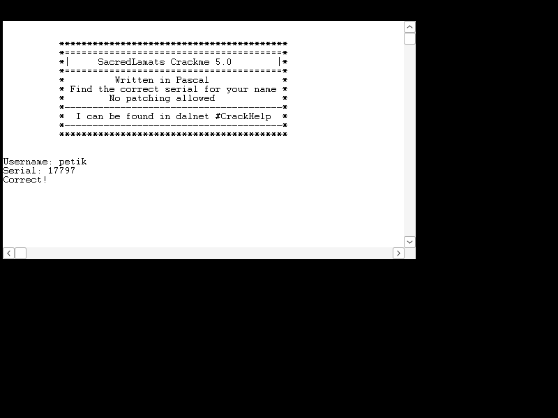
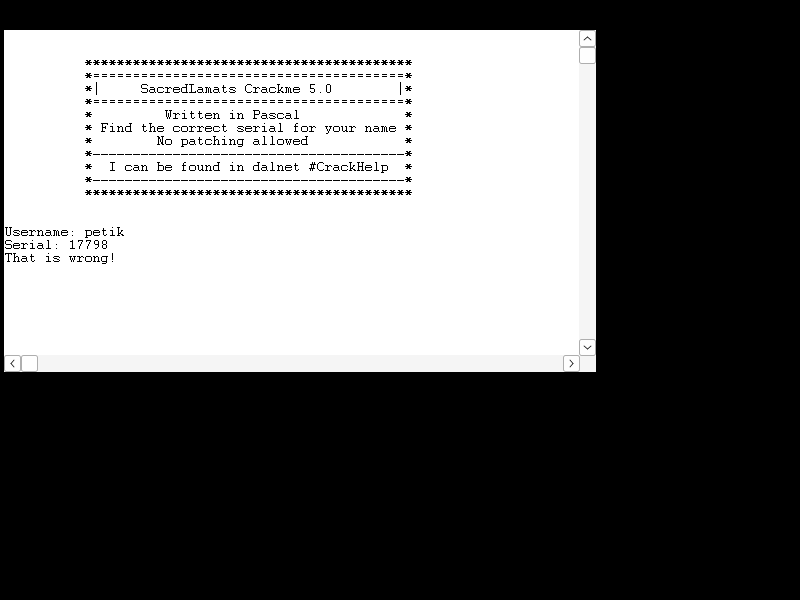

# sacredcrackme_5.0 by sacredlamat

| | |
|---|---|
| **ID** | [`5ab77f5533c5d40ad448c217`](https://crackmes.one/crackme/5ab77f5533c5d40ad448c217) · [ORIGIN](ORIGIN.yml) |
| **Auteur** | sacredlamat (réimport crackmes.de, local `crackmes-de`) |
| **Publié** | 2018-03-25 (exe de 2002) |
| **Plateforme** | Windows 16 bits (**NE**), Turbo Pascal for Windows + unité **WinCrt** |
| **Difficulté** | 1.0 |
| **SHA-256 zip** | `1eec1f3ed05b179517eda9b34c98bdb345b4946cceee1edd9039f46ff89a9130` |
| **SHA-256 exe** | `f3a7eca1ce37b055bb58d1abe87298c18d346791e8362fa41f768bc04d0a6111` |

## Fichiers

| Fichier | Rôle |
|---|---|
| `original/SacredCrackme_5.0.zip`, `original/SacredCrackme 5.0/` | archive + exe Win16 + `Readme.txt` (non patchés) |
| `tools/ne-dump.py` | dump des segments NE + relocations du segment 1 résolues (appels RTL) |
| `analysis/seg1.bin`, `analysis/seg1.asm` | code du programme principal + `ndisasm -b 16` |
| `analysis/seg3.bin`, `analysis/seg4.bin`, `analysis/ne-dump.txt` | RTL System/WinCrt, segment de données (chaînes), table des relocs |
| `tools/sacred5-solve.py` | **keygen** nom → serial (`--check`) |
| `tools/crtdrive.c`, `tools/verify-wine.sh` | saisie clavier (WM_CHAR) dans la fenêtre WinCrt + capture Xvfb |
| `analysis/correct-petik.png`, `analysis/wrong-petik.png` | preuves OK / KO |

## Réponse

| Nom | Serial |
|---|---|
| **`petik`** | **`17797`** |
| `Petik` | `17797` (insensible à la casse : `UpCase`) |

```bash
python3 tools/sacred5-solve.py                 # petik -> 17797
python3 tools/sacred5-solve.py --check 17797   # OK
tools/verify-wine.sh petik 17797 /tmp/ok.png
```

Formule :

```
s      = nom + 'Sorry, wrong!'
serial = 0x15D + Σ ( UpCase(c) + 0x381 )   pour chaque caractère de s
```

## Premier regard

```text
$ file "SacredCrackme 5.0.exe"
MS-DOS executable, NE version 6.01 for MS Windows 3.00 (real+protected mode) (EXE) (GUI)
$ strings -n 4 "SacredCrackme 5.0.exe"
Portions Copyright (c) 1991 Borland ... Written in Pascal ... Username: / Sorry, wrong! / Serial: /
That is wrong! / Correct! / TPWinCrt / Runtime error %d at %04X:%04X.
```

Exe **16 bits** (New Executable) Turbo Pascal for Windows : la fenêtre est une console émulée **WinCrt** (classe `TPWinCrt`). `objdump` ne connaît pas le NE, on découpe à la main. Piège : la chaîne `Sorry, wrong!` *ressemble* à un message d'échec mais n'est **jamais affichée** (le vrai KO est `That is wrong!`).

## Découpage NE

`tools/ne-dump.py` lit l'en-tête NE (`e_lfanew` à `0x3c`) → 4 segments (alignement 2^8) :

```text
seg1 file=0x300  len=0x32d   code du programme principal (entry 1:0002)
seg2 file=0x900  len=0xeb5   WinCrt
seg3 file=0x1b00 len=0xc03   System (RTL)
seg4 file=0x2800 len=0x2bc   DATA (chaînes Pascal [len][texte])
```

Tous les `call far` du segment 1 sont des `9A FFFF 0000` à reloger ; la table de relocations (après le segment) donne la cible via la table d'entrées, par exemple :

```text
seg1+0x01ee call far -> seg3:0x691 (entry 0x1d)   ReadLn(String)
seg1+0x026c call far -> seg3:0xbf0 (entry 0x22)   UpCase
seg1+0x02c7 call far -> seg3:0x711 (entry 0x1e)   Read(Integer)
```

`seg3:0xbf0` désassemblé : `mov al,[ss:bx+4] ; cmp al,'a' ; jb ; cmp al,'z' ; ja ; sub al,20h ; retf 2` → **`System.UpCase`**.

Chaînes dans DS (seg4) : `0x1b1` = `"Username: "`, `0x1bc` = `"Sorry, wrong!"`, `0x1ca` = `"Serial: "`, `0x1d3` = `"That is wrong!"`, `0x1e2` = `"Correct!"`.

## Comment on trouve le prédicat

`ndisasm -b 16 analysis/seg1.bin` (offsets relatifs au segment 1) — après la bannière (série de `Write/WriteLn(Output@0x690, …)`) :

```asm
1C4  push 0x690 / 0x1b1 / 0 ; Write(Output,'Username: ')
1E0  push ds:0x590 ; push ds:0x2c4 ; push 0xff ; call ReadStr ; ReadLn
                     ; ReadLn(Input, name)        name @ DS:0x2c4
1FD  push ds:0x1bc ; push ds:0x3c4 ; push 0xff ; call StrAssign
                     ; s := 'Sorry, wrong!'       s @ DS:0x3c4
210  lea di,[bp-0x100] ; push ss:di ; push ds:0x2c4 ; call StrLoad   ; tmp := name
220  push ds:0x3c4 ; call StrCat                                    ; tmp := tmp + s
22A  push ds:0x3c4 ; push 0xff ; call StrStore                      ; s := name + 'Sorry, wrong!'
238  mov word [0x2be],0x15d ; mov word [0x2c0],0  ; sum (longint) := $15D
244  mov al,[0x3c4] ; xor ah,ah ; mov [bp-2],ax  ; n := Length(s)
     ; for i := 1 to n do
25D  mov di,[0x2bc] ; mov al,[di+0x3c4]          ; c := s[i]
26B  push ax ; call UpCase                       ; c := UpCase(c)
274  xor ah,ah ; xor dx,dx ; add ax,[0x2be] ; adc dx,[0x2c0]   ; sum := sum + c
28A  ... add ax,0x381 ; adc dx,0                 ; sum := sum + $381
2A6  Write(Output,'Serial: ')
2C2  push ds:0x590 ; call ReadInt ; mov [0x4c4],ax ; ReadLn   ; serial : Integer
2D9  mov ax,[0x4c4] ; cwd
2DD  cmp dx,[0x2c0] ; jnz KO ; cmp ax,[0x2be] ; jz OK          ; longint(serial) = sum ?
2E9  KO : WriteLn('That is wrong!')   /   307  OK : WriteLn('Correct!')
```

Pseudo-Pascal reconstruit :

```pascal
ReadLn(name);
s := name + 'Sorry, wrong!';
sum := $15D;
for i := 1 to Length(s) do sum := sum + Ord(UpCase(s[i])) + $381;
Write('Serial: '); ReadLn(serial);        { serial : Integer }
if LongInt(serial) = sum then WriteLn('Correct!') else WriteLn('That is wrong!');
```

### Exemple `petik`

```text
s = "petikSorry, wrong!"  (18 caractères)
UpCase -> "PETIKSORRY, WRONG!"  Σ ord = 1302
sum = 0x15D + 1302 + 18*0x381 = 349 + 1302 + 16146 = 17797
```

### Limite

Le serial est un **Integer 16 bits** : `cwd` étend le signe, donc il faut `sum ≤ 32767`. Chaque caractère ajoute ≥ 0x381+0x20 ≈ 930 : au-delà d'une vingtaine de caractères de nom, il n'existe **aucun** serial valide (le solveur le signale).

## Vérification (live, exe d'origine)

Wine 10 sait encore lancer les exe **Win16** (krnl386/`*.dll16`). `tools/crtdrive.c` (Win32) trouve la fenêtre `TPWinCrt` et y poste des `WM_CHAR` (nom, Entrée, serial, Entrée) ; la sortie WinCrt est peinte, donc lue sur une capture Xvfb.

```bash
tools/verify-wine.sh petik 17797 analysis/correct-petik.png   # -> "Correct!"
tools/verify-wine.sh petik 17798 analysis/wrong-petik.png     # -> "That is wrong!"
```

| OK (`petik` / `17797`) | KO (`petik` / `17798`) |
|---|---|
|  |  |

## Notes

- Aucun anti-debug, pas de packer ; la seule « astuce » est le sel `Sorry, wrong!` concaténé au nom.
- `UpCase` ne touche que `a..z` : les accents (Latin-1) restent tels quels.
- Nom vide accepté : `s = 'Sorry, wrong!'` → serial `12931`.
