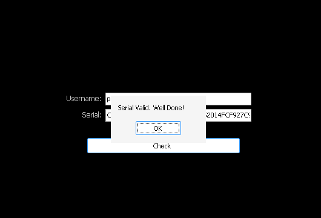
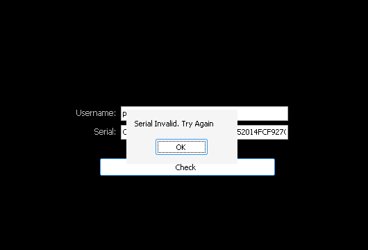

# flatlines_crackme_1 by flatline (Flatline's CrackMe #1)

| | |
|---|---|
| **ID** | [`5ab77f5533c5d40ad448c22f`](https://crackmes.one/crackme/5ab77f5533c5d40ad448c22f) · [ORIGIN](ORIGIN.yml) |
| **Auteur** | flatline (réimport crackmes.de, local `crackmes-de`) |
| **Publié** | 2018-03-25 (binaire de janvier 2011) |
| **Plateforme** | Windows PE32 GUI, Embarcadero Delphi 2010 (VCL, 900 Ko, pas de packer) |
| **Difficulté** | 2.0 |
| **SHA-256 exe** | `97c44337f08251267c19139102ea8950ffd28177c7d4324dff484ab732521f5f` |

## Fichiers

| Fichier | Rôle |
|---|---|
| `original/Flatline-CrackMe-1.zip`, `original/CrackMe1.exe`, `original/Readme.txt` | archive + binaire d'origine + règles (« Both Cracks & Keygens », « No serial fishing ») |
| `analysis/TFORM1.dfm.bin` | ressource RCDATA `TFORM1` (DFM binaire du formulaire) |
| `analysis/handler-disasm.txt` | `objdump` de `Edit1Enter` (0x4B6740) et `Label3Load` (0x4B6750, le OnClick du bouton) |
| `analysis/check-disasm.txt` | `objdump` de la routine de vérification 0x4B63D4 |
| `tools/flatline1-keygen.py` | keygen (`-q`, `--check NOM SERIAL`) |
| `tools/drive.c`, `tools/verify-wine.sh` | preuve live sous wine/Xvfb (WM_SETTEXT + BM_CLICK, capture d'écran avec `SHOT=`) |
| `analysis/wine-run.txt`, `analysis/wine-ok.png`, `analysis/wine-ko.png` | sortie et captures de la preuve live |

## Réponse

```text
serial = UPPER( sha1_hex(nom) privé de tous les caractères du nom (insensible à la casse) )
petik -> CA5DF7F105D63588C60ABB69A52014FCF927C95
```

```bash
python3 tools/flatline1-keygen.py petik          # petik -> CA5DF7F105D63588C60ABB69A52014FCF927C95
python3 tools/flatline1-keygen.py --check petik CA5DF7F105D63588C60ABB69A52014FCF927C95
SHOT=$PWD/analysis/wine-ok.png tools/verify-wine.sh petik CA5DF7F105D63588C60ABB69A52014FCF927C95
```

`SHA-1("petik") = ca5df7f10e5d63588c60abb69a52014fcf927c95`. Parmi les lettres de `petik`, seul `e` est un chiffre hexadécimal : on retire l'unique `e` (position 10) et on passe en majuscules, d'où un serial de **39** caractères.

## Premier regard

```text
$ diec original/CrackMe1.exe
PE32 · Linker: Turbo Linker(2.25) · Compiler: Embarcadero Delphi(2010)[Enterprise]
$ strings -el original/CrackMe1.exe | grep -i serial
Serial Invalid. Try Again
```

Les chaînes Delphi 2010 sont en UTF-16, d'où `strings -el`. La ressource `RCDATA/TFORM1` (extraite avec `pefile`) décrit le formulaire : `Label1` « Username: », `Label2` « Serial: », un **TButton** (nommé `Label3`) « Check » avec `OnClick = Label3Load`, `Edit1` (`OnEnter = Edit1Enter`) et `Edit2`.

## Flow

```text
Check (OnClick) = TForm1.Label3Load  0x4B6750
   Verify(self, Edit1, Edit2)        0x4B63D4   → positionne self.ok [+0x39C] et self.msg [+0x3A0]
   ok == 1 → ShowMessage(self.msg)   (« Serial Valid. Well Done! »)
   ok == 0 → ShowMessage('Serial Invalid. Try Again')
```

## Comment on trouve le serial

### 1. Du nom de méthode au code

La table des méthodes publiées de `TForm1` contient, comme toujours en Delphi, `[taille:word][adresse:dword][nom:shortstring]`. En cherchant l'octet de longueur suivi de `Label3Load` dans le fichier, les 4 octets précédents donnent l'adresse du handler, **0x4B6750** (et 0x4B6740 pour `Edit1Enter`, qui ne fait qu'un appel virtuel sur `Edit2`).

```asm
4B6766  mov  ecx, [ebx+0x394]        ; Edit2 (serial)
4B676C  mov  edx, [ebx+0x38C]        ; Edit1 (username)
4B6774  call 0x4B63D4                ; Verify
4B6779  cmp  dword [ebx+0x39C], 1    ; ok ?
4B678B  call 0x406B04 ; 4B6793 call 0x46A454   ; ShowMessage(self.msg)
4B67A1  mov  eax, 0x4B67D8           ; 'Serial Invalid. Try Again'
4B67A6  call 0x46A454                ; ShowMessage
```

### 2. La routine 0x4B63D4

Les appels de la RTL/VCL ont été identifiés par leur contenu : `0x48391C` = `TControl.GetText`, `0x411C20` = `Trim` (boucles `cmp word [..], 0x20`), `0x411968` = `AnsiUpperCase` (finit par `CharUpperBuffW`), `0x4187BC` = `StringReplace`, `0x406FC0` / `0x4063DC` = comparaisons de chaînes Unicode / Ansi.

```asm
4B6405  mov  [eax+0x39C], 0          ; ok := 0
4B6413  call 0x48391C                ; s := Edit1.Text
4B6426  call 0x406B2C                ; a := AnsiString(s)          (nom NON trimé pour le hash)
4B6450  call 0x4B5CA8                ; Init : 67452301 EFCDAB89 98BADCFE 10325476 C3D2E1F0 → SHA-1
4B6492  call 0x4B5CE0                ; Update(ctx, PAnsiChar(a), Length(a))
4B64A0  call 0x4B5EE4                ; Final → digest[20] @ ebp-0x28
4B64AB  mov  dx, 0x14
4B64AF  call 0x4B62F8                ; h := hex minuscule des 20 octets (0x30+n / 0x57+n)
; boucle i = 1..Length(a)
4B64ED  movzx ebx, byte [edx+edi-1]  ; c := a[i]
4B64FE  movzx eax, byte [0x4B66EC]   ; = 3 → [rfReplaceAll, rfIgnoreCase]
4B6538  call 0x4187BC                ; h := StringReplace(h, c, '', [rfReplaceAll, rfIgnoreCase])
; comparaison
4B6561  call 0x4060C4                ; msg := 'Serial Invalid. Try Again!'
4B656F  call 0x48391C ; 4B6580 call 0x411C20 ; Trim(Edit2.Text)
4B65A6  call 0x411968                ; AnsiUpperCase(h)
4B65B2  call 0x406FC0 ; jne          ; égaux → msg := 'Serial Valid. Well Done!'
4B6646  call 0x4B6368                ; même test en AnsiString → ok := 1 si égaux
```

Le constructeur hexadécimal `0x4B62F8` traite chaque octet en deux quartets : `(b & 0xF0) > 0x90` ⇒ lettre `0x57 + (b >> 4)` (`a`…`f`), sinon `0x30 + (b >> 4)`, idem pour `b & 0x0F`. C'est un `hex()` minuscule ordinaire.

### 3. Prédicat consolidé

```python
h = sha1(nom.encode("cp1252")).hexdigest()
for c in nom:
    h = h.replace(c.lower(), "").replace(c.upper(), "")
valide = Trim(serial) == h.upper()          # comparaison sensible à la casse
```

Seuls les caractères du nom qui sont aussi des chiffres hexadécimaux (`0-9`, `a-f`, `A-F`) changent quelque chose. Le serial attendu est donc toujours en **majuscules** et peut être plus court que 40 caractères (vide si le nom contient tous les chiffres hexa présents dans son SHA-1).

## Vérification

`tools/verify-wine.sh` lance l'exe original sous wine/Xvfb ; `tools/drive.c` (compilé avec `i686-w64-mingw32-gcc`) trouve la fenêtre « Flatline's CrackMe #1 », écrit nom et serial dans les deux `TEdit` (triés par ordonnée) avec `WM_SETTEXT`, envoie `BM_CLICK` au `TButton`, puis liste la `TMessageForm` ouverte. Le texte du `ShowMessage` est un `TLabel` sans fenêtre, d'où une capture de l'écran Xvfb (`SHOT=`, `PIL.ImageGrab`).

| Cas | Entrée | Résultat |
|---|---|---|
| OK | `petik` / `CA5DF7F105D63588C60ABB69A52014FCF927C95` |  « Serial Valid. Well Done! » |
| KO | `petik` / `CA5DF7F10E5D63588C60ABB69A52014FCF927C95` (SHA-1 brut, sans retirer le `e`) |  « Serial Invalid. Try Again » |

## Notes

- Deux messages d'échec coexistent : `'Serial Invalid. Try Again!'` (avec `!`, valeur par défaut de `self.msg`, jamais affichée) et `'Serial Invalid. Try Again'` (sans `!`, affiché par le handler quand `ok = 0`).
- Le `Trim` appliqué au nom (`[ebp-0x104]`) n'est jamais utilisé : le hash porte sur le nom brut, espaces compris.
- Le contrôle nommé `Label3` est en réalité le bouton « Check » ; c'est un nommage trompeur de l'auteur, pas un label cliquable.
- Côté « crack », il suffirait d'inverser le `jne` en 0x4B63A0 (dans 0x4B6368) **et** celui en 0x4B65B7, ou de forcer `ok := 1` ; non fait ici (le dossier `original/` reste intact).
