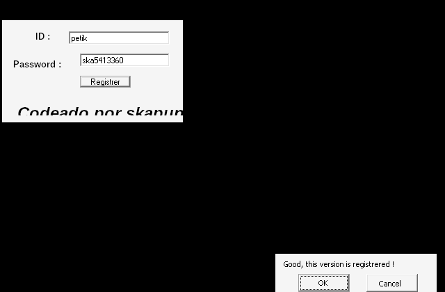

# crackmes.de's renascense_crackme by skapunky

| | |
|---|---|
| **ID** | [`5ab77f5533c5d40ad448c233`](https://crackmes.one/crackme/5ab77f5533c5d40ad448c233) |
| **Auteur (site)** | crackmes.de (crackme de skapunky) |
| **Auteur (local)** | crackmes-de |
| **Plateforme** | Windows, PE32 GUI, Visual Basic 6 (code natif, MSVBVM60) |
| **Difficulté** | 1.0 |
| **SHA-256 archive** | `ca6a75b3a7870705ac0f5b6de26e72eadfbbb1ca92b031497d0181b15d329ec0` |
| **SHA-256 exe** | `16640b3c761bec4ee6b619f4a47ab8242aabaadf6457ba0f97cf0178cc2ebe34` |

## Solution

```
ID       : petik
Password : ska5413360
```

→ MsgBox « **Good, this version is registrered !** » (vérifié sous wine).

Keygen : [`tools/renascense-keygen.py`](tools/renascense-keygen.py).

## Origine

- Page : https://crackmes.one/crackme/5ab77f5533c5d40ad448c233
- Download : https://crackmes.one/download/crackme/5ab77f5533c5d40ad448c233
- ZIP password : `crackmes.one`

Le fichier `CrackMe_Renascense_1.zip` est en réalité une archive **RAR v4** (`file`), extraite avec `unar` ;
l'exécutable `CrackMe Renascense 1.exe` a été renommé `original/renascense.exe`.

## Premier regard

```text
$ file original/renascense.exe
PE32 executable for MS Windows 4.00 (GUI), Intel i386, 3 sections
$ diec original/renascense.exe
Linker: Microsoft Linker(6.0) / Compiler: Visual Basic(6.00.8041)[Native]
```

Chaînes UTF-16 intéressantes (BSTR littéraux de VB) :

| VA | Chaîne |
|---|---|
| `0x408F24` | `ska` |
| `0x408F30` | `Good, this version is registrered !` |
| `0x408F7C` | `CrackMe` (titre de la MsgBox) |
| `0x408F90` | `Sorry, password Incorrect` |

Imports MSVBVM60 utiles : `rtcMidCharVar` (ord 632, `Mid`), `rtcAnsiValueBstr` (ord 516, `Asc`),
`__vbaVarAdd`, `__vbaVarMul`, `__vbaI2Var`, `__vbaStrI2`, `__vbaStrCat`, `__vbaStrCmp`, `__vbaOnError`.

La fenêtre a deux `ThunderRT6TextBox` (**ID** en haut, **Password** en dessous) et un bouton **Registrer**.

## Reverse (statique, `objdump` + résolution de l'IAT)

Le seul `push 0x408f24` (« ska ») est dans le gestionnaire du bouton, qui commence à **`0x4096F0`**.
Listing annoté (noms d'imports résolus avec `pefile`) : [`analysis/check-annotated.txt`](analysis/check-annotated.txt).

1. **Lecture des champs** (`0x40977E`…`0x4098E5`) : le contrôle de vtable `+0x300` (ID) est lu via
   `get_Text` (`+0xA0`) dans un Variant `[ebp-0x8C]`, celui de `+0x2FC` (Password) dans la chaîne `[ebp-0x7C]`.
2. **`__vbaOnError(-1)`** à `0x409900` : c'est un `On Error Resume Next`.
3. **Découpage** (`0x409938`…`0x409EB5`) : 8 appels `Mid(ID, k, 1)` pour k = 1..8, rangés dans un tableau
   de chaînes `c(0..7)` (`[ebp-0x34]`, bornes vérifiées par `__vbaGenerateBoundsError`).
4. **Codes** (`0x409EFD`…`0x40A390`) : `a(i) = Asc(c(i))` (Variant Integer, type 2) dans `a(0..7)` (`[ebp-0x64]`).
   Si l'ID fait moins de 8 caractères, `Asc("")` lève l'erreur 5, ignorée par le Resume Next :
   l'affectation est sautée et `a(i)` reste **Empty** (vaut 0 dans les calculs).
5. **Calcul** :
   - `0x40A51A`…`0x40A5DA` : 7 `__vbaVarAdd` → `s = CStr(a(0)+a(1)+…+a(7))` dans `[ebp-0x24]` ;
   - `0x40A67F` : `v = a(0) * 3` (`__vbaVarMul`, constante Integer 3) dans `[ebp-0x58]` ;
   - `0x40A6F3` + `__vbaI2Var` : `w = CInt(a(7) * 5)` dans `[ebp-0x78]`.
6. **Concaténation** (`0x40A70B`…`0x40A77C`) : `attendu = "ska" & s & CStr(v) & CStr(w)` (`__vbaStrCat` empile
   l'opérande gauche en premier, le résultat partiel est réutilisé comme opérande gauche au cat suivant).
7. **Test** `0x40A7B8` : `__vbaStrCmp(attendu, Password)` ; égal → MsgBox `Good, this version is registrered !`,
   sinon `Sorry, password Incorrect`.

Pseudo-VB reconstruit :

```vb
Private Sub Command1_Click()
    Dim c(7) As String, a(7) As Variant
    nom = Text1.Text : pass = Text2.Text
    On Error Resume Next
    For i = 0 To 7: c(i) = Mid(nom, i + 1, 1): Next
    For i = 0 To 7: a(i) = Asc(c(i)): Next          ' erreur si c(i) = "" -> a(i) reste Empty
    s = a(0) + a(1) + a(2) + a(3) + a(4) + a(5) + a(6) + a(7)
    v = a(0) * 3
    w = CInt(a(7) * 5)
    If pass = "ska" & s & v & CStr(w) Then
        MsgBox "Good, this version is registrered !", vbOKCancel, "CrackMe"
    Else
        MsgBox "Sorry, password Incorrect", vbOKCancel, "CrackMe"
    End If
End Sub
```

Seuls les 8 premiers caractères de l'ID comptent. Pour `petik` : somme = 112+101+116+105+107 = **541**,
`a(0)*3 = 112*3 =` **336**, `a(7)` absent → **0**, donc `ska` + `541` + `336` + `0` = **`ska5413360`**.

## Keygen

```text
$ python3 tools/renascense-keygen.py petik
petik -> ska5413360
$ python3 tools/renascense-keygen.py crackmesone
crackmesone -> ska841297575
```

## Vérification live (wine + Xvfb)

[`tools/verify-wine.sh`](tools/verify-wine.sh) lance l'exe original sous wine (runtime VB6 présent dans le préfixe)
sur un Xvfb, puis [`tools/drive.c`](tools/drive.c) (MinGW) remplit les deux `ThunderRT6TextBox` par `WM_SETTEXT`
(triées par Y : ID puis Password), envoie `BM_CLICK` à **Registrer** et lit la MsgBox (`#32770`).
Sortie complète : [`analysis/wine-run.txt`](analysis/wine-run.txt).

```text
== petik / ska5413360          -> [Good, this version is registrered !]
== petik / ska5413361          -> [Sorry, password Incorrect]
== crackmesone / ska841297575  -> [Good, this version is registrered !]
```



## Status

- [x] reverse
- [x] write-up
- [x] solveur (keygen)
