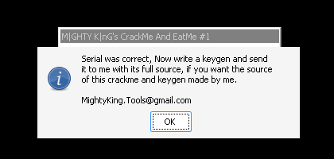

# crackmes.de's crackme_and_eatme_1 by mghty_kng

| | |
|---|---|
| **ID** | [`5ab77f5533c5d40ad448c235`](https://crackmes.one/crackme/5ab77f5533c5d40ad448c235) |
| **Auteur (site)** | crackmes.de (crackme de M\|GHTY K\|nG, alias mghty_kng) |
| **Auteur (local)** | crackmes-de |
| **Plateforme** | Windows, PE32 GUI, script **AutoIt v3** compilé (stub MSVC 2005) |
| **Difficulté** | 1.0 |
| **SHA-256 archive** | `b7eeebf4f7803192867b617e27fb95f2e6ee53e742fa269621a31c2cf8d701da` |
| **SHA-256 exe** | `fbeec1082844573d73e004c5e1d55d59875d6dab5bc643d94c1475795c92a77f` |

## Solution

```
Name   : petik
Serial : 541-PET-541-6.78312058319816e-011
```

→ Status « **Well Done !!** » et MsgBox « Well Done! / Serial was correct, Now write a keygen… » (vérifié sous wine).

Keygen (demandé par les règles) : [`tools/crackme_and_eatme-keygen.py`](tools/crackme_and_eatme-keygen.py).

## Origine

- Page : https://crackmes.one/crackme/5ab77f5533c5d40ad448c235
- Download : https://crackmes.one/download/crackme/5ab77f5533c5d40ad448c235
- ZIP password : `crackmes.one`

L'archive contient `Crackme_And_Eatme.exe` (renommé `original/crackme_and_eatme.exe`), `Read_iNFO.nfo`,
`Solution_By_MIGHTYKInG.txt` (vide) et `void_Crackme_And_Eatme.keygen.rar`, chiffré avec « le serial du nom DrinkMe ».
Le keygen calcule `682-DRI-682-1.34217262006667e-014` pour `DrinkMe`, mais l'archive utilise l'ancien chiffrement
RAR que ni `unar` ni `7z` ne savent ouvrir ici : ce mot de passe n'a pas pu être confirmé.

Le NFO annonce : *Difficulty Level: 1 (very easy) — Language: Autoit — KEYGEN IS REQUIRED — Hint : No hard work needed for easiest method.*

## Premier regard

```text
$ file original/crackme_and_eatme.exe
PE32 executable for MS Windows 4.00 (GUI), Intel i386, 4 sections
$ diec original/crackme_and_eatme.exe
Linker: Microsoft Linker(8.00.50727) / Compiler: Microsoft Visual C/C++(14.00.50727)[LTCG/C++]
$ strings -n 6 original/crackme_and_eatme.exe | grep -m2 -i "autoit\|AU3"
This is a compiled AutoIt script. AV researchers please email avsupport@autoitscript.com for support.
AU3!EA06
```

Marqueur `AU3!EA06` : script AutoIt v3.2.6+ embarqué en ressource. Le stub MSVC n'a aucun intérêt : il faut le script.

## Extraction du script

```bash
pip install --user autoit-ripper
autoit-ripper original/crackme_and_eatme.exe analysis/au3   # -> analysis/au3/script.au3 (833 lignes)
```

Les ~740 premières lignes sont les constantes des includes standard (`GUIConstants`, …). Le reste est la GUI Koda
(`Name` = `$INPUT1`, `Serial` = `$INPUT2`, boutons `Check !` / `About` / `Close`, label `$STATUS`) et la fonction
de vérification, appelée sur `Check !` :

```autoit
Func _CHECK ( $USERNAME )
	Local $S1 = 0 , $S2 = 0 , $S3 = 0 , $S4 = 1
	$R = StringLen ( $USERNAME )
	$S2 = StringLeft ( $USERNAME , 3 )
	$S2 = StringUpper ( $S2 )
	For $I = 1 To $R Step + 1
		$S1 += Asc ( StringLeft ( $USERNAME , 1 ) )     ; somme des codes
		$S3 -= Asc ( StringLeft ( $USERNAME , 1 ) )     ; -somme
		$S4 /= Asc ( StringLeft ( $USERNAME , 1 ) )     ; 1 / produit (double)
		$USERNAME = StringTrimLeft ( $USERNAME , 1 )
	Next
	$SERIAL = $S1 & "-" & $S2 & $S3 & "-" & $S4
	$ENTEREDSERIAL = GUICtrlRead ( $INPUT2 )
	If $R < 3 Then          ; "Name should be atleast 3 char long."
	ElseIf $ENTEREDSERIAL == "" Then      ; "Are you nuts ?"
	ElseIf $ENTEREDSERIAL <> "" Then
		If $ENTEREDSERIAL == $SERIAL Then  ; "Well Done !!" + MsgBox
```

Le serial est donc `S1 - XXX S3 - S4` avec :

- `S1` = somme des codes ASCII du nom ;
- `XXX` = 3 premiers caractères en majuscules ;
- `S3 = -S1`, qui apporte lui-même le second tiret (`"PET" & -541` → `PET-541`) ;
- `S4 = 1 / c1 / c2 / … / cn` en double.

## Le piège : le format du double

AutoIt convertit un nombre non entier en chaîne avec le `"%.15g"` de son CRT MSVC lié en statique, qui écrit
l'exposant sur **3 chiffres**. Pour `petik` : 1 / (112·101·116·105·107) = 1 / 14 742 477 120, soit
`6.78312058319816e-011` (et non `e-11` comme en Python ou en C sous Linux). Avec au moins 3 caractères, le produit
dépasse 32³ et `S4` est toujours en notation exponentielle. Le keygen reproduit ce format.

Pour `petik` : `S1 = 541`, `XXX = PET`, `S3 = -541` → **`541-PET-541-6.78312058319816e-011`**.

## Keygen

```text
$ python3 tools/crackme_and_eatme-keygen.py petik
petik -> 541-PET-541-6.78312058319816e-011
$ python3 tools/crackme_and_eatme-keygen.py crackmesone
crackmesone -> 1163-CRA-1163-5.52314567068908e-023
```

## Vérification live (wine + Xvfb)

[`tools/verify-wine.sh`](tools/verify-wine.sh) lance l'exe original sous wine sur un Xvfb ; [`tools/drive.c`](tools/drive.c)
(MinGW) remplit les deux `Edit` par `WM_SETTEXT` (triés par Y : Name puis Serial), envoie `BM_CLICK` à **Check !**,
puis lit le label Status et la MsgBox. Sortie : [`analysis/wine-run.txt`](analysis/wine-run.txt).

```text
== petik / 541-PET-541-6.78312058319816e-011          -> Status : Well Done !!  + MsgBox « Well Done! »
== petik / 541-PET-541-6.78312058319816e-11           -> Status : Wrong serial :( , Keep tryin'
== crackmesone / 1163-CRA-1163-5.52314567068908e-023  -> Status : Well Done !!  + MsgBox « Well Done! »
```

Le deuxième essai confirme que l'exposant à 2 chiffres est refusé.



## Status

- [x] reverse
- [x] write-up
- [x] solveur (keygen)
