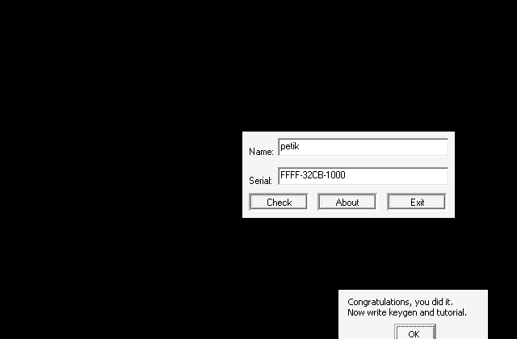
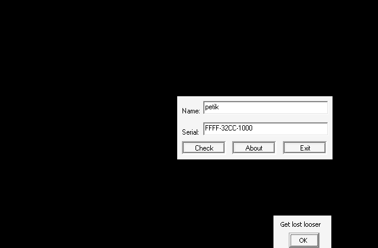

# crackmes.de's knights_crackme1 by knight

| | |
|---|---|
| **ID** | [`5ab77f5533c5d40ad448c245`](https://crackmes.one/crackme/5ab77f5533c5d40ad448c245) — voir [`ORIGIN.yml`](ORIGIN.yml) |
| **Auteur (site)** | crackmes.de (crackme de **Knight**, 2005) |
| **Plateforme** | Windows PE32 GUI (boîte de dialogue), MSVC 6 C++, packé **UPX 1.25** |
| **Difficulté** | 2.0 |
| **SHA-256 (zip)** | `9b50fa4a048e3496af42439dac5c489a7bc7e19d1204f23f91cfe0f77055ac32` |
| **SHA-256 (`Crackme 1.exe`)** | `e91c93f8e3789d14002157d44286a70491d79ea377130f15e1f6718b11c74f5d` |

Consigne (`Readme.txt`) : *Write a working keygen […] No patching allowed!!! — I haven't faced crackme that uses recursion, so i decided to write one on my own.*

## Fichiers

| Fichier | Rôle |
|---|---|
| `original/Knights_crackme#1.zip` | archive crackmes.one |
| `original/Crackme 1.exe`, `original/Readme.txt` | contenu extrait (exe original, packé UPX) |
| `analysis/crackme1.unpacked.exe` | copie dépackée (`tools/upx-3.96 -d`) pour le reverse |
| `analysis/wine-run.txt`, `analysis/wine-ok.png`, `analysis/wine-ko.png` | preuve live wine |
| `tools/knights_crackme1-solve.py` | keygen + `--check` (réplique fidèle de la vérification) |
| `tools/drive.c`, `tools/verify-wine.sh` | pilotage de la boîte de dialogue sous wine/Xvfb |

## Réponse

| Nom | Serial |
|---|---|
| **`petik`** | **`FFFF-32CB-1000`** |
| `crackmesone` | `FFFF-12AA-1000` |

```bash
./tools/knights_crackme1-solve.py            # petik -> FFFF-32CB-1000
./tools/knights_crackme1-solve.py -q NOM     # serial seul
./tools/knights_crackme1-solve.py --check petik FFFF-32CB-1000   # OK
```

Il existe beaucoup de serials valides par nom ; le keygen en choisit un simple (voir § « Assemblage »).

## Premier regard

```text
$ file "Crackme 1.exe"   ->  PE32 executable (GUI) Intel 80386, UPX compressed, 3 sections
$ diec                   ->  Microsoft Visual C/C++(12.20.9044)[C++], Packer: UPX(1.25)[NRV, best]
$ ../../../tools/upx-3.96 -d -o analysis/crackme1.unpacked.exe "original/Crackme 1.exe"
```

L'exe dépacké est minuscule : `user32!DialogBoxParamA`, `GetDlgItem`, `GetWindowTextLengthA`, `SendDlgItemMessageA`, `MessageBoxA`.
Chaînes utiles (`.data`) : `Name must be at least 5 char long` (0x4060B0), `I think u have forgotten something` (0x406030),
`Get lost looser` / `Haha` (0x406054 / 0x406064), `Congratulations, you did it.\nNow write keygen and tutorial.` / `Success` (0x40606C / 0x4060A8).

## Flow

- `0x401284` : `DialogBoxParamA(…, 0x65, …, DlgProc=0x40129C)`.
- `0x40129C` (DlgProc) : `WM_COMMAND` avec `LOWORD(wParam) == 0x3EB` (bouton) → `check(hDlg)` en **`0x401101`**.
- `0x401101` : édit **`0x3F2`** = nom, édit **`0x3F3`** = serial.

## Comment on trouve le prédicat

Tout se lit à l'`objdump -d -M intel` sur la copie dépackée ; le cœur est `0x401101`.

### 1. Longueurs et lecture

```asm
401109  mov  esi, GetDlgItem            ; GetWindowTextLengthA(GetDlgItem(h,0x3F2)) -> [ebp-4] (nom)
...                                     ; idem 0x3F3 -> esi (serial)
40113c  test eax,eax / je 40126a        ; champ vide -> "I think u have forgotten something"
40114c  cmp  eax,5 / jge 401162         ; nom < 5 -> "Name must be at least 5 char long"
401167  call malloc ×2 ; SendDlgItemMessageA(h, id, WM_GETTEXT=0xD, len+1, buf) ×2
4011a0  call 0x4049e6                   ; _strupr(serial)  -> le serial est mis en MAJUSCULES
4011a7  call 0x401390                   ; contrôle de format (asm « à la main », pusha/popa)
```

### 2. Format du serial (`0x401390`)

```asm
4013a1  inc [ebp-4] / inc edi / mov al,[edi] / test al,al / jne   ; compte = strlen
4013ab  mov eax,[ebp-4] / not al / add al,0Fh / jne fail           ; ~len + 15 == 0  ->  len == 14
4013b7  movzx eax,[edi+4] / not al / shl eax,4 / or al,ah          ; al = swap_nibbles(~s[4])
        cmp al,[edi+9] / jne fail                                  ; s[9] == swap_nibbles(~s[4])  (et réciproque)
4013e1  3 groupes × 4 car. dans '0'..'9' ou 'A'..'F' ; après chaque groupe : bl += séparateur (s[4], s[9], s[14]=0)
        add ebx,24h / or ebx,81h / inc bl / sete al                ; ((s4+s9+0x24) | 0x81) & 0xFF == 0xFF
```

Avec `'-'` (0x2D) : `~0x2D = 0xD2`, nibble-swap → `0x2D` ✔ ; `0x2D+0x2D+0x24 = 0x7E`, `0x7E|0x81 = 0xFF` ✔.
Donc format **`HHHH-HHHH-HHHH`** (hex majuscule, 14 caractères).

### 3. Les trois nombres

```asm
4011b4  and byte [esi+4],0 / and byte [esi+9],0     ; coupe le serial en 3 C-strings
4011bc  call 0x4010d2 (s) / (s+5) / (s+10)          ; hex4 -> int : x = x*16 + c - (c<='9' ? 0x30 : 0x37)
4011de  mov ecx,1000h                               ; A,B,C >= 0x1000
4011f5  cmp edi,ebx / jle fail ; cmp edi,eax / jle ; cmp ebx,eax / jle   ; A > B > C
```

### 4. Hash du nom (`0x401090`)

```asm
4010a6  movsx edx, byte [esi+edi]   ; c (signé)
4010aa  mov ecx,edx / xor edx,0AAh / sar ecx,4
4010b5  imul edx,ecx / imul edx,ecx ; (c ^ 0xAA) * (c>>4)^2
4010bb  mov ecx,esi / and ecx,1 / shl ecx,2 / shl edx,cl   ; << 0 (i pair) ou << 4 (i impair)
4010c5  add ebx,edx                 ; h += …
```

`petik` : `p` (0x70) → `(0x70^0xAA)*7*7 = 0xDA*49 = 10682`, `e` → `(0xCF)*36 <<4 = 119232`, … total **h = 260060 (0x3F7DC)**.

### 5. La récursion (`0x401022`) — le « truc » annoncé par l'auteur

`0x401000(arr, n, t)` = recherche linéaire « `t` est-il l'un des `n` éléments ? ». Puis :

```c
bool reach(int *arr, int k, int n, int t) {          /* 0x401022 */
    if (in(arr, n, t)) return true;                  /* call 0x401000 */
    if (k == n) return false;
    int e = arr[k], acc = 0, cur = t;
    do {                                             /* 40105d */
        if (reach(arr, k + 1, n, cur)) return true;  /* essai avec cur, puis cur -= e */
        cur -= e; acc += e;
    } while (acc < t);                               /* cmp ecx,[ebp-8] ; jl */
    return false;
}
```

C'est un test « `t` = somme de multiples de `arr[0]`, `arr[1]` qui se termine sur l'un d'eux ». `0x401101` l'appelle deux fois :

```asm
40120b  lea eax,[ebp-18h] ; push h, 2, 0, eax ; call 401022   ; reach({A,B}, 0, 2, h)
401223  lea eax,[ebp-14h] ; push h, 2, 0, eax ; call 401022   ; reach({B,C}, 0, 2, h)
40121e / 401233  je fail -> sinon MessageBox "Success"
```

### 6. Assemblage (keygen)

Le plus simple : prendre **B diviseur de h**. Dans les deux appels, la boucle sur le 1er élément essaie d'abord `cur = h`
(multiple 0), puis la récursion sur B retire `B` jusqu'à tomber sur `cur == B` → `in()` vrai. A et C sont alors libres :
`A = 0xFFFF`, `C = 0x1000` (bornes de l'ordre strict).

`petik` : h = 260060 = 2²·5·13003 ; le premier diviseur dans `0x1001..0xFFFE` est **13003 = 0x32CB** → **`FFFF-32CB-1000`**.

Le solveur rejoue fidèlement format + hash + `reach` (`--check`) et vérifie chaque serial qu'il propose.
Limite : un nom dont le hash n'a aucun diviseur entre 0x1001 et 0xFFFE (ou un hash ≤ 0) n'est pas couvert par ce raccourci
(le keygen le signale) ; d'autres combinaisons A/B/C restent possibles mais ne sont pas cherchées.

## Vérification live (wine + Xvfb)

[`tools/verify-wine.sh`](tools/verify-wine.sh) lance l'exe **original** (packé) sous wine dans un Xvfb ; [`tools/drive.c`](tools/drive.c)
(MinGW) remplit les édits `0x3F2`/`0x3F3` par `SetDlgItemTextA`, envoie `BM_CLICK` au bouton `0x3EB` et lit la MessageBox (`#32770`).
Sortie : [`analysis/wine-run.txt`](analysis/wine-run.txt).

```text
== petik / FFFF-32CB-1000        -> MsgBox <Success> : Congratulations, you did it.
== petik / FFFF-32CC-1000        -> MsgBox <Haha>    : Get lost looser
== crackmesone / FFFF-12AA-1000  -> MsgBox <Success> : Congratulations, you did it.
```

| OK | KO |
|---|---|
|  |  |

## Notes

- Le serial passe par `_strupr` : `ffff-32cb-1000` marche aussi.
- Les séparateurs ne sont pas forcément `-` : toute paire `(s4, s9)` avec `s9 = swap_nibbles(~s4)` et `((s4+s9+0x24)|0x81)&0xFF == 0xFF` passe.
- Pas d'anti-debug ; UPX seul « protège » le binaire. Aucun patch nécessaire (ni fait).
