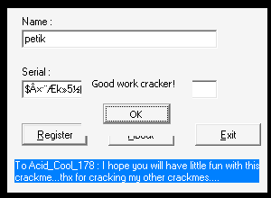
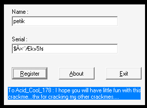

# crackmes.de's crackme_7 by fr1c

| | |
|---|---|
| **ID** | [`5ab77f5533c5d40ad448c247`](https://crackmes.one/crackme/5ab77f5533c5d40ad448c247) — voir [`ORIGIN.yml`](ORIGIN.yml) |
| **Auteur (site)** | crackmes.de (crackme de **Fr1c**, 2000, « CrackMe 7 *final* ») |
| **Plateforme** | Windows PE32 GUI, Borland Delphi, packé **UPX 0.94** |
| **Difficulté** | 1.0 |
| **SHA-256 (zip)** | `946fff1179820c35d7953502a85c2a263404c04610dce27b7f1320dc57b01805` |
| **SHA-256 (`CrackMe7.exe`)** | `eab7a15072c7a9ebfe693e1051384bed31938fcaf1743a6263d16a71e5d7ed39` |

Fenêtre About : *No patching! (you can patch just to enable button and nag) — Key Generator if you can!*

## Fichiers

| Fichier | Rôle |
|---|---|
| `original/crackme7.zip` | archive crackmes.one |
| `original/CrackMe7.exe`, `original/Fr1c.nfo` | contenu extrait (exe original, packé UPX) |
| `analysis/crackme7.unpacked.exe` | copie dépackée (`tools/upx-3.96 -d`) |
| `analysis/wine-run.txt`, `analysis/wine-ok.png`, `analysis/wine-ko.png` | preuve live wine |
| `tools/crackme7-solve.py` | keygen (préfixe + dernier caractère selon le HWND) |
| `tools/drive.c`, `tools/verify-wine.sh` | keygen « live » + pilotage sous wine/Xvfb |

## Réponse

Le serial dépend du nom **et** de l'octet bas du handle de la fenêtre au premier plan au moment du clic
(`GetForegroundWindow`). Pour **`petik`** :

```text
préfixe (10 octets) : 24 C2 D7 B7 A8 C6 6B BB 35 BD      = "$Â×·¨Æk»5½"   (cp1252)
dernier octet       : (ord('t') ^ 5) + 3 + (hwnd & 0xFF) = 0x74 + (hwnd & 0xFF)
sous wine (form = foreground = 0x00010094) : serial = 24C2D7B7A8C66BBB35BD08
```

```bash
./tools/crackme7-solve.py                       # préfixe + formule du dernier caractère (petik)
./tools/crackme7-solve.py -x petik --hwnd 0x10094   # 24c2d7b7a8c66bbb35bd08
tools/verify-wine.sh petik                      # keygen live : lit GetForegroundWindow et tape le serial
```

Le vrai keygen doit donc tourner **à côté** du crackme : c'est ce que fait [`tools/drive.c`](tools/drive.c)
(il amène `TForm1` au premier plan, lit `GetForegroundWindow()` et calcule le dernier octet).

## Premier regard

```text
$ file CrackMe7.exe  ->  PE32 executable (GUI) Intel 80386, UPX compressed
$ diec               ->  Borland Delphi, Turbo Linker 2.25, Packer: UPX(0.94)[NRV, brute]
$ ../../../tools/upx-3.96 -d -o analysis/crackme7.unpacked.exe original/CrackMe7.exe
```

Ressources `RCDATA` : `TFORM1` (Edit1 « Your name », Edit2 « Your serial », Button1 « &Register » → `Button1Click`,
`OnCreate = FormCreate`) et `TFORM2` (About).

## Comment on trouve

### 1. Les handlers Delphi

La table de méthodes publiées de `TForm1` (entrées `taille | adresse | nom Pascal`, juste avant les chaînes
`FormCreate`, `Button3Click`…) donne : `FormCreate = 0x442704`, `Button1Click = 0x442880`.

### 2. `FormCreate` (0x442704) : anti-outils, nag et bouton grisé

```asm
442711  call 0x423dd0                   ; Caption := 'CrackMe 7 by Fr1c - UNREGISTERED'
442716  push 'URSoft W32Dasm Ver 8.93 …' / push 'OWL_Window' / call FindWindowA
        jle … sinon ShowMessage('W32Dasm FOUND') + ExitProcess
442751  CreateFileA('\\.\SICE', …)      ; != -1 -> ShowMessage('SoftIce is DETECTED') + ExitProcess
442777  ShowMessage('Kill me !! My name is NAG SCREEN!')
44277c  xor edx,edx / mov eax,[ebx+2CCh] / call [ecx+60h]   ; Button1.Enabled := False
```

D'où la tolérance de l'auteur (« patch just to enable button and nag ») : ici, rien n'est patché, le
pilote ferme le nag (`WM_CLOSE` sur le `TMessageForm`) et réactive le bouton avec `EnableWindow`.

### 3. `Button1Click` (0x442880)

Appels RTL Delphi 5 reconnus : `0x423da0` = `TControl.GetText`, `0x403a34` = `@LStrLen`,
`0x40395c` = `@LStrFromChar` (dl = caractère), `0x403a3c` = `@LStrCat`, `0x403b44` = `@LStrCmp`.
`[esi+2C4h]` = Edit1 (nom), `[esi+2C8h]` = Edit2 (serial).

```asm
4428af  n = Length(nom) ; jle fin           ; [ebp-0Ch] = n, [ebp-8] = i = 1
4428c6  movzx eax, nom[i]                   ; c
        imul eax,ebx,63h / xor ebx,6        ; (c*99) ^ 6
        add ebx, nom[2] / add ebx, nom[4]   ; + s[1] + s[3]      (indices 0-based)
        LStrFromChar + LStrCat              ; serial += chr(bl)
        edi = n                             ; boucle interne n fois, mais ebx est RÉINITIALISÉ à chaque tour :
44294c  xor ebx,ebx / mov bl, nom[i]        ; c
        add ebx, 2*n / + s[1] / + n / inc / + s[2] / + n / dec / + s[3] / sub ebx,4
        dec edi / jne 44294c                ; -> c + 4n + s[1] + s[2] + s[3] - 4 (même valeur n fois)
        LStrFromChar + LStrCat              ; serial += chr(bl)   (une seule fois, après la boucle)
        inc i / dec cpt / jne 4428c6
442a22  bl = s[2] ; eax = n ; xor ebx,eax ; add ebx,3
        call 0x406178                       ; jmp [0x445568] = user32!GetForegroundWindow  <-- !
        add ebx,eax ; serial += chr(bl)
        LStrCmp(serial, Edit2.Text) ; jne fin ; ShowMessage('Good work cracker!')
```

Les lectures `nom[i]` avant chaque `Length(...)` ignoré (0x442a22…) ne servent à rien : ce sont des leurres.

### 4. Assemblage pour `petik` (n = 5, s[1] = 'e' 0x65, s[2] = 't' 0x74, s[3] = 'i' 0x69)

| c | `(c*99 ^ 6) + 0x65 + 0x69` & 0xFF | `c + 20 + 0x65 + 0x74 + 0x69 - 4` & 0xFF |
|---|---|---|
| `p` 0x70 | 0x24 | 0xC2 |
| `e` 0x65 | 0xD7 | 0xB7 |
| `t` 0x74 | 0xA8 | 0xC6 |
| `i` 0x69 | 0x6B | 0xBB |
| `k` 0x6B | 0x35 | 0xBD |

Dernier : `(0x74 ^ 5) + 3 + hwnd = 0x74 + hwnd` → avec `hwnd = 0x00010094` : `0x108 & 0xFF = 0x08`.

## Vérification live (wine + Xvfb)

[`tools/verify-wine.sh`](tools/verify-wine.sh) lance l'exe **original** (packé) ; [`tools/drive.c`](tools/drive.c) ferme le nag,
réactive Register, met `TForm1` au premier plan, calcule le serial avec `GetForegroundWindow()`, le tape (`WM_SETTEXT`, octets
cp1252), envoie `BM_CLICK` et cherche le `TMessageForm` de `ShowMessage`. Mode `faux` = dernier octet +1.
Sortie : [`analysis/wine-run.txt`](analysis/wine-run.txt).

```text
== petik        form=00010094 foreground=00010094 serial(hex)=24c2d7b7a8c66bbb35bd08  -> Good work cracker!
== petik faux   serial(hex)=24c2d7b7a8c66bbb35bd09                                  -> aucune boîte (refusé)
== crackmesone  serial(hex)=24c1e5d05abf24c13cc9f6cbdec354d1c0cd61ccdec301          -> Good work cracker!
```

| OK (« Good work cracker! ») | KO (dernier octet +1) |
|---|---|
|  |  |

## Notes

- Nom de **4 caractères minimum** (`s[3]` est lu sans contrôle) ; un octet calculé nul rendrait le nom inutilisable (le keygen prévient).
- Le dernier caractère change d'une session à l'autre (HWND) : un serial « fixe » n'existe pas, d'où le keygen live.
- Sur une vraie machine, le HWND au premier plan au moment du clic est celui de `TForm1` (c'est elle qui a le focus).
