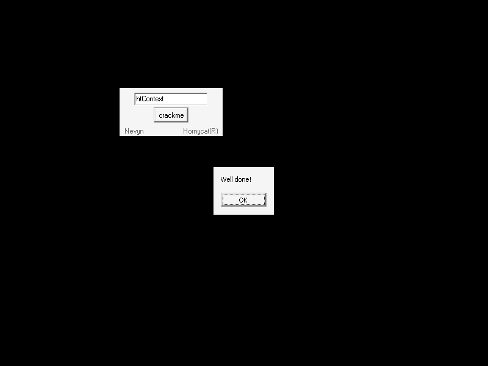
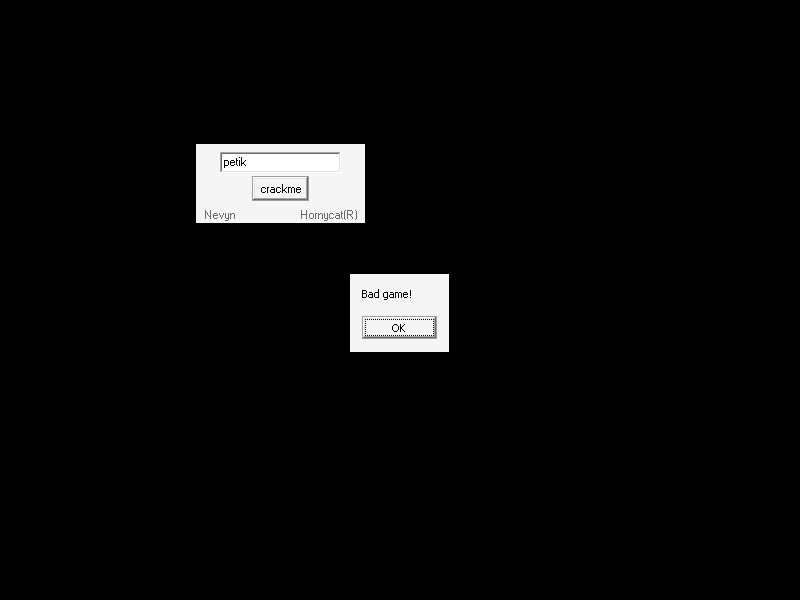

# crackmes.de's nev_crackme by nevyn

| | |
|---|---|
| **ID** | [`5ab77f5533c5d40ad448c258`](https://crackmes.one/crackme/5ab77f5533c5d40ad448c258) · [`ORIGIN.yml`](ORIGIN.yml) |
| **Auteur (site)** | crackmes.de (auteur réel : nevyn / « Hornycat ») |
| **Plateforme** | Windows PE32, Borland Delphi 7, GUI (VCL) |
| **Difficulté** | 2.0 |
| **SHA-256 (zip)** | `91d3aaf2eaf62692242742eaeb33ed0025f59f2cf43716af50a0185d873d6ae3` |
| **SHA-256 (exe)** | `8490f36c738dc29004c769cc2fa9f18ee56335a3fa2c16ef5fe63475800c89d2` |

## Fichiers

| Chemin | Contenu |
|---|---|
| `original/nev-crackme.zip` | archive d’origine (mot de passe site `crackmes.one`) |
| `original/nev-crackme.exe` | binaire Delphi 7 (extrait du zip, non patché) |
| `original/nev-crackme.nfo` | NFO ASCII-art (aucun indice) |
| `tools/nev-crackme-solve.py` | solveur : lit les 2 ShortStrings du binaire et simule le prédicat (`-q`, `--check`) |
| `tools/verify-wine.sh` | preuve live : Xvfb + Wine + xdotool, capture du `ShowMessage` |
| `analysis/screenshot-ok.png` / `screenshot-ko.png` | captures Wine (`htContext` → *Well done!*, `petik` → *Bad game!*) |

## Réponse

**Mot de passe : `htContext`** (sensible à la casse ; pas de nom, donc pas d’exemple `petik` possible — `petik` donne *Bad game!*).

```bash
./tools/nev-crackme-solve.py -q          # htContext
./tools/nev-crackme-solve.py --check htContext   # Well done!
./tools/verify-wine.sh htContext /tmp/ok.png      # preuve live
```

Seconde entrée acceptée (non tapable au clavier car elle commence par `0x7F` DEL) : `"\x7fcTxycroc"` — voir § Notes.

## Premier regard

```text
$ diec original/nev-crackme.exe
PE32 — Linker: Turbo Linker(2.25) — Compiler: Borland Delphi(7)[Enterprise]
```

- 400 Ko : c’est presque entièrement la VCL. Une seule fiche `TForm1` (caption `crackme`) : `Edit1`, `Button1` (caption `crackme`), deux `TLabel` (`Nevyn`, `Hornycat(R)`).
- `strings` ne montre **aucun** message de réussite / échec en clair : ils sont légèrement chiffrés (voir plus bas).
- La ressource DFM (`TPF0` @ fichier `0x61F20`) lie `Button1.OnClick = Button1Click`.

## Flow

Saisie dans `Edit1` → clic sur **crackme** → `Button1Click` → `ShowMessage("Well done!")` ou `ShowMessage("Bad game!")`.

## Comment on trouve le prédicat

### 1. Localiser `Button1Click` sans IDA

Delphi publie ses handlers dans la *method table* de la classe : `u16 taille | u32 adresse | ShortString nom`. Juste avant la chaîne `Button1Click` (offset fichier `0x52C67`) :

```text
13 00 | 3C 39 45 00 | 0C "Button1Click"
        └─ VA 0x0045393C
```

(`strings -t x` puis 6 octets en arrière ; la DFM confirme le nom du handler.)

### 2. Lecture de `Button1Click` (`objdump -d -M intel --start-address=0x45393c`)

```asm
45394a  mov  ebx, 0x456d04            ; i (global)
45394f  mov  esi, 0x456c04            ; S : ShortString[255] (global)
453965  mov  eax, [edi+0x2fc]         ; Form1.Edit1
45396b  call 0x432a4c                 ; TControl.GetText -> [ebp-4]
45397a  call 0x4040e8                 ; S := Edit1.Text  (LStrToString, 255 max)
; --- boucle 1 : S[i] ^= 0x17 pour i = 1..Length(S)
45398f  xor  byte [esi+edx], 0x17
; --- 1re comparaison
45399a  mov  edx, 0x453a3c            ; C1 = ShortString len 9 : 7F 63 54 78 79 63 72 6F 63
4539a4  call 0x402aa8                 ; comparaison mémoire (len+1 octets)
4539a9  jne  0x4539cb                 ;   ≠ -> on garde S chiffré
; --- boucle 2 (seulement si S == C1) : re-XOR 0x17 => S redevient la saisie
4539be  xor  dl, 0x17
; --- 2e comparaison
4539cd  mov  edx, 0x453a48            ; C2 = ShortString len 9 : "htContext"
4539d7  call 0x402aa8
4539dc  jne  0x4539f5
4539e1  mov  eax, 0x453a5c            ; "Xfmm!epof\"" -> décodé -> "Well done!"
4539ee  call 0x42736c                 ; ShowMessage
4539f8  mov  eax, 0x453a70            ; "Cbe!hbnf\""  -> décodé -> "Bad game!"
```

`0x4538AC` décode les messages en retranchant 1 à chaque caractère (`X`→`W`, `f`→`e`, `!`→espace…), d’où l’absence de chaînes lisibles.

### 3. Décodage

`C1 ^ 0x17` :

| C1 | 7F | 63 | 54 | 78 | 79 | 63 | 72 | 6F | 63 |
|---|---|---|---|---|---|---|---|---|---|
| ^0x17 | 68 `h` | 74 `t` | 43 `C` | 6F `o` | 6E `n` | 74 `t` | 65 `e` | 78 `x` | 74 `t` |

Donc `C1 ^ 0x17 == C2 == "htContext"`. Le chemin voulu est :

1. saisie `htContext` → XOR → `7F 63 54 …` = **C1** ✔
2. re-XOR → `htContext` = **C2** ✔ → *Well done!*

Le premier test sert d’« appât » : si on tape directement `htContext` en pensant que c’est la chaîne lisible comparée en clair, ça marche bien, mais seulement grâce à la double transformation.

### Prédicat consolidé

```text
S = input ^ 0x17
if S == C1: S = S ^ 0x17          # == input
ok = (S == C2)
=> ok  ⇔  input == "htContext"  ou  input ^ 0x17 == "htContext"  (= "\x7fcTxycroc")
```

## Vérification (Wine, headless)

`tools/verify-wine.sh` lance l’exe sous `Xvfb :78` + Wine, clique dans `Edit1`, tape le mot de passe, clique **crackme** et capture l’écran (le `ShowMessage` Delphi est une fiche VCL, pas un `MessageBoxA`, donc `WINEDEBUG=+msgbox` ne voit rien → capture d’écran).

| Saisie | Résultat | Capture |
|---|---|---|
| `htContext` | **Well done!** |  |
| `petik` | Bad game! |  |

## Notes

- Pas de nom / serial dépendant : mot de passe unique (+ variante `\x7F…` non saisissable au clavier).
- Piège outillage : `xdotool type --window` n’atteint pas le `TEdit` sous Wine ; il faut cliquer dans le champ puis taper sans `--window`.
- Les variables `S` / `i` sont des globales (`0x456C04` / `0x456D04`) ; une seconde routine incrémente un compteur global `0x456D08` (sans effet sur le check).
