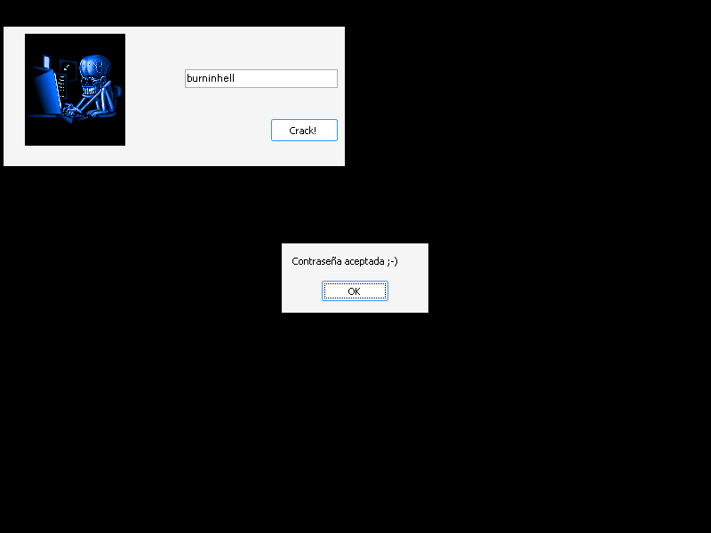

# crackmes.de's crackme_delphi_1.0_by_defc0n1 by defc0n1

| | |
|---|---|
| **ID** | [`5ab77f5533c5d40ad448c25b`](https://crackmes.one/crackme/5ab77f5533c5d40ad448c25b) · [`ORIGIN.yml`](ORIGIN.yml) |
| **Auteur (site)** | crackmes.de (auteur réel : defc0n1) |
| **Plateforme** | Windows PE32, Embarcadero Delphi 2009, GUI (VCL, UnicodeString) |
| **Difficulté** | 1.0 |
| **SHA-256 (zip)** | `d978d66efe9b7f06be1f120a13a7a18252c9bad40bcaacf0ea2e2392a86cb896` |
| **SHA-256 (exe)** | `a7f0d9d3afef1fe75e982dca40652ef135871dcbe314fdccf9cd54ef241a9285` |

## Fichiers

| Chemin | Contenu |
|---|---|
| `original/Crackme_Delphi_1.0_by_Defc0n1.zip` | archive d’origine (mot de passe site `crackmes.one`) |
| `original/crackme_delphi_1.0.exe` | binaire Delphi 2009 (extrait du zip, renommé sans espaces, non patché) |
| `original/readme.txt` | readme de l’auteur (« very very simple… no more than 5 clicks ») |
| `tools/defc0n1-delphi1-solve.py` | solveur : relit la constante UnicodeString dans le binaire (`-q`, `--check`) |
| `tools/verify-wine.sh` | preuve live : Xvfb + Wine + xdotool, capture du `ShowMessage` |
| `analysis/screenshot-ok.png` / `screenshot-ko.png` | captures Wine (`burninhell` → *Contraseña aceptada*, `petik` → *Contraseña incorrecta*) |

## Réponse

**Mot de passe : `burninhell`** (sensible à la casse ; pas de nom, donc pas d’exemple `petik` possible — `petik` donne *Contraseña incorrecta :-(*).

```bash
./tools/defc0n1-delphi1-solve.py -q                 # burninhell
./tools/defc0n1-delphi1-solve.py --check burninhell # Contraseña aceptada ;-)
./tools/verify-wine.sh burninhell /tmp/ok.png       # preuve live
```

## Premier regard

```text
$ file original/crackme_delphi_1.0.exe
PE32 executable for MS Windows 5.00 (GUI), Intel i386, 9 sections
$ diec original/crackme_delphi_1.0.exe
PE32 — Linker: Turbo Linker(2.25) — Compiler: Embarcadero Delphi(2009)[Enterprise]
```

- Delphi **2009** ⇒ les `string` sont des **UnicodeString** (UTF-16LE). `strings -n 6` (ASCII) ne montre que la RTL/VCL ; il faut `strings -el` pour voir les littéraux.
- Ressources RCDATA : `TFORM1` (fiche principale) et `TFORM2` (« Crackeada! Felicidades ;-) », jamais affichée par le chemin OK — c’est un `ShowMessage` qui sert de preuve).
- Pas de packer, pas d’anti-debug.

## Flow

La fiche `TFORM1` (« Crackme Delphi 1.0 by Defc0n1 », 384×157) contient :

| Composant | Classe | Position | Rôle |
|---|---|---|---|
| `Image1` | `TImage` | à gauche | JPEG décoratif |
| `Insert1` | `TEdit` | Left 204, Top 48, 172×21 | texte par défaut « Introduce la contraseña ... » |
| `Button1` | `TButton` | Left 301, Top 104 | « Crack! », `OnClick = Button1Click` |

Un seul champ : c’est un **mot de passe fixe**, pas un name/serial.

## Comment on trouve le mot de passe

### 1. Retrouver `Button1Click` via la RTTI Delphi

La table des méthodes publiées d’une classe VCL contient, pour chaque handler, `u16 taille · u32 adresse · ShortString nom`. On cherche donc la ShortString `\x0cButton1Click` et on lit le pointeur juste avant :

```python
i = img.find(b'\x0cButton1Click')        # deux occurrences : TForm2 puis TForm1
addr = struct.unpack('<I', img[i-4:i])[0]
# 0x490E60 -> TForm2.Button1Click (ferme les fiches)
# 0x491054 -> TForm1.Button1Click  <- le check
```

### 2. Lire le handler

```bash
objdump -d -M intel --start-address=0x491054 --stop-address=0x4910d4 original/crackme_delphi_1.0.exe
```

```asm
49106a: lea  edx,[ebp-0x4]              ; var S: string
49106d: mov  eax,[ebx+0x378]            ; Self.Insert1 (TEdit)
491073: call 0x44b5c4                   ; TControl.GetText(Insert1, S)
491078: mov  eax,[ebp-0x4]              ; S
49107b: mov  edx,0x4910e0               ; littéral UnicodeString
491080: call 0x405af8                   ; System._UStrEqual(S, littéral)  -> ZF
491085: jne  0x4910a9                   ; différent -> message KO
491087: mov  eax,0x491104               ; 'Contraseña aceptada ;-)'
49108c: call 0x43be8c                   ; ShowMessage
491091: ...                             ; Form2.Show / Form1.Hide
4910a9: mov  eax,0x491140               ; 'Contraseña incorrecta :-('
4910ae: call 0x43be8c                   ; ShowMessage
```

En pseudo-Pascal :

```pascal
procedure TForm1.Button1Click(Sender: TObject);
begin
  if Insert1.Text = 'burninhell' then
  begin
    ShowMessage('Contraseña aceptada ;-)');
    Form2.Show; ...
  end else
    ShowMessage('Contraseña incorrecta :-(');
end;
```

### 3. Décoder le littéral

Une UnicodeString constante Delphi 2009 est précédée d’un en-tête `codepage u16 · elemsize u16 · refcount -1 · length u32`. À `0x4910D4` on lit `b0 04 02 00 ff ff ff ff 0a 00 00 00` : codepage 1200 (UTF-16), elemsize 2, refcount -1 (constante), **longueur 10**, puis :

```text
0x4910E0 : 62 00 75 00 72 00 6e 00 69 00 6e 00 68 00 65 00 6c 00 6c 00  ->  "burninhell"
```

`_UStrEqual` compare exactement (longueur puis caractères, sans changement de casse) : `BurninHell` est refusé.

## Vérification (Wine, headless)

`tools/verify-wine.sh` lance l’exe sous `Xvfb :79` + Wine, clique dans `Insert1`, efface le texte par défaut (`End`, `shift+Home`, `BackSpace`), tape le mot de passe, clique **Crack!** et capture l’écran (le `ShowMessage` VCL n’est pas un `MessageBoxA` → capture d’écran).

| Saisie | Résultat | Capture |
|---|---|---|
| `burninhell` | **Contraseña aceptada ;-)** |  |
| `petik` | Contraseña incorrecta :-( |  |

Côté solveur : `--check burninhell` → OK (rc 0), `--check petik` et `--check BurninHell` → KO (rc 1).

## Notes

- Comme annoncé dans le readme : « 5 clics sous OllyDbg » — un breakpoint sur `_UStrEqual` montre directement la constante dans `EDX`.
- Piège outillage : chercher les chaînes en ASCII ne donne rien (Delphi 2009 = UTF-16) ; `strings -el` affiche `burninhell` directement.
- Piège de saisie : le `TEdit` contient déjà « Introduce la contraseña ... » ; il faut le vider avant de taper, sinon le texte est concaténé.
