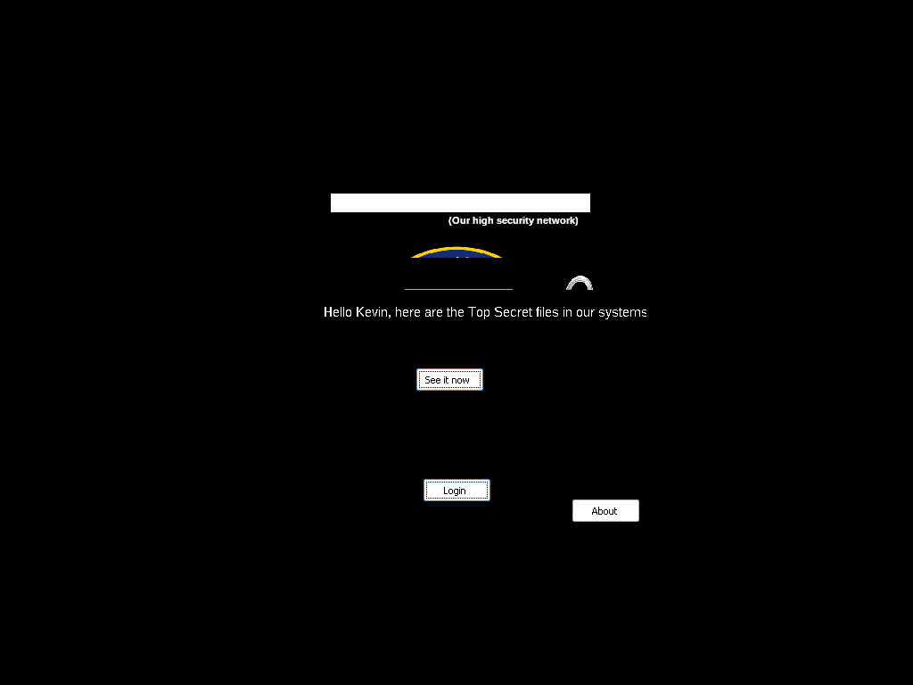
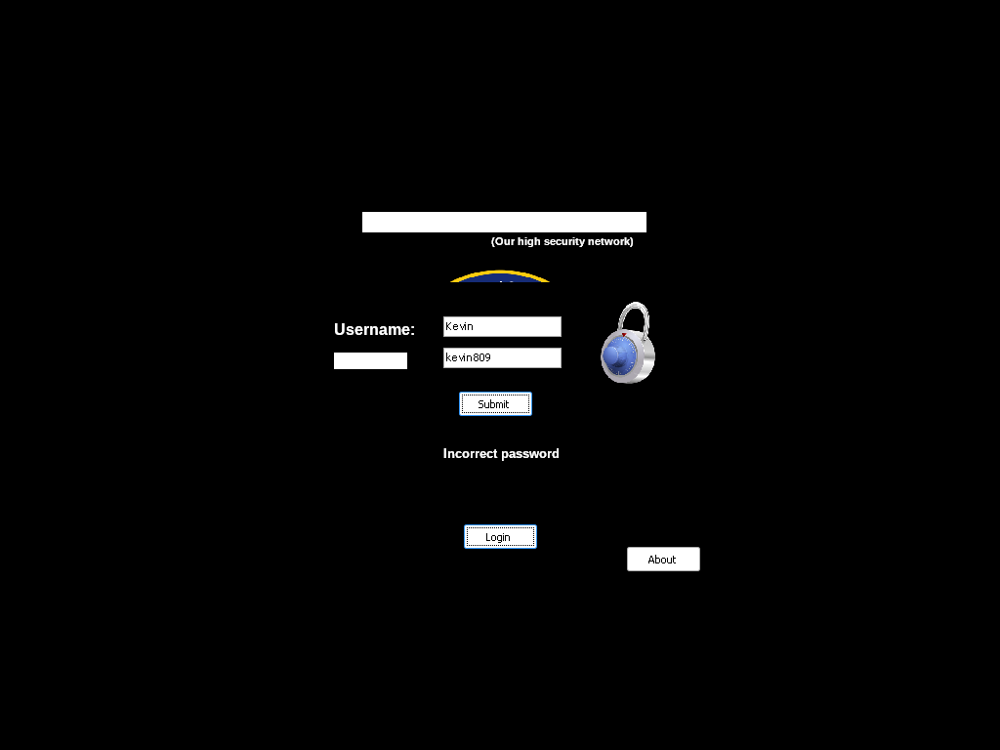

# crackmes.de's crackme_delphi_2.0_by_defc0n1 by defc0n1

| | |
|---|---|
| **ID** | [`5ab77f5533c5d40ad448c25c`](https://crackmes.one/crackme/5ab77f5533c5d40ad448c25c) · [`ORIGIN.yml`](ORIGIN.yml) |
| **Auteur (site)** | crackmes.de (auteur réel : defc0n1) |
| **Plateforme** | Windows PE32, Embarcadero Delphi 2009, GUI (VCL, UnicodeString) |
| **Difficulté** | 1.0 |
| **SHA-256 (zip)** | `78ce350b306703829795cc57a6b4c9c6da310f36c6d04741eebd33ef72320792` |
| **SHA-256 (exe)** | `fa6382898269367ea9fcfb286f1778bb69440f175a24c793a9167711ea541ea1` |

Suite de [crackme_delphi_1.0](../5ab77f5533c5d40ad448c25b/) du même auteur (mot de passe en clair) : ici un username + un mot de passe **calculé** par « a couple of mathematical operations ».

## Fichiers

| Chemin | Contenu |
|---|---|
| `original/Crackme_Delphi_2.0_by_Defc0n1.zip` | archive d’origine (mot de passe site `crackmes.one`) |
| `original/crackme_delphi_2.0.exe` | binaire Delphi 2009 (extrait du zip, renommé sans espaces, non patché) |
| `original/readme.txt` | readme de l’auteur (« the username is so simple to see, but the password is more complex ») |
| `tools/defc0n1-delphi2-solve.py` | solveur : rejoue `Edit2Change` + `Button1Click` (`-q`, `--check USER PASS`, `--clicks N`) |
| `tools/verify-wine.sh` | preuve live : Xvfb + Wine + xdotool (Form1 *Login* → Form2 → *Submit*), capture |
| `analysis/screenshot-ok.png` / `screenshot-ko.png` | captures Wine (`Kevin`/`kevin800` → Form3 *Hello Kevin…*, `Kevin`/`kevin809` → *Incorrect password*) |

## Réponse

**Username : `Kevin`** · **Password : `kevin800`** (les deux sensibles à la casse ; le username est imposé, l’exemple `petik` donne *Incorrect username*).

```bash
./tools/defc0n1-delphi2-solve.py -q                       # Kevin kevin800
./tools/defc0n1-delphi2-solve.py --check Kevin kevin800   # OK: Hello Kevin, ...
./tools/verify-wine.sh Kevin kevin800 /tmp/ok.png         # preuve live
```

## Premier regard

```text
$ file original/crackme_delphi_2.0.exe
PE32 executable for MS Windows (GUI), Intel i386
$ diec original/crackme_delphi_2.0.exe
PE32 — Linker: Turbo Linker(2.25) — Compiler: Embarcadero Delphi(2009)
```

- Delphi **2009** ⇒ littéraux en **UnicodeString** UTF-16LE (`strings -el`).
- Cinq fiches RCDATA : `TFORM1` (« Welcome to CIA Central System », boutons *Login* / *About*), `TFORM2` (*Login* : `Username:` / `Password:`), `TFORM3` (« Hello Kevin, here are the Top Secret files in our systems », bouton *See it now*), `TFORM4` (*Secret Files*, images JPEG — la « blague » du readme), `TFORM5` (*About*).
- Pas de packer, pas d’anti-debug.

## Flow

```text
Form1 ── Login ──► Form2 (Edit1 = username, Edit2 = password, Submit)
                     │ OK  ──► Form3 « Hello Kevin… » ── See it now ──► Form4 « Secret Files »
                     └ KO  ──► Label3 = « Incorrect username » / « Incorrect password »
```

| Composant (Form2) | Champ objet | Position DFM | Événement |
|---|---|---|---|
| `Edit1` | `[Self+0x380]` | Left 144, Top 35 | — |
| `Edit2` | `[Self+0x384]` | Left 144, Top 67 | `OnChange = Edit2Change` |
| `Button1` « Submit » | — | Left 160, Top 112 | `OnClick = Button1Click` |
| `Label3` | `[Self+0x390]` | Left 144, Top 168 | message d’erreur |

## Comment on trouve le prédicat

### 1. Les handlers via la RTTI

Comme pour la v1, on cherche les ShortStrings de la table des méthodes publiées (`u32 adresse` juste avant le nom) :

```text
0x48C984  Button1Click   (TForm2 — Submit, le check)
0x48CB04  Edit2Change    (TForm2 — calcule la constante)
0x478FB0 / 0x48C57C / 0x48C74C / 0x48CD5C / 0x48CD74 : navigation entre fiches (Show / Close)
```

Les deux handlers de `TForm2` utilisent les champs `[Self+0x394..0x3A0]`, absents des composants de la DFM : ce sont des variables `Integer` déclarées dans la classe.

### 2. `Edit2Change` @ 0x48CB04 — la « couple of mathematical operations »

```asm
48cb04: mov  dword [eax+0x394],5        ; a := 5
48cb0e: mov  edx,0xa
48cb13: mov  [eax+0x39c],edx            ; c := 10
48cb19: mov  ecx,[eax+0x394]
48cb1f: imul ecx,edx                    ; b := a*c            = 50
48cb22: mov  [eax+0x398],ecx
48cb28: mov  edx,[eax+0x394]
48cb2e: imul edx,ecx                    ; a*b                 = 250
48cb31: lea  edx,[edx+edx*4]            ; *5                  = 1250
48cb34: lea  edx,[edx+edx*4]            ; *5                  = 6250
48cb37: add  edx,0x45                   ; +69                 = 6319
48cb3a: add  edx,0x1f4                  ; +500                = 6819
48cb40: mov  [eax+0x3a0],edx
48cb46: sub  dword [eax+0x3a0],0x177a   ; -6010   => k := 809
```

La constante est **recalculée à chaque modification d’Edit2** (donc dès qu’on tape le mot de passe) : toujours `809`.

### 3. `Button1Click` @ 0x48C984 — le check

```asm
48c99e: sub  dword [ebx+0x3a0],9        ; k := k - 9          => 800  (piège : pas 809)
48c9a8: mov  eax,[ebx+0x380]            ; Edit1
48c9ae: call 0x44e0dc                   ; TControl.GetText -> U
48c9b6: mov  edx,0x48ca78               ; 'Kevin'
48c9bb: call 0x405ad4                   ; _UStrEqual
48c9c0: jne  0x48ca27                   ; -> Label3.Caption := 'Incorrect username'
48c9c5: mov  eax,[ebx+0x384]            ; Edit2
48c9cb: call 0x44e0dc                   ; GetText -> P
48c9d7: mov  eax,[ebx+0x3a0]
48c9dd: call 0x40a8dc                   ; IntToStr(k) -> '800'
48c9e8: mov  edx,0x48ca90               ; 'kevin'
48c9ed: call 0x40585c                   ; _UStrCat3 : 'kevin' + '800'
48c9f6: call 0x405ad4                   ; _UStrEqual(P, 'kevin800')
48c9fb: jne  0x48ca15                   ; -> Label3.Caption := 'Incorrect password'
48c9fd: ...                             ; Form3.Show ; Form2.Hide
```

En pseudo-Pascal :

```pascal
procedure TForm2.Edit2Change(Sender: TObject);
begin
  a := 5; c := 10; b := a*c;
  k := a*b*25 + $45 + $1F4 - $177A;          // 809
end;

procedure TForm2.Button1Click(Sender: TObject);
begin
  Dec(k, 9);                                 // 800
  if Edit1.Text = 'Kevin' then
    if Edit2.Text = 'kevin' + IntToStr(k) then begin Form3.Show; Hide; end
    else Label3.Caption := 'Incorrect password'
  else Label3.Caption := 'Incorrect username';
end;
```

Littéraux décodés (en-tête UnicodeString `b0 04 02 00 ff ff ff ff <len u32>`) : `0x48CA78 = "Kevin"`, `0x48CA90 = "kevin"`, `0x48CAA8 = "Incorrect password"`, `0x48CADC = "Incorrect username"`.

## Vérification (Wine, headless)

`tools/verify-wine.sh USER PASS` : Xvfb `:80` + Wine, clic *Login* sur Form1, puis dans Form2 vide les deux `TEdit` (`End`, `shift+Home`, `BackSpace`), tape username / password, clique *Submit* et capture l’écran.

| Saisie | Résultat | Capture |
|---|---|---|
| `Kevin` / `kevin800` | **Form3 « Hello Kevin, here are the Top Secret files in our systems »** |  |
| `Kevin` / `kevin809` | *Incorrect password* (la valeur d’`Edit2Change` seule ne suffit pas) |  |

Côté solveur : `--check Kevin kevin800` → OK (rc 0) ; `--check Kevin kevin809` → *Incorrect password* ; `--check petik kevin800` → *Incorrect username*.

## Notes

- Piège principal : lire seulement `Edit2Change` donne `809` ; le `sub [Self+0x3A0],9` au début du clic transforme la cible en **800**.
- Effet de bord (déduit du code, non testé live) : chaque *Submit* retire encore 9 sans réinitialiser ; après un échec, re-cliquer sans retoucher Edit2 attend `kevin791` (`--clicks 2`). Retaper dans Edit2 relance `Edit2Change` et revient à `kevin800`.
- Le username est donné en clair dans le binaire (« so simple to see »), d’où l’absence d’exemple `petik`.
