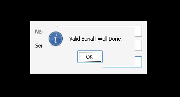
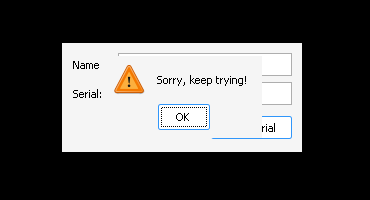

# crackmes.de's c_crackme_2 by mayhem — Mayhem's C++ CrackMe #2

- Origine : [`ORIGIN.yml`](ORIGIN.yml) · [crackmes.one](https://crackmes.one/crackme/5ab77f5633c5d40ad448c274)
- Auteur : mayhem (mirror crackmes.de) · difficulté 2.0
- Plateforme : Windows, PE32 i386 GUI, MSVC 2010 + **MFC 10 Unicode** (`mfc100u.dll`)

Consigne (`original/read.txt`) : écrire un **keygen** (le bruteforce n'est pas accepté), pas de patch.

## Fichiers

| Fichier | Rôle |
|---|---|
| `original/C++_CrackMe_#2.zip` | archive d'origine (mot de passe `crackmes.one`) |
| `original/C++ CrackMe 2.exe` | binaire extrait (non patché) |
| `original/read.txt` | consigne de l'auteur |
| `tools/c_crackme_2-solve.py` | keygen (`-n NOM`, `-q`, `--check SERIAL`) |
| `analysis/run.sh` | preuve live Wine/Xvfb (saisie xdotool + capture) |
| `analysis/dbg.sh` | winedbg : lit les deux valeurs comparées en `0x4019b0` |
| `analysis/good-petik.png`, `analysis/bad.png` | captures OK / KO |

## Réponse

| Nom | Serial |
|---|---|
| `petik` | **`5h25`** |

```bash
python3 tools/c_crackme_2-solve.py              # petik / 5h25  (hash 0x00726249)
python3 tools/c_crackme_2-solve.py -n NOM -q
python3 tools/c_crackme_2-solve.py -n petik --check 5h25   # OK
```

Formule :

```text
hash(nom)    = Σ_i ( 60 · ord(nom[i]) · T[i] + 0x699 )   mod 2^32     (T = 40 dwords @0x416c98)
val(serial)  = Σ_i idx(serial[i]) · 62^i                              (idx dans "a-z0-9A-Z")
valide  ⇔  (int32) val(serial) == hash(nom)      ;  1 ≤ len(nom) ≤ 40
```

Le serial est donc simplement `hash(nom)` écrit en **base 62, chiffre de poids faible en premier**.

## Premier regard

```text
$ file "original/C++ CrackMe 2.exe"
PE32 executable for MS Windows 5.01 (GUI), Intel i386, 5 sections
$ diec …  → MSVC 16.00 (VS2010) [LTCG/C++], Library: MFC(10.0)[Unicode]
```

- Imports : `mfc100u.dll` (169 ordinaux), `KERNEL32`, `USER32` (`SendMessageW`, `EnableWindow`…), `COMCTL32`.
- `strings` ne montre rien d'utile : tout est en UTF-16. En balayant les chaînes UTF-16 de `.rdata` avec leurs VA (petit script `pefile`) :

| VA | Chaîne |
|---|---|
| `0x410608` | `abcdefghijklmnopqrstuvwxyz0123456789ABCDEFGHIJKLMNOPQRSTUVWXYZ` (62 car.) |
| `0x410700` | `Your name must be less than 40 characters in length!` |
| `0x41076c` / `0x410778` | `Gratz` / `Valid Serial! Well Done.` |
| `0x4107ac` / `0x4107b4` | `:(` / `Sorry, keep trying!` |
| `0x4107dc` | `Enter name/serial please.` |

- Ressource dialogue 102 : `Mayhem's C++ CrackMe #2`, champs `Name:` (ID `0x3e9`) et `Serial:` (ID `0x3ea`), bouton `Check Serial`.
- Sous Wine, `mfc100u.dll` n'est pas fourni : on reprend celle extraite du **vcredist x86 2010 SP1** (`vc_red.cab` → `F_CENTRAL_mfc100u_x86`) et on la pose à côté d'une copie de l'exe dans `analysis/` (DLL Microsoft non commitée).

## Flow

Handler du bouton : **`0x401880`** (`objdump -d -M intel`).

```asm
4018d1  push 0x3e9 ; call GetDlgItemTextW → [ebp-0x10] = nom
4018de  push 0x3ea ; call GetDlgItemTextW → [ebp-0x14] = serial
40190a  CString::Compare(nom, "")   ; vide → "Enter name/serial please."
40194d  CString::Compare(serial, "")
40196c  cmp [ecx-0xc],0x28 ; jle     ; len(nom) > 40 → "Your name must be less than 40…"
401990  call 0x4016e0               ; edi = val(serial)   (CString passé par valeur)
4019a6  call 0x401800               ; eax = hash(nom)
4019b0  cmp edi,eax ; jne → ":(" / "Sorry, keep trying!"
4019b4  push 0x40 ; "Gratz" / "Valid Serial! Well Done."   (CWnd::MessageBox)
```

## Comment on trouve le prédicat

### 1. `hash(nom)` — `0x401800`

```asm
401833  push esi ; call CString::GetAt     ; ax = nom[i] (wchar)
401840  movzx eax,ax
401843  imul eax,[esi*4+0x416c98]          ; c · T[i]
40184b  mov ecx,eax ; shl ecx,4 ; sub ecx,eax   ; ecx = 15·c·T[i]
401852  inc esi
401853  lea edi,[edi+ecx*4+0x699]          ; h += 60·c·T[i] + 0x699
40185a  cmp esi,[edx-0xc] ; jl 401833      ; i < len(nom)
```

Réduction de force classique : `(x<<4)-x = 15x`, puis `lea …[ecx*4]` → `60x`. La table `T` (dwords initialisés dans `.data` à `0x416c98`) a 40 entrées, d'où la limite de 40 caractères :

```text
211 316 282 189 156 195 122 369 324 335 239 173 314 356 179 162 280 164 353 192
332 392 223 245 284 212 146 167 244 311 354 308 141 342 290 307 183 398 139 292
```

Pour `petik` : `h = 0x00726249` (7 496 265).

### 2. `val(serial)` — `0x4016e0` (x87)

Deux initialiseurs statiques CRT préparent les globales :

```asm
40d270  push 0x410608 ; mov ecx,0x418068 ; call CString::CString   ; ALPHA = "a-z0-9A-Z"
40d290  mov eax,ds:0x418068 ; fild [eax-0xc] ; fstp ds:0x418070      ; BASE = 62.0 (= len(ALPHA))
```

La fonction boucle en double précision sur `i = 0 … len-1` :

```asm
40174b  fld  ds:0x418070            ; 62.0
401753  call 0x406b90               ; pow (CRT _CIpow) → [ebp-0x30] = 62^k
401766  call 0x406aa0               ; _ftol2(i)
401770  CString::Mid(serial, i, 1)
40178f  call 0x401600               ; idx = position du caractère dans ALPHA (-1 sinon)
40179a  fild idx ; (jns : +2^32 si négatif) ; fmul [ebp-0x30] ; fadd acc
4017b3  fadd ds:0x410a00            ; i += 1.0
4017e1  call 0x406aa0               ; return _ftol2(acc)
```

`0x401600` est un `find` naïf (double boucle `GetAt`/`cmp bx,ax`) qui renvoie l'index de la sous-chaîne, ou `-1`.

**Piège : l'ordre des chiffres.** En lisant `fsubrp st(1),st` dans la sortie d'objdump, on croit que l'exposant vaut `len-1-i` (poids fort en tête). Un premier keygen écrit ainsi donnait `petik / 52h5`… refusé par le binaire. objdump (syntaxe Intel GNU) est connu pour **inverser** l'affichage de `fsub`/`fsubr` avec pop ; plutôt que de démêler la pile x87 à la main, on a lu les deux opérandes du `cmp` sous winedbg (voir plus bas) :

```text
serial "52h5" → edi = 0x712c0b = 7 416 843
idx : '5'=31 '2'=28 'h'=7 '5'=31
31 + 28·62 + 7·62² + 31·62³ = 31 + 1736 + 26908 + 7388168 = 7 416 843   ✔
```

L'exposant est donc `i` : le **premier caractère est le chiffre de poids faible**.

### 3. Assemblage (exemple `petik`)

Alphabet : `a-z` = 0…25, `0-9` = 26…35, `A-Z` = 36…61. On écrit `h` en base 62 en sortant d'abord le chiffre de poids faible :

```text
7 496 265 = 120 907·62 + 31   → '5'
  120 907 =   1 950·62 +  7   → 'h'
    1 950 =      31·62 + 28   → '2'
       31 =       0·62 + 31   → '5'
serial = "5" "h" "2" "5" = 5h25
```

```python
out = ""
while True:
    out += ALPHA[h % 62]; h //= 62
    if not h: break
```

`--check` recalcule `val("5h25") = 31 + 7·62 + 28·62² + 31·62³ = 0x726249`. Les valeurs restent < 2^32, donc exactes en double et sans souci avec `_ftol2`.

## Vérification live (Wine + Xvfb)

```bash
cd analysis
cp "../original/C++ CrackMe 2.exe" cm2.exe      # + mfc100u.dll (vcredist 2010) à côté
xvfb-run -a -s "-screen 0 1024x768x24" ./run.sh petik 5h25 /tmp/ok.png   # → fenêtre "Gratz"
xvfb-run -a -s "-screen 0 1024x768x24" ./run.sh petik 52h6 /tmp/ko.png   # → fenêtre ":("
```

| Cas | Résultat |
|---|---|
| `petik` / `5h25` |  « Valid Serial! Well Done. » |
| `petik` / `52h6` (KO) |  « Sorry, keep trying! » |
| `petik` / `52h5` (ordre big-endian) | « Sorry, keep trying! » |

### winedbg (lecture du `cmp`)

`analysis/dbg.sh` lance `winedbg cm2.exe`, pose `break *0x4019b0`, saisit `petik` / `52h5`, puis :

```text
Wine-dbg> print $edi   → 0x712c0b   (val(serial))
Wine-dbg> print $eax   → 0x726249   (hash(nom))
```

C'est ce qui a permis de corriger l'ordre des chiffres.

## Notes

- Ce n'est **pas** un hash crypto : `hash(nom)` est linéaire en les caractères, d'où la remarque de l'auteur sur le bruteforce facile ; le keygen, lui, est direct (conversion de base).
- Plusieurs serials sont valides pour un même nom (zéros de tête `a` en fin de chaîne, ou débordement mod 2^32 pour de longs serials) ; le keygen donne la forme la plus courte.
- Un caractère hors alphabet donne `idx = -1`, que le binaire réinterprète en `2^32-1` (`fadd 2^32` après `fild`) ; le solveur reproduit ce comportement.
