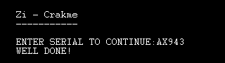
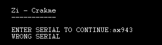

# zi___crakme by zionz (crackmes.de)

- Origine : [ORIGIN.yml](ORIGIN.yml) · [crackmes.one](https://crackmes.one/crackme/5ab77f5633c5d40ad448c278)
- Auteur : zionz (archive crackmes.de) · plateforme : Windows PE32 GUI, **Blitz3D** (BlitzBasic) · difficulté 2.0

| Fichier | Rôle |
|---|---|
| `original/Zi_crakme.zip` | archive d'origine (mot de passe site `crackmes.one`), contient `Zi _Crackme.rar` + `readme.txt` |
| `original/Zi _Crackme.exe` | binaire extrait du RAR (1 294 336 o, sha256 `6c111e2a…a38b018`) |
| `original/readme.txt` | consigne de l'auteur |
| `tools/zi_crakme-solve.py` | relit la constante serial dans le binaire (`-q`, `--check`) |
| `analysis/run.sh` | preuve Wine/Xvfb pilotée par xdotool + capture |
| `analysis/good.png`, `analysis/bad.png` | captures OK / KO |

## Réponse

Pas de nom : serial fixe **`AX943`** (sensible à la casse).

```bash
python3 tools/zi_crakme-solve.py          # serial : AX943
python3 tools/zi_crakme-solve.py --check AX943   # OK
```

Le `readme.txt` dit aussi « *Consider it cracked if it accept any serial* » : on peut patcher, mais
retrouver le vrai serial est plus propre et suffit (aucun patch appliqué ici).

## Premier regard

```text
$ file "Zi _Crackme.exe"
PE32 executable for MS Windows 4.00 (GUI), Intel i386, 5 sections
$ diec "Zi _Crackme.exe"
MSVC6 C++ ; Library: Direct3D, DirectDraw, DirectInput, D3DXOF
```

`readme.txt` : « *its written in BlitzBasic* ». L'exe est le **runtime Blitz3D** générique (1,2 Mo de
`.text` : moteur 3D, `KeyHit`, `WaitKey`, …) ; `strings` sur l'ensemble ne montre que les noms de
commandes Blitz, rien du programme de l'auteur dans `.text`/`.data`.

## Comment on trouve le serial

Un exe Blitz3D = runtime + **programme utilisateur compilé (x86) stocké en ressource**, avec sa
table de relocations symboliques (`__bbStrConst`, `_fprint`, …) que le runtime résout au
chargement. La section `.rsrc` ne fait que 0x10B0 octets (file offset 0x12B000) : c'est là qu'il faut
regarder.

```python
d = open("Zi _Crackme.exe","rb").read()
r = d[0x12b000:0x12b000+0x10b0]
# strings ≥ 4 sur r
```

Fin de la ressource (après une icône) :

```text
+0xd4f  "Zi - Crakme v1.0"        -> AppTitle
+0xd61  "Zi - Crakme"             -> Print
+0xd6d  "-----------"             -> Print
+0xd7a  "ENTER SERIAL TO CONTINUE:"  -> Input
+0xd94  "AX943"                   -> constante comparée
+0xd9a  "WELL DONE!"
+0xda5  "WRONG SERIAL"
...
relocs : __bbStrConst _fapptitle _fgraphics _fprint ×3 _finput __bbStrStore
         __bbStrLoad __bbStrConst __bbStrCompare _fprint _fprint _fwaitkey _fend
```

L'ordre des imports symboliques suit exactement le programme source ; on reconstitue :

```blitzbasic
AppTitle "Zi - Crakme v1.0"
Graphics ...
Print "Zi - Crakme"
Print "-----------"
Print ""
s$ = Input("ENTER SERIAL TO CONTINUE:")      ; _finput + __bbStrStore
If s$ = "AX943" Then                          ; __bbStrLoad, __bbStrConst, __bbStrCompare
    Print "WELL DONE!"
Else
    Print "WRONG SERIAL"
EndIf
WaitKey : End
```

`__bbStrCompare` est une comparaison exacte de chaînes Blitz (sensible à la casse) : pas de calcul,
le serial est la constante `AX943` placée juste après le prompt. Le solveur la relit à cet endroit
(`ENTER SERIAL TO CONTINUE:\0` puis C-string suivante, en vérifiant que les deux suivantes sont bien
`WELL DONE!` / `WRONG SERIAL`).

## Vérification (Wine + Xvfb)

```bash
cd analysis
xvfb-run -a -s "-screen 0 1024x768x24" ./run.sh 'xdotool key --delay 150 shift+a shift+x 9 4 3' good.png
xvfb-run -a -s "-screen 0 1024x768x24" ./run.sh 'xdotool key --delay 150 a x 9 4 3' bad.png
```

| `AX943` → WELL DONE! | `ax943` → WRONG SERIAL |
|---|---|
|  |  |

Le cas KO en minuscules confirme que la comparaison est sensible à la casse.

**Piège** : `xdotool type "AX943"` affiche `ax943` sous le runtime Blitz (le Shift synthétique est
perdu côté DirectInput/Wine) → toujours KO. Il faut envoyer `shift+a shift+x` explicitement
(`key --delay`), ou un Caps Lock ne suffit pas non plus (testé : toujours minuscules).

## Notes

- Aucun anti-debug ni packer ; le seul « obstacle » est que le code utile n'est pas dans `.text` mais
  dans la ressource Blitz3D.
- Variante « accept any serial » demandée par l'auteur : patcher le saut après `__bbStrCompare` dans
  le code de la ressource (non fait, et jamais dans `original/`).
