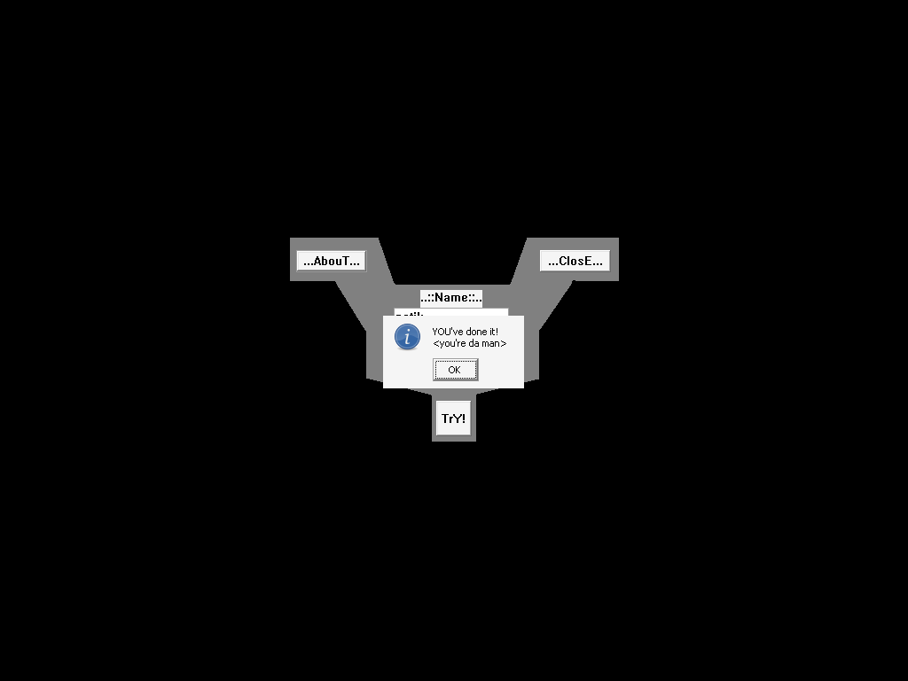

# crackmes.de's crackme_1 by rammy

| | |
|---|---|
| **ID** | [`5ab77f5633c5d40ad448c28d`](https://crackmes.one/crackme/5ab77f5633c5d40ad448c28d) |
| **Auteur (site)** | crackmes.de (RaMMy, 2002) |
| **Auteur (local)** | crackmes-de |
| **Plateforme** | Windows PE32 GUI, MASM 6.14, packé **ASPack 2.12** |
| **Difficulté** | 2.0 |
| **SHA-256 (ZIP)** | `24950ce00f9f8be0d65cd2130f076c9a34779cb2c744beed3bcced7f4ce6a052` |
| **SHA-256 (RaMMy.exe)** | `4ed8958bdcaac75af804a28c1ce86f4b8c35e8ce9194bc711080d17726411861` |

## Origine

- Page : https://crackmes.one/crackme/5ab77f5633c5d40ad448c28d
- Download : https://crackmes.one/download/crackme/5ab77f5633c5d40ad448c28d
- ZIP password : `crackmes.one`

Voir [`ORIGIN.yml`](ORIGIN.yml).

## Fichiers

| Fichier | Rôle |
|---|---|
| `original/rammy_crk_1.zip`, `RaMMy.exe`, `Rules.nfo` | archive d'origine + contenu (non modifiés) |
| `analysis/RaMMy-mem-0x401000-0x404000.bin` | `.text/.rdata/.data` lus dans `/proc/<pid>/mem` après décompression ASPack (Wine) |
| `analysis/text-0x401000.asm` | désassemblage `objdump` de ce dump |
| `analysis/screenshot-ok.png` | preuve live (MessageBox « Great Job ») |
| `tools/rammy1-solve.py` | keygen (`--name`, `-q`, `--check`) |
| `tools/emu-check.py` | recoupement : exécute la vraie routine `0x4015e3` sous unicorn |
| `tools/verify-wine.sh` | preuve live Wine + Xvfb + xdotool |

## Réponse

Keygen name → serial (règle « for more advanced: make a keygen » du `Rules.nfo`) :

| Name | Serial |
|---|---|
| **`petik`** | **`R8~9`** |
| `RaMMy` | `RIN9` |
| `abc` | `RQQ6` |

```bash
python3 tools/rammy1-solve.py              # name=petik  serial=R8~9
python3 tools/rammy1-solve.py --name RaMMy -q
tools/verify-wine.sh petik                 # MessageBox "Great Job" -> OK
```

Formule :

```text
s   = somme des octets du nom
n   = s            (ou len(nom) si len > 19)
v   = 4 * s * (F(n) + 1) + F(200)            (32 bits)
F(k)= Fibonacci 1,1,2,3,5… itéré k fois (32 bits), puis >>1 tant que > 200, puis +1
serial = 'R' + map(octets LE de v jusqu'au premier 0)   (3 caractères en pratique)
map(c) : tant que c < 0x30 → c*=3 ; tant que c > 0x5a → c-=0x59 ; si c ∈ [0x3a..0x40] → c<<=1
```

## Premier regard

```text
$ file original/RaMMy.exe
PE32 executable for MS Windows 4.00 (GUI), Intel i386, 6 sections
$ diec original/RaMMy.exe
PE32  Linker: Microsoft Linker(5.12)  Compiler: MASM(6.14.8444)  Packer: ASPack(2.12-2.42)
$ objdump -h original/RaMMy.exe
.text 0x600 @401000  .rdata  .data  .rsrc  .aspack @44a000  .adata
```

`strings` sur le fichier ne montre que le loader ASPack (`VirtualAlloc`, `LOADER ERROR`, …) : il faut décompresser.

`Rules.nfo` : « For beginners: make the target accept any serial — for more advanced: make a keygen ».

## Unpack « à la main » via Wine

Pas de unpacker ASPack dans la boîte à outils : on laisse le stub faire le travail et on lit la mémoire du process.

```bash
xvfb-run -a wine original/RaMMy.exe &
grep RaMMy /proc/<pid>/maps            # 00400000-... image mappée
python3 -c "f=open('/proc/<pid>/mem','rb'); f.seek(0x401000); open('dump','wb').write(f.read(0x3000))"
objdump -D -b binary -m i386 -M intel --adjust-vma=0x401000 dump > analysis/text-0x401000.asm
```

Les chaînes apparaissent alors dans `.data` (`0x403000`) :

```text
403000 RaMMy                    4030ca YOU've done it!      4030fd TrY!
403102 ..::Name::..             40310f ..::Serial::..       40311e Great Job
```

et les imports (`GetDlgItemTextA`, `lstrcmpA`, `lstrlenA`, `MessageBoxA`, `SetWindowRgn`, `GetPixel`…).

## Flow (WndProc `0x401116`)

- `WM_CREATE` : `CreateWindowExA` des contrôles — EDIT id `0xa` (name, x=0x7d y=0x55), EDIT id `0xb` (serial, x=0x7d y=0x82), BUTTON `0x3e9` « TrY! », `0x3ea` « …AbouT… », `0x3eb` « …ClosE… ». La fenêtre est découpée selon un bitmap (`0x401526` : `GetPixel` + `CombineRgn` + `SetWindowRgn`). Petit bug : une `MessageBoxA("..::Name::..")` s'affiche au démarrage.
- `WM_COMMAND 0x3e9` (« TrY! ») → **code auto-modifiant**.

## Comment on trouve le prédicat

### 1. Le code qu'on lit n'est pas celui qui s'exécute

Le handler de « TrY! » commence par `call 0x4014e1`. Cette routine **réécrit** les octets à partir de `0x4013c1` (la `.text` est RWX à cause d'ASPack) puis saute dessus :

```asm
4014e1  mov  ecx,0x4013c1
4014e6  mov  WORD PTR [ecx],0x6a          ; 6a 00            push 0
4014ee  mov  DWORD PTR [ecx],0xf17068     ; 68 70 f1 00 00   push 0xf170
4014fb  mov  DWORD PTR [ecx],0x11268      ; 68 12 01 00 00   push 0x112 (WM_SYSCOMMAND)
401508  ...                               ; ff 75 08         push [ebp+8]
401514  ...                               ; e8 1b 04 00 00   call SendMessageA
401521  jmp  0x4013c1
```

Puis `GetDlgItemTextA(hwnd, 0xa, 0x403134, 0x32)` (name) et `GetDlgItemTextA(hwnd, 0xb, 0x40313c, 0xa)` (serial), et `call 0x40147f`, qui patche à son tour le site d'appel du calcul :

```asm
; statique (leurre)               ; après patch par 0x40147f
4013fc  push 0x403000  ; "RaMMy"  → push 0x403134   ; name saisi
401401  call 0x4015e3             (inchangé)
401406  push 0x403134             → push 0x40313c   ; serial saisi
40140b  push eax
40140c  call lstrcmpA
401411  cmp  eax,0
401414  je   0x4014a6             ; succès
```

En statique on croit donc que le serial dépend de la chaîne fixe `"RaMMy"` et qu'il est comparé au nom : piège. En réalité **`lstrcmpA(gen(name), serial)`**. Sur succès, `0x4014a6` patche aussi les arguments de la `MessageBoxA` de `0x401399` (« …AbouT… ») pour afficher « Great Job / YOU've done it! ». Sur échec : juste un `SendMessage(WM_SYSCOMMAND, SC_MONITORPOWER, -1)`, aucun message.

### 2. `gen(name)` — `0x4015e3`

```asm
4015fb  xor  edi,edi
401604  mov  bl,[eax] / add edi,ebx / inc eax     ; edi = somme des octets
401615  pop  [0x403144]                           ; s
40161e  call lstrlenA
401623  cmp  eax,0x13 / jbe                       ; len <= 19 → eax = s, sinon eax = len
401639  call 0x401702                             ; fv = F(eax)
401641  mov  [0x403148],0xc8
40164b  push [ebp-0x10] / pop eax                 ; eax = s
40164f  add  eax,[ebp-0x10] / inc cnt / cmp cnt,fv / jb   ; eax = s*(fv+1)
40165d  shl  eax,2                                ; *4
401663  mov  eax,[0x403148] / call 0x401702       ; F(200)
40166d  add  [ebp-0x10],eax                       ; v = 4*s*(fv+1) + F(200)
401675  pop  [0x403138]                           ; v écrit en LE en 0x403138
401687  mov al,[ebx] / test al,al / je            ; pour chaque octet non nul
40168d  call 0x4016a8 / mov [ecx],al              ;   octet = map(octet)
401698  sub  ecx,4 / mov BYTE PTR [ecx],0x52      ; 'R' 4 octets avant la fin → "R" + 3 car.
```

`v` est < 2^24 pour des noms courts : l'octet de poids fort est 0 et termine la chaîne, d'où un serial de **4 caractères** (`R` + 3). (Si `v ≥ 2^24`, la chaîne déborde dans le buffer du serial en `0x40313c` : le keygen refuse ces noms.)

### 3. `F` — `0x401702`

```asm
40171a  a=1 ; b=1 ; i=0
40172e  c=0 ; c+=a ; c+=b ; a=b ; b=c ; i++      ; Fibonacci 32 bits
401773  cmp i,n / jne
40177c  cmp c,0xc8 / jbe / shr c,1 / jmp         ; >>1 tant que > 200
40178e  inc eax                                  ; +1   (n=0 → 0x2c+1)
```

Piège rencontré : le `mov [0x403154],0` est **dans** la boucle (cible du `jne 0x40172e`) — c'est donc un vrai Fibonacci, pas une somme cumulée (première version du keygen fausse, corrigée grâce à `tools/emu-check.py`).

### 4. `map` — `0x4016a8`

```asm
4016a8  cmp eax,0x30 / jb → eax = eax*3 (mov edi,eax ; add eax,eax ; add eax,edi), reboucle
4016b7  cmp eax,0x5a / ja → sub eax,0x59, reboucle
4016c3  cmp eax,0x3a…0x40 → shl eax,1      ; ':'..'@' → 0x74..0x80
```

### 5. Exemple `petik`

```text
s     = 0x70+0x65+0x74+0x69+0x6b = 541
F(541)= 145   F(200) = 105
v     = 4*541*146 + 105 = 316049 = 0x0004d291 → octets 91 d2 04 00
map   : 0x91 → 0x38 '8'
        0xd2 → 0x79 → 0x20 → 0x60 → 0x07 → 0x15 → 0x3f → shl → 0x7e '~'
        0x04 → 0x0c → 0x24 → 0x6c → 0x13 → 0x39 '9'
serial = "R8~9"
```

## Vérification

Recoupement par émulation de la vraie routine (dump post-ASPack + unicorn, `lstrlenA` stubé) :

```text
$ for n in petik RaMMy abc; do python3 tools/rammy1-solve.py -q --name $n; python3 tools/emu-check.py $n; done
R8~9   0x403137 b'R8~9'
RIN9   0x403137 b'RIN9'
RQQ6   0x403137 b'RQQ6'
```

Preuve live sur le binaire **d'origine** (packé) sous Wine/Xvfb, saisie par xdotool aux coordonnées des `CreateWindowExA` :

```text
$ tools/verify-wine.sh petik          → MessageBox "Great Job" -> OK
$ tools/verify-wine.sh RaMMy          → MessageBox "Great Job" -> OK
$ tools/verify-wine.sh abc            → MessageBox "Great Job" -> OK
$ tools/verify-wine.sh petik 'R8~8'   → pas de MessageBox -> KO
```



## Notes

- Le buffer name (`0x403134`, 0x32 octets) chevauche celui du serial (`0x40313c`) : au-delà de 7 caractères, le nom lu par le calcul est `name[:8] + serial`. Garder des noms ≤ 7 caractères (le keygen ne modélise pas ce chevauchement).
- Sous Wine, la MessageBox de démarrage doit être fermée à la souris (un `Return` laisse parfois le focus clavier ailleurs).
- Le patch « beginner » serait d'inverser le `je 0x4014a6` en `0x401414` — pas fait (on ne patche pas `original/`).
