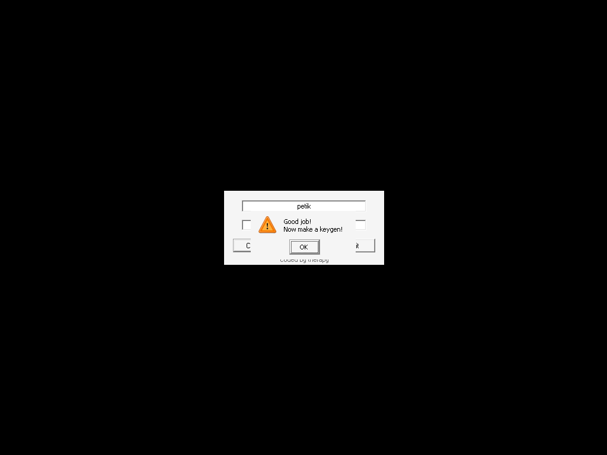

# crackmes.de's easyone___nameserial by therapy

| | |
|---|---|
| **ID** | [`5ab77f5633c5d40ad448c28f`](https://crackmes.one/crackme/5ab77f5633c5d40ad448c28f) |
| **Auteur (site)** | crackmes.de (therapy, 2004) |
| **Auteur (local)** | crackmes-de |
| **Plateforme** | Windows PE32 GUI (DialogBox), MinGW C, non packé, symboles COFF présents |
| **Difficulté** | 1.0 |
| **SHA-256 (ZIP)** | `27ee7a870313b4f2e64c69897cad8999a4a023a0aa518907349bec5d19872500` |
| **SHA-256 ([easyone]-therapy.exe)** | `0a5beeb1d03b9f2cff192b649bf92e10d83f1130ee0335d06eb91a4194d1e1c6` |

## Origine

- Page : https://crackmes.one/crackme/5ab77f5633c5d40ad448c28f
- Download : https://crackmes.one/download/crackme/5ab77f5633c5d40ad448c28f
- ZIP password : `crackmes.one`

Voir [`ORIGIN.yml`](ORIGIN.yml).

## Fichiers

| Fichier | Rôle |
|---|---|
| `original/therapy_easyone.zip`, `[easyone]-therapy.exe`, `info.txt` | archive d'origine + contenu (non modifiés) |
| `analysis/checkserial-0x401290.asm` | `objdump` de `_checkserial` |
| `analysis/screenshot-ok.png` | preuve live (« Good job! Now make a keygen! ») |
| `tools/easyone-solve.py` | keygen (`--name`, `-q`, `--check`) |
| `tools/verify-wine.sh` | preuve live Wine + Xvfb + xdotool |

## Réponse

Keygen (règle du `info.txt` : « no patching », envoyer un keygen) :

| Name | Serial |
|---|---|
| **`petik`** | **`22043`** |
| `therapy` | `6553276` |

```bash
python3 tools/easyone-solve.py                 # name=petik  serial=22043
tools/verify-wine.sh petik                     # MessageBox "Correct!" -> OK
```

```text
pour i, c in enumerate(name) :     r = isqrt(c)   (dichotomie 8 bits)
    serial[i] = '0' + (c - r² + i²) % 10
contraintes : len(name) >= 5, len(serial) == len(name)
```

## Premier regard

```text
$ file original/[easyone]-therapy.exe
PE32 executable for MS Windows 4.00 (GUI), Intel i386 (stripped to external PDB), 5 sections
$ diec …        → Compiler: MinGW
$ strings …     → Name too short / Name must be at least 5 chars long! / Serial too short
                  Correct! / Good job!\nNow make a keygen!
$ strings -el … → [Easyone]  Check Info Quit  EDIT "Enter Name Here" (id 0x65)  EDIT "Enter Serial Here" (id 0x66)
$ objdump -d -M intel … | grep '>:'
00401290 <_checkserial>   004013d8 <_WinMain@16>   00401440 <_DlgProc@16>
```

Les symboles COFF sont restés : la fonction de vérif s'appelle littéralement `_checkserial`.

## Comment on trouve le prédicat

Tout est dans [`analysis/checkserial-0x401290.asm`](analysis/checkserial-0x401290.asm).

### 1. Lecture des champs

```asm
401299  push 0x64 / push 0x403070 / push 0x65 / push hDlg
4012a6  call GetDlgItemTextA        ; name  → 0x403070, nlen = [ebp-4]
4012ae  cmp  eax,4 / jg             ; sinon "Name must be at least 5 chars long!"
4012bc  push 0x64 / push 0x403000 / push 0x66
4012c9  call GetDlgItemTextA        ; serial → 0x403000, slen = edi
4012d0  cmp  edi,4 / jg             ; sinon "Serial too short"
```

### 2. Racine carrée entière par dichotomie (`0x401300`–`0x401361`)

Variables 8 bits : `lo=[ebp-5]`, `mid=[ebp-6]`, `hi=[ebp-7]`, `flag=[ebp-8]`, `ebx = c = name[i]`.

```asm
401300  lo = 0 ; hi = c ; flag = 0
401314  mid = (lo + hi) >> 1             ; add / sar 1
401323  ecx = mid*mid                    ; imul ecx,ecx
40132a  cmp ecx,ebx / jle  → sinon hi = mid    (mid² > c)
401331  cmp ecx,ebx / jae  → sinon lo = mid    (mid² < c)
401338  if (lo+1 == hi) flag = 2
401349  if (mid² == c)  flag = 1
401351  while (flag == 0)
401357  if (flag == 2) mid = lo          ; → mid = floor(sqrt(c))
```

C'est un `isqrt` classique (identique à `math.isqrt` pour tout c ≥ 2, donc pour tout ASCII imprimable).

### 3. Comparaison caractère par caractère (`0x401363`–`0x4013af`)

```asm
401363  cmp esi,edi / je fail             ; serial plus court que le nom → échec
401367  ecx = serial[i]
40136e  edx = name[i] - mid*mid           ; reste de la racine
40137e  ebx = i*i + edx
401386  mov edx,0x66666667 / imul ebx / sar edx,2 / …   ; q = ebx / 10 (division par magic number)
401399  lea eax,[edx+edx*4] / add eax,eax / sub ebx,eax ; ebx = ebx % 10
4013a0  lea eax,[ebx+0x30]                ; '0' + …
4013a3  cmp ecx,eax / jne fail
4013b5  cmp edi,esi / jne fail            ; à la fin, len(serial) doit == len(name)
4013c9  MessageBoxA("Good job!\nNow make a keygen!", "Correct!")
```

Pièges : `0x66666667` + `sar edx,2` = division signée par 10 (réduction de force du compilateur) ; l'échec est **silencieux** (aucune MessageBox) ; un serial plus long que le nom est refusé par le test final `slen == i`.

### 4. Exemple `petik`

| i | c | r = isqrt(c) | c − r² | + i² | % 10 |
|---|---|---|---|---|---|
| 0 | `p` 112 | 10 | 12 | 12 | **2** |
| 1 | `e` 101 | 10 | 1 | 2 | **2** |
| 2 | `t` 116 | 10 | 16 | 20 | **0** |
| 3 | `i` 105 | 10 | 5 | 14 | **4** |
| 4 | `k` 107 | 10 | 7 | 23 | **3** |

→ **`22043`**.

## Vérification

Binaire d'origine sous Wine/Xvfb, champs remplis par xdotool, détection de la MessageBox « Correct! » :

```text
$ tools/verify-wine.sh petik            → name=petik serial=22043     MessageBox "Correct!" -> OK
$ tools/verify-wine.sh therapy          → name=therapy serial=6553276 MessageBox "Correct!" -> OK
$ tools/verify-wine.sh petik 22044      → pas de MessageBox -> KO
```



## Notes

- Serial uniquement numérique, de même longueur que le nom.
- La dichotomie diffère de `isqrt` seulement pour c = 1 (renvoie 0) — sans importance pour un nom saisi au clavier ; le keygen réplique quand même la boucle exacte.
