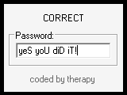

# crackmes.de's password_check by therapy (crackme #2 « FindMe »)

| | |
|---|---|
| **ID** | [`5ab77f5633c5d40ad448c291`](https://crackmes.one/crackme/5ab77f5633c5d40ad448c291) ([ORIGIN.yml](ORIGIN.yml)) |
| **Auteur (site)** | crackmes.de (therapy) |
| **Plateforme** | Windows, PE32 GUI (dialogue), MinGW C, symboles COFF présents |
| **Difficulté site** | 1.0 |
| **SHA-256 (zip)** | voir [ORIGIN.yml](ORIGIN.yml) |

## Fichiers

| Fichier | Rôle |
|---|---|
| `original/therapy_findme.zip` | archive d'origine |
| `original/[crackme #2]-FindMe.exe`, `original/info.txt` | contenu extrait (exe non patché, consignes) |
| `tools/findme-solve.py` | solveur (relit la table dans l'exe et inverse le check) ; `--check PW` |
| `tools/verify-wine.sh` | preuve live Wine + Xvfb + xdotool, capture optionnelle |
| `analysis/convert-check-0x401214.asm` | désassemblage de `_convert` et `_check` |
| `analysis/screenshot-ok.png`, `analysis/screenshot-ko.png` | captures live |

## Réponse

Mot de passe (unique) : **`yeS yoU diD iT!`** (15 caractères, avec les espaces et le `!`).

```bash
python3 tools/findme-solve.py                 # yeS yoU diD iT!
./tools/verify-wine.sh "" analysis/ok.png     # tape le mot de passe dans le dialogue
```



## Premier regard

```text
$ file '[crackme #2]-FindMe.exe'
PE32 executable for MS Windows 4.00 (GUI), Intel i386 (stripped to external PDB), 5 sections
$ diec ...           -> Compiler: MinGW
$ strings -n 4 ...   -> "YES YES INCORRECT", DialogBoxParamA, SendMessageA, SetDlgItemTextA, GlobalAlloc
$ objdump -t ...     -> _convert (0x401214), _check (0x4012b8), _DlgProc@16 (0x4014a4)
```

`info.txt` : il faut faire passer le texte « INCORRECT » à « CORRECT », pas de patch.
Le `.data` contient `YES YES INCORRECT` à `0x402008` suivi d'un bloc d'octets `0xCC`/`0xC?`.

## Flow

- `_DlgProc` : à `WM_INITDIALOG` il mémorise l'EDIT `0x67` (`GetDlgItem`) et met `INCORRECT`
  (`0x402010`) dans le STATIC `0x29a`.
- À `WM_COMMAND` avec `HIWORD(wParam) == 0x300` (**EN_CHANGE**) sur l'EDIT `0x67` : `call _check`.
  Il n'y a donc pas de bouton, le test tourne à chaque frappe.

## Comment on trouve la réponse

### `_convert(src, dst)` @ 0x401214

Pour chaque octet de `src`, écrit deux caractères : le quartet haut puis le bas, avec
`q <= 9 ? q + 0x30 : q + 0x36`. C'est un encodage hexadécimal **décalé d'un cran** :
10..15 donnent `@ A B C D E` au lieu de `A..F`. La fonction renvoie `2 * len(src)`.

```asm
401241 mov al,[ebp-0x5] ; shr al,4          ; quartet haut
40124a cmp byte [ebp-0x6],9 ; jbe -> +0x30  ; '0'..'9'
401250 add byte [ebp-0x6],0x36              ; 10 -> 0x40 '@' (bug/astuce : pas 0x37)
40126b and byte [ebp-0x5],0xf               ; quartet bas, même traitement
```

### `_check` @ 0x4012b8

```asm
4012cb SendMessageA(edit, WM_GETTEXTLENGTH=0xe) -> n   ; si n <= 0 : rien
40130e SendMessageA(edit, WM_GETTEXT=0xd, n+1, P)
401398 c1 = convert(P,  H1)        ; 2n
4013b4 c2 = convert(H1, H2)        ; 4n
4013d0 c3 = convert(H2, H3)        ; 8n
4013ea cmp c1+c2+c3, 0xd2          ; 14n == 210  ->  n == 15
401412 mov dl,[H3+i] ; mov al,0xff ; sub al,dl
401422 cmp al,[0x40201a+i] ; jne ; inc ok      ; pour i < c3 (120)
401437 cmp ok, 0x78                ; 120 correspondances
40143d add [ebp-0x18], 2           ; "INCORRECT"+2 = "CORRECT"
401453 SetDlgItemTextA(dlg, 0x29a, ...)
```

Donc `H3[i] = 0xFF - table[i]` pour la table de 120 octets à `0x40201a`.
Le premier octet `0xCC` donne `0x33` = `'3'`. Les 120 octets donnent :

```text
H3 = 333733393336333533353333333233303337333933363435...333433323331
H2 = 373936353533323037393645...              (inverse de l'hex une fois)
H1 = 79655320796E552064694420695421         (deux fois ; 0x6F -> '6E' avec l'alphabet décalé)
P  = "yeS yoU diD iT!"                        (trois fois)
```

`_convert` est injective et la longueur est forcée à 15, donc le mot de passe est **unique**.
Le solveur fait exactement ça : il lit la table dans la section `.data` de l'exe, applique
`0xFF - b`, puis inverse trois fois l'hex avec l'alphabet `0123456789@ABCDE`.

## Vérification

Live sous Wine (Xvfb, saisie au clavier par `xdotool type` dans l'EDIT qui a le focus) :

| Saisie | Texte du STATIC |
|---|---|
| `yeS yoU diD iT!` | **CORRECT** ([capture](analysis/screenshot-ok.png)) |
| `petik` | INCORRECT ([capture](analysis/screenshot-ko.png)) |

```text
$ python3 tools/findme-solve.py --check 'yes you did it!'
INCORRECT          # la casse compte
```

## Notes

- Le piège est l'alphabet hex `0123456789@ABCDE` : un décodage hex standard échoue dès qu'un
  quartet vaut 10..15 (ici, seuls des chiffres apparaissent dans `H3`, mais `H2`/`H1` s'en
  servent aussi).
- Le texte `YES YES INCORRECT` est un leurre : seul le pointeur `INCORRECT` (+2 = `CORRECT`) sert.
