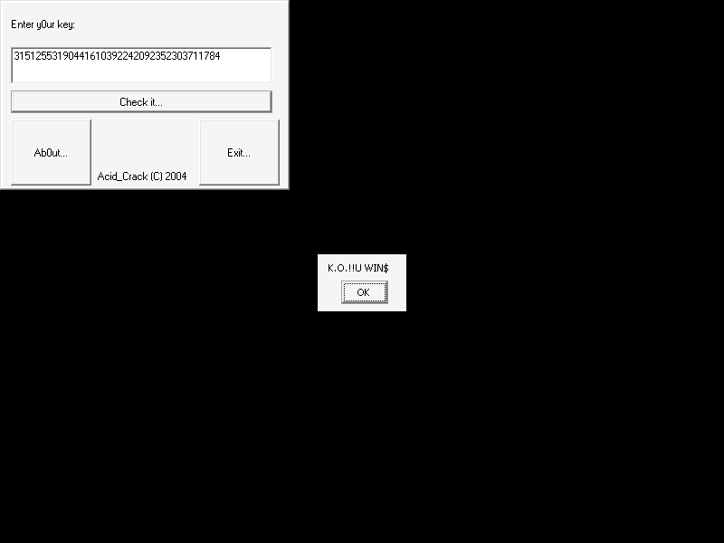

# crackmes.de's a_c_c_m by acid_crack (« A_C_Crack_me! »)

| | |
|---|---|
| **ID** | [`5ab77f5633c5d40ad448c29d`](https://crackmes.one/crackme/5ab77f5633c5d40ad448c29d) ([ORIGIN.yml](ORIGIN.yml)) |
| **Auteur (site)** | crackmes.de (acid_crack) |
| **Plateforme** | Windows, PE32 GUI, Visual Basic 6 **natif** (MSVBVM60) |
| **Difficulté site** | 2.0 |
| **SHA-256 (zip)** | `688f278d55720961046a26f526a7f7f411e1f9fb66e1971649f4e9b15c2890ed` |

## Fichiers

| Fichier | Rôle |
|---|---|
| `original/Acid_Crack_cm_n2.zip` | archive d'origine |
| `original/A_C_Crack_me!.exe` | exe extrait (non patché) |
| `tools/accm-solve.py` | keygen : clé du jour (ou d'un jour donné) |
| `tools/verify-wine.sh` | preuve live Wine + Xvfb + xdotool, capture optionnelle |
| `analysis/form_load-0x4022d0.asm` | `Form_Load` annoté (calcul de la clé) |
| `analysis/command1_click-0x4025e0.asm` | `Command1_Click` annoté (comparaison) |
| `analysis/screenshot-ok.png`, `analysis/screenshot-ko.png` | captures live |

## Réponse

Il n'y a pas de nom : la clé ne dépend que du **jour du mois** (`Day(Date)`) au moment où la fenêtre se charge.

Avec `d = Day(Date)` :

```text
A = 2·d²        B = A·3000/1500 = 2A        C = (A + B)·2 = 6A        D = C² = 144·d⁴
clé = "31512" & D & "41610" & A & "24209" & C & "303711" & B
```

Exemple le 14 (le jour de la résolution, 14/10/2026) : `d = 14`, `A = 392`, `B = 784`, `C = 2352`, `D = 5531904` →

**`31512553190441610392242092352303711784`**

```bash
python3 tools/accm-solve.py          # clé du jour courant
python3 tools/accm-solve.py 1        # le 1er du mois : 3151214441610224209123037114
./tools/verify-wine.sh "" analysis/screenshot-ok.png
```



## Premier regard

```text
$ file 'A_C_Crack_me!.exe'
PE32 executable for MS Windows 4.00 (GUI), Intel i386, 3 sections
$ diec ...          -> Visual Basic(6.00.8041)[Native], Linker 6.0
$ strings ...       -> Text1, Command1 "Check it...", "Enter y0ur key:",
                       "31512" "41610" "24209" "303711" (UTF-16),
                       "K.O.!!U WIN$", "U LOSE!!INSERT COIN$"
imports : __vbaVarPow, __vbaVarMul, __vbaVarDiv, __vbaVarAdd, __vbaVarCat, __vbaStrCmp
          + MSVBVM60 par ordinal : #610, #542, #595
```

Les ordinaux se résolvent avec la table d'export de `msvbvm60.dll` (runtime VB6 installé dans le préfixe Wine) :
`#610 = rtcGetDateVar` (`Date`), `#542 = rtcGetDayOfMonth` (`Day`), `#595 = rtcMsgBox`.

Le message de l'auteur (dans les chaînes) : « The 0nly thing that u have 2 d0 is 2 make a key_gen (Please d0nt patch it..) ».

## Reverse

Pas de décompilateur VB ici : `objdump -d -M intel`, puis un petit script qui remplace chaque `call ds:[IAT]` par le nom de l'import. Deux procédures suffisent.

### `Form_Load` (0x4022d0) : la clé est calculée au chargement

```asm
call  ds:0x401098            ; #610 rtcGetDateVar  -> v28 = Date
call  ds:0x4010ac            ; #542 rtcGetDayOfMonth -> v38 = Day(v28)
...   (constante 2, type VT_I2)
call  __vbaVarPow            ; Day ^ 2
call  __vbaVarMul            ; * 2                -> Me.+0x34  (A)
mov   [ebp-0x90], 0xbb8      ; 3000
mov   [ebp-0xa0], 0x5dc      ; 1500
call  __vbaVarMul            ; A * 3000
call  __vbaVarDiv            ; / 1500             -> Me.+0x44  (B = 2A)
call  __vbaVarAdd            ; A + B
call  __vbaVarMul            ; * 2                -> Me.+0x54  (C = 6A)
call  __vbaVarPow            ; C ^ 2              -> Me.+0x64  (D)
; 7 × __vbaVarCat (edi = &__vbaVarCat), chaînes 0x401a10.. 0x401a40 :
;   "31512" & D & "41610" & A & "24209" & C & "303711" & B
call  __vbaStrVarMove / __vbaStrCopy               -> Me.+0x74  (clé, String)
```

`__vbaVarCat(res, droite, gauche)` empile l'opérande de droite avant celui de gauche, ce qui donne l'ordre ci-dessus. Les résultats de `^` et `/` sont des `Double`, mais toujours entiers ici (max `D = 144·31⁴ = 132987024`), donc `CStr` les écrit sans décimales ni notation exponentielle.

### `Command1_Click` (0x4025e0) : simple comparaison

```asm
call  [edx+0x2fc]            ; Me.Text1
call  [ecx+0xa0]             ; .Text -> [ebp-0x18]
push  [ebp-0x18]             ; saisie
push  [esi+0x74]             ; clé calculée au Load
call  __vbaStrCmp            ; 0 si égales
neg esi / sbb esi,esi / inc esi / neg esi   ; esi = (cmp == 0) ? -1 : 0  (True VB)
cmp   si, bx
je    0x402702               ; -> MsgBox "U LOSE!!INSERT COIN$"
                             ; sinon MsgBox "K.O.!!U WIN$"
```

Comparaison exacte (binaire, sensible à tout caractère en plus) avec la chaîne calculée au chargement. Un piège : si la fenêtre reste ouverte après minuit, la clé à saisir reste celle du jour du **chargement**.

## Keygen

```python
def key(day):
    a = day ** 2 * 2
    b = a * 3000 // 1500
    c = (a + b) * 2
    d = c ** 2
    return f"31512{d}41610{a}24209{c}303711{b}"
```

## Vérification live (Wine)

`tools/verify-wine.sh` lance l'exe sous Wine dans un Xvfb sans gestionnaire de fenêtres (la fiche apparaît en haut à gauche, sans barre de titre), clique dans `Text1` (150,70), tape la clé et clique sur « Check it... » (155,112) :

- clé du jour `31512553190441610392242092352303711784` → **« K.O.!!U WIN$ »** ([capture](analysis/screenshot-ok.png))
- `123456` → **« U LOSE!!INSERT COIN$ »** ([capture](analysis/screenshot-ko.png))

## Status

- [x] reverse
- [x] write-up
- [x] solveur (keygen dépendant de la date, vérifié live)
