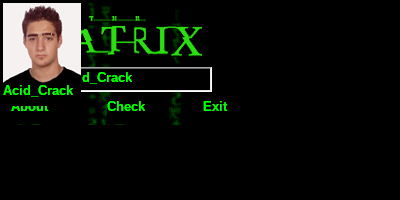

# crackmes.de's matrix_acid_crack by acid_crack (« Matrix »)

| | |
|---|---|
| **ID** | [`5ab77f5633c5d40ad448c29e`](https://crackmes.one/crackme/5ab77f5633c5d40ad448c29e) ([ORIGIN.yml](ORIGIN.yml)) |
| **Auteur (site)** | crackmes.de (acid_crack) |
| **Plateforme** | Windows, PE32 GUI, Visual Basic 6 **P-code** (MSVBVM60, `MethCallEngine`) |
| **Difficulté site** | 1.0 |
| **SHA-256 (zip)** | `13e0b2819bf88455e544af42ca7607ce7f120be6a4840ab2fb260f93c3f872ab` |
| **SHA-256 (exe)** | `19205b949cdc967bc3b5aa5de89f7705f2f3d6bd1fdeda45659b9a75f90fc9f7` |

## Fichiers

| Fichier | Rôle |
|---|---|
| `original/matrix.zip` | archive d'origine |
| `original/matrix.exe` | exe extrait (non patché) |
| `tools/matrix_acid_crack-solve.py` | serial (`-q`), `--check` relit le littéral dans l'exe |
| `tools/verify-wine.sh` | preuve live Wine + Xvfb + xdotool, capture optionnelle |
| `analysis/relay-check.txt` | extrait `WINEDEBUG=+relay` au clic « Check » |
| `analysis/pcode-check-0xe780.hex` | octets P-code autour du littéral |
| `analysis/screenshot-ok.png`, `screenshot-ko.png`, `screenshot-easter-egg.png` | captures live |

## Réponse

Pas de nom : le serial est **fixe**.

**`151202`**

```bash
python3 tools/matrix_acid_crack-solve.py -q        # 151202
python3 tools/matrix_acid_crack-solve.py --check   # relit 0x00024EA2 dans original/matrix.exe
./tools/verify-wine.sh 151202 analysis/screenshot-ok.png
```


## Premier regard

```text
$ file matrix.exe
PE32 executable for MS Windows 4.00 (GUI), Intel i386, 3 sections
$ diec matrix.exe        -> Microsoft Visual Basic(6.0), Linker 6.0
imports MSVBVM60 : MethCallEngine, EVENT_SINK_*, __vbaExceptHandler, #100, #617
```

`MethCallEngine` dans les imports = projet compilé en **P-code** (le code des événements est
du bytecode interprété par `msvbvm60.dll`, pas du x86) : `objdump` ne montre rien d'utile.

`strings` donne l'interface (Form1 : `Text1` « Enter your serial... », labels `About`, `Check`,
`Exit`, `Timer1`, Form2/3/4, un GIF « Matrix ») et, en UTF-16, une seule chaîne intéressante :
`Acid_Crack` (VA `0x4043ac`). Aucun serial en clair.

## Flow

1. Form1 : saisie dans `Text1`, clic sur le **label** `Check` (pas de bouton).
2. Mauvais serial → Form2, texte « Free your mind cracker... » tapé lettre à lettre (Timer).
3. Bon serial → « Nice job cracker... ».
4. Si le texte vaut `Acid_Crack` → easter egg : photo de l'auteur + label « Acid_Crack ».

## Comment on trouve le serial

Faute de décompilateur P-code sur la box, on laisse le runtime travailler et on **trace ses
appels OLE** : en P-code, les conversions et comparaisons de chaînes passent par `oleaut32`,
donc elles traversent une frontière de DLL visible avec le relay de Wine.

```bash
WINEDEBUG=+relay wine original/matrix.exe 2>/tmp/relay.log &
# taper ZQXJK123 dans Text1, cliquer « Check »
rg "VarBstrFromI4|VarBstrCmp" /tmp/relay.log
```

Extrait (`analysis/relay-check.txt`) :

```text
Call oleaut32.VarBstrFromI4(00024ea2,00000409,...)                    ; CStr(&H24EA2)
Call oleaut32.VarBstrCmp(L"ZQXJK123", L"151202", 0, 00030001)          ; Text1 = "151202" ?
Call KERNEL32.lstrlenA(00404bfe "Free your mind cracker...")            ; -> échec, Form2
Call oleaut32.VarBstrCmp(L"ZQXJK123", 004043ac L"Acid_Crack", ...)     ; 2e test (easter egg)
```

Le runtime convertit l'entier `0x24EA2 = 151202` en chaîne, puis le compare à la saisie.

### Ancrage dans le P-code

On cherche l'immédiat `a2 4e 02 00` dans le fichier : une seule occurrence, à `0xe78d`.

```text
0000e780: 58ff 0100 54ff 0300 5cff 0200 f5a2 4e02  X...T...\.....N.
0000e790: 00fb fe31 78ff 0468 ff21 0ffc 0219 6cff  ...1x..h.!....l.
0000e7a0: 086c ff0d a000 0000 3e68 ff31 74ff 1a6c  .l......>h.1t..l
```

- `f5 a2 4e 02 00` (offset `0xe78c`) : opcode P-code `F5` = **LitI4**, immédiat 32 bits LE
  `0x00024EA2` → empile 151202 ;
- juste après viennent la conversion en chaîne (→ `VarBstrFromI4`) et, plus loin, le
  `0d a0 00 00 00` (appel de vtable `+0xA0`, le getter `Text1.Text`) puis la comparaison
  (→ `VarBstrCmp`).

Équivalent VB plausible :

```vb
Private Sub Label3_Click()          ' « Check »
    If Text1.Text = CStr(151202) Then
        ' « Nice job cracker... »
    Else
        Form2.Show                  ' « Free your mind cracker... »
    End If
    If Text1.Text = "Acid_Crack" Then ' easter egg (photo de l'auteur)
    ...
End Sub
```

`tools/matrix_acid_crack-solve.py --check` vérifie l'opcode `F5` à `0xe78c` et relit
l'immédiat, pour ne pas dépendre d'une valeur recopiée à la main.

## Vérification (Wine + Xvfb)

`tools/verify-wine.sh` lance l'exe sur un Xvfb sans gestionnaire de fenêtres (Form1 en 0,0),
clique dans `Text1` (130,79), tape le serial, clique le label « Check » (126,106) et capture.

| Saisie | Résultat |
|---|---|
| `151202` | « Nice job cracker... » ✅  |
| `151203` | « Free your mind cracker... » ❌  |
| `Acid_Crack` | easter egg (photo + « Acid_Crack »), pas le message de réussite  |

## Notes

- Runtime VB6 (`msvbvm60.dll`) requis dans le préfixe Wine (installé sur la box).
- Ce n'est pas un keygen : rien ne dépend d'un nom, de la date ou de la machine.
- `Acid_Crack` est un leurre/easter egg, à ne pas confondre avec le serial.
- Le relay Wine est une méthode générique pour les VB6 P-code « simples » : toute comparaison
  de chaînes finit dans `VarBstrCmp` / `__vbaStrCmp` → `oleaut32`.
