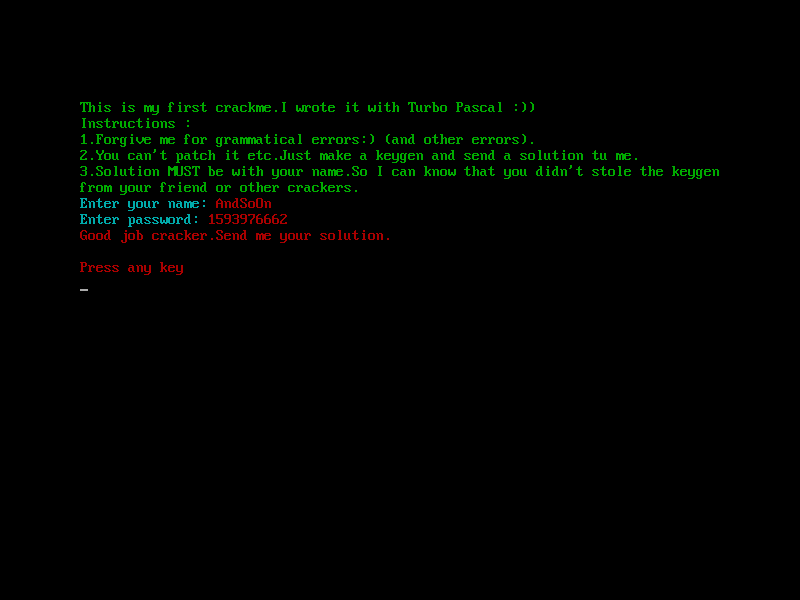
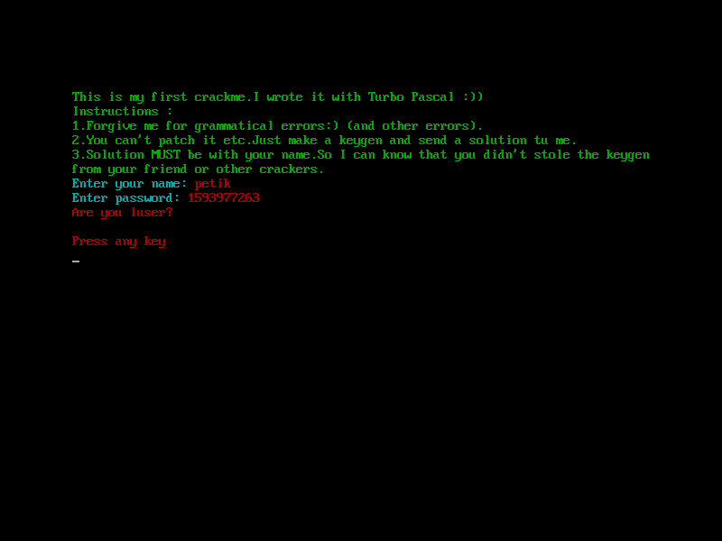

# crackmes.de's andsoon_crackme1 by andsoon

| | |
|---|---|
| **ID** | [`5ab77f5633c5d40ad448c2a3`](https://crackmes.one/crackme/5ab77f5633c5d40ad448c2a3) |
| **Auteur (site)** | crackmes.de (auteur original : AndSoOn) |
| **Auteur (local)** | crackmes-de |
| **Plateforme** | MS-DOS (MZ, Turbo Pascal 7 + unit CRT) |
| **Difficulté** | 2.0 |
| **SHA-256 (zip)** | `e192e1a0045d12a4e1486564387f770783a986ca41ae91493a6ca432dc74ec68` |

Voir [`ORIGIN.yml`](ORIGIN.yml).

## Fichiers

| Chemin | Rôle |
|---|---|
| `original/AndSoOn_Crackme1.zip` | archive crackmes.one (mot de passe `crackmes.one`) |
| `original/CRACKME1_by_AndSoOn.EXE` | binaire DOS (5936 octets) |
| `original/ReadMe.txt` | readme de l'auteur (« keygenme », name + password, non packé) |
| `analysis/main-ndisasm.txt` | désassemblage `ndisasm` du programme principal |
| `analysis/screenshot-ok.png` / `screenshot-ok-andsoon.png` / `screenshot-ko.png` | vérifs DOSBox |
| `tools/andsoon_crackme1-solve.py` | keygen (`-q`, `--check`) |
| `tools/verify-dosbox.sh` | vérification live DOSBox + xdotool + capture |

## Réponse

Keygen : le password est un **longint décimal** dérivé du nom.

```
s = Σ UpCase(c)            (nom)
s = s XOR 0x00031337
s = (s div 10) * 20
password = s + 0x5EFC051A
```

Exemple : **`petik` → `1593977262`**

```bash
python3 tools/andsoon_crackme1-solve.py            # name='petik' password=1593977262
python3 tools/andsoon_crackme1-solve.py -q AndSoOn # 1593976662
python3 tools/andsoon_crackme1-solve.py --check 1593977262   # OK
```

## Premier regard

```
$ file CRACKME1_by_AndSoOn.EXE
MS-DOS executable, MZ for MS-DOS
$ strings CRACKME1_by_AndSoOn.EXE
This is my first crackme.I wrote it with Turbo Pascal :))
...
Enter your name:
Enter password:
Good job cracker.Send me your solution.
Are you luser?
Press any key
Portions Copyright (c) 1983,92 Borland
```

Turbo Pascal (runtime Borland 1992 → TP 7), pas de packer. Les chaînes sont des
**Pascal strings** (octet de longueur devant : `9This is…` = 0x39 = 57 caractères),
stockées en tête du segment de code principal, juste avant le code de `main`.

## Flow

1. Affiche les instructions (WriteLn), couleur via `CRT.TextColor`.
2. `Enter your name:` → lit le nom **caractère par caractère** jusqu'à `Eoln`, en
   accumulant `UpCase(ch)` dans un longint global `[0x52]:[0x54]`.
3. Transforme la somme (XOR, div, mul, add).
4. `Enter password:` → `Read(Input, longint)` dans `[0x56]:[0x58]`.
5. Compare les deux longints : égal → `Good job cracker.`, sinon `Are you luser?`.

## Comment on trouve le prédicat

### Ancrage

En-tête MZ : `e_cparhdr = 0x15` → image à l'offset fichier `0x150` ;
`CS:IP = 0000:01A9`. On extrait l'image et on désassemble depuis l'entrée :

```bash
dd if=original/CRACKME1_by_AndSoOn.EXE of=code.bin bs=1 skip=336
ndisasm -b16 -o0x1a9 -e 0x1a9 code.bin > analysis/main-ndisasm.txt
```

Les appels `far` vont vers deux segments : `0x45` (unit **CRT**, `call 0x45:0x263`
avec `al=3/4` = `TextColor(Cyan/Red)`) et `0xA7` (unit **System**). Repères System
identifiés par l'usage : `0x701` = Write(string), `0x5DD` = WriteLn,
`0x5FE` = fin de Write/Read, `0x291` = IOCheck, `0x7C7` = Eoln, `0x635` = Read(char),
`0xAE6` = UpCase, `0x72D` = Read(longint), `0x807`/`0x844` = helpers longint.

### Lecture du nom (0x2B8–0x2FE)

```asm
2B8: push ds:0070 ; call System.Eoln        ; Input
2C7: or al,al ; jnz 300                       ; fin de ligne → sortie de boucle
2D0: call System.ReadChar ; mov [5Ah],al      ; Read(ch)
2E6: push [5Ah] ; call System.UpCase
2EB: xor ah,ah ; xor dx,dx
2EF: add ax,[52h] ; adc dx,[54h]              ; s := s + UpCase(ch)  (longint)
2F7: mov [52h],ax ; mov [54h],dx
2FE: jmp 2B8
```

La casse du nom ne compte donc pas (`petik` ≡ `PETIK`).

### Transformation (0x300–0x348)

```asm
300: mov ax,[52h] ; mov dx,[54h]
307: xor ax,1337h ; xor dx,0003h              ; s := s xor $31337
31C: mov cx,0Ah ; xor bx,bx ; call A7:0844    ; s := s div 10
334: mov cx,14h ; xor bx,bx ; call A7:0807    ; s := s * 20
33E: add ax,051Ah ; adc dx,5EFCh              ; s := s + $5EFC051A
```

Pour savoir lequel des deux helpers est la multiplication, on les désassemble
(`ndisasm -e $((0xA70+0x807))`) : `A7:0807` fait `imul ecx` (chemin 386) / trois
`mul` 16 bits → **LongMul** ; `A7:0844` fait `cdq ; idiv ecx` → **LongDiv**
(quotient signé). Ordre réel : **div 10 puis × 20** — ce n'est donc pas `s*2`,
le reste de la division est perdu (`(s div 10)*20` est toujours multiple de 20).

### Lecture et comparaison du password (0x378–0x3D3)

```asm
37D: call System.ReadLongint ; mov [56h],ax ; mov [58h],dx   ; Read(pass) ; ReadLn
393: mov ax,[52h] ; mov dx,[54h]
39A: cmp dx,[58h] ; jnz 3C2
3A0: cmp ax,[56h] ; jnz 3C2
3A6: ... Write('Good job cracker.Send me your solution.')
3D5: ... Write('Are you luser?')
```

### Exemple `petik`

| Étape | Valeur |
|---|---|
| UpCase : `P E T I K` | 80+69+84+73+75 = **381** (0x17D) |
| `381 xor 0x31337` | 0x3124A = **201290** |
| `div 10` | 20129 |
| `* 20` | 402580 (0x62494) |
| `+ 0x5EFC051A` | 0x5F0229AE = **1593977262** |

## Vérification

DOSBox sous Xvfb, saisie tapée avec `xdotool` :

```bash
xvfb-run -a -s "-screen 0 800x600x24" tools/verify-dosbox.sh petik 1593977262 ok.png
xvfb-run -a -s "-screen 0 800x600x24" tools/verify-dosbox.sh petik 1593977263 ko.png
```

| Cas | Résultat |
|---|---|
| `petik` / `1593977262` | **Good job cracker.Send me your solution.** —  |
| `AndSoOn` / `1593976662` | Good job cracker. —  |
| `petik` / `1593977263` | **Are you luser?** —  |

## Notes

- Pas d'anti-debug ni de packer ; tout le check est dans le bloc `begin…end.` principal.
- `UpCase` de TP ne touche que `a..z` (le keygen fait pareil, pas d'Unicode).
- Le password est lu par `Read(longint)` : les valeurs hors 32 bits signés ou non
  numériques provoquent un runtime error 106 de TP au lieu du message KO.
- La somme ne dépend que des caractères (anagrammes ⇒ même password) et le
  `div 10` crée encore plus de collisions.
