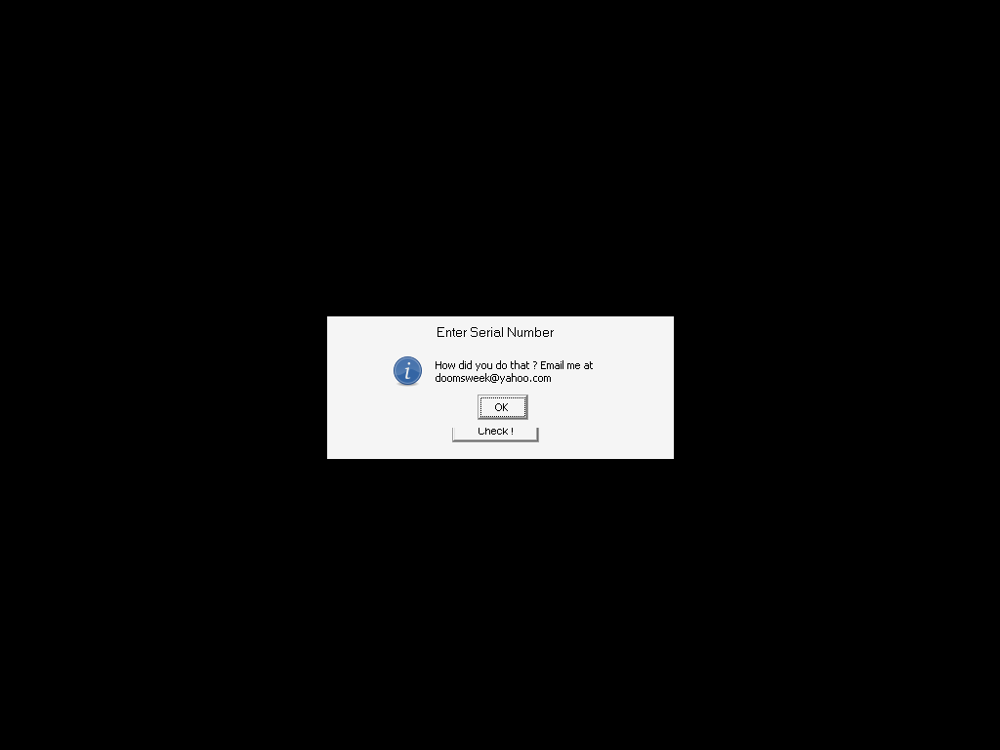
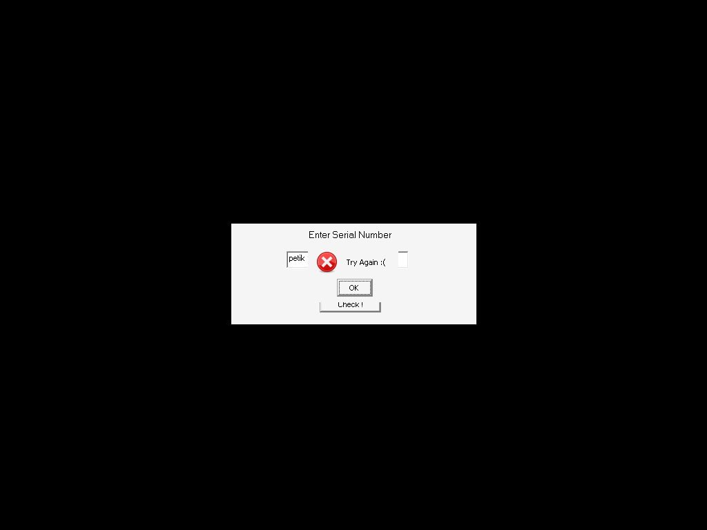

# crackmes.de's d00msweek039s_crackme_1 by doomsweek

| | |
|---|---|
| **ID** | [`5ab77f5633c5d40ad448c2c4`](https://crackmes.one/crackme/5ab77f5633c5d40ad448c2c4) |
| **Auteur (site)** | crackmes.de (doomsweek) |
| **Auteur (local)** | crackmes-de |
| **Plateforme** | Windows PE32 GUI, Visual Basic 6 (code natif) |
| **Difficulté** | 1.0 |
| **SHA-256 (zip)** | `7f9fb8f107d508a2599b1db3084faafbfb5d403f8277c43ce32d67916ddc0e1c` |
| **SHA-256 (`d00m1.exe`)** | `a90ba19eab751c043a2fd9cb4a40b7bb4a34d7ed9ae4c48a869c7d74993b7b53` |

## Solution

Serial : **`CFDXXQRQAASD`** (constant, pas de nom).

```bash
tools/d00m1-solve.py                  # CFD + XXQ + RQA + ASD => CFDXXQRQAASD
tools/d00m1-solve.py --check CFDXXQRQAASD
tools/verify-wine.sh CFDXXQRQAASD     # preuve live (wine + runtime VB6 + Xvfb)
```

## Premier regard

```text
$ file original/d00m1.exe
PE32 executable for MS Windows 4.00 (GUI), Intel i386, 3 sections
$ diec original/d00m1.exe
Linker: Microsoft Linker(6.0)   Compiler: Visual Basic(6.00.8041)[Native]
```

Une seule fiche `frmMain` (« CrackMe 1 by d00msweek ») : un label « Enter Serial Number »,
une zone `txtSerial` et un bouton `cmdCheck` (« Check ! »). Imports MSVBVM60 très parlants :
`__vbaStrCopy`, `__vbaStrCat`, `__vbaStrCmp`. Les chaînes UTF-16 (`strings -el`) donnent
déjà les messages et quatre petits blocs suspects :

```text
How did you do that ? Email me at doomsweek@yahoo.com   Congrats
Try Again :(                                            Sorry
CFD  XXQ  RQA  ASD
```

## Reverse

Les BSTR littéraux de VB6 sont référencés par adresse dans `.text`. On cherche les xrefs
(imm32 = VA de la chaîne) :

| Chaîne | VA | xref |
|---|---|---|
| `CFD` | `0x401c34` | `0x4020c7` |
| `XXQ` | `0x401c40` | `0x4020d1` |
| `RQA` | `0x401c4c` | `0x4020db` |
| `ASD` | `0x401c58` | `0x4020e5` |
| `Congrats` | `0x401bec` | `0x401f31` |
| `Try Again :(` | `0x401c04` | `0x401fcc` |

### `Form_Load` (`0x402080`)

```asm
4020c0  mov  edi, [__vbaStrCopy]
4020c6  mov  edx, 0x401c34        ; "CFD"
4020cb  lea  ecx, [esi+0x34]      ; Me.m34 = "CFD"
4020ce  call edi
4020d0  mov  edx, 0x401c40        ; "XXQ"  → Me.m38
4020da  mov  edx, 0x401c4c        ; "RQA"  → Me.m3C
4020e4  mov  edx, 0x401c58        ; "ASD"  → Me.m40
```

Quatre variables de module de la fiche reçoivent les morceaux du serial au chargement.

### `cmdCheck_Click` (`0x401e00`)

Après lecture de `txtSerial.Text` (dans `[ebp-0x18]`) :

```asm
401e84  mov  eax, [ebp-0x18]      ; Text (reste sur la pile pour __vbaStrCmp)
401e87  mov  ecx, [esi+0x34]      ; "CFD"
401e8a  mov  edx, [esi+0x38]      ; "XXQ"
401e8d  mov  ebx, [__vbaStrCat]
401e93  push eax
401e94  push ecx
401e95  push edx
401e96  call ebx                  ; "CFD" & "XXQ"
401ea4  mov  eax, [esi+0x3c]      ; & "RQA"
401ea8  call ebx
401eb5  mov  ecx, [esi+0x40]      ; & "ASD"
401eba  call ebx
401ec8  call [__vbaStrCmp]        ; StrCmp(Text, "CFDXXQRQAASD")
401ece  mov  esi, eax
401ed3  neg  esi / sbb esi,esi / inc esi / neg esi   ; esi = (cmp == 0) ? -1 : 0  (True VB)
401efb  cmp  si, di
401efe  je   0x401f8a             ; False → MsgBox "Try Again :(", "Sorry"
401f04  ...                       ; True  → MsgBox "How did you do that ?…", "Congrats"
```

En VB : `If txtSerial.Text = m34 & m38 & m3C & m40 Then MsgBox "How did you do that ?…", , "Congrats" Else MsgBox "Try Again :(", , "Sorry"`.
Le serial est donc la concaténation **`CFD` + `XXQ` + `RQA` + `ASD` = `CFDXXQRQAASD`**.

## Solveur

[`tools/d00m1-solve.py`](tools/d00m1-solve.py) relit les quatre `mov edx, imm32 / lea ecx,[esi+disp8] / call edi`
de `Form_Load` dans le binaire, décode les BSTR UTF-16 et les concatène dans l'ordre des offsets
(`0x34`, `0x38`, `0x3C`, `0x40`). `--check S` reproduit le test.

## Vérification live (wine)

[`tools/verify-wine.sh`](tools/verify-wine.sh) lance `d00m1.exe` sous wine (runtime VB6) dans un Xvfb
privé, clique dans `txtSerial`, tape le serial, clique « Check ! » et cherche la MsgBox :

```text
$ tools/verify-wine.sh CFDXXQRQAASD
MsgBox : Congrats
$ tools/verify-wine.sh petik
MsgBox : Sorry
```

| Bon serial | Mauvais serial (`petik`) |
|---|---|
|  |  |

Note : la fiche n'a pas de barre de titre sous wine ; envoyer les touches à la fenêtre sans clic
préalable ne remplit pas la zone de texte, d'où les clics à coordonnées relatives.

## Contenu

```
original/   # d00m1.zip (site) + d00m1.exe extrait
analysis/   # disasm.txt (cmdCheck_Click + Form_Load), captures wine
tools/      # d00m1-solve.py, verify-wine.sh
```

## Status

- [x] reverse
- [x] write-up
- [x] solveur
