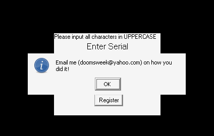
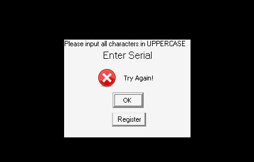

# crackmes.de's d00msweek039s_crackme_2 by doomsweek

| | |
|---|---|
| **ID** | [`5ab77f5633c5d40ad448c2c5`](https://crackmes.one/crackme/5ab77f5633c5d40ad448c2c5) |
| **Auteur (site)** | crackmes.de (doomsweek) |
| **Auteur (local)** | crackmes-de |
| **Plateforme** | Windows PE32 GUI, Visual Basic 6 (code natif) |
| **Difficulté** | 1.0 |
| **SHA-256 (zip)** | `ec3af69e70e2405461190f6e7a1a2a1b7b30d396f2e61cefb01fe914e7315400` |
| **SHA-256 (`d00m2.exe`)** | `9db8e7717d35ce100fc9d927ea4794694762e65f05f63c75c00b208482a66794` |

## Solution

Keygen : le « serial » est 3 lettres majuscules (une par case), le **code** vaut

```
Code = "ZYX" + atbash(L1) + atbash(L2) + atbash(L3) + "XXX"      (atbash : A↔Z, B↔Y, … M↔N)
```

Le serial doit tenir en 3 lettres : l'exemple habituel `petik` devient donc **`PET`**.

| Serial (cases 1-2-3) | Code |
|---|---|
| `P` `E` `T` | **`ZYXKVGXXX`** |
| `A` `A` `A` | `ZYXZZZXXX` |

```bash
tools/d00m2-solve.py PET                       # serial PET -> code ZYXKVGXXX
tools/d00m2-solve.py --check PET ZYXKVGXXX     # Congrats!
tools/verify-wine.sh PET ZYXKVGXXX             # preuve live (wine + runtime VB6 + Xvfb)
```

## Premier regard

```text
$ file original/d00m2.exe
PE32 executable for MS Windows 4.00 (GUI), Intel i386, 3 sections
$ diec original/d00m2.exe
Linker: Microsoft Linker(6.0)   Compiler: Visual Basic(6.00.8041)[Native]
```

Une fiche `frmMain` (« CrackMe 2 by d00msweek ») : « Please input all characters in
UPPERCASE », « Enter Serial » avec **trois petites cases** (`Text1`..`Text3`), « Enter Code »
avec `txtCode`, et un bouton `Command1` (« Register »).



Imports MSVBVM60 utiles : `__vbaStrCmp`, `__vbaVarCopy`, `__vbaVarAdd`, `__vbaVarTstEq`,
`rtcMsgBox` (ordinal 595). Chaînes UTF-16 (`strings -el`) :

```text
Email me (doomsweek@yahoo.com) on how you did it!   Congrats!
Try Again!   Sorry! :p
```

…plus, dans `.text`, les 26 lettres `A`..`Z` et deux blocs `ZYX` (`0x401a60`) et `XXX` (`0x401a6c`).

## Reverse

Tout est dans **`Command1_Click`** (`0x4022b0`, un seul gros handler ; extraits dans
[`analysis/disasm.txt`](analysis/disasm.txt)).

### 1. Cascade de 78 comparaisons (Atbash)

Le handler répète **26 fois par case** le même bloc : lecture de `.Text` d'un contrôle
(getter de la fiche `[vtbl+0x2fc]`, `+0x300` ou `+0x304`, puis `get_Text` = `[vtbl+0xa0]`),
`__vbaStrCmp` avec une lettre, et si égalité `__vbaVarCopy` d'une **autre** lettre dans une
Variant locale :

```asm
40232e  call [edx+0x2fc]            ; case 1
402348  call [ecx+0xa0]             ; .Text -> [ebp-0x48]
402366  push [ebp-0x48]
40236a  push 0x401990               ; "A"
40236f  call __vbaStrCmp
402392  test di, di                 ; égal ?
4023a0  mov  [ebp-0xb4], 0x401998   ; "Z"
4023aa  mov  [ebp-0xbc], 8          ; VT_BSTR
4023b4  call __vbaVarCopy           ; v24 = "Z"
...
4023f9  push 0x4019a0               ; "B"   ->  "Y"   (0x4019a8)
```

En extrayant automatiquement les 78 triplets (contrôle, lettre comparée, lettre copiée)
on obtient exactement `A→Z, B→Y, …, Z→A` pour chaque case, c.-à-d. un **Atbash** :

| Contrôle (getter) | Variant destination |
|---|---|
| case 1 (`+0x2fc`) | `[ebp-0x24]` |
| case 2 (`+0x300`) | `[ebp-0x34]` |
| case 3 (`+0x304`) | `[ebp-0x44]` |

Comme la comparaison porte sur le `.Text` **entier**, chaque case doit contenir une seule
lettre majuscule (d'où l'avertissement « UPPERCASE ») ; sinon la Variant reste vide.

### 2. Construction du code et test

```asm
404cf2  call [edx+0x314]            ; txtCode
404d0c  call [ecx+0xa0]             ; .Text  -> Variant [ebp-0x9c] (VT_BSTR|VT_BYREF)
404d71  mov  [ebp-0xb4], 0x401a60   ; "ZYX"
404d7b  mov  [ebp-0xc4], 0x401a6c   ; "XXX"
404d85  call __vbaVarAdd            ; "ZYX" + v24
404d90  call __vbaVarAdd            ;       + v34
404d9b  call __vbaVarAdd            ;       + v44
404dac  call __vbaVarAdd            ;       + "XXX"
404daf  call __vbaVarTstEq          ; == txtCode.Text ?
404e02  je   0x404e82               ; non -> "Try Again!" / "Sorry! :p"
404e18  ... 0x401ae0 "Congrats!"  + 0x401a78 "Email me …"  -> rtcMsgBox
```

`__vbaVarAdd` sur deux Variants chaînes = concaténation, d'où
`Code = "ZYX" & atbash(L1) & atbash(L2) & atbash(L3) & "XXX"`.

## Vérification

Sous wine (runtime VB6) dans un Xvfb privé, [`tools/verify-wine.sh`](tools/verify-wine.sh) tape
les trois lettres, le code, clique sur Register et cherche la MsgBox :

```text
$ tools/verify-wine.sh PET ZYXKVGXXX
MsgBox : Congrats!
$ tools/verify-wine.sh PET ZYXAAAXXX
MsgBox : Sorry! :p
```

| Bon code | Mauvais code |
|---|---|
|  |  |

## Status

- [x] reverse
- [x] write-up
- [x] solveur
