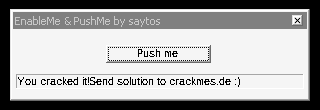
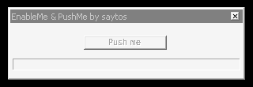

# EnableMe & PushMe #1 — saytos (crackmes.de)

- crackmes.one : [5ab77f5633c5d40ad448c2ee](https://crackmes.one/crackme/5ab77f5633c5d40ad448c2ee) — origine : [ORIGIN.yml](ORIGIN.yml)
- Auteur : saytos (archive crackmes.de, 2006) · Windows PE32 GUI · assembleur (MASM/FASM) · difficulté 2.0
- Consigne (`readme.txt`) : *« Patch this crackme, enable button "Push me". If press on button, you must see good_boy message. »*

## Fichiers

| Fichier | Rôle |
|---|---|
| `original/PushMe#1.zip` | archive d'origine (`PushMe#1.exe` 5 120 o + `readme.txt`) |
| `tools/crackmes-de-enableme_pushme_1_by_saytos-solve.py` | patcher (`--check` pour tester un exe, `--no-ep` pour XP pur) |
| `tools/wine-xdotool-check.sh` | lancement sous wine + clic « Push me » + capture |
| `analysis/ok-patched.png` | exe patché : bouton actif, good boy affiché |
| `analysis/ko-original-ep-only.png` | exe d'origine (seul le correctif d'entrée Wine) : bouton grisé |

## Réponse

C'est un **patchme** : pas de serial. Patch minimal retenu :

| VA | Offset fichier | Avant | Après |
|---|---|---|---|
| `0x401185`–`0x4011A7` (35 o) | `0x585` | `CreateThread(…401088…)` + `call 401233` + `call 401313` | `push 1` / `push [0x40200C]` / `call [EnableWindow]` + `nop`×21 |
| `0x4010E1` (4 o, compat Wine) | `0x4E1` | `pusha` / `cmp eax,1` | `xor eax,eax` / `jmp 0x4010FD` |

```bash
python3 tools/crackmes-de-enableme_pushme_1_by_saytos-solve.py PushMe#1.exe PushMe#1_patched.exe
# clic sur « Push me » → « You cracked it!Send solution to crackmes.de :) »
```

## Premier regard

```
$ file PushMe#1.exe
PE32 executable for MS Windows 4.00 (GUI), Intel i386, 4 sections   (.code .data .idata .rsrc)
$ objdump -p PushMe#1.exe   # imports
KERNEL32 : CreateThread ExitProcess ExitThread GetModuleHandleA OpenProcess
           ReadProcessMemory Sleep WriteProcessMemory
USER32   : DialogBoxParamA EnableWindow EndDialog GetDlgItem
           GetWindowThreadProcessId IsWindowEnabled SendMessageA
```

Le trio `OpenProcess` / `ReadProcessMemory` / `WriteProcessMemory` sur **son propre processus**, plus `CreateThread`, annonce tout de suite un anti-patch : des threads qui relisent le code et le restaurent. `strings` ne montre aucun message lisible : le texte de victoire est chiffré dans `.data` (`0x40201C`, 0x2E octets, XOR `0x40`) :

```python
>>> bytes(b ^ 0x40 for b in data[0x81c:0x81c+0x2e])
b'You cracked it!Send solution to crackmes.de :)'
```

## Flow

1. **Entrée `0x4010E1`** : petite boucle d'obfuscation (`pusha`, `call`/`jmp`/`inc eax` jusqu'à `eax == 1`, puis `add esp,8` / `popa`). Elle suppose **EAX = 0 au point d'entrée** (cas de Windows XP). Puis `GetModuleHandleA(eax=0)` et `DialogBoxParamA(hInst, 1, 0, DlgProc=0x401123, 0)`.
2. **`WM_INITDIALOG` (`0x401157`)** : `hButton = GetDlgItem(hDlg, 0x291)` → `[0x40200C]`, `hText = GetDlgItem(hDlg, 0x18B)` → `[0x402014]`, puis lancement de **3 threads** :
   - **B** `0x401088` : `OpenProcess` sur son propre PID, puis toutes les 60 ms : si `IsWindowEnabled(hButton)` → `EnableWindow(hButton, FALSE)` et `[0x402058] += 0x41` ;
   - **C** `0x40124F` (4 tours × 2×300 ms puis `ExitThread`) : relit l'octet `0x4010C0` (le `je` du thread B) ; s'il ≠ `0x74` → le restaure et `[0x402058] += 0x40` ; relit `0x4010C3` (le `push 0` = argument FALSE d'`EnableWindow`) et le remet à `0` ;
   - **A** `0x401000` : toutes les 40 ms relit 2 octets à `0x4011E0` (le `je 0x40122C` du check final, `74 4A`) ; s'ils sont modifiés → les restaure et `[0x402058] += 0x20`.
3. **`WM_COMMAND` id `0x291` (`0x4011AF`)** : le check du clic.

## Comment on trouve le patch

### Le prédicat du good boy

```asm
4011bd  mov  eax, [0x402058]      ; compteur d'intégrité, init 0x1BD (.data)
4011c2  mov  ebx, [0x40205C]      ; constante 0x43
4011c8  xor  eax, ebx
4011ca  cmp  eax, 0x1FE           ; 0x1BD ^ 0x43 = 0x1FE  -> OK tant que personne n'a triché
4011cf  jne  0x40122C
4011d1  push [0x40200C]           ; hButton
4011d7  call IsWindowEnabled
4011dd  cmp  eax, 0
4011e0  je   0x40122C             ; <- surveillé par le thread A
4011e2  ... XOR 0x40 sur 0x2E octets @0x40201C, Sleep(1000)
401209  SendMessageA(hText, 0x0C /*WM_SETTEXT*/, 0, 0x40201C)
```

Dans `.data` : `0x402058 = BD 01 00 00` et `0x40205C = 43 00 00 00`. Donc **sans aucune pénalité le compteur est déjà bon** ; il suffit que le bouton soit **actif** au moment du clic (et qu'on n'ait pas déclenché une pénalité, qui est cumulative et définitive : `+0x20`, `+0x40`, `+0x41`).

### Pourquoi les patchs « évidents » échouent

- Activer le bouton de l'extérieur (ou via un patch de ressource) : le thread B le regrise en ≤ 60 ms **et** ajoute `0x41` au compteur → plus jamais `0x1FE`.
- Patcher le `je` du thread B (`0x4010C0`) ou son `push 0` (`0x4010C3`) : le thread C les restaure dès son premier tour (`+0x40` pour le `je`).
- Patcher le `je` du check final (`0x4011E0`) : le thread A le restaure en ≤ 40 ms et ajoute `0x20`.

Les gardiens ne surveillent que ces 3 adresses-là ; **rien ne relit le code de `WM_INITDIALOG`**. On frappe donc à la source : là où les threads sont créés.

### Le patch

`0x401185`–`0x4011A7` (35 octets) contiennent `mov eax,0x401088` + `CreateThread` du thread B, puis `call 0x401233` (crée C) et `call 0x401313` (crée A). On les remplace par :

```asm
401185  6A 01              push 1                 ; TRUE
401187  FF 35 0C 20 40 00  push [0x40200C]        ; hButton (déjà rempli juste au-dessus)
40118D  FF 15 42 31 40 00  call [EnableWindow]    ; IAT 0x403142
401193  90 × 21            nop                    ; jusqu'à 4011A8 : mov eax,1 (retour TRUE)
```

Plus aucun thread → aucune pénalité → compteur `0x1BD`, bouton actif → `0x1BD ^ 0x43 == 0x1FE` et `IsWindowEnabled ≠ 0` → message déchiffré et affiché dans l'edit `0x18B`.

### Correctif d'entrée (Wine / Windows ≥ 7)

Sous Wine, l'exe d'origine plante immédiatement (`err:virtual:virtual_setup_exception stack overflow`). La boucle d'entrée fait, à chaque tour, deux `call` jamais dépilés et `inc eax` jusqu'à `eax == 1` : avec EAX = 0 (XP) il n'y a qu'un tour et `add esp,8` nettoie ; avec EAX = adresse d'entrée (Wine) il faudrait ~4 milliards de tours → la pile explose. Et `GetModuleHandleA` reçoit justement EAX en argument (il faut `NULL`). D'où, à `0x4010E1` : `31 C0 EB 18` = `xor eax,eax ; jmp 0x4010FD` (on saute `pusha`/boucle/`popa`, on garde `push eax ; call GetModuleHandleA`). Ce correctif ne touche pas à la protection ; `--no-ep` le désactive pour un XP « pur ».

## Vérification

```bash
xvfb-run -a -s "-screen 0 800x600x24" tools/wine-xdotool-check.sh patched.exe analysis/ok-patched.png
xvfb-run -a -s "-screen 0 800x600x24" tools/wine-xdotool-check.sh ko.exe     analysis/ko-original-ep-only.png
```

- OK (patch complet) : bouton actif, après clic + 1 s → **« You cracked it!Send solution to crackmes.de :) »** — 
- KO (seulement le correctif d'entrée, protection intacte) : « Push me » grisé, le clic ne fait rien — 

## Notes

- Ce n'est pas un keygenme : aucune saisie, la seule « clé » est l'état du compteur `0x402058`.
- Le `int3` à `0x40114A` n'est jamais exécuté (le thread C saute à `0x40114B` : `ExitThread(1)`).
- Patch alternatif possible : forcer `jne`/`je` du check final… mais il faut alors aussi neutraliser A et B, donc plus d'octets touchés que la solution retenue.
