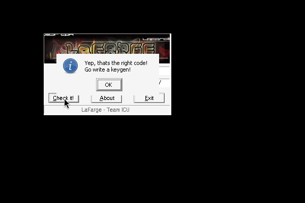
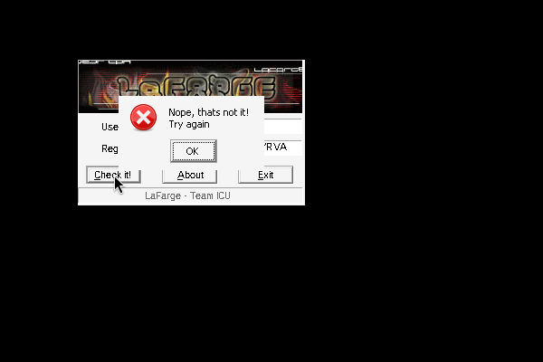

# crackmes.de's crackme_v0.2 by lafarge (Team ICU)

| | |
|---|---|
| **ID** | [`5ab77f5633c5d40ad448c2f0`](https://crackmes.one/crackme/5ab77f5633c5d40ad448c2f0) · [`ORIGIN.yml`](ORIGIN.yml) |
| **Auteur (site)** | crackmes.de (LaFarge, Team ICU) |
| **Plateforme** | Windows PE32 (GUI, DialogBox, asm), i386 |
| **SHA-256 (zip)** | `93a211ed0db2559c8d8f8bc3c657b73a3fe37f3601152917665a41f64498597b` |

## Fichiers

| Chemin | Rôle |
|---|---|
| `original/lafarge__s.crackme.0.2.crackme-icu.zip` | archive d'origine (`crackme.exe`, `ICU.nfo`, `File_ID.Diz`) |
| `analysis/ex/` | contenu dézippé (copie de travail) |
| `analysis/dis.txt` | `objdump -d -M intel` de `crackme.exe` |
| `analysis/screenshot-ok.png`, `screenshot-ko.png` | preuve live sous Wine |
| `tools/lafarge-crackme02-solve.py` | keygen (`-q`, `--check <exe>`) |

## Réponse

Keygen nom → serial (`XXXX-XXXX-XXXX-XXXX`, majuscules A–Y) :

| Nom | Serial |
|---|---|
| `petik` | **`WXJK-ROOT-SYQM-YRVV`** |

```bash
python3 tools/lafarge-crackme02-solve.py petik            # name=petik  serial=WXJK-ROOT-SYQM-YRVV
python3 tools/lafarge-crackme02-solve.py -q petik         # serial seul
python3 tools/lafarge-crackme02-solve.py petik --check analysis/ex/crackme.exe   # compare au vrai code (unicorn)
```

Nom ≥ 4 caractères obligatoire.

## Premier regard

```bash
unzip -P crackmes.one original/*.zip -d analysis/ex
file analysis/ex/crackme.exe     # PE32 GUI i386, 4 sections, non packé
strings -n 5 analysis/ex/crackme.exe
```

- Le `.nfo` annonce « simple algo for all newbie keygenners » : keygen attendu, pas de patch.
- `strings` : `"Dont look at my fucking code !!!!"` (leurre), messages `Yep, thats the right code!`, `Nope, thats not it!`, `Ummm, no serial entered!`, `Username must have at least 4 chars...`.
- Imports : `DialogBoxParamA`, `SendDlgItemMessageA`, `lstrcmpA`, `lstrcpyA`, `lstrlenA`, `waveOut*` (musique de fond tracker dans une ressource, sans intérêt pour le check).

## Flow

Les API sont appelées via des thunks `jmp [IAT]` en `.text` (`0x401318…0x40137e`). La DlgProc (`0x4010ba`) traite :

- `WM_INITDIALOG` (0x110) : icône, lance la musique ;
- `WM_COMMAND` (0x111) avec ID `0x3ec` = bouton **Check it!** → routine de check `0x401132…0x4012bc` ; `0x3ee` = Exit ; `0x3ed` = About.

## Comment on trouve le prédicat

**Ancrage** : le seul `lstrcmpA` passe par le thunk `0x401372` (`jmp [0x405034]`), appelé une seule fois en `0x401285`. On remonte à partir de là.

```asm
40113d  call GetDlgItem        ; ctrl 0x3ea = champ Username
401142  push 0x406384 / push 0x40 / push 0xd(WM_GETTEXT) → SendMessageA
401151  cmp eax,3 ; ja ok      ; sinon "Username must have at least 4 chars..."
40116e  push 0x406ba4 ; call lstrlenA   → [0x406b9c] = A = 16      (constante .data)
40117f  push 0x406384 ; call lstrlenA   → [0x406b98] = B = len(nom)
401192  lstrcpyA(0x406584, 0x406ba4)    ; buf = copie de la constante
4011ad  cmp B,A ... → [0x406ba0] = max(A,B)   ; nombre d'itérations
```

Boucle (`0x4011c7…0x4011fd`, `esi` = i, de 0 à `max(A,B)-1`) :

```asm
4011c9  push 0x19            ; ...
4011cc  idiv [0x406b9c]      ; edx = i % A      (A = 16)
4011d5  lea  ecx,[edi+edx]   ; ecx = &buf[i % 16]    (edi = 0x406584)
4011d9  idiv [0x406b98]      ; edx = i % B
4011e5  movzx eax,[0x406384+edx]   ; nom[i % B]
4011e9  movzx edx,[ecx]            ; buf[i % 16]
4011ec  xor  eax,edx
4011ef  idiv ebx             ; ebx = 0x19 (pop ebx) → edx = (nom ^ buf) % 25
4011f1  add  dl,0x41         ; + 'A'
4011fb  mov  [ecx],dl        ; buf[i % 16] = résultat
```

Soit : `buf[i%16] = ((nom[i%len] ^ buf[i%16]) % 25) + 0x41`, avec `buf` initialisé par la constante `.data` @0x406ba4 :
`5f 72 20 3c 28 29 3c 31 2d 5a 32 5b 6c 35 2c 5e` = `_r <()<1-Z2[l5,^` (16 octets, `lstrlenA` = 16).

Les 16 octets de `buf` sont ensuite recopiés par 4 `movsd` en `0x406b84` avec un `-` (0x2d) inséré après chaque groupe de 4 : `XXXX-XXXX-XXXX-XXXX`. Le serial saisi (ctrl `0x64`, `WM_GETTEXT` → `0x406584`) est comparé à `0x406b84` par `lstrcmpA` ; si vide → « no serial entered ».

Exemple `petik` (len 5, 16 itérations) : à chaque tour `i`, `buf[i] ^= 'p','e','t','i','k','p',...` puis réduction mod 25 + 'A'. Au 1er tour : `'_'(0x5f) ^ 'p'(0x70) = 0x2f = 47`, `47 % 25 = 22`, `+0x41 = 'W'` → premier caractère `W`. Les positions sont indépendantes ici (i < 16 ne touche chaque `buf[j]` qu'une fois), d'où le serial final `WXJK-ROOT-SYQM-YRVV`.

**Pièges** : (1) le `push 0x19 / pop ebx` est dans la boucle, ne pas le confondre avec le `push eax / pop eax` autour ; (2) pour un nom > 16 caractères, la boucle fait `len(nom)` tours et `buf[j]` est réécrit plusieurs fois (le keygen reproduit cela avec `max(16, len)`) ; (3) la constante `0x406ba4` est utilisée telle quelle (pas déchiffrée au runtime), confirmé par unicorn et Wine.

## Vérification

- **Unicorn** : `--check` charge `.text`/`.data` du PE, émule le vrai code de `0x40116e` à `0x401248` (thunks `lstrlenA`/`lstrcpyA` simulés) et compare `0x406b84` au keygen — OK pour `petik`, `abcd` et un nom de 33 caractères.
- **Wine live** (`xvfb-run -a wine`, saisie par `xdotool`, capture `ffmpeg x11grab`) :
  - OK : `petik` / `WXJK-ROOT-SYQM-YRVV` → « Yep, thats the right code! Go write a keygen! » — 
  - KO : `petik` / `WXJK-ROOT-SYQM-YRVA` → « Nope, thats not it! Try again » — 

## Notes

- Pas de GDB ni de debugger : reverse statique (`objdump`), unicorn et Wine.
- MCP `ida`/x64dbg non utilisés.
- Le texte « Dont look at my fucking code » est un simple leurre ; aucun anti-debug n'intervient dans le check.
