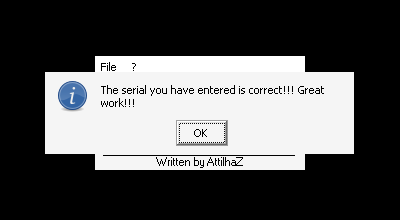

# crackmes.de's crackme01 by attilhaz

| | |
|---|---|
| **ID** | [`5ab77f5733c5d40ad448c30f`](https://crackmes.one/crackme/5ab77f5733c5d40ad448c30f) · [`ORIGIN.yml`](ORIGIN.yml) |
| **Auteur** | attilhaz (mirror crackmes.de) |
| **Plateforme** | Windows PE32 GUI, Visual Basic 6 **natif** (MSVBVM60) |
| **SHA-256 (zip)** | `f246e93d5e445b57d0b5713b74717d765486a965b5b3b7d85b0ad71949cebcd4` |
| **Type** | serial en dur (pas de nom) |

## Fichiers

| Chemin | Contenu |
|---|---|
| `original/crackme01.zip` | archive d'origine (mdp `crackmes.one`) : `Crackme01.exe` + `Readme.txt` — jamais modifiée |
| `tools/crackme01-solve.py` | affiche le serial (lu/validé dans l'exe extrait du zip) ; `--check` le teste sous Wine/Xvfb + un cas KO |
| `analysis/screenshot-ok.png` | MsgBox « The serial you have entered is correct!!! » sous Wine |
| `analysis/x/Crackme01.exe` | exe extrait (copie de travail) |

## Réponse

**Serial : `Rmth2hm89T21`**

```bash
python3 -I tools/crackme01-solve.py -q          # → Rmth2hm89T21
python3 -I tools/crackme01-solve.py --check     # Wine + Xvfb + xdotool
```

Aucun champ nom : `petik` n'a pas lieu d'être comme user ; on l'utilise seulement comme serial **faux** pour le test KO.

## Premier regard

```bash
unzip -P crackmes.one original/crackme01.zip -d analysis/x
file analysis/x/Crackme01.exe     # PE32 GUI i386, 3 sections (.text .data .rsrc)
strings -n 5 analysis/x/Crackme01.exe      # MSVBVM60.DLL, __vbaStrCmp, __vbaNew2…
strings -el -n 3 analysis/x/Crackme01.exe  # chaînes UTF-16 (VB6)
```

- Imports `MSVBVM60.DLL` → VB6 **natif** (code x86 réel, pas du P-code).
- `strings -el` donne les messages : `The serial you have entered is correct!!! Great work!!!` / `…invalid. Try again!!!`, `You cannot patch me. Find the serial!!!` et, juste à côté, une chaîne qui n'est ni un message ni un titre : **`Rmth2hm89T21`**.
- `Readme.txt` : « you must find the correct serial… No patches are allowed ».

## Flow

Fenêtre « Crackme01 » : menu File / ?, label `Serial:`, champ `Text1`, bouton `Command1` (OK). Au clic, le handler compare `Text1.Text` à une constante ; MsgBox « Great!!! » (icône info) si égal, sinon « Try again ».

## Comment on trouve

Ancrage : `objdump -d -M intel Crackme01.exe` (pas de symboles). Le handler du bouton est la fonction vers `0x402340` ; on y arrive en cherchant les xrefs vers `__vbaStrCmp` (IAT `0x40103c`, vu avec `objdump -p`).

```asm
402380: call DWORD PTR [edx+0x300]   ; Text1 (accesseur de contrôle via vtable de la form)
40238b: call ds:0x401020             ; __vbaObjSet
40239a: call DWORD PTR [ecx+0xa0]    ; Text1.get_Text → BSTR dans [ebp-0x18]
4023bb: push eax                     ; arg1 = texte saisi
4023bc: push 0x4019bc                ; arg2 = BSTR constant (UTF-16LE) = "Rmth2hm89T21"
4023c1: call ds:0x40103c             ; __vbaStrCmp (0 si égal)
4023cc: neg esi / sbb esi,esi / inc esi / neg esi   ; idiome VB : esi = (cmp==0) ? -1 : 0 (True/False)
```

Le saut vers la MsgBox « correct » / « invalid » dépend de ce booléen. Vérification de la constante : `python3 -c` cherchant `'Rmth2hm89T21'.encode('utf-16le')` dans le fichier → offset fichier `0x19bc` = VA `0x4019bc` (section `.text` : file off = VA − 0x400000), exactement l'argument poussé en `0x4023bc`.

Pièges : chaîne en UTF-16 (invisible avec `strings` ANSI seul → `-el`) ; l'idiome `neg/sbb/inc/neg` est le « = » VB (True = −1), pas un calcul sur le serial. Aucun calcul : le serial est constant.

## Vérification

Sous Wine avec Xvfb (fenêtre 210×114 en (295,256) ; champ ≈ (400,316), OK ≈ (455,336)), pilotage `xdotool` :

```text
$ python3 -I tools/crackme01-solve.py --check
Serial : Rmth2hm89T21
Rmth2hm89T21 -> ['Crackme01', 'Great!!!']      # OK
petik -> ['Crackme01', 'Try again']            # KO
```

Capture du cas OK : 

## Notes

- Pas d'anti-debug ni de dérivation ; le message « You cannot patch me » est un simple texte.
- Aucun GDB / x64dbg / IDA utilisé : reverse statique (`objdump`) + preuve Wine.
