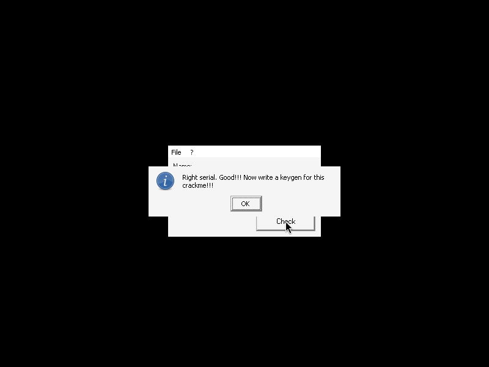

# crackmes.de's crackme21 by attilhaz

| | |
|---|---|
| **ID** | [`5ab77f5733c5d40ad448c313`](https://crackmes.one/crackme/5ab77f5733c5d40ad448c313) · [`ORIGIN.yml`](ORIGIN.yml) |
| **Auteur** | attilhaz (mirror crackmes.de) |
| **Plateforme** | Windows PE32 GUI, Visual Basic 6 **natif** (MSVBVM60) |
| **SHA-256 (zip)** | `69e56f2d247eed521c1a63c81b96921b65fcfcf40e216be7417dc566d83ccc60` |
| **Type** | keygen name → serial |

## Fichiers

| Chemin | Contenu |
|---|---|
| `original/crackme21.zip` | archive d'origine (mdp `crackmes.one`) : `Crackme21.exe` + `Readme.txt` — jamais modifiée |
| `tools/crackme21-solve.py` | keygen ; `--check` teste sous Wine/Xvfb (cas OK + KO) |
| `analysis/dis-from-4011d0.txt` | `objdump -d` à partir de `0x4011d0` (code VB) |
| `analysis/gdb-encrypt.gdb` | script gdb utilisé pour lire les valeurs réelles |
| `analysis/screenshot-ok.png` / `screenshot-ko.png` | MsgBox « Right serial » / « Wrong serial » sous Wine |

## Réponse

| Nom | Serial |
|---|---|
| `petik` | **`ZA-AAU`** |
| `abcdefg` | `KX-MZO-AQ` |

```bash
python3 -I tools/crackme21-solve.py -q                 # → ZA-AAU
python3 -I tools/crackme21-solve.py --user abcdefg
python3 -I tools/crackme21-solve.py --check            # Wine + Xvfb + xdotool
```

Le `Readme.txt` demande un serial pour son nom, un patch, un keygen : on fait le keygen (le patch serait trivial : forcer le `je` @`0x402c5d`).

## Premier regard

```bash
unzip -P crackmes.one original/crackme21.zip -d /tmp/c21
diec /tmp/c21/Crackme21.exe      # PE32, MS Linker 6.0, Visual Basic 6 [Native]
strings -n 4 /tmp/c21/Crackme21.exe       # MSVBVM60.DLL, « EncryptPassword », __vbaStrCmp…
strings -el -n 4 /tmp/c21/Crackme21.exe   # messages UTF-16
```

- Le nom de méthode `EncryptPassword` apparaît dans les métadonnées VB.
- Messages : `Wrong serial. Try again!!!` / `Right serial. Good!!! Now write a keygen for this crackme!!!` (titre `Congrats!!!`).
- UI : `Name:` (Text1), `Serial:` (Text2), bouton `Check`, plus un `Text3` **caché** qui sert de compteur.

## Flow

`Check_Click` (@`0x402ab0`) : `Text1.Text` (vtable form `+0x308`) → `EncryptPassword(nom, clé=10)` (méthode form `+0x6f8`, @`0x402580`) → comparé à `Text2.Text` (`+0x304`) par `__vbaVarTstNe` ; égal → MsgBox « Right serial » ; sinon « Wrong serial ».

## Comment on trouve

Ancrage : `objdump -d -M intel --start-address=0x4011d0 Crackme21.exe` (les imports MSVBVM60 sont dans `.text`, un désassemblage depuis `0x401000` donne du bruit). Le handler `Check` appelle une méthode de la form avec **un octet** `0x0a` (`__vbaUI1I2(10)` @`0x402b71`) : c'est la clé.

`EncryptPassword` @`0x402580` — boucle `i = 1..Len(nom)` :

```asm
4025dc  call __vbaUI1I2          ; i (octet) ; i == Len+1 → sortie (0x4028ac)
402630  call rtcMidCharVar       ; Mid(nom, i, 1)
402645  call rtcAnsiValueBstr    ; Asc(...)  → [ebp-0x1c]
; compteur caché : Text3.Text = CStr(Val(Text3.Text) + 1.0)       (0x4026c5 : fadd 1.0)
402775  call __vbaStrCmp(Text3.Text,"3")
        → si égal : Text3.Text = "0" et acc &= "-"                (0x401a24 / 0x401a2c)
; i impair : a = Asc + clé       i pair : a = Asc - clé     (0x402808 : and ax,1)
402839  mov dx,0xa ; sub dx,cx   ; dx = 10 - clé = 0  → a ^= 0 (sans effet avec clé=10)
40284a  cmp ax,0x41 ; jge → sinon ax += 0x21
40285a  cmp ax,0x5a ; jle fin → sinon ax -= 0x20 ; retour 40284a   ; ramène dans 'A'..'Z'
402874  Chr(ax) ; acc = acc & Chr(ax)
```

Détails :
- **Tirets** : `Text3` vaut `"0"` au départ (remis à `"0"` à la fin). À l'itération 3, 6, 9… un `-` est ajouté *avant* le caractère courant → `c1 c2 - c3 c4 c5 - c6 c7 c8 …`.
- **Normalisation** : boucle 16 bits signée ; `a < 0x41` → `+0x21`, `a > 0x5a` → `−0x20`, jusqu'à tomber dans `A..Z` (ex. `e`=0x65, pair → 0x5b → 0x3b+… → `A`).
- Exemple `petik` : `p` (i=1, +10) = 0x7a → 0x5a `Z` ; `e` (i=2, −10) = 0x5b → `A` ; i=3 → `-` puis `t` (+10) = 0x7e → 0x5e → 0x3e → 0x5f → 0x3f … → `A` ; `i` (i=4, −10) → `A` ; `k` (i=5, +10) = 0x75 → 0x55 `U` ⇒ **`ZA-AAU`**.

### Debug GDB (pas à pas)

Pas de gdb « lancé sur le binaire » : le PE tourne sous Wine, on s'attache au processus.

```bash
xvfb-run -a wine Crackme21.exe &          # ou DISPLAY=:97 Xvfb + wine
gdb -q -nx -batch -p $(pgrep -f 'Crackme21.exe$') -x analysis/gdb-encrypt.gdb
```

- `break *0x402874` : avant `Chr()` ; `$bl` = i, `$ax` = caractère calculé → `i=1 ax=90 (Z)`, `2 → 65 (A)`, `3 → 65`, `4 → 65`, `5 → 85 (U)`.
- `break *0x4028ac` (sortie de boucle) : `x/ws *(int*)($ebp-0x18)` → accumulateur UTF-16 = `ZA-AAU`.
- Piège : le champ Nom n'était pas vidé entre deux essais (`petikpetik`, 10 itérations) → mon premier test « faux » venait de là ; le script de `--check` vide les champs (End + BackSpace). Le modèle initial (préfixe au lieu d'append) a été tranché par ce dump.
- Piège Wine/gdb : processus 32 bits → gdb passe par `__kernel_vsyscall`, pas de symboles (`printf %ls` indisponible, utiliser `x/ws`).

## Vérification

```text
$ python3 -I tools/crackme21-solve.py --check
petik -> ZA-AAU
OK  : ['Congrats!!!', 'Crackme21']          # analysis/screenshot-ok.png (Right serial. Good!!!)
KO  : ['Crackme21', 'Error']                # analysis/screenshot-ko.png (Wrong serial. Try again!!!)
```



## Notes

- La clé `10` rend le XOR `(10 - clé)` neutre ; avec une autre clé, `EncryptPassword` changerait aussi le décalage ±clé (le keygen gère les deux).
- Le compteur dans une `TextBox` cachée est une obfuscation : il n'influence que la position des tirets.
- Le serial dépend de la **position** (parité) et du caractère, pas d'une somme globale : pas de collision utile entre noms.
