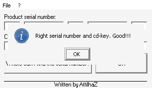

# crackmes.de's crackme09 by attilhaz

| | |
|---|---|
| **ID** | [`5ab77f5733c5d40ad448c315`](https://crackmes.one/crackme/5ab77f5733c5d40ad448c315) · [`ORIGIN.yml`](ORIGIN.yml) |
| **Auteur** | attilhaz (mirror crackmes.de) |
| **Plateforme** | Windows PE32 GUI, Visual Basic 6 **natif** (MSVBVM60) |
| **SHA-256 (zip)** | `f5e2c496cfc9333afe66a4005f47fbc6a4ebe1ed1a1af4497bacef167ea4c748` |
| **Type** | keygen : 5 champs « serial » + 1 champ « Cd-Key » dérivé |

## Fichiers

| Chemin | Contenu |
|---|---|
| `original/crackme09.zip` | archive d'origine (mdp `crackmes.one`) : `Crackme09.exe` + `Readme.txt` — jamais modifiée |
| `tools/crackme09-solve.py` | keygen (`-q`, `--f1/--f3/--f5`) ; `--check` teste l'exe sous Wine/Xvfb (cas OK + 2 cas KO) |
| `analysis/screenshot-ok.png` | MsgBox « Right serial number and cd-key. Good!!! » sous Wine |

## Réponse

Les champs 1, 3 et 5 sont **libres** (≤ 4 caractères observés), les champs 2 et 4 sont des constantes, le Cd-Key se déduit des champs libres.

| Champ | Valeur |
|---|---|
| Serial 1 | `F1` (libre) — ex. `pe` |
| Serial 2 | `Arcx0d21` |
| Serial 3 | `F3` (libre) — ex. `ti` |
| Serial 4 | `rNtp4v21` |
| Serial 5 | `F5` (libre) — ex. `k` |
| Cd-Key | `Fc` + F1 + `3d7` + F3 + `jk21` + F5 + `fr1a` |

Exemple avec `petik` découpé en `pe` / `ti` / `k` : serial `pe | Arcx0d21 | ti | rNtp4v21 | k`, **Cd-Key `Fcpe3d7tijk21kfr1a`**.

```bash
python3 -I tools/crackme09-solve.py                 # pe | Arcx0d21 | ti | rNtp4v21 | k  +  Fcpe3d7tijk21kfr1a
python3 -I tools/crackme09-solve.py -q --f1 ab --f3 cd --f5 ef
python3 -I tools/crackme09-solve.py --check --shot analysis/screenshot-ok.png   # Wine + Xvfb + xdotool
```

Pas de champ nom : `petik` sert seulement à remplir les trois champs libres.

## Premier regard

```bash
unzip -P crackmes.one original/crackme09.zip -d /tmp/cm9
file /tmp/cm9/Crackme09.exe        # PE32 GUI i386, 3 sections (.text .data .rsrc)
diec  /tmp/cm9/Crackme09.exe       # Microsoft Linker 6.0, Visual Basic 6 [Native]
strings -el -n 4 /tmp/cm9/Crackme09.exe   # chaînes UTF-16 (BSTR VB6)
```

- `Readme.txt` : trouver serial + cd-key, patcher, keygen, autokeygen.
- Import unique `MSVBVM60.DLL` → code x86 natif (pas de P-code) : `__vbaStrCmp`, `__vbaVarCat`, `__vbaVarTstEq`…
- `strings -el` donne les messages (`No serial founded.`, `No cd-key founded.`, `Wrong Cd-Key!!!`, `Wrong serial number!!!`, `Right serial number and cd-key. Good!!!`) et, au milieu, des chaînes qui ne sont pas des messages : `Arcx0d21`, `rNtp4v21`, `Fc`, `3d7`, `jk21`, `fr1a`.

## Flow

Fenêtre « Crackme09 » : 5 petites TextBox (Text1..Text5, « Product serial number »), une grande (Text6, « Cd-Key »), bouton OK. Au clic :

1. un champ vide → MsgBox `No serial founded.` (Text1..3) ou `No cd-key founded.` (Text4..6) ;
2. Text2 ≠ `Arcx0d21` ou Text4 ≠ `rNtp4v21` → `Wrong serial number!!!` (titre `Errore`) ;
3. Text6 ≠ concaténation des constantes et de Text1/3/5 → `Wrong Cd-Key!!!` (titre `Error`) ;
4. sinon `Right serial number and cd-key. Good!!!` (titre `Congratution!!!`).

## Comment on trouve

Ancrage : `objdump -d -M intel Crackme09.exe` (`.text` à `0x401000`, offset fichier = VA − 0x400000). L'IAT de `MSVBVM60` (`objdump -p`) donne `__vbaStrCmp` = `0x401044`, `__vbaVarCat` = `0x40106c`, `__vbaVarTstEq` = `0x401048`. Le handler du bouton va d'environ `0x402c00` à `0x403640`.

Chaque champ est lu par `call [vtable+off]` sur la form, offset = `0x2fc + 4*(n-1)` : Text1 `0x2fc`, Text2 `0x304`, Text3 `0x308`, Text4 `0x30c`, Text5 `0x310`, Text6 `0x314`, puis `Text.get` (`[ecx+0xa0]`).

**Champs 2 et 4 — constantes** (`__vbaStrCmp`, BSTR UTF-16 en dur) :

```asm
403139: call ds:0x401028         ; __vbaObjSet(Text2) (vtable +0x304)
403148: call [ecx+0xa0]          ; .Text → BSTR [ebp-0x68]
40316a: push 0x401bc4            ; "Arcx0d21"
40316f: call ds:0x401044         ; __vbaStrCmp
40317a: neg edi / sbb edi,edi / neg edi / neg edi   ; booléen VB (≠ → -1)
403190: jne  0x4031fd            ; → "Wrong serial number!!!" (0x401ccc)
...
4031d1: push 0x401bdc            ; "rNtp4v21" comparé à Text4 (+0x30c)
```

**Cd-Key — concaténation de Variants.** Les trois champs libres sont copiés (`__vbaVarMove` `0x401008`) : Text1 → `[ebp-0x34]` (`0x4032f0`), Text3 → `[ebp-0x44]` (`0x40334c`), Text5 → `[ebp-0x54]` (`0x4033ac`). Puis 6 appels `__vbaVarCat` (`ebx = 0x40106c`) autour de `0x4033cb`–`0x40346f`, avec les constantes `Fc` (`0x401bf4`), `3d7` (`0x401c00`), `jk21` (`0x401c10`), `fr1a` (`0x401c20`) placées dans des Variants `0x8` :

```asm
4033d7: lea eax,[ebp-0x34]   ; Text1
4033e0: mov [ebp-0xd4],0x401bf4   ; "Fc"
...                              ; VarCat(dest, Text1, "Fc"), puis (…,"3d7"), (…,Text3), (…,"jk21"), (…,Text5), (…,"fr1a")
4034ac: call [edx+0x314]     ; Text6.Text
403500: call ds:0x401048     ; __vbaVarTstEq(Text6, résultat concaténé)
403524: test si,si ; je 0x4035bc   ; faux → "Wrong Cd-Key!!!"
```

Les 6 `VarCat` s'enchaînent en cascade (chaque résultat devient l'argument du suivant), l'ordre d'empilement des arguments est inversé par rapport à l'ordre des opérandes VB.

**Piège (ordre de concaténation).** Ma première lecture donnait `fr1a+F5+jk21+F3+3d7+F1+Fc` (j'avais pris le premier argument empilé pour l'opérande de droite) : `Wrong Cd-Key!!!` sous Wine, alors que les 5 champs serial étaient acceptés (le message prouve que l'étape 2 est passée). J'ai alors rejoué quelques ordres dans la même instance (champ Cd-Key vidé/retapé) : seul l'ordre inverse `Fc+F1+3d7+F3+jk21+F5+fr1a` donne « Right serial number and cd-key. Good!!! ». C'est donc l'ordre d'apparition des constantes dans l'asm (`Fc`, `3d7`, `jk21`, `fr1a`) qui est l'ordre de lecture, avec F1/F3/F5 intercalés.

Autres pièges : chaînes UTF-16 (invisibles avec `strings` ANSI seul → `-el`) ; l'idiome `neg/sbb/neg` est le `=` VB, pas un calcul sur les saisies ; les champs 1/3/5 n'ont **aucune** contrainte dans le code (la limite à 4 caractères observée vient de `MaxLength` des TextBox, pas du prédicat).

## Vérification

Sous Wine + Xvfb, pilotage `xdotool` (fenêtre en (247,224) ; champs serial y=276, x=271/335/399/463/527 ; Cd-Key (400,316) ; OK (491,351)) ; le résultat est lu via le titre de la MsgBox :

```text
$ python3 -I tools/crackme09-solve.py --check --shot analysis/screenshot-ok.png
Serial : pe | Arcx0d21 | ti | rNtp4v21 | k
Cd-Key : Fcpe3d7tijk21kfr1a
OK -> ['Congratution!!!', 'Crackme09']          # Right serial number and cd-key. Good!!!
KO cd-key -> ['Crackme09', 'Error']             # dernier caractère du cd-key changé → Wrong Cd-Key!!!
KO serial -> ['Crackme09', 'Errore']            # Text2 = "bad" → Wrong serial number!!!
```

Capture du cas OK : 

Vérifié aussi à la main avec d'autres valeurs libres (`ab`/`cd`/`ef` → `Fcab3d7cdjk21effr1a` accepté).

## Notes

- Le crackme n'a pas de dépendance à un nom ni à une machine : tout est constant, seule la dérivation du Cd-Key lie les champs.
- Reverse 100 % statique + preuve Wine ; pas de session GDB ni debugger live (pas de section « Debug GDB »).
- Patch / autokeygen demandés dans le `Readme.txt` : non faits ici (le keygen suffit au write-up) ; `original/` n'a pas été modifié.
