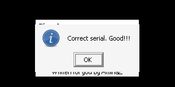

# crackmes.de's crackme14 by attilhaz

| | |
|---|---|
| **ID** | [`5ab77f5733c5d40ad448c316`](https://crackmes.one/crackme/5ab77f5733c5d40ad448c316) · [`ORIGIN.yml`](ORIGIN.yml) |
| **Auteur** | attilhaz (mirror crackmes.de) |
| **Plateforme** | Windows PE32 GUI, Visual Basic 6 **natif** (MSVBVM60) |
| **SHA-256 (zip)** | `bd9aeb0d546881f5ce0a06ea47bca4ff153d950019e0096ca58af563e8d45950` |
| **Type** | keygen : le serial n'est contraint que par sa **longueur** (15) |

## Fichiers

| Chemin | Contenu |
|---|---|
| `original/crackme14.zip` | archive d'origine (mdp `crackmes.one`) : `Crackme14.exe` + `Readme.txt` — jamais modifiée |
| `tools/crackme14-solve.py` | keygen (`-q`, `--name`) ; `--check` teste l'exe sous Wine/Xvfb (cas OK + 2 cas KO) |
| `analysis/screenshot-ok.png` | MsgBox « Correct serial. Good!!! » sous Wine |

## Réponse

**Tout serial de exactement 15 caractères est accepté.** Il n'y a pas de nom ni de calcul.

| Entrée | Serial |
|---|---|
| `petik` répété et tronqué à 15 | **`petikpetikpetik`** |

```bash
python3 -I tools/crackme14-solve.py                  # petikpetikpetik
python3 -I tools/crackme14-solve.py -q --name ab     # abababababababa
python3 -I tools/crackme14-solve.py --check --shot analysis/screenshot-ok.png   # Wine + Xvfb + xdotool
```

## Premier regard

```bash
unzip -P crackmes.one original/crackme14.zip -d /tmp/c14
file /tmp/c14/Crackme14.exe     # PE32 GUI i386, 3 sections (.text .data .rsrc)
diec /tmp/c14/Crackme14.exe     # Microsoft Linker 6.0, Visual Basic 6 [Native]
strings -n 4 /tmp/c14/Crackme14.exe
```

- `Readme.txt` : « Find the correct serial and make a keygen. You cannot patch it. »
- Import unique `MSVBVM60.DLL` : code x86 natif, pas de P-code. Parmi les imports, `__vbaLenBstr` (longueur d'une chaîne) mais **aucun** `__vbaStrCmp` / `__vbaVarTstEq` : le serial n'est donc pas comparé à une valeur.
- `strings` montre aussi `_CIcos`, `_CIsin`, `_CIsqrt`, `_CIlog`, `_adj_fptan`… : ce sont les stubs FPU habituels du runtime VB6, **pas** un calcul flottant du crackme (piège).
- Messages UTF-16 (`strings -el`, ou lecture directe des BSTR) : `Correct serial. Good!!!` / `Good!!!`, `Wrong serial. Try again!!!` / `Bad!!!`, `About`, `Rulez`.

## Flow

Fenêtre « Crackme14 » : menu `File` / `?`, une TextBox (Text1), un bouton `Check` (Command2) et le label « Written for you by AttilhaZ ». Au clic sur `Check` : MsgBox `Correct serial. Good!!!` (titre `Good!!!`) ou `Wrong serial. Try again!!!` (titre `Bad!!!`).

## Comment on trouve

Ancrage : `objdump -d -M intel --no-show-raw-insn Crackme14.exe` (`.text` à `0x401000`, offset fichier = VA − 0x400000). Les trois gestionnaires d'événements consécutifs sont à `0x402100` (About), `0x402210` (**Check**), `0x402400` (Rulez) ; chacun construit deux Variants BSTR (message + titre) et appelle `rtcMsgBox` via `0x401020`.

Le handler `0x402210` :

```asm
402270: call [edx+0x2fc]        ; Form.Text1 (vtable +0x2fc, 1re TextBox)
40227b: call ds:0x401024        ; __vbaObjSet
40228a: call [ecx+0xa0]         ; .Text → BSTR dans [ebp-0x18]
4022ac: call ds:0x401008        ; __vbaLenBstr(BSTR)  → eax = longueur
4022b4: cmp  eax,0xf            ; longueur == 15 ?
4022b7: sete cl / neg ecx       ; booléen VB (vrai = -1)
4022da: cmp  si,di / je 0x402344
; vrai  : msg 0x401e04 "Correct serial. Good!!!", titre 0x401e38 "Good!!!"   (MsgBox style 0x40)
; faux  : msg 0x401e4c "Wrong serial. Try again!!!", titre 0x401e88 "Bad!!!" (MsgBox style 0x10 = erreur)
```

Le style passé à `rtcMsgBox` (`push 0x40` côté OK, `push 0x10` côté KO) confirme le sens des branches : 0x40 = icône information, 0x10 = icône erreur. Le prédicat est donc **uniquement** `Len(Text1.Text) = 15` : pas de lecture des caractères, pas de boucle, pas de FPU. Le décodage des BSTR (`0x401e04`, `0x401e4c`, …) a été fait avec un script Python qui lit les octets UTF-16LE à `VA − 0x400000`.

**Pièges.**
- Les `_CIcos/_CIsin/_CIsqrt/_CIlog` dans les chaînes ne sont que le jeu de stubs maths du runtime ; aucun n'est appelé depuis le handler.
- Un désassemblage linéaire de `objdump` devient du bruit après `0x4025f0` : c'est la table des structures VB (`ProjectInfo`, `ObjectTable`…), pas du code.
- Le `Readme.txt` interdit le patch : ici il serait trivial (`cmp eax,0xf` → toujours vrai), mais le but est le keygen, donc `original/` reste intact.

## Vérification

Sous Wine + Xvfb, pilotage `xdotool` (TextBox en (400,300), bouton `Check` en (440,327)) ; le résultat est lu via le titre de la MsgBox :

```text
$ python3 -I tools/crackme14-solve.py --check --shot analysis/screenshot-ok.png
Serial : petikpetikpetik (15 car.)
OK     -> ['Crackme14', 'Good!!!']      # Correct serial. Good!!!
KO 14  -> ['Bad!!!', 'Crackme14']       # 14 caractères → Wrong serial. Try again!!!
KO 16  -> ['Bad!!!', 'Crackme14']       # 16 caractères → Wrong serial. Try again!!!
```

Capture du cas OK : 

## Notes

- Reverse 100 % statique (objdump) + preuve Wine ; pas de session GDB ni de debugger live (pas de section « Debug GDB »).
- Pas de champ nom : `petik` sert uniquement à remplir les 15 caractères.
- `original/` n'a pas été modifié ; l'exe est extrait dans un répertoire temporaire par le solveur.
