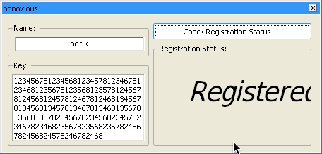
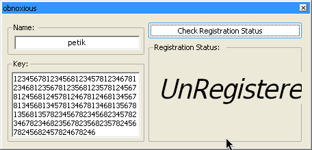

# crackmes.de's get2thatnumber by obnoxious

| | |
|---|---|
| **ID** | [`5ab77f5733c5d40ad448c343`](https://crackmes.one/crackme/5ab77f5733c5d40ad448c343) ([`ORIGIN.yml`](ORIGIN.yml)) |
| **Auteur (site)** | crackmes.de (obnoxious) |
| **Plateforme** | Windows PE32 GUI, .NET 2.0 (WinForms) |
| **SHA-256 du ZIP** | `cbde59ea4ff3943aa88a9144d033b635e1f355f858f8b025f98b03f92629a6f0` |
| **SHA-256 de l'exe** | `68d603e6b601054b77ce336c7af001dfe9a2b7c08684f9140402e6320bb8c0d7` |

Règles du `Readme.txt` : *no patching, no bruteforcing* → keygen.

## Fichiers

| Chemin | Rôle |
|---|---|
| `original/Get2ThatNumberFixed.zip` | archive d'origine (mdp `crackmes.one`), non touchée |
| `analysis/extracted/` | exe + Readme extraits (copie de travail) |
| `analysis/extracted/Get2ThatNumberFixed-src/` | C# décompilé (`ilspycmd -p`) |
| `analysis/screenshot-ok.png`, `screenshot-ko.png` | preuve Wine-mono |
| `tools/get2thatnumber-solve.py` | keygen / `--check` |

## Réponse

Keygen name → key (le key va dans la RichTextBox, le nom dans la TextBox) :

```bash
python3 tools/get2thatnumber-solve.py --name petik        # détail
python3 tools/get2thatnumber-solve.py --name petik -q     # key seule
python3 tools/get2thatnumber-solve.py --name petik --check <key>
```

| Name | Délimiteur | Segments | Key |
|---|---|---|---|
| `petik` | `8` | 34 | `123456781234568123457812346781234681235678123568123578124567812456812457812467812468134567813456813457813467813468135678135681357823456782345682345782346782346823567823568235782456782456824578246782468` |

## Premier regard

```bash
unzip -P crackmes.one original/*.zip -d analysis/extracted
file analysis/extracted/*.exe   # PE32 ... Mono/.Net assembly
diec analysis/extracted/*.exe   # .NET Framework CLR 2.0, MS Linker 8.0
~/.dotnet/tools/ilspycmd -p -o analysis/extracted/Get2ThatNumberFixed-src analysis/extracted/Get2ThatNumberFixed.exe
```

Les `strings` montrent `function_one`, `function_two`, `button1_Click` : tout est dans `Form1.cs`. (Note : l'alias `decompiledotnet` n'existe pas dans le shell agent, `ilspycmd` a été appelé directement.)

## Flow

`button1_Click → chk()` :

1. nom vide → « Where is the name? » ;
2. `lt = function_one()` (délimiteur dérivé du nom) ;
3. `num = function_two(lt)` (nombre de segments requis) ;
4. le key est découpé en segments qui finissent par le caractère `lt` (inclus) ;
5. `num` segments au moins, les `num` premiers deux à deux distincts, chacun commençant par `1` ou `2` et dont chaque chiffre est +1 ou +2 par rapport au précédent ;
6. label « Registered » sinon « UnRegistered ».

## Comment on trouve

**Ancrage** : `Form1.chk()`, `function_one()`, `function_two()` dans le C# décompilé.

**function_one** : `n = sum(octets du nom) & 0xF` puis une cascade de `if` qui ramène tout vers {5, 6, 8}. En tabulant les 16 valeurs :

| n | 0 | 1 | 2 | 3 | 4 | 5 | 6 | 7 | 8 | 9 | 10 | 11 | 12 | 13 | 14 | 15 |
|---|---|---|---|---|---|---|---|---|---|---|---|---|---|---|---|---|
| lt | 5 | 6 | 6 | 8 | 8 | 5 | 6 | 6 | 8 | 8 | 5 | 6 | 6 | 8 | 8 | 8 |

(le piège : `n<5 → n+5` puis 7→6 et 9→8 ; `n>=10 → n-5` puis `case 10→8`, 7→6, 9→8.)

**function_two** : `5→8`, `6→13`, sinon (8) `34`. Ce sont des Fibonacci : indice que le compteur est le nombre de chemins.

**Le prédicat** : un segment = suite de chiffres commençant par 1 ou 2, chaque pas valant +1 ou +2, terminée par `lt` (et, comme la suite est croissante, `lt` n'apparaît pas avant la fin → le split se fait bien à la fin). Le nombre de tels chemins est : pour `lt=5` → 5 (depuis 1) + 3 (depuis 2) = 8 ; `lt=6` → 8+5 = 13 ; `lt=8` → 21+13 = 34, exactement `function_two`. Comme les `num` segments doivent être distincts, il faut donc **tous** les chemins, une fois chacun. Pas de bruteforce : on les énumère.

**Assemblage pour `petik`** : `112+101+116+105+107 = 541`, `541 & 0xF = 13` → `lt = 8` → 34 segments : `12345678`, `1234568`, `1234578`, … concaténés (ordre libre, les restes après le 34ᵉ segment sont ignorés).

Piège : le délimiteur est inclus dans le segment (`Substring(0, num3+1)`), donc la dernière différence testée est bien celle qui mène à `lt`.

## Vérification

Binaire d'origine sous Wine-mono (prefix copie de `~/.wine`, `xvfb-run`/Xvfb + `xdotool`, capture `ffmpeg x11grab`) — le prefix par défaut avait un .NET natif cassé, on a retiré `Microsoft.NET` et remis `mscoree` en builtin dans la copie.

- OK : `petik` + key ci-dessus → « Registered » : 
- KO : même key privée de son dernier `8` (33 segments + reste) → « UnRegistered » : 

## Notes

- Pas de GDB/x64dbg/IDA : reverse 100 % statique sur le C# décompilé.
- Le nom influence seulement `lt` ; tous les noms mènent à 8, 13 ou 34 segments.
- `--check` est une réimplémentation Python de `chk()`, la preuve réelle étant la capture Wine.
