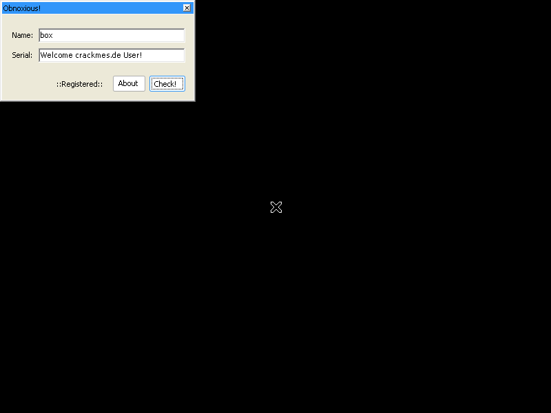
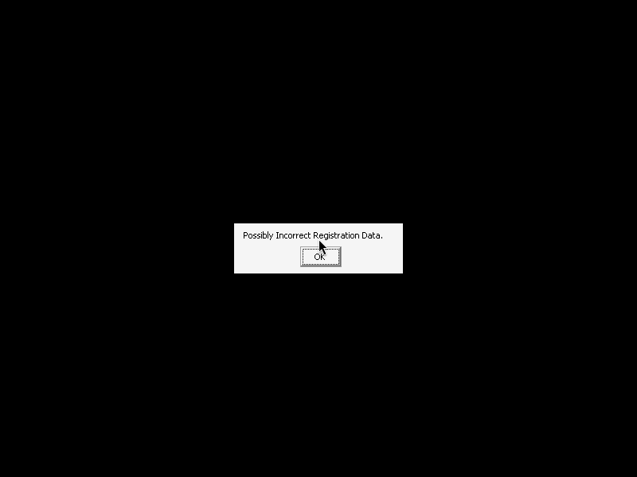

# Obnoxious's KGM#2 (obnoxious) — crackmes.de

| | |
|---|---|
| **ID** | [`5ab77f5733c5d40ad448c346`](https://crackmes.one/crackme/5ab77f5733c5d40ad448c346) · [`ORIGIN.yml`](ORIGIN.yml) |
| **Auteur** | obnoxious (famille `crackmes-de`) |
| **Plateforme** | Windows PE32 GUI, .NET (WinForms), 2008 |
| **SHA-256 (zip)** | `4575b62f049d854d1876b82d818db4c853ccab28e51c8be6d30275ab45fe5ca7` |

## Fichiers

| Chemin | Rôle |
|---|---|
| `original/Obnoxious__sKGM#2.zip` | archive d'origine (mot de passe `crackmes.one`), non modifiée |
| `analysis/zip/Obnoxious2.exe`, `ReadMe.txt` | contenu dézippé |
| `analysis/Obnoxious2-src/` | C# décompilé (`ilspycmd -p`) |
| `analysis/screenshot-ok.png` / `screenshot-ko.png` | preuve Wine : Registered / clé incorrecte |
| `tools/obnoxious-skgm2-solve.py` | keygen |

## Réponse

Le serial **ne dépend pas du champ Name** : il est calculé à partir du **nom d'utilisateur Windows** (`SystemInformation.UserName`) et du **DoubleClickTime** (500 ms par défaut).

| User Windows | DoubleClickTime | Serial |
|---|---|---|
| `petik` | 500 | `1139-0141-3676-1172-4444` |
| `box` (user du test Wine) | 500 | `1810-17-41-48-17-31-92-33-51` |

```bash
python3 tools/obnoxious-skgm2-solve.py --user petik            # serial
python3 tools/obnoxious-skgm2-solve.py --user petik --dct 500 --check '1139-0141-3676-1172-4444'
python3 tools/obnoxious-skgm2-solve.py -q --user petik
```

## Premier regard

```text
$ file Obnoxious2.exe   -> PE32 executable (GUI) Intel i386 Mono/.Net assembly
$ strings -e l Obnoxious2.exe
SOFTWARE\crackmes\User   C:\windows\key.txt   ::Unregistered::   ::Registered::
Welcome crackmes.de User!   No! No! No! No!   Possibly Incorrect Registration Data.
```

.NET : pas besoin d'IDA, `ilspycmd -p -o analysis/Obnoxious2-src analysis/zip/Obnoxious2.exe` (équivalent de `decompiledotnet`, absent du PATH du shell agent) donne tout `Form1.cs`.

## Flow

1. `Form1_Load` : si la clé `HKLM\SOFTWARE\crackmes\User` n'existe pas → « You have'nt registered my Previous crackme yet? » puis fermeture (il faut avoir créé cette clé, cf. KGM#1). Sinon, si `C:\windows\key.txt` est absent → nag « KeyFile not found! » toutes les 5 s (timer). Sinon le contenu de `key.txt` est comparé au serial attendu : égal → « Welcome crackmes.de User! » / `::Registered::`, sinon « Possibly Incorrect Registration Data ».
2. `button1_Click` (« Check! ») : calcule le même serial attendu, le compare à `textBox2`. Si OK : `::Registered::`, arrêt du timer, écriture de `key.txt` (attribut Hidden). Sinon « No! No! No! No! ».

## Comment on trouve le serial

Ancrage : `analysis/Obnoxious2-src/Obnoxious2/Form1.cs`, `button1_Click` et `getmd5` (identiques dans `Form1_Load`).

```csharp
int length = UserName.Length;  int num = length;           // n = len(user)
string md5str = UserName + SystemInformation.DoubleClickTime;
md5str = getmd5(md5str);
string text = md5str.Substring(length, 20).ToUpper();      // 20 caractères à partir de l'offset n
for (length = 4; length < text.Length; length += num)
    text = text.Insert(length, "-");                       // tirets : 1er à 4, puis pas de n
```

```csharp
foreach (byte b in md5)  text += b.ToString("");           // PIÈGE
```

Pièges :
- `b.ToString("")` n'est **pas** de l'hex : c'est la représentation **décimale** de chaque octet, sans zéro de remplissage (longueur variable, ~30–48 chiffres). `ToUpper()` est donc sans effet.
- `text.Length` grandit à chaque `Insert` : la boucle teste la longueur *courante*. L'écart entre tirets est `n` (longueur du user), avec le premier à l'index 4, donc le format dépend du user (`petik`, n=5 : `4-4-4-4-4` ; `box`, n=3 : tirets plus serrés).
- L'entrée est l'ASCII de `UserName + str(DoubleClickTime)` ; le champ Name n'est que pré-rempli avec le user.

Exemple `petik` : MD5(`petik500`) → octets en décimal concaténés → on saute 5 caractères, on prend 20 chiffres → insertion de tirets aux index 4, 9, 14, 19 → `1139-0141-3676-1172-4444`.

## Vérification (Wine)

Wine-mono ne fonctionne que dans un prefix **win32** ici (le prefix 64 bits plante en stack overflow) : `WINEARCH=win32`, mono copié depuis `~/.wine`, clé `HKLM\SOFTWARE\crackmes\User` créée avec `wine reg add`, puis `xvfb-run -a wine analysis/zip/Obnoxious2.exe`, capture via `ffmpeg -f x11grab`. User Wine = `box`, DoubleClickTime = 500.

- **OK** : `key.txt` = serial généré par le keygen pour `box` → `::Registered::` et « Welcome crackmes.de User! » : 
- **KO** : `key.txt` avec le dernier chiffre modifié → « Possibly Incorrect Registration Data. » : 

La preuve passe par le chemin `Form1_Load` (comparaison de `key.txt`) et non par la saisie dans la boîte : le calcul est le même code que dans `button1_Click`. Pas de session GDB ni de debug live (pas de x64dbg actif).

## Notes

- Le « petik » n'est pas saisissable comme Name : sur une vraie machine le serial est lié au compte Windows ; le keygen prend `--user` et `--dct` pour simuler.
- Les nags se retirent aussi en patchant (ReadMe), non nécessaire ici.
