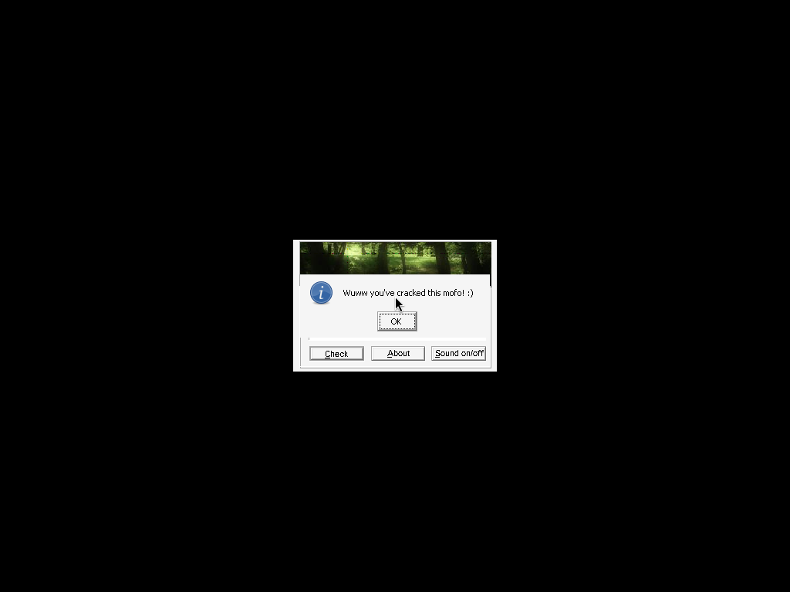
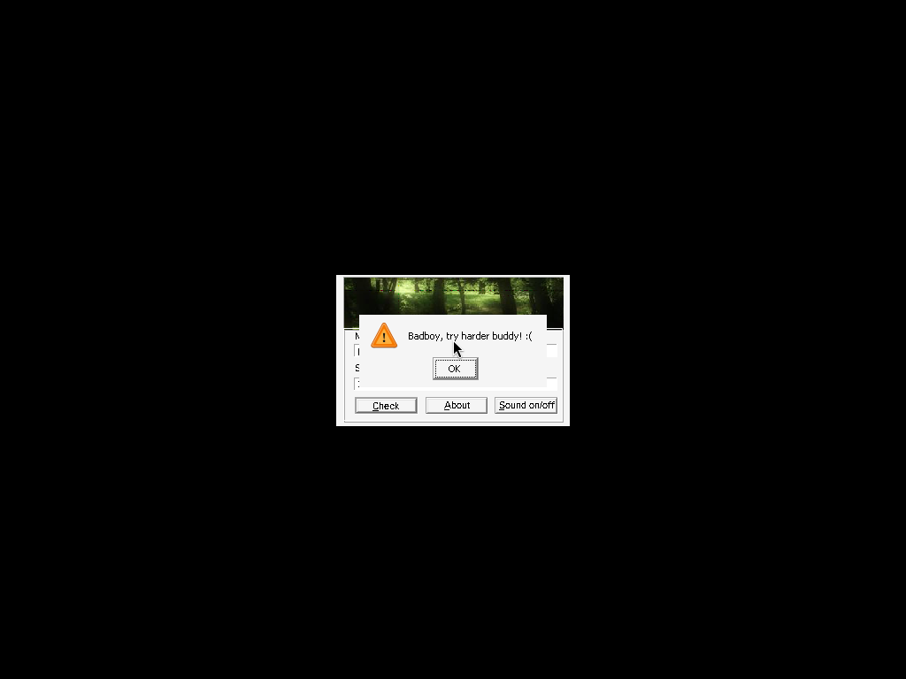

# very_easy_keygenme (hackereh@) — crackmes.de

| | |
|---|---|
| **ID** | [`5ab77f5733c5d40ad448c353`](https://crackmes.one/crackme/5ab77f5733c5d40ad448c353) · [`ORIGIN.yml`](ORIGIN.yml) |
| **Auteur** | hackereh@ (importé via crackmes-de) |
| **Plateforme** | Windows PE32 GUI (MASM32, dialogue Win32) |
| **SHA-256 (zip)** | `5f237e00314af3e4072916ae431a838f41c7120357895041eef4f06d6fd21693` |

## Fichiers

| Chemin | Rôle |
|---|---|
| `original/My_KeygenMe.zip` | archive d'origine (`Readme.txt` + `hackereh@.exe`), non modifiée |
| `analysis/extracted/` | contenu dézippé (pour l'analyse) |
| `analysis/screenshot-ok.png`, `screenshot-ko.png` | preuves Wine/xvfb |
| `tools/hackereh-solve.py` | keygen |

## Réponse

Keygen name → serial (nom de 1 à 24 caractères) :

| Name | Serial |
|---|---|
| `petik` | **`2636335687`** |
| `a` | `3418517923` |

```bash
python3 tools/hackereh-solve.py --name petik        # name='petik' serial=2636335687
python3 tools/hackereh-solve.py --name petik -q     # 2636335687
python3 tools/hackereh-solve.py --check
```

## Premier regard

```bash
unzip original/My_KeygenMe.zip -d analysis/extracted
file analysis/extracted/hackereh@.exe   # PE32 GUI i386
diec analysis/extracted/hackereh@.exe   # MASM32, pas de packer
strings -n 5 analysis/extracted/hackereh@.exe
```

`strings` donne les messages : `At least 1 character!!`, `Not more than 24 Characters`, `Wuww you've cracked this mofo! :)`, `Badboy, try harder buddy! :(`, et le format `%u`. Le Readme dit juste « keygenme très simple, faire un keygen ». Pas de packer.

## Flow

Dialogue (`DialogBoxParamA`), DlgProc en `0x401029`. `WM_COMMAND` (`0x111`) avec l'id `0xC8` (bouton *Check*) appelle la routine de vérification `0x4011f2`. Champ Name = id `0x3E9`, Serial = id `0x3EA`.

## Comment on trouve le prédicat

Ancrage : `objdump -d -M intel analysis/extracted/hackereh@.exe`, routine `0x4011f2` (appelée depuis le `cmp ax,0xc8` en `0x401180`).

```asm
401209 call GetDlgItemTextA        ; nom -> 0x4062a0, max 0x1e ; eax = longueur
40120e cmp eax,1 / jb  -> "You must enter a name and a serial"
401217 cmp eax,0x18 / ja -> "Not more than 24 Characters"
40121c mov ebx,eax                 ; ebx = len
401227 mov edx,0xdeadc0de          ; graine
40122c movsx eax,byte [ecx+edi]    ; c = nom[i] (signé)
401230 add   eax,edx               ; c + edx
401232 imul  eax,eax,0x666         ; * 0x666
401238 add   edx,eax               ; edx += eax
40123a sub   eax,0x777             ; eax -= 0x777
40123f inc ecx / cmp ecx,ebx / jne ; boucle
401244 mov ebx,eax                 ; valeur finale = DERNIER eax (pas edx)
401253 wsprintfA(0x406202, "%u", ebx)   ; format @0x40618e
40126a GetDlgItemTextA(serial -> 0x4062b8)
401281 lstrcmpA(0x406202, 0x4062b8) ; jne -> Badboy ; sinon "Wuww you've cracked"
```

Décodage : tout est en 32 bits modulo 2^32 ; le serial est donc la valeur **non signée décimale** (`%u`) du dernier `eax`. Pièges : la valeur renvoyée est `eax` (après le `sub 0x777`), pas l'accumulateur `edx` ; `edx` ne sert qu'à propager l'état d'un caractère au suivant.

Exemple `petik` : `edx0=0xdeadc0de`, pour chaque lettre `eax=(c+edx)*0x666`, `edx+=eax`, `eax-=0x777` ; après `k` : `eax = 2636335687`.

Pseudo-code :

```python
edx = 0xdeadc0de
for c in name:
    eax = ((c + edx) * 0x666) & 0xffffffff
    edx = (edx + eax) & 0xffffffff
    eax = (eax - 0x777) & 0xffffffff
serial = str(eax)
```

Reverse 100 % statique (objdump), pas de GDB ni de debugger MCP.

## Vérification

Preuve live sous Wine (`xvfb-run -a`, saisie via `xdotool`, capture `ffmpeg x11grab`) sur `hackereh@.exe` extrait de l'archive d'origine :

- `petik` / `2636335687` → « Wuww you've cracked this mofo! :) » : 
- `petik` / `1234` → « Badboy, try harder buddy! :( » : 

## Notes

- Aucun patch, `original/` intact (seul le zip y est).
- Longueur du nom : 1..24 ; hors bornes → message d'erreur avant tout calcul.
