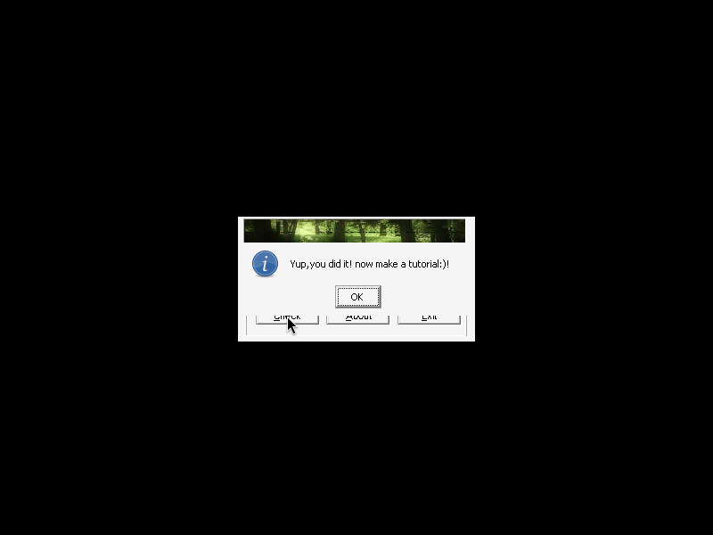
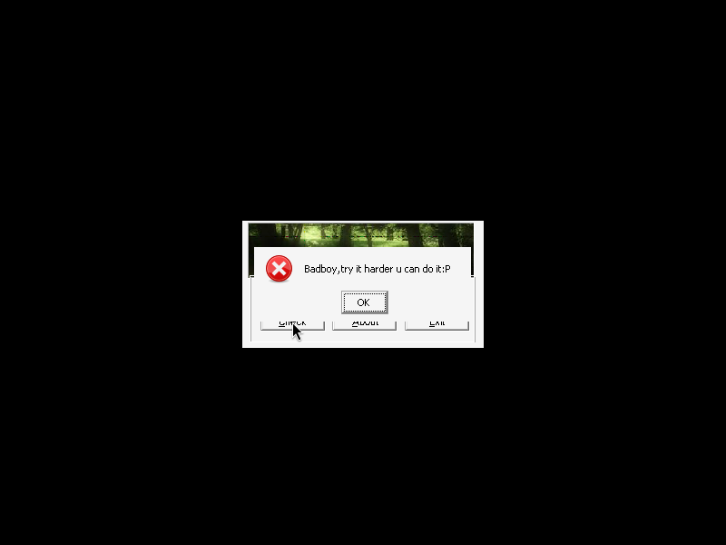

# crackme_by_hackereh (hackereh@) — crackmes.de

| | |
|---|---|
| **ID** | [`5ab77f5733c5d40ad448c354`](https://crackmes.one/crackme/5ab77f5733c5d40ad448c354) ([`ORIGIN.yml`](ORIGIN.yml)) |
| **Auteur** | hackereh@ (crackmes.de) |
| **Plateforme** | Windows PE32 GUI, MASM32 (MASM 6.14) |
| **SHA-256 (zip)** | `8696e49a0f73eb0f6284fa42dcf94ef68370eaa696722a91bc504c5371bea146` |

## Fichiers

| Chemin | Rôle |
|---|---|
| `original/hackereha.zip` | archive d'origine (non modifiée) |
| `analysis/extracted/hackereh@.exe`, `RULEZ!!!.TXT` | contenu décompressé (zip) |
| `analysis/screenshot-ok.png`, `screenshot-ko.png` | preuve live Wine/xvfb |
| `tools/hackereh-crackme-solve.py` | solveur (`-q`, `--all`, `--check`) |

## Réponse

Pas de nom d'utilisateur : un seul champ **Serial**, de **6 caractères**. Il y a **plusieurs serials valides** (le readme de l'auteur le dit : « several right serial… because ascii values »).

**Exemple : `Reh@0)`**

```bash
python3 tools/hackereh-crackme-solve.py -q          # Reh@0)
python3 tools/hackereh-crackme-solve.py --all       # les 9216 serials ASCII imprimables
python3 tools/hackereh-crackme-solve.py --check
```

## Premier regard

```bash
unzip original/hackereha.zip -d analysis/extracted
diec analysis/extracted/hackereh@.exe   # PE32, MASM32, MASM 6.14
strings -n 5 analysis/extracted/hackereh@.exe
```

`strings` donne les messages : `Please enter 1 or more chars!`, `Yup,you did it! now make a tutorial:)!`, `Badboy,try it harder u can do it:P`. `RULEZ!!!.TXT` : « no patching », « just find the right serial », « several right serials ».

## Flow

Dialogue (`DialogBoxParamA`) dont la `DlgProc` est en `0x401029`. Sur `WM_COMMAND` (0x111) avec l'ID `0xC8` (bouton *Check*) → `call 0x401169`. Celle-ci lit le champ `0x3E9` dans le buffer `0x403138` (`GetDlgItemTextA`, 30 max) :

- longueur 0 → « Please enter 1 or more chars! » ;
- sinon check par caractère → succès (icône info `0x40`) ou « Badboy » (icône erreur `0x10`).

## Comment on trouve

Ancrage : `objdump -d -M intel analysis/extracted/hackereh@.exe`, fonction `0x401169`, check à `0x401194`.

```asm
401185  test al,al             ; al = longueur renvoyée par GetDlgItemTextA
401189  mov  ecx,eax           ; ecx = longueur
40118f  mov  edi,0x403138      ; edi = serial
401194  movsx eax,BYTE PTR [edi]
401197  and  al,0xad           ; c0 & 0xad
401199  jne  0x4011db         ; != 0 -> Badboy
40119b  movsx eax,BYTE PTR [edi+1]
40119f  and  al,0x9a          ; c1 & 0x9a
4011a3  movsx eax,BYTE PTR [edi+2]
4011a7  and  al,0x97          ; c2 & 0x97
4011ab  movsx eax,BYTE PTR [edi+3]
4011af  and  al,0xbf          ; c3 & 0xbf
4011b3  movsx eax,BYTE PTR [edi+4]
4011b7  and  eax,0x5fc5      ; c4 & 0x5fc5
4011be  movsx eax,BYTE PTR [edi+5]
4011c2  and  eax,0xd6        ; c5 & 0xd6
4011c9  cmp  ecx,6           ; longueur == 6
```

Chaque caractère doit donc **annuler** son masque : `c[i] & masque[i] == 0`, i.e. n'utiliser que les bits **absents** du masque. D'où la multiplicité des solutions.

| i | masque | bits autorisés (`~masque`) | caractères imprimables possibles |
|---|---|---|---|
| 0 | `0xad` | `0x52` | `@ B P R` |
| 1 | `0x9a` | `0x65` | `␠ ! $ % @ A D E ` a d e` |
| 2 | `0x97` | `0x68` | `␠ ( @ H ` h` |
| 3 | `0xbf` | `0x40` | `@` (0 exclu : terminateur) |
| 4 | `0x5fc5` | `0x3a` (et c < 0x80, à cause du `movsx` + octet haut `0x5f`/signe) | `␠ " ( * 0 2 8 :` |
| 5 | `0xd6` | `0x29` | `␠ ! ( )` |

Soit 4·12·6·1·8·4 = 9216 serials imprimables. Exemple : `R`=0x52 (`0x52&0xad=0`), `e`=0x65 (`&0x9a=0`), `h`=0x68 (`&0x97=0`), `@`=0x40 (`&0xbf=0`), `0`=0x30 (`&0xc5=0`), `)`=0x29 (`&0xd6=0`) → `Reh@0)` (clin d'œil à `hackereh@`).

Pièges : l'`and` des 4 premiers est sur `al` (8 bits, flags sur l'octet) alors que les deux derniers sont sur `eax` avec `movsx` : un octet ≥ 0x80 donnerait des bits hauts à 1 qui ne passent pas `0x5fc5` (pos. 4). La longueur est testée en dernier (`cmp ecx,6`) mais est bien obligatoire.

## Vérification

Binaire d'origine sous Wine/xvfb, saisie via `xdotool` puis clic sur *Check* :

```bash
xvfb-run -a -s "-screen 0 800x600x24" ./run.sh 'Reh@0)' ok.png    # wine + xdotool type + click (322,354) + ffmpeg x11grab
```

- OK `Reh@0)` : « Yup,you did it! now make a tutorial:)! » — 
- KO `AAAAAA` : « Badboy,try it harder u can do it:P » — 

## Notes

- Pas de GDB ni de debugger : reverse 100 % statique + preuve Wine.
- Le check ne dépend d'aucun nom ; ce n'est pas un keygen, juste une famille de serials (`--all`).
