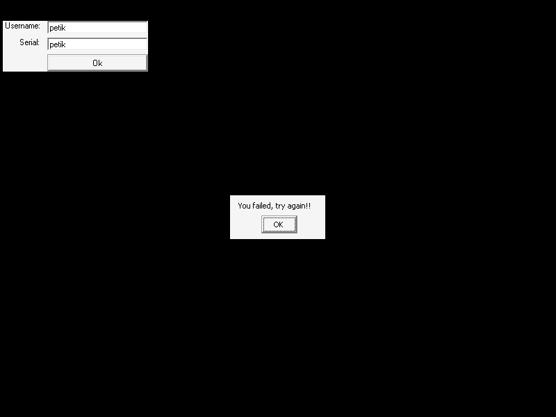

# crackmes.de's crackme_1 by magenta

| | |
|---|---|
| **ID** | [`5ab77f5733c5d40ad448c35b`](https://crackmes.one/crackme/5ab77f5733c5d40ad448c35b) |
| **Auteur (site)** | crackmes.de (Magenta[GD]) |
| **Auteur (local)** | crackmes-de |
| **Plateforme** | Windows PE32 GUI, Visual Basic 5 (code natif, `MSVBVM50.DLL`) |
| **SHA-256 (zip)** | `1ced261fbd6746cad2c7561d4fd10fae9599d337461f016789699b592603fec0` |

Origine : [`ORIGIN.yml`](ORIGIN.yml) · ZIP password : `crackmes.one`.

## Fichiers

| Chemin | Rôle |
|---|---|
| `original/magenta1.zip` | archive d'origine (non modifiée) : `Crackme#1.exe`, `Crackme#1.txt`, `Soln/Es67.html` |
| `analysis/x/` | contenu dézippé (hors `original/`) |
| `analysis/screenshot-ok.png`, `screenshot-ko.png`, `screenshot-edge.png` | preuves Wine |
| `tools/magenta1-solve.py` | keygen + `--check` (Wine/xvfb + xdotool) |

## Réponse

**Serial = chaque caractère du nom décalé de +1** (`Chr(Asc(c)+1)`).

| Username | Serial |
|---|---|
| `petik` | `qfujl` |

```bash
python3 tools/magenta1-solve.py --user petik        # user='petik' serial='qfujl'
python3 tools/magenta1-solve.py -q --user petik     # qfujl
python3 tools/magenta1-solve.py --user petik --check  # lance le binaire sous Wine
```

## Premier regard

```bash
unzip -P crackmes.one original/magenta1.zip -d analysis/x
file analysis/x/Crackme#1.exe     # PE32 GUI, i386
diec analysis/x/Crackme#1.exe     # Microsoft Visual Basic (5.0)
strings -n 4 analysis/x/Crackme#1.exe
```

`strings` : imports `__vbaVarTstEq`, `__vbaVarAdd`, `__vbaLenVar`, `__vbaStrVarVal`…, formulaire `Command1_Click`, messages `Well done dude!` / `You failed, try again!!`. Le `.txt` de l'auteur indique de « bpx le compare de Msvbvm50 ».
Le zip contient aussi une solution tierce (`Soln/Es67.html`) ; elle a servi de recoupement, mais le prédicat a été relu dans le binaire et **validé en live**.

## Flow

1. UI : deux champs (Username, Serial) + bouton `Ok`.
2. `Command1_Click` calcule un serial « attendu » à partir du nom (boucle de caractères).
3. Il le compare (`__vbaVarTstEq`) au serial saisi : OK → `Well done dude!` puis image, sinon `You failed, try again!!`.

## Comment on trouve

- **Ancrage** : le code VB natif est dans `.text`; la boucle sur les caractères du nom va de `0x40a983` (`test eax,eax / je 0x40aac9` = test de fin de `For`) à `jmp 0x40a983` en `0x40aac4`.
  `objdump -d -M intel --start-address=0x40a900 --stop-address=0x40ab00 'Crackme#1.exe'`
- **Lecture** (appels indirects vers les thunks `__vba*` de l'IAT, 0x40d1xx) :

```asm
40a971  call [0x40d128]        ; __vbaVarForInit  : début du For (compteur [ebp-0x24])
40a983  test eax,eax           ; fin de boucle ?
40a985  je   0x40aac9
40a9b8  call [0x40d140]        ; extraction du caractère i du nom (Mid) → [ebp-0x94]
40a9f3  call [0x40d14c]        ; __vbaVarTstEq : comparaison du compteur à une constante 1 (0x8002 = ref entier)
40aa2e  call [0x40d174]        ; conversion en chaîne (__vbaStrVarVal)
40aa35  call [0x40d114]        ; Asc(c) → eax
40aa3b  inc  ax                ; +1   (le « jo » qui suit = __vbaErrorOverflow si 32767)
40aa79  call [0x40d16c]        ; conversion du code en variant
40aa94  call [0x40d1a0]        ; concaténation (__vbaVarAdd) à l'accumulateur [ebp-0x84]
40aabe  call [0x40d1b4]        ; __vbaVarForNext
```

  Le `inc ax` sur le code ASCII du caractère est le cœur du keygen : `serial += Chr(Asc(Mid(name,i,1)) + 1)`.
- **Comparaison finale** : `0x40aac9` → `0x40aad4 call __vbaVarTstEq` entre le serial calculé (`[ebp-0x84]`) et le serial saisi (`[ebp-0x54]`), `je 0x40ac9c` = chemin « Looser ».
- **Assemblage** (`petik`) : `p→q`, `e→f`, `t→u`, `i→j`, `k→l` ⇒ `qfujl`.
- **Pièges** : binaire VB5 → pas de `cmp` direct, tout passe par le runtime (`__vba*`) ; `strings` donne surtout des noms d'imports. Les branches `0x8002` (variants par référence) rendent l'asm peu lisible, d'où la validation empirique ci-dessous. Je n'ai pas décodé précisément le petit `if` en `0x40a9f9` (il met `0x41` dans une variable annexe sans effet observé sur le serial) : tous les tests live, y compris avec espace, concordent avec `+1`.

## Debug dynamique

Pas de GDB / x64dbg utilisé : reverse statique (`objdump`) + exécution sous Wine pilotée par `xdotool` (clic dans les champs aux coordonnées 140,40 / 140,63, clic sur `Ok` en 140,90, capture `PIL.ImageGrab`).

## Vérification

```bash
python3 tools/magenta1-solve.py --user petik --check --shot analysis/screenshot-ok.png
python3 tools/magenta1-solve.py --user petik --serial petik --check --shot analysis/screenshot-ko.png
python3 tools/magenta1-solve.py --user "Az z" --check --shot analysis/screenshot-edge.png
```

| Cas | Capture | Résultat |
|---|---|---|
| `petik` / `qfujl` |  | `Well done dude!` |
| `petik` / `petik` |  | `You failed, try again!!` |
| `Az z` / `B{!{` (espace, `z`→`{`) |  | `Well done dude!` |

## Notes

- Selon l'essai de The Sandman (`Soln/`), nom **et** serial vides sont aussi acceptés (bug du crackme) ; non rejoué ici.
- Pas de patch (le `.txt` l'interdit) ; `original/` n'a pas été modifié.
