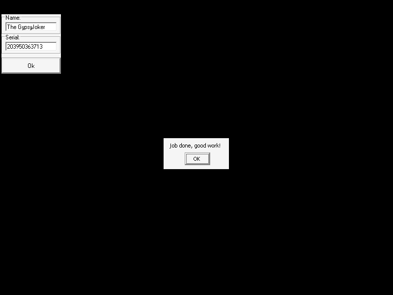
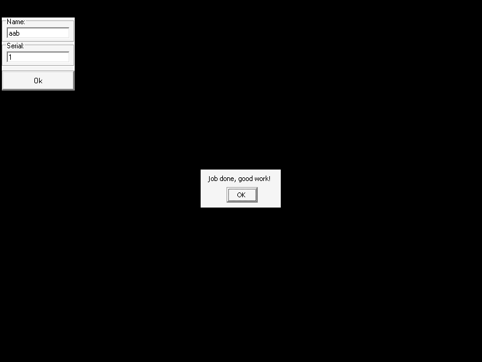

# crackmes.de's crackme_2 by magenta

| | |
|---|---|
| **ID** | [`5ab77f5733c5d40ad448c35d`](https://crackmes.one/crackme/5ab77f5733c5d40ad448c35d) |
| **Auteur (site)** | crackmes.de (Magenta[GD]) |
| **Auteur (local)** | crackmes-de |
| **Plateforme** | Windows PE32 GUI, Visual Basic 5 (code natif, `MSVBVM50.DLL`) |
| **SHA-256 (zip)** | `92be75ba0757bdad70309ea6dd3733871c915e6cecf21b26a39a8ea99579d173` |

Origine : [`ORIGIN.yml`](ORIGIN.yml) · ZIP password : `crackmes.one`.

## Fichiers

| Chemin | Rôle |
|---|---|
| `original/magenta2.zip` | archive d'origine (non modifiée) : `Crackme#2.exe`, `Crackme#2.txt`, `magenta2.html` (solution tierce de « Jeff ») |
| `analysis/x/` | contenu dézippé (hors `original/`) |
| `analysis/screenshot-ok.png`, `screenshot-ko.png`, `screenshot-html.png`, `screenshot-edge.png` | preuves Wine |
| `tools/magenta2-solve.py` | keygen + `--check` (Wine/xvfb + xdotool) |

## Réponse

**Serial = concaténation, pour chaque lettre du nom (nom circulaire), de `Asc(suivante) − Asc(courante)` en décimal, uniquement quand cette différence est > 0.**

| Username | Serial |
|---|---|
| `petik` | `1525` |

```bash
python3 tools/magenta2-solve.py --user petik          # user='petik' serial='1525'
python3 tools/magenta2-solve.py -q --user petik       # 1525
python3 tools/magenta2-solve.py --user petik --check  # lance le binaire sous Wine
```

## Premier regard

```bash
unzip -P crackmes.one original/magenta2.zip -d analysis/x
file analysis/x/Crackme#2.exe     # PE32 GUI, i386
diec analysis/x/Crackme#2.exe     # Microsoft Visual Basic (5.0)
strings -n 5 analysis/x/Crackme#2.exe
```

`strings` : imports `__vbaVarAdd`, `__vbaVarTstGt`, `__vbaVarSub`, `__vbaVarTstEq`, `__vbaStrVarVal`, `__vbaVarForInit/Next`, formulaire `Command1_Click`, textes UTF-16 `Congratulations`, `Job done, good work!`, `You have to type your Name/Serial`. Le `.txt` interdit le patch. Le `.html` du zip contient une solution tierce (nom `The GypsyJoker` → `203950363713`) ; elle a servi de **point de recoupement** après avoir relu le prédicat.

## Flow

1. Deux champs : `Text1` = Name (`[ebp-0x44]`), `Text2` = Serial (`[ebp-0x64]`) + bouton `Ok`.
2. Si l'un des deux est vide → MessageBox « You have to type your Name/Serial ».
3. Boucle `For i = 1 To Len(name)` qui construit un serial attendu (Variant String) dans `[ebp-0x94]`.
4. `Val(attendu) − Val(saisi) = 0` ? → « Congratulations / Job done, good work! » sinon message d'échec.

## Comment on trouve

- **Ancrage** : `Command1_Click` est la procédure native de `.text` ; la boucle est autour de `0x402532`–`0x4027ee`.
  `objdump -d -M intel --start-address=0x402200 --stop-address=0x402c00 'Crackme#2.exe'`
- **Appels par ordinaux** : plusieurs imports de `MSVBVM50` n'ont pas de nom dans la table du PE (IAT `0x404158`, `0x40418c`, `0x40419c`, `0x40420c`, `0x404230`). On les résout avec la DLL (Wine) : `pefile` sur `msvbvm50.dll` → 516 `rtcAnsiValueBstr` (Asc), 522 `rtcLeftTrimVar` (LTrim), 632 `rtcMidCharVar` (Mid), 613 `rtcVarStrFromVar` (Str), 581 `rtcR8ValFromBstr` (Val).
- **Lecture** (VB5 → tout passe par des variants ; arguments empilés de droite à gauche) :

```asm
402532  call [0x404164]   ; __vbaLenVar(name)       → borne du For
402552  call [0x40416c]   ; __vbaVarForInit / test de fin (i dans [ebp-0x24])
402593  call [0x40419c]   ; Mid(name, i, 1)          → [ebp-0x34]  (lettre courante)
4025e6  call [0x404204]   ; __vbaVarAdd(i, 1)
402672  call [0x40419c]   ; Mid(name, i+1, 1)        → [ebp-0x54]  (lettre suivante)
402643  call [0x4041a8]   ; __vbaVarTstEq(suivante, "")  → si vide : suivante = Mid(name,1,1)  (nom circulaire)
4026a1  call [0x404158]   ; Asc(courante)  → [ebp-0xa4]
4026e0  call [0x404158]   ; Asc(suivante)  → [ebp-0xb4]
40271b  call [0x404130]   ; __vbaVarTstGt(Asc suivante, Asc courante)
40273b  call [0x404134]   ; __vbaVarSub  : diff = suivante − courante
402783  call [0x40420c]   ; Str(diff)
402797  call [0x40418c]   ; LTrim(...)  (Str met un espace devant les positifs)
4027b2  call [0x404204]   ; __vbaVarAdd(accu, texte) → concaténation dans [ebp-0x94]
4027e8  call [0x404220]   ; __vbaVarForNext
```

  `__vbaVarAdd` sur deux Variant String **concatène** : l'accumulateur est une chaîne, pas une somme.
- **Comparaison finale** (`0x4027f3`) : `Val([ebp-0x94])` (attendu) moins `Val([ebp-0x64])` (saisi) → `__vbaVarTstEq(…, 0)` en `0x402894` ; chemin « Congratulations » (`0x4028c5`) si égal, sinon `0x402b0f`.
- **Assemblage** (`petik`, `p=112 e=101 t=116 i=105 k=107`) :
  `p→e` : 101−112 < 0 → rien · `e→t` : 116−101 = **15** · `t→i` : < 0 → rien · `i→k` : 107−105 = **2** · `k→p` (retour au début) : 112−107 = **5** ⇒ `15`+`2`+`5` = **`1525`**.
- **Recoupement** avec l'essai du `.html` : `The GypsyJoker` → 20, 39, 50, 3, 6, 37, 13 ⇒ `203950363713` (identique à la sortie du solveur ; `The Gypsy Joker` avec 2 espaces ajouterait un `42`, donc le nom de l'essai n'avait qu'un espace).
- **Pièges** :
  - les ordinaux sans nom (Asc / LTrim / Str…) : sans eux la boucle semble sans sens ;
  - le sens de la comparaison : à la lecture de `__vbaVarTstGt` / `__vbaVarSub` l'ordre des arguments est inversé (stdcall) — j'ai tranché par l'essai live (seul « suivante > courante » donne le bon serial) ;
  - lettres égales (diff = 0) : aucune contribution (`aab` → `1`, validé live) ;
  - le test est numérique (`Val`, double) : au-delà de ~15 chiffres, plusieurs serials proches sont équivalents ; non exploité ;
  - un nom sans aucun saut « montant » (ex. 1 caractère) donne un serial vide → refusé par le contrôle « champ vide ».

## Debug dynamique

Pas de GDB / x64dbg utilisé : reverse statique (`objdump`, `pefile`) + exécution sous Wine pilotée par `xdotool`. Disposition de la fenêtre (Xvfb sans WM) : champ Name en (60,53), Serial en (60,93), `Ok` en (60,133).

## Vérification

```bash
python3 tools/magenta2-solve.py --user petik --check --shot analysis/screenshot-ok.png
python3 tools/magenta2-solve.py --user petik --serial 1526 --check --shot analysis/screenshot-ko.png
python3 tools/magenta2-solve.py --user "The GypsyJoker" --check --shot analysis/screenshot-html.png
python3 tools/magenta2-solve.py --user aab --check --shot analysis/screenshot-edge.png
```

| Cas | Capture | Résultat |
|---|---|---|
| `petik` / `1525` |  | MessageBox « Congratulations » (`xdotool search` → OK) |
| `petik` / `1526` |  | pas de « Congratulations » (KO) |
| `The GypsyJoker` / `203950363713` |  | « Congratulations » |
| `aab` / `1` (lettres égales + wrap) |  | « Congratulations » |

## Notes

- Pas de patch (le `.txt` l'interdit) ; `original/` n'a pas été modifié (le zip a été dézippé sous `analysis/x/`).
- Les screenshots Xvfb sans window manager n'affichent pas toujours la MessageBox ; le verdict se base sur `xdotool search --name Congratulations`.
