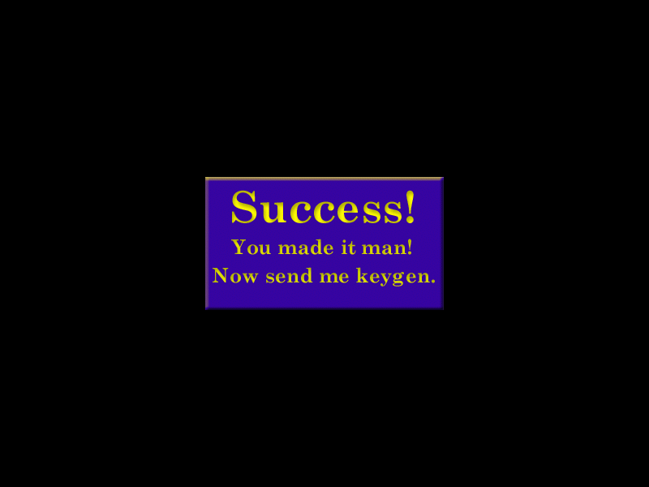

# gc_crackme_8 (Genocide Crackme 8) — gandalf

| | |
|---|---|
| **ID** | [`5ab77f5733c5d40ad448c368`](https://crackmes.one/crackme/5ab77f5733c5d40ad448c368) · [`ORIGIN.yml`](ORIGIN.yml) |
| **Auteur** | gandalf (importé via crackmes.de) |
| **Plateforme** | Windows PE32 GUI, Borland Delphi, packé UPX 0.92 |
| **SHA-256 (zip)** | `9a2dd9e49705adb484a98e4f6704e3f0bb18d487522a11ba459edcafe362228d` |

## Fichiers

| Chemin | Rôle |
|---|---|
| `original/gncrk8.zip` | archive d'origine (mot de passe `crackmes.one`) → `crackme8.exe` (non modifié) |
| `analysis/crackme8.unpacked.exe` | exécutable dépacké (`tools/upx-3.96`) |
| `analysis/screenshot-*.png` | preuves live Wine/xvfb |
| `tools/gc-crackme8-solve.py` | keygen |

## Réponse

Keygen : name → (Serial, Code). Company = n'importe quel texte non vide.

| Name | Company | Serial (Edit3) | Code (Edit4) |
|---|---|---|---|
| **`petik`** | `x` | **`1402517`** | **`4834592`** |
| `Gandalf` | `x` | `1961877` | `4673424` |

```bash
python3 tools/gc-crackme8-solve.py --name petik      # détail
python3 tools/gc-crackme8-solve.py --name petik -q   # "1402517 4834592"
python3 tools/gc-crackme8-solve.py --check           # vecteurs validés en live
```

Contraintes sur Name : identifiant Delphi valide (lettres/chiffres/`_`, pas de chiffre en tête), ≥ 5 caractères (voir plus bas pourquoi), et pas un nom déjà pris par un composant du formulaire (`Edit1`, `Image2`…).

## Premier regard

```bash
unzip -P crackmes.one original/gncrk8.zip -d /tmp/g8     # crackme8.exe, 130048 octets
file crackme8.exe     # PE32 GUI, UPX compressed, 3 sections
diec crackme8.exe     # Borland Delphi, UPX(0.92)
./tools/upx-3.96 -d -o analysis/crackme8.unpacked.exe /tmp/g8/crackme8.exe
```

UPX 0.92 (1999) se dépacke sans problème avec le 3.96 du dépôt (514048 octets). Une fenêtre « Genocide Crackme 8 » sans bordure : quatre `TEdit` (Name / Company / Serial / Code) et trois « boutons » qui sont en fait des `TImage` (Check, About, Give Up!). Pas de MessageBox : le succès ouvre un `Form2` « Success! You made it man! Now send me keygen. ».

## Flow

Le DFM de `TForm1` (resource `TPF0`) montre quatre `TEdit` et trois `TImage` avec handlers ; la table des méthodes publiées de la VMT (@0x42bbb0 environ) donne :

| Handler | Adresse | Rôle |
|---|---|---|
| `Image4Click` | 0x42bc9c | « Give Up! » → `Close` |
| `Image3Click` | 0x42bca4 | « About » → affiche un autre form |
| `Image2DblClick` | 0x42bed0 | **« Check » : il faut un double-clic** |

Piège : un simple clic sur « Check » ne fait rien, la vérification est sur `OnDblClick`.

## Comment on trouve

Ancrage : `objdump -d -M intel --start-address=0x42bcb4 --stop-address=0x42c016 analysis/crackme8.unpacked.exe` (le code Delphi n'a pas de symboles ; on part des handlers de la table de méthodes publiées, 0x42bc9c / 0x42bca4 / 0x42bed0).

**1. Pré-validation (0x42bcb4)** — quatre flags `0x42e720..723` mis à 1 (= invalide) puis remis à 0 :

```asm
42bcc9: mov BYTE PTR ds:0x42e720,1 ...        ; 4 flags « invalide »
42bd14: call 0x4037c0 (Length)                ; Edit1 : longueur
42bd19: cmp eax,5 ; jge → flag0 = 0           ; Name >= 5 caractères
42bd41: cmp [Edit2],0 ; jne → flag1 = 0        ; Company non vide
        idem Edit3 (flag2), Edit4 (flag3)      ; Serial / Code non vides
```

**2. Handler `Image2DblClick` (0x42bed0)** — si les 4 flags sont à 0 :

```asm
42bf3d: call [ecx+0x18]            ; Form1.<slot virtuel> := Edit1.Text  (SetName du TComponent)
42bf5c: call 0x40379c              ; Edit2 → ShortString[10] en 0x42e724 (inutilisé ensuite)
42bf84: call 0x406574 (StrToInt)   ; Edit3 → [0x42e760]
42bf9f: call 0x406574 (StrToInt)   ; Edit4 → [0x42e764]
        [0x42e730]=0 ; [0x42e734]=0
42bfb7: call 0x42bdd0              ; calcule A -> [0x42e730]
42bfbc: call 0x42be44              ; calcule B -> [0x42e734]
42bfc1: call 0x42bea8              ; compare, puis Form2.Show
```

Le point non évident : l'appel virtuel `[vmt+0x18]` avec le texte de `Edit1` est le setter `Name` du `TComponent`. Le nom saisi **devient le Name du formulaire** (d'où l'exigence « identifiant valide » : sinon `EComponentError` « is not a valid component name »). Le calcul qui suit ne lit pas `Edit1` mais `Form1.Name` :

```asm
42bdd0: mov eax,[0x42e71c]        ; Form1
        mov eax,[eax+8]           ; TComponent.FName (AnsiString, pointe sur les chars)
        movzx eax,BYTE PTR [eax+3] ; -> arr[0] = n[3]
        ... [eax+1] -> arr[1] ; [eax+4] -> arr[2] ; [eax+0] -> arr[3] ; [eax+2] -> arr[4]
```

Donc `arr = [n[3], n[1], n[4], n[0], n[2]]` (seuls les 5 premiers caractères comptent, d'où le « ≥ 5 »).

**3. Calcul de A (0x42bdd0) et B (0x42be44)** — deux repliements identiques à des constantes près, tous deux sur `arr` (32 bits, wrap) :

```asm
; A (esi=0x42e730)                       ; B (esi=0x42e734)
42be29: imul ecx,[eax],0xd80             42be8d: imul ecx,[eax],0x1a62
        add  ecx,[esi]                           add  ecx,[esi]
        xor  ecx,0x3a115                         xor  ecx,0xddc36
        mov  [esi],ecx                           mov  [esi],ecx
        add eax,4 ; dec dl ; jne                 add eax,4 ; dec dl ; jne
```

```python
a = b = 0
for v in arr:
    a = ((v*0xD80  + a) & 0xFFFFFFFF) ^ 0x3A115
    b = ((v*0x1A62 + b) & 0xFFFFFFFF) ^ 0xDDC36
```

Piège : `0x42be44` commence par recopier des caractères du serial (`0x42e725..729` → `0x42e74c..75c`), ce qui ressemble à un usage de Company, mais la boucle lit `0x42e738..0x42e74b` (le tableau issu du Name) et s'arrête avant : ces copies sont **inutiles**. Company n'entre dans aucun calcul.

**4. Comparaison (0x42bea8)** :

```asm
42bea8: mov eax,[0x42e764]   ; Edit4 (Code)
        cmp eax,[0x42e734]   ; == B
        jne fail
        mov eax,[0x42e760]   ; Edit3 (Serial)
        cmp eax,[0x42e730]   ; == A
        jne fail
        call 0x42653c        ; Form2.Show -> « Success! »
```

Les comparaisons sont signées 32 bits : si A ou B dépasse `0x7fffffff` il faut saisir la valeur négative (le solveur renvoie des `int32`).

**5. Exemple pas à pas, `petik`** : `arr = [i, e, k, p, t] = [105, 101, 107, 112, 116]`

- A : 0 → (105·0xd80+0)^0x3a115 → … → **1402517**
- B : 0 → (105·0x1a62+0)^0xddc36 → … → **4834592**

Détail : pour Serial/Code décimaux, le champ doit contenir uniquement des chiffres (`StrToInt`, sinon `EConvertError`).

## Vérification

Pas de GDB / x64dbg ici (reverse statique + preuve live), donc pas de section « Debug GDB ».

```bash
unzip -P crackmes.one original/gncrk8.zip -d /tmp/g8
xvfb-run -a -s "-screen 0 800x600x24" bash -c '
  wine /tmp/g8/crackme8.exe & sleep 10
  # Edit à x≈440, y = 246/270/294/318 ; « Check » = TImage en (305,359) : DOUBLE-clic
  ...'   # saisie via xdotool, captures via PIL.ImageGrab
```

| Cas | Saisie | Résultat | Capture |
|---|---|---|---|
| OK | `petik` / `x` / `1402517` / `4834592` | Form2 « Success! » | [saisie](analysis/screenshot-saisie.png) · [ok](analysis/screenshot-ok.png) |
| OK | `Gandalf` / `x` / `1961877` / `4673424` | Form2 « Success! » | [ok](analysis/screenshot-ok-gandalf.png) |
| KO | `petik` / `x` / `1402517` / `4834593` (Code +1) | reste sur la fenêtre principale | [ko](analysis/screenshot-ko.png) |



## Notes

- Le Name n'est pas « juste un texte » : il est assigné comme `Name` du `TForm1` ; l'algorithme n'a donc que 5 octets utiles, et un nom invalide lève une exception Delphi avant tout calcul.
- Company est purement décoratif (non vide suffit).
- Vérification déclenchée par **double-clic** sur « Check » (`OnDblClick`), pas par un clic simple.
- Aucun anti-debug rencontré ; seul le packer UPX 0.92 est à retirer.
