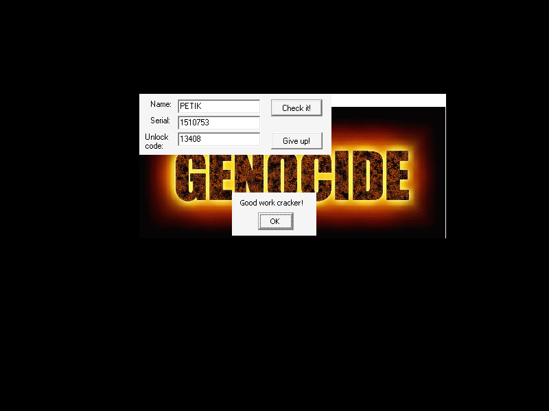

# gc_crackme_10 (Genocide Crackme 10) — gandalf

| | |
|---|---|
| **ID** | [`5ab77f5733c5d40ad448c36b`](https://crackmes.one/crackme/5ab77f5733c5d40ad448c36b) · [`ORIGIN.yml`](ORIGIN.yml) |
| **Auteur** | gandalf (importé via crackmes.de) |
| **Plateforme** | Windows PE32 GUI, Borland Delphi 3, packé UPX |
| **SHA-256 (zip)** | `b1694cbbf7d15b7bda35cf0ce6b3f036484ca770fe996e66eab89251b2bf2089` |

## Fichiers

| Chemin | Rôle |
|---|---|
| `original/gncrk10.zip` | archive d'origine (mot de passe `crackmes.one`) → `GNCRK10.EXE` (non modifié) |
| `analysis/gncrk10.unpacked.exe` | exécutable dépacké (`tools/upx-3.96`) |
| `analysis/screenshot-*.png` | preuves live Wine/xvfb |
| `tools/gc-crackme10-solve.py` | keygen |

## Réponse

Menu **Help › Register** → formulaire Name / Serial / Unlock code.

| Name | Serial | Unlock code |
|---|---|---|
| **`petik`** (affiché `PETIK`) | **`1510753`** | **`13408`** |
| `Gandalf` | `2229570` | `13408` |

```bash
python3 tools/gc-crackme10-solve.py --name petik      # détail
python3 tools/gc-crackme10-solve.py --name petik -q   # "1510753 13408"
python3 tools/gc-crackme10-solve.py --check
```

Le nom doit contenir uniquement des lettres, ≥ 5 caractères. L'Unlock code ne dépend pas du nom (beaucoup de valeurs sont valides : 13408, 13409… ; le solveur donne la plus petite).

## Premier regard

```bash
unzip -P crackmes.one original/gncrk10.zip -d /tmp/g10          # GNCRK10.EXE, 133632 octets
file GNCRK10.EXE   # PE32 GUI, UPX compressed, 3 sections
./tools/upx-3.96 -d -o analysis/gncrk10.unpacked.exe /tmp/g10/GNCRK10.EXE   # 312832 octets
diec analysis/gncrk10.unpacked.exe    # Borland Delphi(3), Turbo Linker
```

Au lancement : fenêtre MDI « GENOCIDE » avec menus File / Help. **Help › Register** ouvre le formulaire (3 `TEdit`, boutons « Check it! » / « Give up! »). Succès = `MessageBox` « Good work cracker! ».

## Flow

Table des méthodes publiées de `TForm` (recherchée via les chaînes `Edit3KeyPress`, `Button2Click`, … : chaque entrée = `word size, dword addr, ShortString name`, donc l'adresse est 4 octets avant l'octet de longueur du nom) :

| Handler | Adresse | Rôle |
|---|---|---|
| `Edit3KeyPress` / `Edit2KeyPress` | 0x42d3a4 / 0x42d3c0 | filtre : chiffres seulement (touche sinon mise à `0`) |
| `Edit1KeyPress` | 0x42d3d4 | filtre : lettres seulement |
| `Button2Click` | 0x42d3b8 | « Give up! » → `Close` |
| *(handler de « Check it! »)* | 0x42d630 | enchaîne les 3 vérifs, puis `MessageBox` |

Champs : `Edit1` = `[Form+0x1e8]` (Name), `Edit2` = `[Form+0x1ec]` (Serial), `Edit3` = `[Form+0x1f0]` (Unlock code). Flags globaux `0x42f710` (« invalide »), `0x42f711`, `0x42f712`.

## Comment on trouve

Ancrage : `objdump -d -M intel --start-address=0x42d3f0 --stop-address=0x42d680 analysis/gncrk10.unpacked.exe` (pas de symboles Delphi ; on part de la table de méthodes puis du handler 0x42d630 qui contient le `MessageBox`, push de `"Good work cracker!"` en 0x42d688).

**Handler Check (0x42d630)** :

```asm
42d63e: call 0x42d3f0          ; vérif 1 : champs non vides, Name >= 5   -> flag 0x42f710
42d643: cmp BYTE [0x42f710],0 ; jne fail          ; il faut flag == 0
42d64c: call 0x42d4b8          ; vérif 2 : Unlock code                    -> flag 0x42f711
42d651: cmp BYTE [0x42f711],1 ; jne fail
42d65a: call 0x42d554          ; vérif 3 : Serial vs Name                 -> flag 0x42f712
42d65f: cmp BYTE [0x42f712],1 ; jne fail
42d668: ... call 0x4055fc      ; MessageBox("Good work cracker!")
```

**Vérif 1 (0x42d3f0)** : `Length(Edit1) >= 5` (`cmp eax,5 ; jge`), `Edit2` et `Edit3` non vides.

**Vérif 2 — Unlock code (0x42d4b8)** : indépendante du nom.

```asm
42d4e2: call 0x406640          ; StrToInt(Edit3) -> ebx
42d4fc..: mov eax,[Edit3 text] ; call 0x4037c0 (Length) ; al = nb de chiffres
42d508: xor ebx,0x15e86        ; \ répété `al` fois
42d50e: and ebx,0x11ef0        ; /
42d518: cmp ebx,0x10ae0        ; doit valoir 0x10ae0
```

Soit `f(y) = (y ^ 0x15e86) & 0x11ef0` appliqué *n* fois, *n* = nombre de chiffres saisis. Après la 1re passe, y est un sous-ensemble du masque `0x11ef0`, et l'on a `f(0x10ae0)=0x1460`, `f(0x1460)=0x10ae0` : 2-cycle. Il faut donc que le résultat final tombe sur `0x10ae0` selon la parité de n. Recherche brute (le solveur) : plus petit entier dont `f^len(str(x))(x) == 0x10ae0` → **13408** (5 chiffres : `0x10ae0 → 0x1460 → 0x10ae0 → 0x1460 → 0x10ae0`). Piège : le nombre de passes dépend de la longueur de la chaîne, pas seulement de la valeur (13407 et 12345 échouent).

**Vérif 3 — Serial (0x42d554)** :

```asm
42d572: mov edi,0x8991b
42d594: call [ecx+0x18]        ; Form.Name := Edit1.Text  (setter TComponent.Name)
42d5ad: call 0x406640          ; StrToInt(Edit2) -> [ebp-4]
; boucle : bl=0 ; tant que Length(Name) >= (bl & 0xff)
42d5bf: movzx eax,BYTE [Name+esi-1]
42d5c4: mov ecx,5 ; cdq ; idiv ecx          ; edx = c % 5
42d5cc: imul eax,edx,0xefd5f
42d5d2: xor edi,eax
42d5d4: add bl,2
; fin
42d5f3: xor eax,0x8991b ; cmp edi,eax       ; edi == Serial ^ 0x8991b
```

`esi` parcourt 0, 2, 4, … ≤ len. Pour `esi=0` on lit l'octet avant la chaîne (octet haut de la longueur = 0 → `0%5=0`, sans effet). Pour `esi = 2, 4, …` on lit `Name[esi-1]` (0-based : indices 1, 3, 5…). Le `0x8991b` initial s'annule avec le xor final :

`Serial = XOR_{i impair < len}( (Name[i] % 5) * 0xefd5f )`

Le Name est assigné comme `Name` du `TForm` : d'où l'exigence « identifiant valide » (lettres seulement, l'`OnKeyPress` filtre déjà).

**Piège majeur — majuscules** : le `TEdit` Name force `CharCase = ecUpperCase` (observé en live : `petik` tapé s'affiche `PETIK`). Le calcul porte donc sur les **majuscules** — la première version du solveur avec `petik` en minuscules échouait en live.

**Exemple `petik` → `PETIK`** : indices 1 et 3 → `E`=69 (69%5=4), `I`=73 (73%5=3).
`4*0xefd5f = 0x3bf57c`, `3*0xefd5f = 0x2cf81d`, XOR = `0x170d61` = **1510753**.

## Vérification

Pas de GDB / x64dbg (reverse statique + preuve live), donc pas de section « Debug GDB ».

```bash
unzip -P crackmes.one original/gncrk10.zip -d /tmp/g10
xvfb-run -a -s "-screen 0 800x600x24" bash -c '
  cd /tmp/g10; wine GNCRK10.EXE & sleep 8
  xdotool mousemove 249 148 click 1; xdotool mousemove 270 168 click 1    # Help > Register
  # champs en (320,155) (320,179) (320,203) ; « Check it! » en (432,157)
  ...'   # saisie via xdotool type, captures PIL.ImageGrab
```

| Cas | Saisie (Name / Serial / Unlock) | Résultat | Capture |
|---|---|---|---|
| OK | `petik` / `1510753` / `13408` | « Good work cracker! » | [saisie](analysis/screenshot-saisie.png) · [ok](analysis/screenshot-ok.png) |
| OK | `Gandalf` / `2229570` / `13408` | « Good work cracker! » | [ok](analysis/screenshot-ok-gandalf.png) |
| KO | `petik` / `1510754` / `13408` (Serial +1) | rien | [ko](analysis/screenshot-ko-serial.png) |
| KO | `petik` / `1510753` / `12345` | rien | [ko](analysis/screenshot-ko-unlock.png) |



## Notes

- Le Serial ne dépend que de 1 caractère sur 2 (indices impairs du nom en majuscules) et seulement de leur valeur mod 5 : beaucoup de noms donnent le même serial.
- L'Unlock code est constant ; l'auteur ne l'a pas lié au nom.
- Les `OnKeyPress` empêchent de saisir autre chose que lettres / chiffres : le solveur respecte ces contraintes.
- Aucun anti-debug ; seul UPX à retirer pour lire le code.
