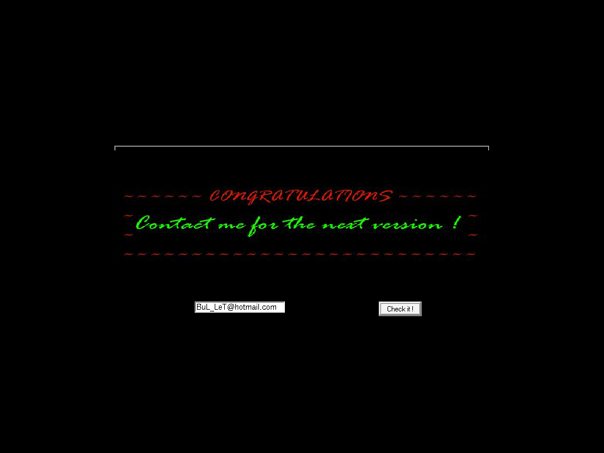
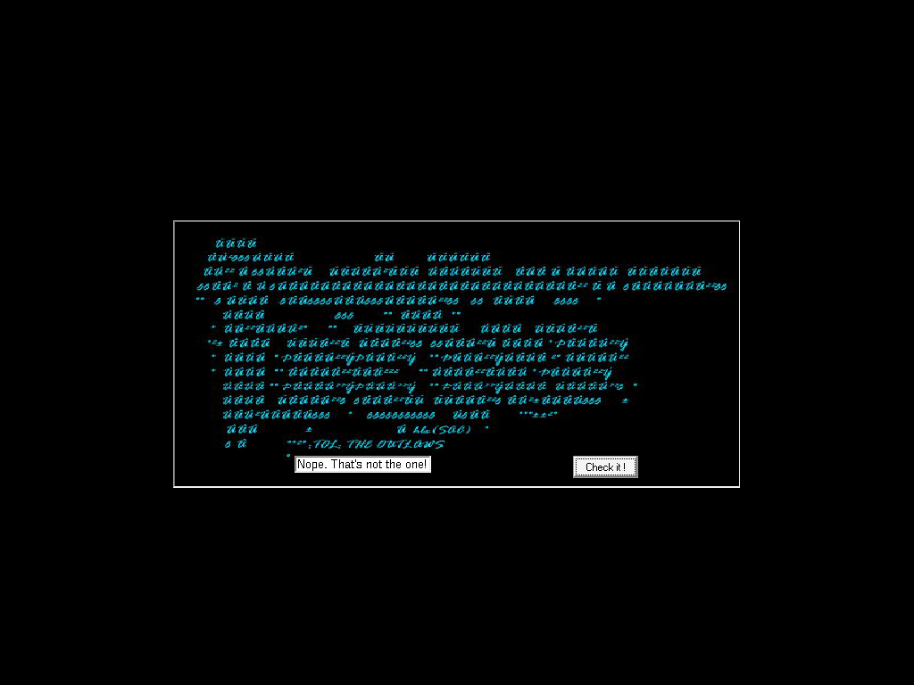

# crackmes.de's crackme_v1.75 by tol (CRaCKMe v1.75 — BuLLeT / The Outlaws '98)

| | |
|---|---|
| **ID** | [`5ab77f5733c5d40ad448c385`](https://crackmes.one/crackme/5ab77f5733c5d40ad448c385) ([`ORIGIN.yml`](ORIGIN.yml)) |
| **Auteur (site)** | crackmes.de (crackme de BuLLeT, groupe TOL « The Outlaws », 31/05/1998) |
| **Plateforme** | Windows PE32 GUI, Visual Basic 5 (MSVBVM50, code natif) |
| **SHA-256 du zip** | `b918edd435be14f3c56a0d6dd16a28d8e9570c0ba410ae6f3e31021773df28e4` |

## Fichiers

| Fichier | Rôle |
|---|---|
| `original/tol_b175.zip` | archive d'origine (mot de passe `crackmes.one`), contient `BRK175.EXE`, `FILE_ID.DIZ`, `TOL98.NFO` |
| `analysis/x/` | contenu dézippé (hors `original/`) |
| `analysis/brk175.asm` | `objdump -d -M intel BRK175.EXE` |
| `analysis/screenshot-ok.png` / `screenshot-ko.png` | preuves live Wine/Xvfb |
| `tools/brk175-solve.py` | solveur (extrait la chaîne du binaire, `--check` = preuve live) |
| `tools/wine-live-test.sh` | pilote Wine + xdotool (saisie + clic + capture) |

## Réponse

**Mot de passe : `2hard4u2crackm8`** (pas de nom/login → pas d'exemple `petik` ; `petik` sert ici de mauvaise entrée).

```bash
python3 -I tools/brk175-solve.py        # Mot de passe : 2hard4u2crackm8
python3 -I tools/brk175-solve.py -q
python3 -I tools/brk175-solve.py --check   # Wine + xvfb + xdotool
```

## Premier regard

```bash
unzip -P crackmes.one original/tol_b175.zip -d analysis/x
file analysis/x/BRK175.EXE      # PE32 executable (GUI) Intel i386, 5 sections
diec analysis/x/BRK175.EXE      # Compiler: Microsoft Visual Basic(5.0)
strings -n 5 analysis/x/BRK175.EXE
strings -el -n 3 analysis/x/BRK175.EXE   # chaînes UTF-16 (BSTR VB)
```

- Fenêtre : `CRaCKMe V1.75 --- By BuLLeT - [TOL'98]`, une textbox (« Enter your guess here :) ») et un bouton « Check it ! ».
- Imports VB : `__vbaStrCmp`, `__vbaObjSet`, `__vbaHresultCheckObj`… ; le projet est `Command1_Click` / `Form1` / `Text1` (chemin PDB-like `C:\Programmer\VB5\BuLLeT\Crackme175\Project1.vbp`).
- Chaînes UTF-16 intéressantes, contiguës dans `.text` : `2hard4u2crackm8`, `BuL_LeT@hotmail.com`, `Nope. That's not the one!`.

## Flow

L'utilisateur tape un texte, clique sur « Check it ! » → handler `Command1_Click`. Il lit `Text1.Text` (vtable IDispatch), le compare à une chaîne constante via `__vbaStrCmp`. Égal : l'image « CONGRATULATIONS / Contact me for the next version ! » est affichée et la textbox prend la valeur `BuL_LeT@hotmail.com`. Différent : textbox = `Nope. That's not the one!`.

## Comment on trouve

**Ancrage** : le handler est tout en fin de `.text` (0x4106xx–0x4107bb). On cherche l'appel à `__vbaStrCmp` (thunk `0x4010b8`) :

```bash
objdump -d -M intel analysis/x/BRK175.EXE > analysis/brk175.asm
grep -n "0x410150\|0x4101b0" analysis/brk175.asm
```

**Lecture du binaire** (`Command1_Click`, extraits commentés) :

```asm
4106c9: mov  eax,[ebx]
4106cb: call [eax+0xa0]         ; Text1.Text (get) -> BSTR dans [ebp-0x18]
4106e6: push DWORD PTR [ebp-0x18]   ; saisie
4106e9: push 0x410150               ; BSTR constant (UTF-16) = "2hard4u2crackm8"
4106ee: call 0x4010b8               ; __vbaStrCmp  -> 0 si égal
4106f3: mov  ebx,eax
4106f8: neg  ebx / sbb ebx,ebx / inc ebx / neg ebx   ; ebx = (eax==0) ? -1 : 0 (VB True/False)
41070c: test bx,bx
410710: je   0x410765               ; faux -> branche « Nope »
; vrai : Image visible (+0x8c), Text1.Text = 0x410184 ("BuL_LeT@hotmail.com")
410774: push 0x4101b0               ; branche faux : Text1.Text = "Nope. That's not the one!"
```

**Décodage** : les VA `0x410150 / 0x410184 / 0x4101b0` correspondent aux offsets fichier `0xf550 / 0xf584 / 0xf5b0` (`.text` : VA 0x401000 ↔ offset 0x400). Ce sont des BSTR UTF-16LE terminés par `00 00` :

```text
0xf550  "2hard4u2crackm8"
0xf584  "BuL_LeT@hotmail.com"
0xf5b0  "Nope. That's not the one!"
```

Le `strings` classique (ASCII) ne montre que `2hard4u2crackm8` quand on le tombe par hasard, mais c'est `strings -el` qui le révèle proprement ; c'est exactement la chaîne passée en 2ᵉ argument de `__vbaStrCmp`. Pas de calcul, pas de dérivation : le mot de passe est une constante.

**Pièges** : (1) la comparaison est sensible à la casse (`__vbaStrCmp` en mode binaire) ; (2) l'adresse `0x4106e9` pousse un BSTR (pointeur sur les caractères, longueur à `-4`), donc la chaîne n'est pas préfixée dans un `strings` ASCII ; (3) sous Wine, `ctrl+a` ne sélectionne pas le texte de la textbox VB : il faut vider par `End` + beaucoup de `BackSpace`, sinon le texte saisi s'ajoute à « Enter your guess here :) » et on obtient un faux KO.

## Vérification

Preuve live avec le binaire d'origine (extrait du zip) sous Wine/Xvfb, saisie par xdotool :

```bash
xvfb-run -a -s "-screen 0 1024x768x24" bash tools/wine-live-test.sh 2hard4u2crackm8 screenshot-ok.png
xvfb-run -a -s "-screen 0 1024x768x24" bash tools/wine-live-test.sh petik screenshot-ko.png
```

| Entrée | Résultat | Capture |
|---|---|---|
| `2hard4u2crackm8` | « CONGRATULATIONS — Contact me for the next version ! », textbox = `BuL_LeT@hotmail.com` |  |
| `petik` | textbox = `Nope. That's not the one!` |  |

## Notes

- Pas de GDB / x64dbg / IDA utilisés : reverse 100 % statique (`objdump` + lecture des BSTR) confirmé par Wine ; section Debug GDB non applicable.
- Pas d'anti-debug ni de pack : le VB5 natif laisse la constante en clair dans `.text`.
- Ce n'est pas un keygen : un seul mot de passe valide.
