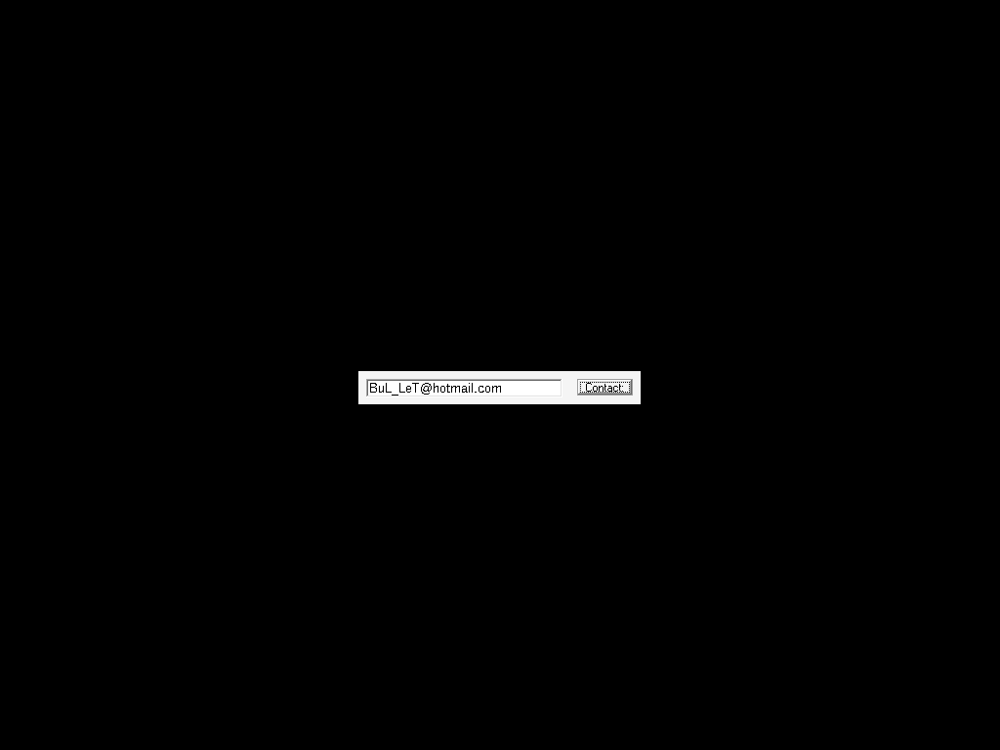
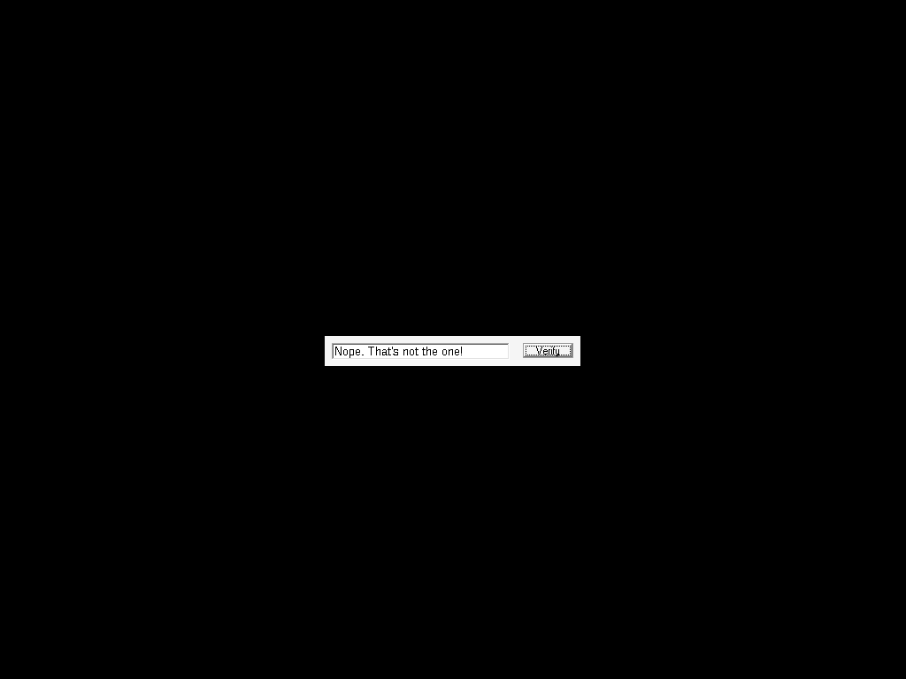

# crackmes.de's crackme_v2.75 by tol (CRaCKMe v2.75 — BuLLeT / The Outlaws '98)

| | |
|---|---|
| **ID** | [`5ab77f5733c5d40ad448c386`](https://crackmes.one/crackme/5ab77f5733c5d40ad448c386) ([`ORIGIN.yml`](ORIGIN.yml)) |
| **Auteur (site)** | crackmes.de (crackme de BuLLeT, groupe TOL « The Outlaws », 09/06/1998) |
| **Plateforme** | Windows PE32 GUI, Visual Basic 5 (MSVBVM50, code natif) |
| **SHA-256 du zip** | `a1d511b45888f9cf8c47b94cfd9a5e99c184afcdb61f25618ca8a3287b5d8a2f` |

## Fichiers

| Fichier | Rôle |
|---|---|
| `original/tol_b275.zip` | archive d'origine (mot de passe `crackmes.one`) : `B-CRKME2.EXE`, `FILE_ID.DIZ`, `TOL98.NFO` |
| `analysis/x/` | contenu dézippé (hors `original/`) |
| `analysis/b-crkme2.asm` | `objdump -d -M intel B-CRKME2.EXE` |
| `analysis/screenshot-ok.png` / `screenshot-ko.png` | preuves live Wine/Xvfb |
| `tools/crackme275-solve.py` | solveur (reconstruit le mot de passe depuis le binaire, `--check` = preuve live) |
| `tools/wine-live-test.sh` | pilote Wine + xdotool (saisie + clic + capture) |

## Réponse

**Mot de passe : `2rK4HJ4-7n8RgT09IW6a7kSlg33`** (pas de nom/login → pas d'exemple `petik` ; `petik` sert ici de mauvaise entrée).

```bash
python3 -I tools/crackme275-solve.py          # Mot de passe : 2rK4HJ4-7n8RgT09IW6a7kSlg33
python3 -I tools/crackme275-solve.py -q
python3 -I tools/crackme275-solve.py --check  # Wine + xvfb + xdotool
```

## Premier regard

```bash
unzip -P crackmes.one original/tol_b275.zip -d analysis/x
file analysis/x/B-CRKME2.EXE     # PE32 executable (GUI) Intel i386, 5 sections
diec analysis/x/B-CRKME2.EXE     # Compiler: Microsoft Visual Basic(5.0)
strings -n 5 analysis/x/B-CRKME2.EXE
```

- Fenêtre « CrackMe #2 By BuLLeT - [TOL'98] » : une textbox (« Enter password here ! ») et un bouton « Verify ».
- Le `strings` ASCII montre des chaînes louches (`l2rK4sdg6lk7n8Rg2ovcns6a7kSlk09ush4dg3312dklfv`, `DFGKHJ45TDLKDSFVLK234RT09IWCFPOMGBH698UGSEOIVN-5NVEWTO845VKJLLKN`) : ce ne sont **pas** le mot de passe, mais deux « tables » dans lesquelles on découpe des morceaux. Contrairement à la v1.75, il n'y a pas de comparaison directe avec une constante.
- Imports VB : `__vbaVarAdd`, `__vbaVarTstEq`, `__vbaVarMove`, `rtcMidCharVar` (via thunk) ; les `_CIsin/_CIcos/_adj_fptan…` sont des imports standard du runtime, non utilisés ici.

## Flow

Clic sur « Verify » → `Command1_Click` (0x401d28–0x402287). Le handler :

1. charge deux variants chaîne constants A et B ;
2. en extrait 6 morceaux par `Mid$` ;
3. les concatène (avec un `"-"` constant) par `__vbaVarAdd` ;
4. compare `Text1.Text` au résultat via `__vbaVarTstEq`.

Égal : bouton = « Contact: », textbox = `BuL_LeT@hotmail.com`. Différent : bouton = « Verify », textbox = `Nope. That's not the one!`.

## Comment on trouve

**Ancrage** : le seul gros handler est à la fin de `.text` ; il contient les appels aux thunks VB `0x4010d0` (Mid), `0x4010b2` (VarAdd), `0x4010c4` (VarTstEq).

```bash
objdump -d -M intel analysis/x/B-CRKME2.EXE > analysis/b-crkme2.asm
grep -n "4010d0\|4010b2\|4010c4" analysis/b-crkme2.asm
```

**Constantes A et B** : deux variants string (`vt=8`) initialisés par `__vbaVarCopy` (thunk `0x4010dc`) :

```asm
401dd4: mov DWORD PTR [ebp-0x124],0x401a04   ; A = BSTR @0x401a04
401de4: call 0x4010dc                        ; copie dans [ebp-0x64]
401df5: mov DWORD PTR [ebp-0x124],0x401a94   ; B = BSTR @0x401a94
401e05: call 0x4010dc                        ; copie dans [ebp-0x84]
```

VA → offset fichier : `.text` VA 0x401000 ↔ offset 0x400. Ce sont des BSTR UTF-16LE, longueur en octets à `-4` :

```text
A (0x401a04, 69 car.) = l2rK4sdg6lk7n8Rg2ovcns6a7kSlk09ush4dg3312dklfvækjgæh4356ælkasdffc1tg5
B (0x401a94, 64 car.) = DFGKHJ45TDLKDSFVLK234RT09IWCFPOMGBH698UGSEOIVN-5NVEWTO845VKJLLKN
```

Piège : A contient trois `æ` (0xE6) qui font couper `strings` en morceaux (`dklfv` / `kjg` / `h4356` / `lkasdffc1tg5`) ; vues en UTF-16 la chaîne est continue et les positions `Mid` en tiennent compte (même si les morceaux extraits ne les touchent pas).

**Six `Mid$`** (`rtcMidCharVar(dst, src, start, [len])`, `start` = Long, `len` = Variant Integer dont la valeur est à `[ebp-0xa4]`) :

```asm
401e0a..401e30: len=4,  start=2     sur A -> [ebp-0x74]   ; Mid(A, 2, 4)  = "2rK4"
401e54..401e72: len=5,  start=0xc   sur A -> [ebp-0x94]   ; Mid(A,12, 5)  = "7n8Rg"
401e93..401eb7: len=6,  start=0x17  sur A -> [ebp-0x24]   ; Mid(A,23, 6)  = "6a7kSl"
401f17..401ef9: len=3,  start=0x25  sur A -> [ebp-0x34]   ; Mid(A,37, 3)  = "g33"
401f1d..401f3e: len=3,  start=5     sur B -> [ebp-0x44]   ; Mid(B, 5, 3)  = "HJ4"
401f5c..401f83: len=5,  start=0x17  sur B -> [ebp-0x54]   ; Mid(B,23, 5)  = "T09IW"
```

**Concaténation** : `__vbaVarAdd(dst, left, right)` — les arguments sont empilés de droite à gauche, donc le *dernier* `push` est la destination, l'avant-dernier l'opérande gauche :

```asm
402003: push -0x44(HJ4)  ... push -0x74(2rK4)  ; (poussés dans cet ordre)
40202c: call VarAdd  ; r1 = Mid74 + Mid44     = "2rK4" + "HJ4"
402040: call VarAdd  ; r2 = r1 + "-"          (const 0x401b2c = "-")
402054: call VarAdd  ; r3 = r2 + Mid94        (+ "7n8Rg")
402065: call VarAdd  ; r4 = r3 + Mid54        (+ "T09IW")
402076: call VarAdd  ; r5 = r4 + Mid24        (+ "6a7kSl")
402087: call VarAdd  ; r6 = r5 + Mid34        (+ "g33")
40208d: call 0x4010c4 ; __vbaVarTstEq(r6, Text1.Text)
4020da: cmp si,di / je 0x402140               ; faux -> « Nope »
```

Résultat : `2rK4` `HJ4` `-` `7n8Rg` `T09IW` `6a7kSl` `g33` = **`2rK4HJ4-7n8RgT09IW6a7kSlg33`**.

**Pièges** : (1) ma première lecture de l'ordre d'empilement des `__vbaVarAdd` était inversée (concat `g33 6a7kSl T09IW 7n8Rg - HJ4 2rK4`, donnée par `Mid34 + Mid24 + …`) : elle est rejetée par le binaire (« Nope »), l'ordre correct a été validé en live ; (2) le `"-"` n'est pas dans A/B mais dans une constante séparée à 0x401b2c ; (3) `Mid` est 1-based ; (4) sous Wine, la textbox est vidée par `End` + beaucoup de `BackSpace` avant la saisie (le texte de départ est « Enter password here ! »).

Chaînes du handler : `0x401b34` « Contact: », `0x401b5c` `BuL_LeT@hotmail.com`, `0x401b88` « Verify », `0x401b9c` « Nope. That's not the one! ».

## Vérification

Binaire d'origine (extrait du zip) sous Wine/Xvfb, saisie par xdotool :

```bash
xvfb-run -a -s "-screen 0 1024x768x24" bash tools/wine-live-test.sh 2rK4HJ4-7n8RgT09IW6a7kSlg33 screenshot-ok.png
xvfb-run -a -s "-screen 0 1024x768x24" bash tools/wine-live-test.sh petik screenshot-ko.png
```

| Entrée | Résultat | Capture |
|---|---|---|
| `2rK4HJ4-7n8RgT09IW6a7kSlg33` | bouton « Contact: », textbox = `BuL_LeT@hotmail.com` |  |
| `petik` | textbox = `Nope. That's not the one!` |  |

Aussi KO (testé) : l'ordre inversé `g336a7kSlT09IW7n8Rg-HJ42rK4`.

## Notes

- Pas de GDB / x64dbg / IDA : reverse statique (`objdump` + décodage des BSTR), confirmé par Wine ; section Debug GDB non applicable.
- Pas d'anti-debug ni de pack. Pas un keygen : un seul mot de passe, mais construit à l'exécution (donc invisible à `strings`, contrairement à la v1.75).
