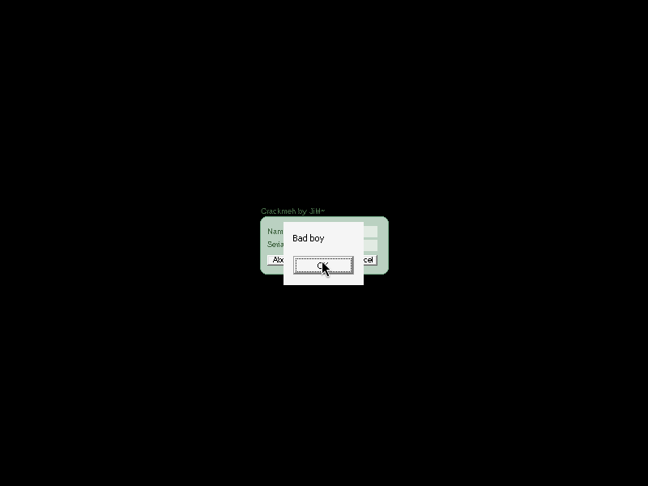

# Crackmeh (crackmeh) — JiM~

| | |
|---|---|
| **ID** | [`5ab77f5733c5d40ad448c389`](https://crackmes.one/crackme/5ab77f5733c5d40ad448c389) ([`ORIGIN.yml`](ORIGIN.yml)) |
| **Auteur (site)** | crackmes.de (JiM~) |
| **Plateforme** | Windows PE32 GUI, Delphi 2006 (Turbo Linker 2.25), FastMM |
| **SHA-256 (zip)** | `648e56a149fe03f1bebd48a1d0b2d7582d1280d876f14c6813ee4dd116c8a699` |

## Fichiers

| Chemin | Rôle |
|---|---|
| `original/Crackmeh.zip` | archive d'origine (mot de passe `crackmes.one`), contient `Crackmeh.exe` |
| `analysis/x/Crackmeh.exe` | exe extrait (copie de travail, `original/` intact) |
| `analysis/screenshot-ok.png` / `screenshot-ko.png` | preuve Wine : *Good boy* / *Bad boy* |
| `tools/crackmeh-solve.py` | keygen (`-q`, `--check`) |
| `tools/wine-live-test.sh` | pilote le crackme sous Xvfb + xdotool + capture ffmpeg |

## Réponse

Keygen name → serial (16 caractères) :

| Name | Serial |
|---|---|
| `petik` | **`10N1bT6bh0WC2228`** |
| `Hello` | `10KXbR6nl0WC2228` |

```bash
python3 tools/crackmeh-solve.py petik          # name=petik serial=10N1bT6bh0WC2228
python3 tools/crackmeh-solve.py -q petik       # serial seul
python3 tools/crackmeh-solve.py petik --check 10N1bT6bh0WC2228   # OK
```

## Premier regard

```bash
unzip -P crackmes.one original/Crackmeh.zip -d analysis/x
file analysis/x/Crackmeh.exe   # PE32 GUI i386, 9 sections
diec analysis/x/Crackmeh.exe   # Borland Delphi 2006, Turbo Linker 2.25
```

Fenêtre `TForm1` sans bordure : `Edit1` (Name), `Edit2` (Serial), boutons About / Check / Cancel. Pas de packer. Les `strings` sont noyées dans la RTL/VCL Delphi (FastMM, TEdit…) ; l'utile est le DFM (ressource `TPF0`, offset fichier `0x61c88`) qui donne les noms de handlers : `Button2Click` pour *Check*.

## Flow

`Check` → `Button2Click` : calcule un serial depuis `Edit1.Text` et le compare à `Edit2.Text` → `ShowMessage('Good boy')` ou `'Bad boy'`.

## Comment on trouve le prédicat

**Ancrage** : les handlers VCL sont listés dans la table de méthodes publiées de `TForm1`. On cherche le nom `\x0cButton2Click` dans `.text` (offset `0x59350`), l'entrée précédente `13 00 | b8 a1 45 00` donne l'adresse du handler : **VA `0x45a1b8`** (`Button1Click` = `0x45a134`, About).

```bash
objdump -d -M intel analysis/x/Crackmeh.exe --start-address=0x45a1b8 --stop-address=0x45a335
```

**Lecture de `Button2Click`** (strings Delphi : `refcnt|len|data`, les littéraux sont `"\x01"` @0x45a34c, `"\x02"` @0x45a358, `"\x03"` @0x45a364, `"="` @0x45a370) :

```asm
push 45a34c ; "\x01"
mov  eax,[ebx+368h] ; Edit1 -> GetText (0x43bc28)
push name
push 45a358 ; "\x02"
push 45a364 ; "\x03"
call _LStrCatN(…, 4)       ; s = "\x01" + name + "\x02" + "\x03"
call 0x459fc4              ; s = Base64Custom(s)
; boucle : tant que RightStr(s,1) == "=" -> re-encode (ne se déclenche jamais, pas de padding)
loop: cmp Length(s),10h ; jl corps
  corps : s = IntToStr(len mod 10) + s + IntToStr(len*2)
call 0x42e300 (edx=10h)    ; s = RightStr(s,16)
cmp avec Edit2.Text -> "Good boy" / "Bad boy"
```

Points de lecture :

- `_LStrCatN` (`0x404a08`) : le premier argument empilé est la première chaîne (il lit `[esp+n*4+0x18]` en premier) → ordre naturel d'empilement.
- `0x42e300` : `lea eax,[len]; inc; sub eax,esi; copy` → c'est **`RightStr(s, n)`** (n derniers caractères), pas `LeftStr`.
- `0x4085f4` = `IntToStr`.

**Base64 custom** (`0x459fc4`) : accumulateur de bits classique (`esi` = acc, `ebx` = nb de bits) : à chaque octet `acc = acc<<8 + b`, `bits += 8`, tant que `bits >= 6` émettre `ALPHA[acc >> (bits-6)]`. Reste final : `ALPHA[acc << (6-bits)]`. **Aucun padding `=`**. Alphabet @0x45a0f0 : `0123456789ABCDEFGHIJKLMNOPQRSTUVWXYZabcdefghijklmnopqrstuvwxyz+/` (chiffres d'abord — pas l'ordre RFC).

**Assemblage pour `petik`** :

1. `s = 01 70 65 74 69 6b 02 03` (8 octets)
2. base64 custom : 8 octets = 64 bits → 10 caractères + 4 bits restants (décalés de 2) = 11 caractères : `0N1bT6bh0WC`
3. len 11 < 16 → `"1"` (11 mod 10) + s + `"22"` (11×2) = `10N1bT6bh0WC22` (14 caractères)
4. len 14 < 16 → `"4"` (14 mod 10) + s + `"28"` (14×2) = `410N1bT6bh0WC2228` (17 caractères ≥ 16)
5. `RightStr(s,16)` (le `4` de tête saute) → **`10N1bT6bh0WC2228`**

**Piège rencontré** : première version du keygen avec `LeftStr` → *Bad boy* sous Wine alors que les champs étaient bien saisis ; relecture de `0x42e300` (calcul `len+1-n`) → c'est `RightStr`. Confirme qu'on ne signe rien sans preuve live.

## Vérification (Wine / Xvfb)

```bash
tools/wine-live-test.sh petik 10N1bT6bh0WC2228 analysis/screenshot-ok.png   # Good boy
tools/wine-live-test.sh petik 10N1bT6bh0WC2229 analysis/screenshot-ko.png   # Bad boy (dernier chiffre modifié)
tools/wine-live-test.sh Hello 10KXbR6nl0WC2228 /tmp/hello.png               # Good boy (2e nom)
```




Le script lance Xvfb `:77`, `wine Crackmeh.exe`, saisit via `xdotool` (coordonnées fixes de la fenêtre centrée), clique *Check* et capture avec `ffmpeg -f x11grab`.

## Notes

- Debug 100 % statique + Wine ; ni GDB ni x64dbg/IDA n'ont été utilisés → pas de section « Debug GDB ».
- Pour un nom court, la queue `…2228` ne dépend que de la longueur du base64 (11 car.) ; seule la tête dépend du nom.
- Noms longs : le serial est les 16 derniers caractères du base64 (aucun padding appliqué), donc seule la fin du nom influence le résultat.
