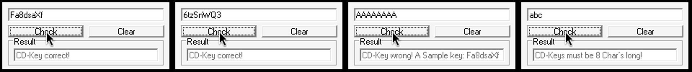

# KeygenME1 (keygenme1) — darkmaster2

| | |
|---|---|
| **ID** | [`5ab77f5833c5d40ad448c394`](https://crackmes.one/crackme/5ab77f5833c5d40ad448c394) · [`ORIGIN.yml`](ORIGIN.yml) |
| **Auteur** | darkmaster2 (« Darkmaster », via crackmes.de) |
| **Plateforme** | Windows PE32 GUI, Visual Basic 6 **natif** (`MSVBVM60.DLL`) |
| **SHA-256 (zip)** | `98f49a0ef7b51c46a8c904342946bb68c391624b2591f16bc84e6c2d67d44349` |

## Fichiers

| Chemin | Rôle |
|---|---|
| `original/keygenme.zip` | archive d'origine (contient `KeygenME.exe` + `Readme.txt`), non modifiée |
| `analysis/extracted/` | contenu dézippé (`unzip -P crackmes.one`) |
| `analysis/disasm.txt` | `objdump -d -M intel` de `.text` |
| `analysis/screenshot-verification.png` | preuve live Wine (4 cas) |
| `tools/keygenme1-solve.py` | keygen + `--check` |
| `tools/wine-live.sh` | pilotage Xvfb + Wine + xdotool + capture, pour la preuve live |

## Réponse

Pas de nom d'utilisateur : la clé (« CD-Key ») est autonome, `petik` n'a donc pas lieu d'être ici.

| Clé (8 caractères) | Résultat |
|---|---|
| `Fa8dsaXf` (exemple de l'auteur) | `CD-Key correct!` |
| `6tzSnWQ3` (générée) | `CD-Key correct!` |

```bash
python3 -I tools/keygenme1-solve.py            # une clé
python3 -I tools/keygenme1-solve.py -n 5 -q    # plusieurs
python3 -I tools/keygenme1-solve.py --check Fa8dsaXf
```

## Premier regard

```bash
unzip -P crackmes.one original/keygenme.zip -d analysis/extracted
file analysis/extracted/KeygenME.exe   # PE32 GUI, i386, 3 sections
diec  analysis/extracted/KeygenME.exe  # Microsoft Linker 6.0, Visual Basic 6.00.8041 [Native]
strings -n 5 analysis/extracted/KeygenME.exe
```

Strings utiles : `CD-Keys must be 8 Char` + `s long!` (la chaîne est coupée en deux : le `'` de « Char's » est un octet non imprimable), `CD-Key correct!`, `CD-Key wrong! A Sample key: Fa8dsaXf`, `No CD-Key checked yet!`. Le chemin PDB VB (`C_KeygenME.vbp`) confirme VB6. Import unique : `MSVBVM60.DLL` (`__vbaLenBstr`, `__vbaStrVarVal`, `__vbaVarTstLe`, `rtcAnsiValueBstr`…, voir `objdump -p`).

L'UI : une zone de saisie (pré-remplie `CD-Key`, **MaxLength = 8**), boutons `Check` / `Clear`, un label `Result`.

## Flow

`Check_Click` (code natif à `0x402250`, appelé via la table d'événements du form) :

1. lit le texte (`call [edx+0x30c]` → propriété `.Text`) ;
2. `Len(texte) < 8` → message « CD-Keys must be 8 Char's long! » ;
3. calcule un nombre `x` à partir des 8 caractères ;
4. `x == 20` → `CD-Key correct!`, sinon `CD-Key wrong! A Sample key: Fa8dsaXf`.

## Comment on trouve le prédicat

**Ancrage** : le binaire est du VB6 natif, donc pas de P-code à décompiler, mais du x86 truffé d'appels `__vba*`. On repère le handler en cherchant les `push` des adresses des chaînes (`0x401bd4` = « must be 8 chars », `0x401c18` = correct, `0x401c3c` = wrong) : tous dans la fonction `0x402250..0x40262a`.

**Lecture** (adresses de `analysis/disasm.txt`) :

```asm
4022ff  cmp  eax, 8            ; eax = Len(text)  (__vbaLenBstr)
402302  jge  40234a            ; sinon -> message "must be 8 Chars"

; --- boucle 1 : somme des codes ASCII, i = 1..8
40234a  mov  [ebp-8c], 8       ; borne
402354  mov  esi, 1            ; i
402391  call Mid$(text, i, 1)  ; 0x401040
4023a6  call rtcAnsiValueBstr  ; Asc()  (ordinal 516)
4023ac  add  ax, bx            ; bx += Asc(...)   (16 bits, jo -> overflow)

; --- mélange
4023eb  imul ax, ax, 2         ; 2*S
4023f8  xor  eax, ebx          ; x = (2*S) ^ S

; --- boucle 2 : réduction "digit root" partielle
402430  call __vbaLenVar       ; Len(Str$(x))   (Str$ ajoute un espace de signe)
40243b  call __vbaVarTstLe     ; Len <= 3 ?     (donc x <= 99)
402447  not  esi
40244f  test si, si
402452  je   40254c            ; x a <= 2 chiffres -> sortie de boucle
40248f  mov  esi, 2            ; j = 2 : on SAUTE le 1er char de Str$(x) (l'espace)
4024dc  call Mid$(Str$(x), j, 1)
4024f1  call Asc
402503  sub  ax, 0x30          ; chiffre
4024f7  add  ax, di           ; di += chiffre
402541  mov  [ebp-1c], edi     ; x = somme des chiffres ; on reboucle en 402403

40254c  cmp  word [ebp-1c], 0x14   ; x == 20 ?
402554  jne  40257f                 ; wrong
```

**Décodage / pièges**

- `Str$(x)` d'un nombre positif commence par un espace : c'est pourquoi la boucle 2 démarre à `j = 2` et pourquoi le test est `Len <= 3` (= au plus 2 chiffres) et non `<= 2`.
- Les opérations sont en `Integer` VB (16 bits signé) avec `jo` → `ErrorOverflow`. Avec 8 caractères ASCII imprimables, `S ≤ 8·126 = 1008`, `2S ≤ 2016` : aucun débordement.
- La boucle externe est un « do while Len > 3 » : si `x >= 100`, on le remplace par la somme de ses chiffres, jusqu'à avoir `x <= 99`. Le test final est `x == 20` : soit `x` est directement 20 (deux chiffres), soit une somme de chiffres tombe sur 20 (ex. 1919 → 1+9+1+9 = 20).
- L'`xor` est entre `2S` et `S` : ce n'est **pas** `3S`.

**Vérification à la main** sur l'exemple de l'auteur `Fa8dsaXf` :
`70+97+56+100+115+97+88+102 = 725` → `2·725 = 1450` → `1450 ^ 725 = 1919` → `1+9+1+9 = 20` ✔.

**Prédicat consolidé** (`tools/keygenme1-solve.py`) :

```python
s = sum(map(ord, key[:8]))
x = (2*s) ^ s
while x >= 100: x = sum(map(int, str(x)))
ok = (x == 20)
```

Les clés valides sont très nombreuses (aucune contrainte sur les caractères) : le keygen tire 8 caractères alphanumériques au hasard jusqu'à satisfaire le prédicat.

## Vérification

Sans GDB ni x64dbg (analyse statique + Wine) :

```bash
xvfb-run -a wine analysis/extracted/KeygenME.exe        # ou tools/wine-live.sh <clé> <png>
tools/wine-live.sh Fa8dsaXf analysis/shot.png
```

`tools/wine-live.sh` lance Xvfb+Wine (display 377 par défaut, `DSP=` pour changer), clique `Clear`, saisit la clé, clique `Check` et capture le framebuffer (`-fbdir`, converti avec PIL).



De gauche à droite : `Fa8dsaXf` → *correct* ; `6tzSnWQ3` (keygen) → *correct* ; `AAAAAAAA` → *wrong* (S = 520, 1040 ^ 520 = 1560 → 12 ≠ 20) ; `abc` → *CD-Keys must be 8 Char's long!*.

## Notes

- Piège UI : la zone de saisie a `MaxLength=8` et contient `CD-Key` au départ ; il faut `Clear` avant de taper, sinon la saisie est tronquée (`CD-KeyFa`…).
- Pas de nom : le prédicat ne dépend que des 8 premiers caractères ; au-delà de 8 la zone refuse la saisie.
- Aucun anti-debug, aucune table cachée : le « sample key » affiché par le crackme est lui-même une clé valide.
