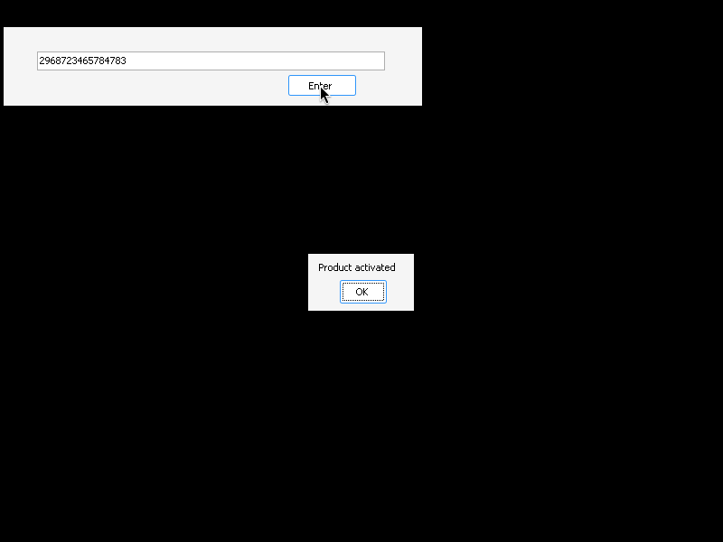
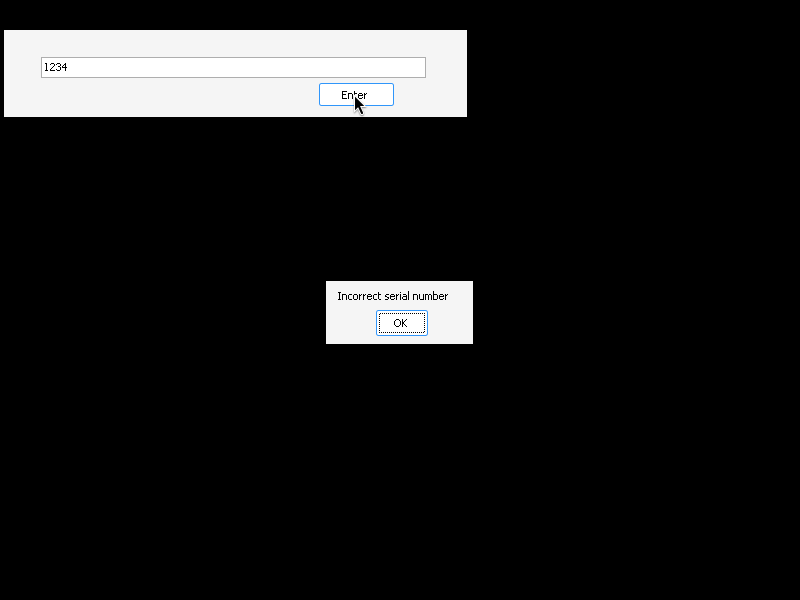

# crackmes.de's krakkrsr (KrakkRSR.exe) by crackr

| | |
|---|---|
| **ID** | [`5ab77f5833c5d40ad448c3b9`](https://crackmes.one/crackme/5ab77f5833c5d40ad448c3b9) · [`ORIGIN.yml`](ORIGIN.yml) |
| **Auteur** | crackr (miroir crackmes.de, famille locale `crackmes-de`) |
| **Plateforme** | Windows PE32 GUI, .NET Framework 4 (WinForms, C#) |
| **SHA-256 (archive)** | `51d54c5fd6e3e0c8b697771fe4f253ad5ffd81067ebd09f0b7260a6968e84908` |

## Fichiers

| Chemin | Rôle |
|---|---|
| `original/KrakkRSR.zip` | archive d'origine (**en réalité un RAR v4**, malgré l'extension) |
| `analysis/KrakkRSR.exe` | exe extrait (`unar`) |
| `analysis/KrakkRSR-src/` | C# décompilé (`ilspycmd -p`) |
| `analysis/screenshot-ok.png`, `screenshot-ko.png` | preuve live Wine + Mono |
| `tools/krakkrsr-solve.py` | solveur / extracteur du serial (`-q`, `--check`) |

## Réponse

**Serial : `2968723465784783`**

Pas de nom d'utilisateur : `petik` n'est pas utilisé (le serial est une constante).

```bash
python3 -I tools/krakkrsr-solve.py          # Serial : 2968723465784783
python3 -I tools/krakkrsr-solve.py -q --check
```

## Premier regard

```bash
file original/KrakkRSR.zip      # RAR archive data, v4  (pas un ZIP !)
7z x original/KrakkRSR.zip      # « Unsupported Method » -> exe de 0 octet
unar -o analysis/y original/KrakkRSR.zip   # OK, KrakkRSR.exe (8192 o)
file analysis/KrakkRSR.exe      # PE32 GUI, Mono/.Net assembly
diec analysis/KrakkRSR.exe      # .NET Framework CLR 4.0.30319, Visual Studio
```

Piège : `7z` ouvre le RAR mais échoue sur la méthode de compression et laisse un fichier vide ; `unar` fonctionne.
Les `strings` montrent `Form1`, `button1`, `textBox1`, `textBox1_TextChanged` : une fenêtre avec un champ + un bouton « Enter ».

## Flow

1. L'utilisateur tape un texte dans `textBox1`, clique sur `button1` (« Enter »).
2. `button1_Click` compare le texte à un champ privé `krakkey`.
3. Égal → MessageBox « Product activated », sinon « Incorrect serial number ».

## Comment on trouve

**Ancrage** : assembly .NET, donc pas d'IDA — décompilation C# :

```bash
export PATH=$PATH:~/.dotnet/tools:~/.dotnet DOTNET_ROOT=~/.dotnet
ilspycmd -p -o analysis/KrakkRSR-src analysis/KrakkRSR.exe
# (l'alias `decompiledotnet` n'existe pas dans le shell agent : appel direct d'ilspycmd)
```

Le check est dans `analysis/KrakkRSR-src/KrakkRSR/Form1.cs` :

```csharp
private string krakkey = "2968723465784783";      // initialisé dans le ctor

private void button1_Click(object sender, EventArgs e)
{
    if (textBox1.Text == krakkey)                 // comparaison de strings directe
        MessageBox.Show("Product activated");
    else
        MessageBox.Show("Incorrect serial number");
}
```

Aucune transformation : le serial est un littéral. On le retrouve aussi sans décompileur : les littéraux
C# vivent dans le heap `#US` en UTF-16LE (offset fichier `0x11ee` pour le serial, `0x1210` pour
« Product activated ») — c'est ce que fait `tools/krakkrsr-solve.py` (regex `\d{16}` sur le décodage UTF-16LE).

Pièges : l'extension `.zip` est trompeuse (RAR) ; le serial n'apparaît **pas** dans `strings` simple car il est en UTF-16
(`strings -el` le montre).

## Vérification

Sous Wine + Mono (Wine Mono présent), serveur sans écran : `Xvfb` + `xdotool` (clic dans le champ, saisie, clic sur « Enter ») + capture `ffmpeg -f x11grab`.

| Saisie | Résultat | Capture |
|---|---|---|
| `2968723465784783` | « Product activated » |  |
| `1234` | « Incorrect serial number » |  |

## Notes

- Aucun GDB / debugger utilisé (reverse 100 % statique + preuve live Wine), donc pas de section GDB.
- Ce n'est pas un keygen : un unique serial valide, codé en dur ; pas de dépendance au nom, à la machine ou à la date.
