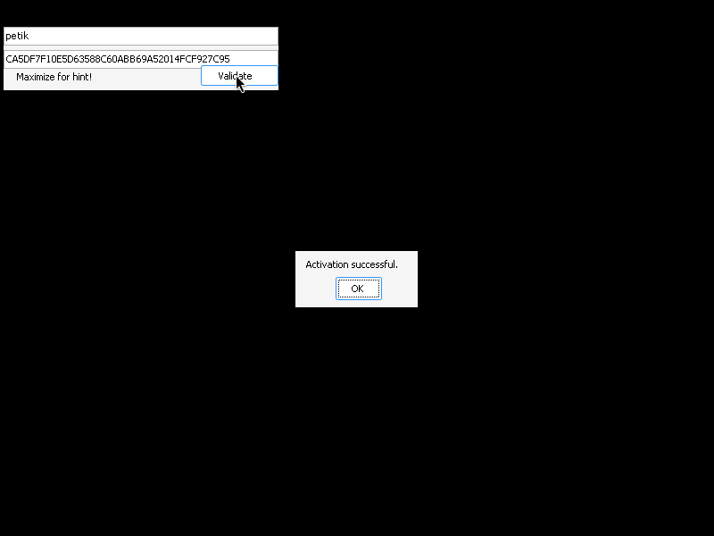
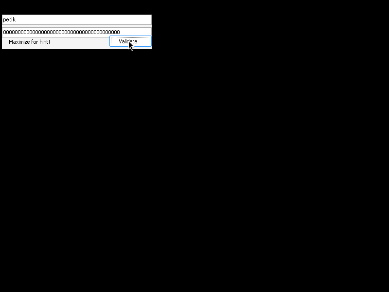

# crackmes.de's KRAKK v.10 SHA-1 edition (keygenme) by crackr

| | |
|---|---|
| **ID** | [`5ab77f5833c5d40ad448c3ba`](https://crackmes.one/crackme/5ab77f5833c5d40ad448c3ba) · [`ORIGIN.yml`](ORIGIN.yml) |
| **Auteur** | crackr (miroir crackmes.de, famille locale `crackmes-de`) |
| **Plateforme** | Windows PE32 GUI, .NET Framework 4 (WinForms, C#) |
| **SHA-256 (archive)** | `b88397f2f0d65d1b5545a66427e41884fc3051cb55b268c035e63d20af3f28ef` |

## Fichiers

| Chemin | Rôle |
|---|---|
| `original/KRAKK_v.10_SHA-1_edition.zip` | archive d'origine (ZIP, mot de passe `crackmes.one`) — non modifiée |
| `analysis/krakk-sha1.exe` | exe extrait (`KRAKK v.10 SHA-1 edition.exe`, renommé sans espaces) |
| `analysis/krakk-sha1-src/` | C# décompilé (`ilspycmd -p`) |
| `analysis/screenshot-ok.png`, `screenshot-ko.png` | preuve live Wine + Mono |
| `tools/krakk-sha1-solve.py` | keygen (`-q`, `--check`) |

## Réponse

**Key = SHA-1(UTF-8(username)) en hexadécimal MAJUSCULES (40 caractères).**

| Username | Key |
|---|---|
| `petik` | `CA5DF7F10E5D63588C60ABB69A52014FCF927C95` |

```bash
python3 -I tools/krakk-sha1-solve.py            # petik -> CA5DF7F1...
python3 -I tools/krakk-sha1-solve.py -q alice
python3 -I tools/krakk-sha1-solve.py --check
```

## Premier regard

```bash
unzip -P crackmes.one -d analysis/x original/KRAKK_v.10_SHA-1_edition.zip
file analysis/x/*.exe     # PE32 GUI, Mono/.Net assembly
diec analysis/x/*.exe     # .NET Framework CLR 4.0.30319, Visual Studio
strings -n 5 analysis/x/*.exe   # Form1, Form2, textBox1/2, SHA1Managed, get_UTF8, Append...
```

Les `strings` annoncent déjà la couleur : `SHA1Managed`, `get_UTF8`, `StringBuilder.Append`. L'UI
(Form1) affiche « Username », « Key », un bouton « Validate » et le label « Maximize for hint! » (le
label `X2` caché en dessous, cf. plus bas, est l'indice).

## Flow

1. `textBox1` (Username) : à chaque modification, `sha1 = Hash(textBox1.Text)`.
2. `button1_Click` : si `sha1 == textBox2.Text` → MessageBox « Activation successful. » puis ouverture de Form2 (bouton « CrackR » → lien vers la page de l'auteur).
3. Sinon : rien ne se passe (aucun message d'erreur).

## Comment on trouve

**Ancrage** : assembly .NET, donc pas d'IDA — décompilation C#. L'alias `decompiledotnet` n'est pas disponible
dans le shell agent, appel direct d'`ilspycmd` :

```bash
ilspycmd -p -o analysis/krakk-sha1-src analysis/krakk-sha1.exe
```

Le check est dans `analysis/krakk-sha1-src/KRAKK_v._10_SHA_1_edition/Form1.cs` :

```csharp
private void textBox1_TextChanged(object s, EventArgs e) { sha1 = Hash(textBox1.Text); }

private static string Hash(string input)
{
    using SHA1Managed h = new SHA1Managed();
    byte[] d = h.ComputeHash(Encoding.UTF8.GetBytes(input));   // SHA-1 de l'UTF-8 du nom
    StringBuilder sb = new StringBuilder(d.Length * 2);
    foreach (byte b in d) sb.Append(b.ToString("X2"));          // hex MAJUSCULES, 2 chiffres/octet
    return sb.ToString();
}

private void button1_Click(object s, EventArgs e)
{
    if (sha1 == textBox2.Text) {                                // comparaison sensible à la casse
        MessageBox.Show("Activation successful.");
        new Form2().Show();
    }
}
```

Décodage : la clé est donc la représentation hexadécimale du SHA-1 du nom. Le format `"X2"` impose les
**majuscules** (le label « X2 » du formulaire est l'indice annoncé par « Maximize for hint! ») et la comparaison de
chaînes est ordinale/sensible à la casse : la version en minuscules est refusée.

Exemple `petik` : `SHA1("petik")` = `ca5df7f10e5d63588c60abb69a52014fcf927c95` → majuscules
`CA5DF7F10E5D63588C60ABB69A52014FCF927C95`.

Pièges :
- `sha1` n'est calculé que dans `textBox1_TextChanged` : si le nom n'est jamais modifié, `sha1` reste `null` et rien ne valide (le texte par défaut « Username » n'est pas hashé).
- `textBox1_MouseDown` vide le champ au premier clic (placeholder « Username »/« Key »).
- Aucune ponctuation / nouvelle ligne : le hash porte sur les octets UTF-8 exacts (espaces compris).

## Vérification

Wine + Mono sur serveur sans écran : `Xvfb :77` + `xdotool` (clic champ, saisie, clic « Validate ») + capture `ffmpeg -f x11grab`.
Piège de test : le décor de fenêtre décale les coordonnées de (4, 30) px.

| Saisie | Résultat | Capture |
|---|---|---|
| `petik` / `CA5DF7F10E5D63588C60ABB69A52014FCF927C95` | « Activation successful. » |  |
| `petik` / `0000…0000` (40 zéros) | aucune MessageBox |  |

## Notes

- Aucun GDB / debugger : reverse 100 % statique + preuve live Wine, donc pas de section GDB.
- C'est un vrai keygen (la clé dépend du nom) ; ni machine, ni date. Pas de protection particulière.
