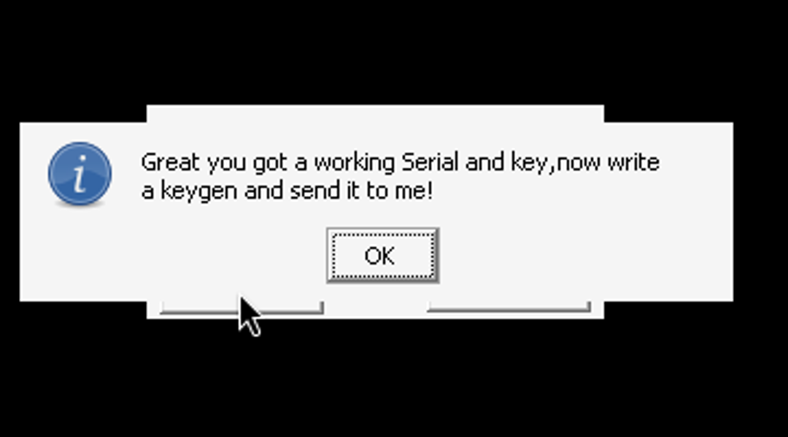
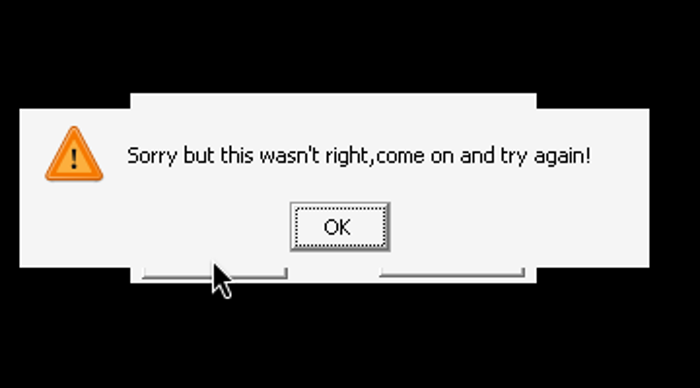

# crackme_n1 (crackme_1.exe) — ByteL0rd / mAsTeR_pOwEr

| | |
|---|---|
| **ID** | [`5ab77f5833c5d40ad448c3c2`](https://crackmes.one/crackme/5ab77f5833c5d40ad448c3c2) · [`ORIGIN.yml`](ORIGIN.yml) |
| **Auteur (site)** | crackmes.de (crackme de *ByteL0rd*, release MP2K 2003-08-28) |
| **Plateforme** | Windows PE32 GUI, Borland Delphi (non-VCL, API Win32 brutes), Turbo Linker |
| **SHA-256 (zip)** | `24b64a920557748e452e30de90572e273279b1a36db0742cccac3c37bdd0c0ae` |

## Fichiers

| Chemin | Rôle |
|---|---|
| `original/bytel0rds_crackme_n1.other_mp2k.zip` | archive d'origine (contient `crackme_1.exe`, `mp.nfo`, `file_id.diz`) |
| `analysis/x/` | contenu du zip décompressé (copie de travail, `original/` n'est pas touché) |
| `analysis/screenshot-ok.png` / `screenshot-ko.png` | preuve Wine (cas OK / KO) |
| `tools/crackme-n1-solve.py` | keygen + `--check` (pilote le vrai `.exe` sous Wine/Xvfb via `xdotool`) |

## Réponse

Trois champs : **Name** (≥ 5 car.), **RegKey** (`DDD-DDD-DDD-L`), **Serial** (5 chiffres `1-9`).

| Name | RegKey | Serial |
|---|---|---|
| **`petik`** | `111-111-111-A` | **`11118`** |

```bash
python3 -I tools/crackme-n1-solve.py --name petik            # -> regkey=111-111-111-A serial=11118
python3 -I tools/crackme-n1-solve.py --name petik --check analysis/x/crackme_1.exe
```

Le RegKey est libre (tant que le format est respecté et que `V^n < 2^63`, voir plus bas) ; le solveur calcule le Serial correspondant à `--name` / `--regkey`.

## Premier regard

```text
$ file original/*.zip   -> Zip archive (11700 octets)
$ diec crackme_1.exe    -> PE32, Linker: Turbo Linker 2.25, Compiler: Borland Delphi 6-7/2005
$ strings -n 6 crackme_1.exe
Succeed!  / Great you got a working Serial and key,now write a keygen and send it to me!
NO :-(    / Sorry but this wasn't right,come on and try again!
About     / This is my very first 'real'  KeyGenMe ...
```

Le `.nfo` annonce « quelques opérations arithmétiques simples, pas d'anti-debug ». La fenêtre (Wine) : `Name`, `RegKey`, `Serial`, boutons `Check` / `About`.

## Flow

La fenêtre est gérée par une WndProc écrite à la main (`0x403a9c`). Sur `WM_COMMAND` (`0x111`, `wParam` = 0 → bouton *Check*) :

1. `GetDlgItemTextA` ×3 sur les contrôles `5`, `6`, `7` (Name, RegKey, Serial), avec tests de longueur (`0x403b55`, `0x403b88`, `0x403bb7`) :
   `len(Name) ≥ 5`, `len(RegKey) == 13` (`0xd`), `len(Serial) == 5`.
2. `call 0x403790(Name, RegKey, Serial)` : calcule la valeur globale `[0x405688]`.
3. `call 0x403754([0x405688])` ; `cmp al,1` → *Succeed!* sinon `NO :-(` (`0x403bd4`).

## Comment on trouve

**Ancrage** : `strings` donne les messages ; `objdump -d -M intel --start-address=0x403690 --stop-address=0x403a00` (+ `0x403a00…0x403aa0` pour la fin). La fonction `0x403790` fait tout le calcul, `0x403754` est le test final. (Pas d'IDA nécessaire : code Delphi court.)

### 1. Name → n (`0x4037f8..0x403868`)

```asm
; boucle 1 : concatène chaque caractère (0x40303c = CharToStr) dans une string temp
; boucle 2 : somme des octets
403847: add DWORD PTR [0x40566c], eax        ; S = sum(Name)
403859: call 0x4036d8                         ; IntToBin(S) -> chaîne de '0'/'1' (récursif S>>1, table "0123456789ABCDEF"[S&1])
403883: cmp BYTE PTR [eax+ebx-1], 0x31        ; compte les '1'
40388a: inc DWORD PTR [0x40566c]              ; n = popcount(S)
```

`petik` : `112+101+116+105+107 = 541 = 0b1000011101` → **n = 5**.

### 2. RegKey → V (`0x40389b..0x403995`)

Format strict `DDD-DDD-DDD-L`, chiffres `'1'..'9'` (le `0` est refusé : `cmp al,0x31 / jb`), séparateurs `'-'` aux index 3, 7, 11 :

```asm
4038c0: mov edx,0xb ; sub edx,ebx ; imul edx   ; chiffre * (11-i)   i=1..3  -> poids 10,9,8
40390a: mov edx,0xc ; sub edx,ebx ; imul edx   ; chiffre * (12-i)   i=5..7  -> poids 7,6,5
403954: mov edx,0xd ; sub edx,ebx ; imul edx   ; chiffre * (13-i)   i=9..11 -> poids 4,3,2
403992: and eax,1   ; add [0x405670],eax        ; dernier car. 'A'..'Z' : + (c & 1)
```

`V = Σ d_k·(10,9,8,7,6,5,4,3,2) + (L & 1)`. `111-111-111-A` : `54 + 1 = 55`.

### 3. Boucle x87 : V^n (`0x40399d..0x4039d6`)

`[0x40567c]` est initialisé à `1.0` (extended `3fff 8000000000000000`), puis `n` fois `fild V ; fmulp` → `V^n` en `long double`. Piège : `fistp` (`0x40257c`) convertit ensuite en int64 signé.

### 4. Serial → K (`0x4039d8..0x403a55`)

Chaque caractère doit être `'1'..'9'`, puis conversion décimale (poids ×10 en partant de la fin) → entier `K`.

### 5. Test final

```asm
403a55: mov eax,[0x405674]        ; K
403a5d: fld TBYTE [0x40567c]      ; V^n
403a63: call 0x40257c             ; fistp qword -> edx:eax = round(V^n)
403a68: call 0x4031d0             ; _llmod : (V^n) mod K  (signé 64 bits, args K sur la pile)
403a6d: mov [0x405688], eax
...
403bca: mov eax,[0x405688] ; call 0x403754 ; cmp al,1
```

`0x403754` est un test de primalité naïf (division d'essai de 2 à n/2 ; renvoie `0` pour `n==1` ou n composé).
**Prédicat** : `(round(V^n) mod K)` doit être premier (au sens de ce test : `0,2,3,5,7,…` passent aussi, `1` et les composés non).

`petik` / `111-111-111-A` : `55^5 = 503284375` ; `503284375 mod 11118 = 5869` (premier) ✓ ; `mod 11111 = 519 = 3·173` ✗.

### Pièges

- **Trois champs, mal nommés** : le crackme appelle « Serial » le champ de 5 chiffres et « RegKey » celui à tirets ; l'ordre des `GetDlgItemText` (ctrl 5/6/7) est Name, RegKey, Serial.
- **Overflow `fistp`** : si `V^n ≥ 2^63`, l'exception x87 *invalid operation* (CW Delphi `0x1332`, non masquée) est levée, capturée par le `try` de `0x403790`, et `[0x405688]` reste à sa valeur initiale `4` (non premier) → **toujours KO**. Constaté sous Wine : `abcde` + `357-951-246-Q` (`262^8 ≈ 2.2·10^19`) échoue pour tout Serial, alors que `abcde` + `444-444-554-A` (`V=224`, `224^8 < 2^63`) passe avec `11111`. Le solveur refuse ce cas avec un message clair.
- Pas de contrôle de plage hors `1..9`, donc le `0` interdit partout (RegKey et Serial).

## Vérification

`--check` lance le vrai `crackme_1.exe` sous `xvfb-run -a wine`, clique dans les 3 champs (`xdotool`), clique *Check* et détecte la MessageBox `Succeed!`.

| Cas | Résultat |
|---|---|
| `petik` / `111-111-111-A` / `11118` | **OK** — [screenshot-ok.png](analysis/screenshot-ok.png) |
| `petik` / `111-111-111-A` / `11111` (mod = 519 composé) | **KO** — [screenshot-ko.png](analysis/screenshot-ko.png) |
| `Reverser_Engineer` / `999-987-654-Z` / `11113` | OK |
| `zzzzzzzz` / `999-999-999-Z` / `11123` | OK |
| `abcde` / `444-444-554-A` / `11111` | OK (proche de la limite `2^63`) |
| `abcde` / `357-951-246-Q` / n'importe | KO (overflow `fistp`) |




## Notes

- Pas de GDB ni de debugger live : reverse 100 % statique (`objdump`) + preuve Wine ; pas de section Debug GDB.
- Le zip de `original/` n'est pas modifié ; l'exécutable est dézippé sous `analysis/x/`.
- Ce n'est ni un patch ni un check de nom/serial figé : le Serial dépend de (Name, RegKey) ; beaucoup de solutions existent (tout `K` tel que `V^n mod K` est « premier »).
