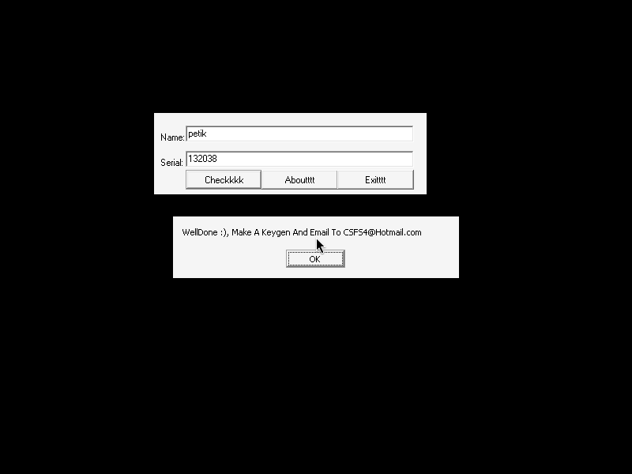
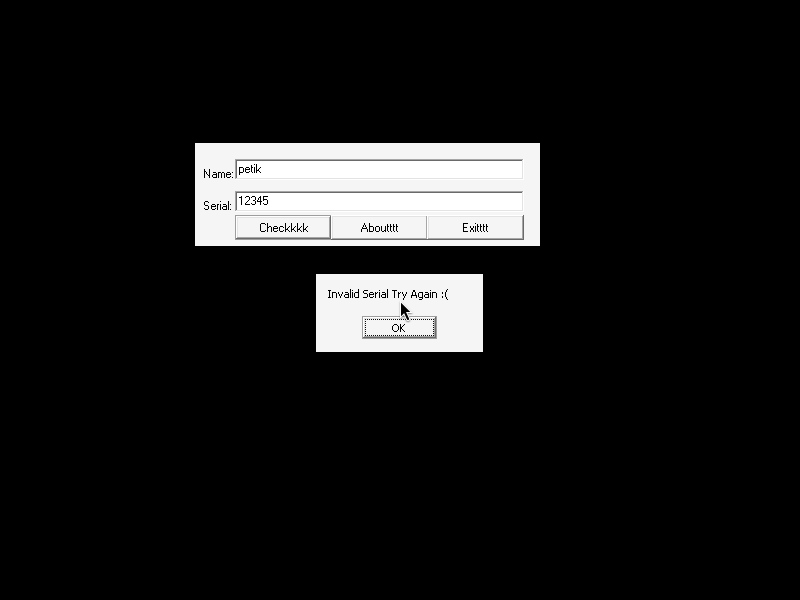

# crackmes.de's crackmes4begginers___keygenme1 by csfs

| | |
|---|---|
| **ID** | [`5ab77f5833c5d40ad448c3c8`](https://crackmes.one/crackme/5ab77f5833c5d40ad448c3c8) ([`ORIGIN.yml`](ORIGIN.yml)) |
| **Auteur** | csfs (crackmes.de) |
| **Plateforme** | Windows PE32 GUI, Borland Delphi 7 |
| **SHA-256 (zip)** | `9111a160b95de01718caca3ef9b680cef1adb25372b4c7733f3174261c3f6caf` |

## Fichiers

| Chemin | Rôle |
|---|---|
| `original/keygenme1.zip` | archive d'origine (contient `keygenme1.exe` + `README.txt`), non modifiée |
| `analysis/extract/` | extraction du zip (mot de passe `crackmes.one`) |
| `analysis/screenshot-ok.png` / `screenshot-ko.png` | preuve live Wine (serial valide / invalide) |
| `tools/keygenme1-csfs-solve.py` | keygen |

## Réponse

Serial = **code ASCII du dernier caractère du nom × 1234**, en décimal.

| Nom | Serial |
|---|---|
| `petik` | **`132038`** (`'k'`=107 → 107×1234) |

```bash
python3 tools/keygenme1-csfs-solve.py petik     # petik -> 132038
python3 tools/keygenme1-csfs-solve.py -q petik  # 132038
```

## Premier regard

```bash
unzip -P crackmes.one original/keygenme1.zip -d analysis/extract
file analysis/extract/keygenme1.exe   # PE32 GUI, i386
diec analysis/extract/keygenme1.exe   # Borland Delphi 7, Turbo Linker
```

Le `README.txt` de l'auteur dit : « Find a valid serial for your name, but remember don't always look in the EAX register » — indice : le serial n'est pas simplement visible dans EAX au moment de la comparaison (c'est une chaîne Delphi, `AnsiString`, comparée via un appel RTL).

Fenêtre « Keygen Me 1 By CSFS » : champs **Name** et **Serial**, boutons `Checkkkk` / `Aboutttt` / `Exittttt`.

## Flow

`Button1Click` (Check) lit les deux Edit, calcule le serial attendu depuis le nom, compare, et affiche une `ShowMessage` : `WellDone :), Make A Keygen And Email To CSFS4@Hotmail.com` ou `Invalid Serial Try Again :(`.

## Comment on trouve

**Ancrage.** Binaire Delphi : le handler est un événement publié, donc référencé dans la table des méthodes publiées de `TForm1`. On cherche le nom dans le fichier :

```python
i = d.find(b'\x0cButton1Click')   # 0x52bd9 ; juste avant : a4 38 45 00  -> adresse 0x4538a4
```

(`strings` montre aussi `Edit1`, `Button1`, `TForm1`, `Button1Click`). Désassemblage : `objdump -d -M intel --start-address=0x4538a4 --stop-address=0x453970 analysis/extract/keygenme1.exe`.

**Lecture** (`Button1Click` @ `0x4538a4`, commenté) :

```asm
mov  eax,[ebx+0x2f8]      ; Edit « Name »
call 0x432a4c             ; TControl.GetText -> [ebp-4]
mov  eax,[ebp-4]
call 0x40410c             ; Length(name)  (eax = len)
mov  edx,[ebp-4]
movzx eax,byte [edx+eax-1]; c = name[len]  (1-indexé Delphi) = DERNIER caractère
imul edx,eax,0x16         ; c*22
imul esi,edx,0x38         ; c*22*56 = c*1232
add  eax,eax              ; 2c
add  esi,eax              ; c*1232 + 2c = c*1234
call 0x407ce0             ; IntToStr(esi) -> [ebp-8]
mov  eax,[ebx+0x2fc]      ; Edit « Serial »
call 0x432a4c             ; -> [ebp-0xc]
call 0x404258             ; LStrCmp(serial, attendu)
jne  ...                  ; égal -> ShowMessage("WellDone :) ...")
...                       ; second contrôle identique ; différent -> "Invalid Serial Try Again :("
```

**Décodage.** Seul le dernier caractère compte : `c*0x16*0x38 + 2c = c*(1232+2) = 1234*c`. Le serial est `IntToStr` de cette valeur (donc décimal). Exemple `petik` : dernier car. `k`=0x6B=107 → 107×1234 = **132038**. Conséquence : tous les noms finissant par `k` ont le même serial.

**Pièges.** Le « don't look in EAX » : la comparaison passe par `LStrCmp` sur des `AnsiString`, EAX/EDX ne sont que des pointeurs. Il y a deux comparaisons successives (le premier test affiche WellDone, le second affiche Invalid si différent) — elles testent la même chose. Nom vide : `name[0]` lu hors chaîne, le solveur le refuse.

## Vérification

Preuve live sous Wine (`xvfb-run -a`), pilotée avec `xdotool` (saisie Name, Tab, Serial, Tab, Espace sur `Checkkkk`) puis capture `ffmpeg x11grab` :

- OK : `petik` / `132038` →  « WellDone :), Make A Keygen And Email To CSFS4@Hotmail.com »
- KO : `petik` / `12345` →  « Invalid Serial Try Again :( »

## Notes

- Pas de GDB : reverse statique (objdump) + preuve Wine.
- `original/` non modifié ; l'extraction est sous `analysis/extract/`.
