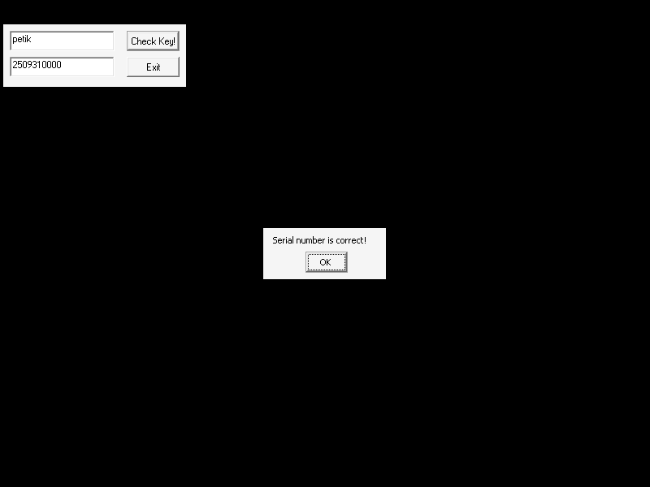
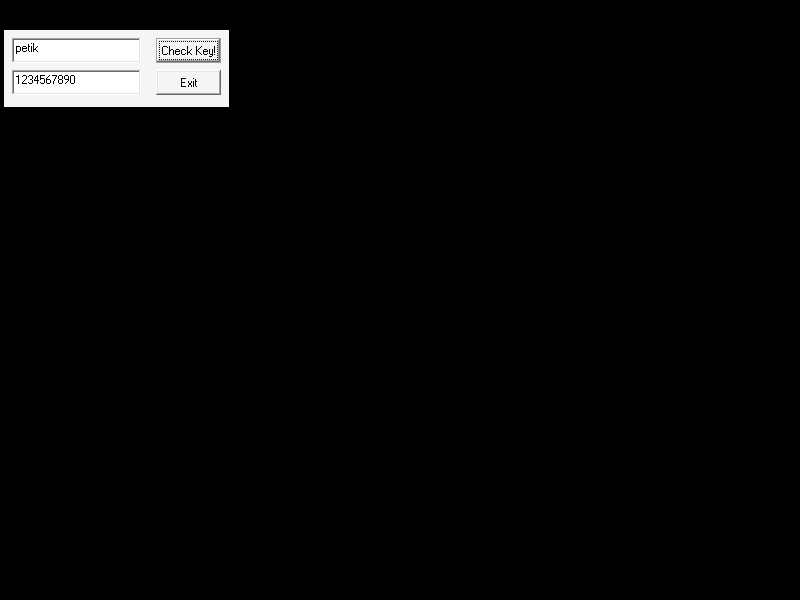

# UTW KeyGenMe v3 (rootsec / otromasf) — crackmes.de mirror

| | |
|---|---|
| **ID** | [`5ab77f5833c5d40ad448c3e7`](https://crackmes.one/crackme/5ab77f5833c5d40ad448c3e7) · [`ORIGIN.yml`](ORIGIN.yml) |
| **Auteur (site)** | crackmes.de (crackme signé *otromasf*, « More hard that UTW KeyGenMe ») |
| **Plateforme** | Windows PE32 GUI, **VB6 natif**, packé **FSG 2.0** |
| **SHA-256 (zip)** | `6122ffe1249faeb9292a30d146ca2a32ac07662937deece10bc39c5bd6cb47dc` |
| **SHA-256 (`UTW KGMv3.exe`)** | `028acb239c45b127d9c8209e19ca49ca155cff8e609a99b649e4187129d36cc9` |

## Fichiers

| Chemin | Rôle |
|---|---|
| `original/UTW_KGMv3.zip` | archive d'origine (`UTW KGMv3.exe` + `Readme.txt`), non modifiée |
| `tools/utw-kgmv3-solve.py` | **keygen** name→serial, `-q`, `--name`, `--check` (preuve Wine, cas OK + KO) |
| `tools/fsg-unpack-unicorn.py` | unpack FSG sous Unicorn (sans exécuter le PE) |
| `tools/wine-drive.sh` | pilote Xvfb + Wine + xdotool (saisie + clic + capture) |
| `tools/kgmv3.gdb` | script GDB (attach au process Wine) |
| `analysis/kgmv3-unpacked-dump.bin` | image dépackée brute (0x400000..0x40d000) |
| `analysis/kgmv3-native-402ab0-405e20.asm` | désassemblage du code VB natif (`objdump -D`) |
| `analysis/screenshot-ok.png` / `screenshot-ko.png` | preuve Wine |

## Réponse

Keygen : **`serial = str(A) + str(B)`** avec `A = len(name) + 2·c²` (`c` = code ASCII du **1er** caractère) et `B = len(name) · 2000`.

| Name | Serial |
|---|---|
| **`petik`** | **`2509310000`** |
| `abc` | `188216000` |

```bash
python3 tools/utw-kgmv3-solve.py                  # petik -> 2509310000
python3 tools/utw-kgmv3-solve.py --name abc -q    # 188216000
python3 tools/utw-kgmv3-solve.py --check original/UTW_KGMv3.zip
```

Contraintes (arithmétique `Integer` VB 16 bits, un overflow lève une erreur) : name non vide, 1er caractère ASCII ≤ 127, `len ≤ 16`, `A ≤ 32767`.

## Premier regard

```text
$ unzip -P crackmes.one original/UTW_KGMv3.zip -d /tmp/utw3     # (zip non chiffré en pratique)
$ file "UTW KGMv3.exe"   -> PE32 executable (GUI) Intel 80386, 2 sections
$ diec  "UTW KGMv3.exe"  -> Packer: FSG(2.0)
```

- Deux sections : une vide en raw (RVA `0x1000`, vsize `0x9000`, destination du dépack) et une section de données packées (RVA `0xa000`, raw `0x200`, `0x2b8d` octets).
- EP = RVA `0x154` : le stub FSG vit **dans l'en-tête PE** (`xchg esp,[0x40cb50]` / `popa` / décompresseur aPLib-like).
- Après dépack : imports **MSVBVM60.DLL** (`__vbaStrCat`, `__vbaVarTstEq`, `__vbaStrI2`…) → **VB6**. Resources/VB header : `VB5!` à `0x401c4c`, projet « KeyGenMe », Form1 avec `Text1`, `Text2`, `Command1` (« Check Key! ») et Exit.
- Textes : `Serial number is correct!` (MessageBox, titre `UTW KeyGenMe `), plus `OLLYDBG.EXE`, `idag.exe`, `winmgmts:`, `win32_process`, `Terminate` → **anti-debug** (WMI : tue OllyDbg / IDA s'ils tournent).
- Le `Readme.txt` demande un keygen (pas de patch).

## Flow

1. `Form_Load`/timer : énumère les process (`winmgmts:` → `win32_process`) et `Terminate` ceux nommés `OLLYDBG.EXE` / `idag.exe` (fonction vers `0x403370`, `__vbaVarLateMemCallLd`). Sous Wine, rien à tuer.
2. Clic sur **Check Key!** (handler `0x402b50`) : lit `Text1` (name) et `Text2` (serial), recalcule le serial attendu, **passe les deux chaînes dans la même fonction de transformation** (`0x405c70`), puis compare avec `__vbaVarTstEq`.
3. Égalité → MessageBox `Serial number is correct!`.

## Comment on trouve

### Ancrage — dépack FSG

`diec` annonce FSG ; pas d'`upx`. On l'émule avec Unicorn (`tools/fsg-unpack-unicorn.py`) :

- map de l'en-tête à `0x400000` et des données packées à `0x40a000`, pile à `0x1f0000` ;
- le stub fait `xchg esp,[0x40cb50]` / `popa` : `ebx = 0x40cb54` devient la table de pointeurs du décompresseur (`[ebx]` getbit, `[ebx+0xc]` = saut final = **OEP `0x401470`**, `[ebx+0x10]` = LoadLibraryA, `[ebx+0x14]` = GetProcAddress) ;
- piège : ces deux derniers slots contiennent des RVA de noms ; on les écrase (hook sur `0x400160`) par des adresses factices `0x70000000/0x70000100` interceptées en `UC_HOOK_CODE` qui rendent des thunks `ret` et enregistrent le nom de l'API ;
- arrêt à l'OEP : `68 4c 1c 40 00 / e8 …` = `push VBHeader (0x401c4c)` / `call ThunRTMain`. Dump de l'image → `analysis/kgmv3-unpacked-dump.bin` (88 imports MSVBVM60 reconstitués dans l'IAT `0x401000-0x40115c`).

Le dump est du **VB6 natif** (pas du P-code) : le code est en `0x402b50..0x405e10`.

```bash
python3 tools/fsg-unpack-unicorn.py "UTW KGMv3.exe" analysis/kgmv3-unpacked-dump.bin
objdump -D -b binary -mi386 -M intel --adjust-vma=0x400000 \
        --start-address=0x402ab0 --stop-address=0x405e20 analysis/kgmv3-unpacked-dump.bin
```

### Lecture du handler `0x402b50`

Les appels `__vba*` sont lus via l'IAT (`0x401xxx`) ; noms issus de l'IAT reconstruite par l'unpacker ; les ordinaux MSVBVM60 (`ord516`, `ord608`, `ord617`) sont **identifiés par leur usage** (non vérifiés contre une table) : `0x401034`≈`Asc`, `0x4010d8`≈`Chr`, `0x401138`≈`Left`, `0x401054` = `__vbaLenVar`, `0x401004` = `__vbaStrI2`, `0x401048` = `__vbaStrCat`, `0x40109c` = `__vbaVarTstEq`).

```asm
402c10: call [edx+0x308]        ; Text1 (objet contrôle) ...
402c2a: call [ecx+0xa0]         ; ... .Text -> [ebp-0x24] = name
402c70: call [eax+0x304]        ; Text2 .Text -> [ebx+0x44] = serial saisi
```

Premier bloc : chaînes décoy reconstruites par `Chr` + `__vbaVarCat` : `Chr(0x55)&Chr(0x54)&Chr(0x57)` = `"UTW"` → `[ebx+0x38]` et `Chr(55,38,35,54,38,34,57,38,37)` = `"U85T84W87"` → `[ebx+0x34]` (le serial du v2 !). **Ces deux champs ne servent pas** à la comparaison finale : piège hérité du crackme précédent.

Calcul réel :

```asm
402ee9: push 1 ; call [0x401138]   ; Left(name,1)  -> var68      (ord617 ≈ Left$)
402ef5: push 2 ; call [0x401138]   ; Left(name,2)  -> var78
402f0f: call [0x401034]            ; Asc(Left(name,1))      = c   (Asc ne lit que le 1er car.)
402f1b: imul dx,dx,2 ; jo ...      ; 2*c            (Integer, jo = overflow VB)
402f34: call [0x401034]            ; Asc(Left(name,2))      = c   (encore le 1er !)
402f47: imul dx,ax ; jo ...        ; 2*c*c
402f6a: call edi (LenVar) ; VarAdd(Len(name), 2*c*c) ; I2Var -> [ebx+0x3c] = A
402fbc: mov [ebp-0x160],0x7d0      ; 2000
402fe0: VarMul(Len(name), 2000)    ; I2Var -> [ebx+0x3e] = B
```

Piège : `Asc(Left(name,2))` n'est **pas** le 2e caractère : `Asc` d'une chaîne renvoie le code du premier. C'est pour ça que ma première lecture (2e caractère → `22629`) était fausse ; la valeur observée sous gdb (`25093`) a corrigé ça.

Assemblage :

```asm
402ffc..403015: __vbaStrI2(A), __vbaStrI2(B) ; __vbaStrCat(...) -> [ebp-0x40]
```

L'ordre de concaténation n'est pas évident à la lecture de la pile ; l'observation sous GDB (voir plus bas) tranche : la chaîne attendue avant transformation est `CStr(A) & CStr(B)`. Avec `petik` : `len=5`, `c = 'p' = 112` → `A = 5 + 2·112·112 = 25093`, `B = 5·2000 = 10000` → **`2509310000`**.

### La transformation `0x405c70` = MD5

Les deux chaînes (attendue et saisie) passent par `0x405c70` (appelle `0x403c70`, `0x405d60` — initialisation de constantes flottantes —, `0x4039a0`, `0x405510`, `0x405af0`) : un **MD5 écrit en VB**. Je n'ai pas relu cette routine en détail : j'ai observé les entrées/sorties sous GDB (section suivante) et vérifié `md5("2509310000") = cdfeff45cfe85635beee1bbb724ac7fc` (valeur lue en mémoire = hash standard). MD5 étant sans collision pratique, `MD5(saisie) == MD5(attendu)` ⇔ `saisie == attendu` : le keygen est simplement la chaîne en clair `CStr(A)&CStr(B)`, aucun besoin d'inverser le hash.

## Debug GDB (pas à pas)

GDB n'a pas servi à lancer le PE mais à **s'attacher au process Wine** pour lire les chaînes avant/après hash (confirmation de la formule).

```bash
# 1. Xvfb + wine (cf. tools/wine-drive.sh)
Xvfb :79 -screen 0 800x600x24 &  export DISPLAY=:79
wine "UTW KGMv3.exe" &
# 2. PID du process PE (comm = "UTW KGMv3.exe", pas "wine")
P=$(pgrep -x "UTW KGMv3.exe" | tail -1)
# 3. attach + breakpoints (tools/kgmv3.gdb)
gdb -q -p $P -batch -x tools/kgmv3.gdb
# 4. xdotool : name=petik, serial=2509310000, clic sur Check Key!
```

`tools/kgmv3.gdb` :

| Adresse | Observation |
|---|---|
| `*0x403029` (avant `call 0x405c70` sur le serial attendu) | `x/hs *(int*)($ebp-0x40)` → `u"2509310000"` (A puis B) |
| `*0x403082` (juste avant `__vbaVarTstEq`) | `x/hs $eax` → `u"cdfeff45cfe85635beee1bbb724ac7fc"` (MD5 attendu) |

Résultat observé pour `petik` : `PRE-EXPECTED = 2509310000`, `EXPECTED-T = cdfeff45cfe85635beee1bbb724ac7fc` = `md5("2509310000")`. Puis la MessageBox apparaît (fenêtre `UTW KeyGenMe`).

Pièges :
- les chaînes VB sont des **BSTR UTF-16** → `x/hs` (pas `x/s`) ;
- le breakpoint doit tomber sur une **frontière d'instruction** : `0x403083` (milieu de `lea edx,[ebp-0x168]`) a produit un `SIGILL` ; l'instruction commence en `0x403082` ;
- le process Wine du PE a pour `comm` `UTW KGMv3.exe` : prendre ce PID, pas celui du `wine` lanceur ;
- ne pas lancer deux `gdb -p` sur le même PID (`already traced`) ;
- un `pkill -f` large tue aussi le shell appelant : utiliser `pgrep -x`.

## Vérification

```bash
python3 tools/utw-kgmv3-solve.py --check original/UTW_KGMv3.zip
```

```text
'petik' '2509310000' -> MessageBox (OK)   [|UTW KeyGenMe|UTW KeyGenMe |UTW KeyGenMe|]
'petik' '1234567890' -> rien (KO)         [|KeyGenMe|UTW KeyGenMe |]
```

Aussi `abc` / `188216000` → OK.

- OK :  — MessageBox `Serial number is correct!`
- KO :  — aucune fenêtre supplémentaire.

## Notes

- Ce n'est **pas** un serial fixe : il dépend de `len(name)` et du 1er caractère (le 2e n'entre pas en jeu, `Asc(Left(name,2))` = `Asc(name[0])`).
- `UTW` / `U85T84W87` (serial du v2) sont calculés mais jamais comparés : leurre.
- Le MD5 « maison » ne protège rien : il est appliqué des deux côtés.
- L'anti-debug WMI (`OLLYDBG.EXE`, `idag.exe`) n'a pas d'effet sous Wine/GDB.
- Dépack/émulation seulement ; `original/` n'a jamais été modifié (zip extrait dans `/tmp`).
