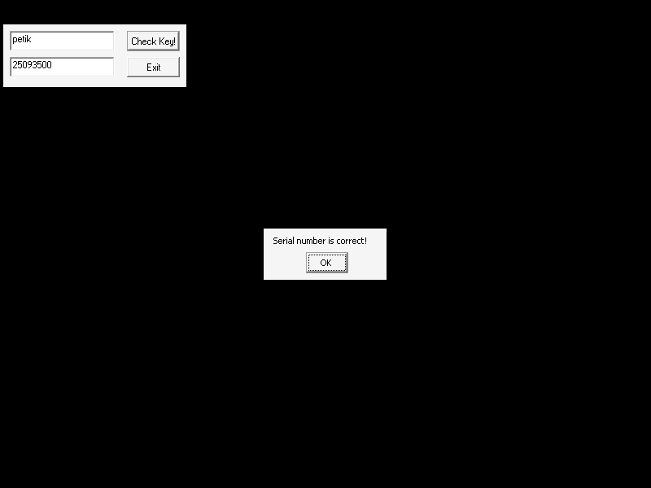
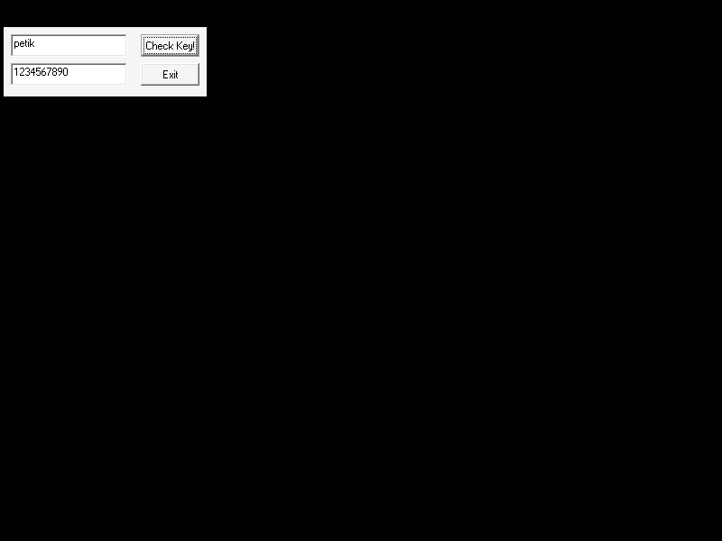

# UTW KeyGenMe (rootsec / otromasf) — crackmes.de mirror

| | |
|---|---|
| **ID** | [`5ab77f5833c5d40ad448c3e8`](https://crackmes.one/crackme/5ab77f5833c5d40ad448c3e8) · [`ORIGIN.yml`](ORIGIN.yml) |
| **Auteur (site)** | crackmes.de (crackme signé *otromasf*, version 1 de la série UTW KeyGenMe) |
| **Plateforme** | Windows PE32 GUI, **VB6 natif**, packé **FSG 2.0** |
| **SHA-256 (zip)** | `23fdd50659f41b20c732d47a5b3b7f1be388b832ee649c9e16a0e1bc5a4a5584` |
| **SHA-256 (`UTW KeyGenMe.exe`)** | `2b73c978ff7c62892dc324c4e890a31303bab8f40e5b1e06a3b28244a626c9c2` |

## Fichiers

| Chemin | Rôle |
|---|---|
| `original/UTW_KeyGenMe.zip` | archive d'origine (`UTW KeyGenMe.exe` + `Readme.txt`), non modifiée |
| `tools/utw-keygenme-solve.py` | **keygen** name→serial, `-q`, `--name`, `--check` (preuve Wine, cas OK + KO) |
| `tools/fsg-unpack-unicorn.py` | unpack FSG sous Unicorn (sans exécuter le PE) |
| `tools/wine-drive.sh` | pilote Xvfb + Wine + xdotool (saisie + clic + capture) |
| `analysis/keygenme-unpacked-dump.bin` | image dépackée brute (`0x400000..0x409000`) |
| `analysis/iat.txt` | IAT reconstituée (slot → API MSVBVM60) |
| `analysis/keygenme-handler-4027c0-402e8f.asm` | désassemblage du handler du bouton (`objdump -D`) |
| `analysis/screenshot-ok.png` / `screenshot-ko.png` | preuve Wine |

## Réponse

Keygen : **`serial = str(A) + str(B)`** avec `A = len(name) + 2·c²` (`c` = code ASCII du **1er** caractère) et `B = len(name) · 100`.

| Name | Serial |
|---|---|
| **`petik`** | **`25093500`** |
| `abc` | `18821300` |

```bash
python3 tools/utw-keygenme-solve.py                  # petik -> 25093500
python3 tools/utw-keygenme-solve.py --name abc -q    # 18821300
python3 tools/utw-keygenme-solve.py --check original/UTW_KeyGenMe.zip
```

Contraintes (arithmétique `Integer` VB 16 bits, un overflow lève une erreur) : name non vide, 1er caractère ASCII ≤ 127, `A ≤ 32767`, `len·100 ≤ 32767`.

## Premier regard

```text
$ unzip -P crackmes.one original/UTW_KeyGenMe.zip -d /tmp/utw1     # (zip non chiffré en pratique)
$ file "UTW KeyGenMe.exe"   -> PE32 executable (GUI) Intel 80386, 2 sections
$ diec  "UTW KeyGenMe.exe"  -> Packer: FSG(2.0)
```

- Deux sections : une vide en raw (RVA `0x1000`, vsize `0x6000`, destination du dépack) et une section de données packées (RVA `0x7000`, raw `0x200`, `0x1a29` octets).
- EP = RVA `0x154` : le stub FSG vit **dans l'en-tête PE** (`xchg [0x4089ec],esp` / `popa` / décompresseur).
- Après dépack : imports **MSVBVM60.DLL** (`__vbaStrI2`, `__vbaStrCat`, `__vbaVarTstEq`, `__vbaLenVar`…) → **VB6**. Form1 « Check Key! » avec `Text1`, `Text2`, `Command1`.
- Textes : `Serial number is correct!` (MessageBox, titre `UTW KeyGenMe `), `OLLYDBG.EXE`, `idag.exe`, `winmgmts:`, `win32_process`, `Terminate` → **anti-debug WMI** (tue OllyDbg/IDA ; sans effet sous Wine).
- Le `Readme.txt` demande un keygen, sans patch, avec tutoriel.

## Flow

1. Clic sur **Check Key!** : handler VB natif en `0x4027c0` (jusqu'à `0x402e8f`).
2. Lit les deux champs texte, calcule le serial attendu à partir du name, le compare (`__vbaVarTstEq`) au serial saisi.
3. Égalité → `MsgBox "Serial number is correct!"` (titre `UTW KeyGenMe`).

## Comment on trouve

### Ancrage — dépack FSG

`diec` annonce FSG ; pas d'`upx`. Même méthode que pour [utw_keygenme_v3](../5ab77f5833c5d40ad448c3e7/) : émulation Unicorn de l'en-tête (`tools/fsg-unpack-unicorn.py`).

- en-tête mappé à `0x400000`, données packées à `0x407000`, pile à `0x1f0000` ;
- le stub fait `xchg [0x4089ec],esp` / `popa` : `ebx` devient la table de pointeurs du décompresseur (`[ebx+0x10]` = LoadLibraryA, `[ebx+0x14]` = GetProcAddress) ;
- piège : ces deux slots contiennent des RVA de noms ; hook en `0x400160` pour les remplacer par des adresses factices interceptées (`UC_HOOK_CODE`) qui rendent des thunks `ret` et mémorisent le nom de l'API → IAT reconstituée (`analysis/iat.txt`, 71 imports) ;
- l'OEP n'est pas connu d'avance : arrêt au **premier `EIP` dans `0x401000..0x407000`** → `0x40131c` (`push VBHeader` / `call ThunRTMain`).

```bash
python3 tools/fsg-unpack-unicorn.py "UTW KeyGenMe.exe" analysis/keygenme-unpacked-dump.bin
objdump -D -b binary -mi386 -M intel --adjust-vma=0x400000 analysis/keygenme-unpacked-dump.bin
```

Code **VB6 natif** (pas P-code). Ancrage du handler : le `MsgBox` a pour texte `0x4023c4` (`Serial number is correct!`) et pour titre `0x402364` ; la seule xref est dans `0x402d7e` → fonction commençant en `0x4027c0` (prologue `push ebp / push 0x401176` = handler d'exception VB).

### Lecture du handler `0x4027c0`

Les `call [0x4010xx]` sont lus via l'IAT reconstituée. Les ordinaux (`ord516`, `ord608`, `ord617`) sont **identifiés par leur usage** (non vérifiés contre une table) : `ord516 ≈ Asc`, `ord608 ≈ Chr`, `ord617 ≈ Left`.

```asm
40287d: call [edx+0x308]   ; Text1 -> .Text (vtable+0xa0) -> VarMove -> [ebp-0x34]  = name
4028df: call [eax+0x304]   ; Text2 -> .Text                         -> [ebp-0x24]  = serial saisi
```

Bloc leurre : `Chr(0x55)&Chr(0x54)&Chr(0x57)` = `"UTW"` → `[ebx+0x38]`, puis `Chr(55,38,35,54,38,34,57,38,37)` = `"U85T84W87"` → `[ebx+0x34]`. Ces champs **ne servent pas** à la comparaison finale (leurre / serial du « Crackme v2 » de la même série).

Calcul réel :

```asm
402b62: push 1 ; call ord617       ; Left(name,1)  -> [ebp-0x64]
402b6b: push 2 ; call ord617       ; Left(name,2)  -> [ebp-0x74]
402b80: call __vbaStrVarVal ; call Asc    ; c = Asc(Left(name,1))
402b91: imul dx,dx,2 ; jo overflow         ; 2*c      (Integer 16 bits)
402baa: call Asc(Left(name,2))             ; = c encore (Asc ne lit que le 1er car.)
402bbd: imul dx,ax ; jo overflow           ; 2*c*c
402be0: __vbaLenVar(name) ; __vbaVarAdd(Len, 2*c*c) ; __vbaI2Var -> [ebx+0x3c] = A
402c32: mov [ebp-0x15c],0x64               ; 100
402c56: __vbaVarMul(Len, 100) ; __vbaI2Var -> [ebx+0x3e] = B
402c6f: __vbaStrI2(A) ; ...  __vbaStrI2(B) ; __vbaStrCat   -> [ebx+0x40]  = str(A)+str(B)
402cdb: __vbaVarTstEq(ByRef Variant(str(A)&str(B)), [ebp-0x24] = saisie)
402ce4: je  0x402dd4                       ; différent -> sortie sans message
402d92..: MsgBox("Serial number is correct!", title "UTW KeyGenMe ")
```

Différence avec le v3 : ici la comparaison est **en clair** (pas de hash) et le multiplicateur est `100` (`0x64`) au lieu de `2000`.

Assemblage avec `petik` : `len = 5`, `c = 'p' = 112` → `A = 5 + 2·112² = 5 + 25088 = 25093`, `B = 5·100 = 500` → `"25093" + "500"` = **`25093500`**.

Pièges :
- `Asc(Left(name,2))` n'est **pas** le 2e caractère : `Asc` d'une chaîne ne regarde que le premier ;
- `imul … ; jo` = contrôle d'overflow `Integer` VB (erreur 6) → contraintes sur la longueur et le 1er caractère ;
- le champ du haut (`Text1`) est le name, celui du bas (`Text2`) le serial : confirmé par le test live.

## Debug GDB

Non utilisé : reverse statique (Unicorn + `objdump`) confirmé par la preuve Wine ci-dessous.

## Vérification

```bash
python3 tools/utw-keygenme-solve.py --check original/UTW_KeyGenMe.zip
```

```text
'petik' '25093500'  -> MessageBox (OK)   [|UTW KeyGenMe|UTW KeyGenMe |UTW KeyGenMe|]
'petik' '1234567890' -> rien (KO)        [|KeyGenMe|UTW KeyGenMe |]
```

Aussi `abc` / `18821300` → OK (MessageBox) ; `abc` / `1234567890` → KO.

- OK :  — MessageBox `Serial number is correct!`
- KO :  — aucune fenêtre supplémentaire (la capture KO vient du dernier appel, name `abc`).

## Notes

- Ce n'est **pas** un serial fixe : il dépend de `len(name)` et du 1er caractère uniquement.
- `UTW` / `U85T84W87` sont construits mais jamais comparés : leurre.
- L'anti-debug WMI (`OLLYDBG.EXE`, `idag.exe`) n'a pas d'effet sous Wine.
- Émulation seulement ; `original/` n'a jamais été modifié (zip extrait dans `/tmp`).
