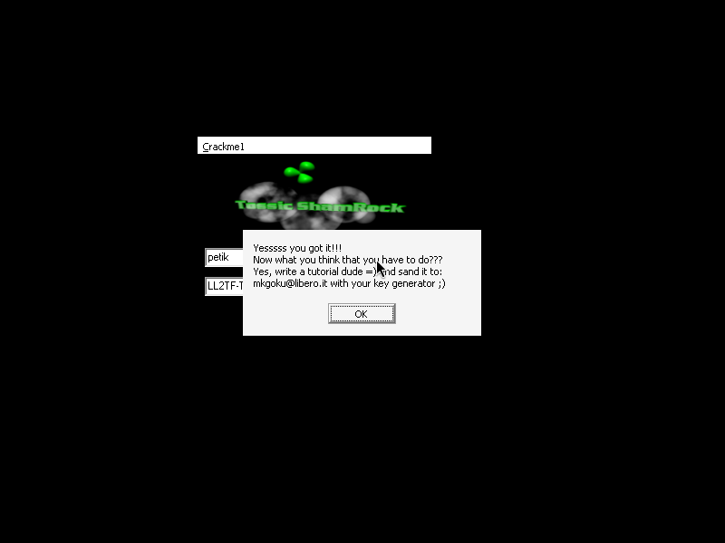
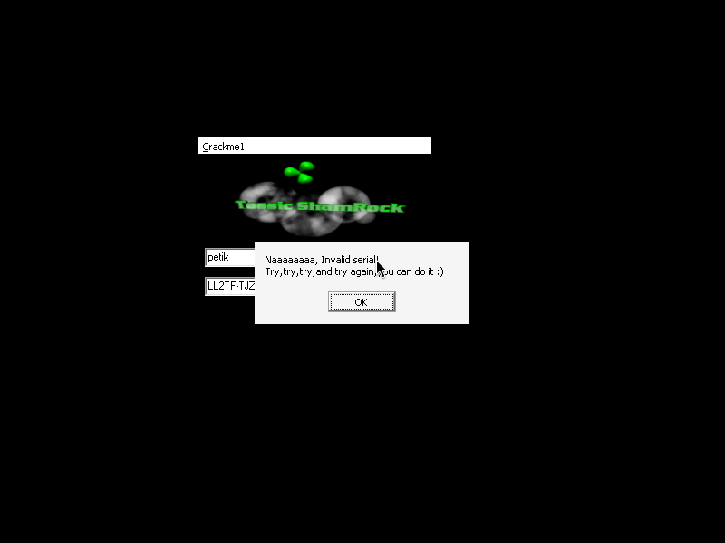

# crackme1 (Crackme1.exe) — tossic_shamrock

| | |
|---|---|
| **ID** | [`5ab77f5833c5d40ad448c3ea`](https://crackmes.one/crackme/5ab77f5833c5d40ad448c3ea) · [`ORIGIN.yml`](ORIGIN.yml) |
| **Auteur (site)** | crackmes.de (« CrackMe#1 By ToSsIc_ShAmRoCk », mkgoku@libero.it) |
| **Auteur (local)** | crackmes-de |
| **Plateforme** | Windows PE32 GUI, Borland Delphi 6 (Turbo Linker 2.25) |
| **SHA-256 (zip)** | `d80f0ae5d2e5f05c60733fd667c7cba74981d49c14f0830059fe2ce8c6ac0f8d` |

## Fichiers

| Fichier | Rôle |
|---|---|
| `original/tossics_crackme1.zip` | archive d’origine (`Crackme1.exe` + `ReadMe.nfo`, mot de passe `crackmes.one`) |
| `tools/crackme1-solve.py` | keygen (`--name`, `-q`) |
| `tools/verify-wine.sh` | preuve live Wine + xvfb + xdotool (sur copie patchée en `/tmp`, `original/` intact) |
| `analysis/screenshot-ok.png` / `screenshot-ko.png` | cas OK / KO |
| `analysis/screenshot-trial-expired.png` | le piège « trial Delphi expiré » sous Wine |

## Réponse

Keygen name → serial (nom d’au moins 4 caractères) :

| Name | Serial |
|---|---|
| **`petik`** | **`LL2TF-TJZTU-ALFIGH`** |

```bash
python3 tools/crackme1-solve.py --name petik        # name=petik / serial=LL2TF-TJZTU-ALFIGH
python3 tools/crackme1-solve.py --name petik -q     # LL2TF-TJZTU-ALFIGH
tools/verify-wine.sh petik LL2TF-TJZTU-ALFIGH /tmp/ok.png
```

Formule : `serial = "LL2TF-" + UpperCase( ∏ chr(((name[i] ^ i) + (i | 3)) & 0xFF) , i = 1..n ) + "-ALFIGH"`.

## Premier regard

```bash
unzip -P crackmes.one original/tossics_crackme1.zip     # Crackme1.exe + ReadMe.nfo
file Crackme1.exe      # PE32 GUI, Intel i386, 8 sections (CODE/DATA/BSS/.idata/.tls/.rdata/.reloc/.rsrc)
diec Crackme1.exe      # Linker: Turbo Linker 2.25 / Compiler: Borland Delphi 6 Enterprise
```

- Pas de packer : `CODE` à `0x401000`, `DATA` à `0x456000`.
- `strings` montre les classes VCL (`TEdit`, `TButton`, `OnClick`) et, dans la table de publiés de `TForm1`
  (`0x454a41…`) : `Edit1`, `Edit2`, `Button1`, `Button2`, `Button1Click`, `Button2Click`, `About1Click`.
- Le `ReadMe.nfo` (CP437) ne contient que le crédit et « Crack it and send me the solution and keygen ».
- **Piège Wine** : le binaire est lié avec la RTL « trial » de Delphi 6 Enterprise. En 2026 il affiche
  *« This module was compiled with a trial version of Delphi. The trial period has expired. »* puis quitte
  ([capture](analysis/screenshot-trial-expired.png)) — ce n’est pas le crackme, c’est le runtime.

## Flow

1. Fenêtre noire avec logo, deux `TEdit` (nom puis serial) et boutons *Check* / *End*.
2. *Check* → `TForm1.Button1Click` : calcule un serial à partir du nom et le compare au contenu d’`Edit2`.
3. OK → bip + MessageBox « Yessssss you got it!!! … write a tutorial dude =) and send it to mkgoku@libero.it with your key generator ;) ».
4. KO → « Naaaaaaaa, Invalid serial! Try,try,try,and try again,you can do it :) ».

## Comment on trouve

### Ancrage

La table de méthodes publiées de `TForm1` (VMT, fichier `0x54ab0…`) associe `Button1Click` → `0x00455720`
(`1300 20 57 45 00 0c "Button1Click"`, entrée de 0x13 octets : adresse sur 4 octets, puis nom Pascal).
Désassemblage ciblé :

```bash
objdump -d -M intel --start-address=0x455720 --stop-address=0x4558cc Crackme1.exe
```

Les littéraux Delphi sont des `AnsiString` (`ffffffff | len | octets | 00`), lus avec
`xxd -s $((VA-0x401000+0x400))` (CODE) ou `…-0x456000+0x55200` (DATA).

### Lecture de `Button1Click` (0x455720)

```asm
455744 lea  edx,[ebp-8]              ; edx = &name
455747 mov  eax,[ebp-4]              ; Self
45574a mov  eax,[eax+0x2f0]          ; Self.Edit1
455750 call 0x435300                 ; Edit1.Text → name
455755 cmp  [ebp-8],0 / jne ...      ; vide → ShowMessage("Yo must write something")
45576d cmp  eax,4 / jge ...          ; Length(name) < 4 → ShowMessage("No,no. Dont try to trick…")
455782 [ebp-0x10] := 'LL2TF-'        ; littéral 0x455938
45578f [ebp-0x14] := '-ALFIGH'       ; littéral 0x455948
                                     ; boucle esi = 1 .. Length(name)
4557b4 mov  bl,[eax+esi-1]           ;   c = name[i]
4557b8 xor  ebx,esi                  ;   c ^= i
4557ba mov  eax,esi ; or eax,3       ;   i | 3
4557bf add  ebx,eax                  ;   v = (c ^ i) + (i | 3)
4557c4 mov  edx,ebx
4557c6 call 0x404514                 ;   LStrFromChar(tmp, Char(v))   <-- 1 SEUL octet
4557d1 call 0x4045f4                 ;   mid := mid + tmp             (LStrCat)
4557da push [ebp-0x10] / push [ebp-0xc] / push [ebp-0x14]
4557eb call 0x4046ac                 ; LStrCatN(3) : prefix + mid + suffix
4557f6 call 0x4082bc                 ; copie en MAJUSCULES (a-z → -0x20)
455812 Edit2.Text  (Self+0x2f4)
45581d call 0x404730                 ; LStrCmp(calculé, Edit2.Text)
455822 je …                          ; égal → ni « Invalid serial » ; sinon MessageBox KO
455858 call 0x404730 / jne           ; égal → 40c318 (bip) + MessageBox « Yessssss you got it »
```

Un troisième test (`0x455882`) compare `Edit2` à la chaîne `KeyGen` : si le serial saisi vaut littéralement
`KeyGen`, la routine affiche le serial calculé (petite triche de l’auteur pour son keygen).

### Décodage et pièges

- **`0x404514` n’est PAS `IntToStr`** : première lecture erronée (serial en décimal
  `LL2TF-116106122116117-ALFIGH` → refusé sous Wine). C’est `_LStrFromChar` : `mov edx,ebx` passe le
  caractère en `dl`, donc seul l’octet bas de `v` compte. Chaque lettre du nom donne **un caractère**.
- `0x4082bc` : boucle `cmp al,0x61 ; jb ; cmp al,0x7a ; ja ; sub al,0x20` = `UpperCase` de la RTL ASCII
  (seuls `a-z` bougent). Le serial attendu est donc en majuscules ; le texte saisi n’est pas converti.
- Pour les noms qui produisent des octets non imprimables ou ≥ 0x80 le serial n’est pas saisissable
  (le solveur le signale sur stderr) ; `petik` donne bien du pur ASCII.

### Assemblage de la réponse, `petik` pas à pas

| i | c | c ^ i | i \| 3 | v = somme | `chr(v)` | après UpperCase |
|---|---|---|---|---|---|---|
| 1 | `p` 0x70 | 0x71 | 3 | 0x74 (116) | `t` | `T` |
| 2 | `e` 0x65 | 0x67 | 3 | 0x6a (106) | `j` | `J` |
| 3 | `t` 0x74 | 0x77 | 3 | 0x7a (122) | `z` | `Z` |
| 4 | `i` 0x69 | 0x6d | 7 | 0x74 (116) | `t` | `T` |
| 5 | `k` 0x6b | 0x6e | 7 | 0x75 (117) | `u` | `U` |

→ `LL2TF-` + `TJZTU` + `-ALFIGH` = **`LL2TF-TJZTU-ALFIGH`**.

## Prédicat consolidé

```python
mid    = "".join(chr(((ord(c) ^ i) + (i | 3)) & 0xFF) for i, c in enumerate(name, 1))
serial = upper_ascii("LL2TF-" + mid + "-ALFIGH")        # len(name) >= 4
ok     = (serial == Edit2.Text)
```

## Vérification

Pas de GDB ni de debugger MCP : reverse statique (`objdump`/`xxd`) + preuve live sous Wine.

1. Le trial Delphi bloque le lancement. Pour la preuve live, `tools/verify-wine.sh` extrait `Crackme1.exe`
   dans un répertoire temporaire et patche **la copie** (octet fichier `0x54f8d`, VA `0x455b8d` :
   `72 05` `jb` → `EB 05` `jmp`, ce qui saute le `jmp 0x403ff8` « trial expired » de la RTL ; le
   test de date compare à un timestamp 2002). `original/` n’est jamais modifié. La logique du crackme
   (`Button1Click`) n’est pas touchée.
2. `xvfb-run` + Wine, `xdotool` clique dans `Edit1` (298,285), tape `petik`, clique dans `Edit2` (298,317),
   tape le serial, clique *Check* (415,286) ; capture `ffmpeg -f x11grab`.

| Cas | Entrée | Résultat |
|---|---|---|
| OK | `petik` / `LL2TF-TJZTU-ALFIGH` | « Yessssss you got it!!! … » — [screenshot-ok.png](analysis/screenshot-ok.png) |
| KO | `petik` / `LL2TF-TJZTU-ALFIGX` | « Naaaaaaaa, Invalid serial! » — [screenshot-ko.png](analysis/screenshot-ko.png) |
| KO (erreur de lecture) | `petik` / `LL2TF-116106122116117-ALFIGH` | « Invalid serial! » (serial décimal, hypothèse `IntToStr` fausse) |




## Notes

- Le check n’est pas un simple mot de passe : il dépend du nom (chaque lettre → 1 octet), préfixe/suffixe fixes.
- Une « auto-vérification » (checksum du code à `0x403f64`, `0x455b6e…0x455bb6`) saute vers le handler
  d’expiration en cas d’écart — raison de plus pour ne pas patcher le code de la RTL à l’aveugle ; le patch
  de la copie ne touche que le `jb` et la preuve reste valide.
- Ne pas confondre avec le serial « décimal » : `LStrFromChar` ≠ `IntToStr`.
