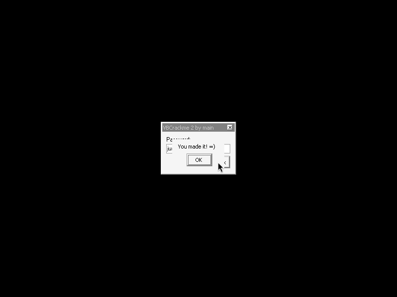

# crackmes.de's vbcrackme_2 by main (`VBCrackme2.exe`)

| | |
|---|---|
| **ID** | [`5ab77f5833c5d40ad448c3ec`](https://crackmes.one/crackme/5ab77f5833c5d40ad448c3ec) · [`ORIGIN.yml`](ORIGIN.yml) |
| **Auteur (site)** | crackmes.de (crackme de *main*) |
| **Plateforme** | Windows PE32, GUI, **VB6 compilé en code natif** (`MSVBVM60.DLL`) |
| **SHA-256 (zip)** | `1c8838138a1cbdb6394d7f97d4d277813634462826bb0c9dc92d35c6ea1906af` |

## Fichiers

| Chemin | Rôle |
|---|---|
| `original/VBCrackme2.by.main.zip` | archive d'origine (mot de passe zip `crackmes.one`), non modifiée |
| `analysis/extracted/` | `VBCrackme2.exe` + `ReadMe.txt` extraits du zip (copie de travail) |
| `analysis/screenshot-*.png` | preuves Wine/xvfb (OK, verrouillé, mauvais mot de passe, unlock) |
| `tools/vbcrackme2-solve.py` | solveur / `--check` statique / `--live` Wine |

## Réponse

Il y a deux « secrets » : le **password d'unlock est passé en ligne de commande** (`Command$`, c'est l'indice du ReadMe), le **serial** est tapé dans la zone de saisie.

| Étape | Valeur |
|---|---|
| Argument de lancement (`Command$`) | **`Phase1`** → `VBCrackme2.exe Phase1` |
| Bouton **Unlock** | message « If your password is correct the code is now unlocked » |
| Serial (textbox) puis **Check** | **`just some password`** → « You made it! =) » |

(Pas de champ user/login dans ce crackme, donc pas d'exemple `petik`.)

```bash
python3 -I tools/vbcrackme2-solve.py            # Phase1 / just some password
python3 -I tools/vbcrackme2-solve.py --check    # vérifie chiffré, octets cibles et serial dans le binaire d'origine
python3 -I tools/vbcrackme2-solve.py --live out.png   # Wine + xvfb + xdotool, capture finale
```

## Premier regard

```bash
unzip -P crackmes.one original/VBCrackme2.by.main.zip -d analysis/extracted
cat analysis/extracted/ReadMe.txt
file analysis/extracted/VBCrackme2.exe      # PE32 GUI i386, 3 sections (.text .data .rsrc)
strings -a -t x -n 3 -e l analysis/extracted/VBCrackme2.exe   # chaînes UTF-16
```

`ReadMe.txt` : *« Find the password which decrypts the correct code to set the correct variable! Hint: Command$ »*.

Le `.text` commence par la table d'imports (IAT, `jmp [..]` en 0x401136+), l'en-tête `VB5!` est à 0x4014a0, le vrai code utilisateur est à 0x402210-0x4029c0 (3 procédures). Chaînes UTF-16 utiles (offsets fichier = VA − 0x400000) :

| VA | Chaîne |
|---|---|
| 0x401e44 | `just some password` |
| 0x401e70 | `You made it! =)` |
| 0x401ea8 | `The serial check can only run if you unlock the code with the correct password!` |
| 0x401f4c | `If your password is correct the code is now unlocked` |
| 0x401fbc | `Nope` |

Ce n'est **pas** du P-code (pas de `ProcCallEngine`) : du x86 classique, lisible avec `objdump`.

## Flow

```text
Unlock (sub @0x402590) : Command$ non vide ?
      pour i = 1..6 : octet[i] = Asc(Mid$(CHIFFRÉ,i,1)) XOR Asc(Mid$(Command$,i,1))
      WriteProcessMemory(OpenProcess(PROCESS_ALL_ACCESS, GetCurrentProcessId()), 0x40246f, octets, 6)
Check  (sub @0x402210) : [form+0x34] == True ?  non -> msgbox « can only run if you unlock… »
                                               oui -> Text == "just some password" ? « You made it! » : rien
sub @0x402410          : On Error Resume Next ; [form+0x34] = True ; msgbox « If your password is correct… »
```

## Comment on trouve

### 1. Ancrage : la routine d'unlock (0x402590)

Les imports VB6 sont appelés par ordinal ; on les résout en parsant l'import directory (la table `ILT` contient des ordinaux). Noms **déduits de l'usage** (pas confirmés par une table d'export) : 516 ≈ Asc, 537 ≈ Chr$, 595 ≈ MsgBox, 608 ≈ Chr$ renvoyant un Variant, 632 ≈ Mid$ (Variant), 669 ≈ Command$ (cohérent avec l'indice du ReadMe). Le script d'extraction (python, ~10 lignes sur `struct`) donne par exemple `0x401088 → ord608`, `0x401030 → ord669`, `0x401098 → ord537`.

Début de la sub (`objdump -d -M intel --start-address=0x402590`) :

```asm
4025dd: push 0x36 ; push eax ; call esi        ; esi = [0x401088] : Chr(0x36) -> Variant
402636: push 0xaf ; ...        ; Chr(0xaf)
402641: push 0x27              ; Chr(0x27)
40264c: push 0x47              ; Chr(0x47)
402657: push 0x9a              ; Chr(0x9a)
402665: push 0xce              ; Chr(0xce)
402673: ... call [0x401094] x5 ; __vbaVarCat : concaténation des 6 Chr()
4026c3: call [0x401008]        ; StrVarMove -> [ebp-0x28] = CHIFFRÉ (6 octets)
402722: call [0x401030]        ; Command$
402730: push 0x401fcc ; call __vbaStrCmp   ; Command$ <> "" ?  (0x401fcc = BSTR vide)
```

Puis la boucle `For i = 1 To Len(CHIFFRÉ)` (`cmp di, [ebp-0x130]` ; `jg` sortie ; `add ax, di ; jo` = `i = i + 1`) :

```asm
402817: Asc(Mid$(CHIFFRÉ,i,1))   ; ord516 -> [ebp-0x140]
402831: Asc(Mid$(Command$,i,1))   ; ord516 -> edx
402840: xor eax, edx
402843: call [0x401098]           ; Chr$(a XOR b) (ord537)
402856: __vbaMidStmtBstr          ; réécrit le caractère i de la chaîne
```

Après la boucle :

```asm
4028b1: call 0x401d20   ; GetCurrentProcessId
4028c7: call 0x401d78   ; OpenProcess(0x1f0fff = PROCESS_ALL_ACCESS, 0, pid)
4028d8: call [LenBstr]  ; taille = 6
4028e7: call [StrToAnsi]
4028ee: mov eax, 0x40246f ; push eax
4028f5: call 0x401e08   ; WriteProcessMemory(hProc, 0x40246f, buf, 6, &written)
```

(`0x401d20`, `0x401d78`, `0x401e08` sont les thunks `Declare Function` VB : `DllFunctionCall` + `kernel32.dll` — chaînes `GetCurrentProcessId`, `OpenProcess`, `CloseHandle`, `WriteProcessMemory` visibles dans `strings`.)

Le crackme **déchiffre donc du code** : le « password » XORe 6 octets, et le résultat est écrit **dans sa propre section `.text`**, à `0x40246f`.

### 2. Que doit-il y avoir en 0x40246f ?

```bash
objdump -d -M intel --start-address=0x402410 --stop-address=0x402490 analysis/extracted/VBCrackme2.exe
```

```asm
402467: push 0x1
402469: call [0x401040]                    ; __vbaOnError  (On Error Resume Next)
40246f: mov WORD PTR [esi+0x34], 0xffff    ; 66 c7 46 34 ff ff  -> « Unlocked = True » (champ du Form)
402475: ... msgbox « If your password is correct the code is now unlocked »
```

Et le handler Check (0x402210) lit le même champ :

```asm
402255: cmp WORD PTR [esi+0x34], 0xffff    ; déverrouillé ?
40226f: jne 0x402342                       ; non -> msgbox « The serial check can only run if you unlock… »
4022b4: push 0x401e44 ; call __vbaStrCmp   ; texte == "just some password" ?
```

« Set the correct variable » (ReadMe) = mettre `[form+0x34]` à `True` : ce sont exactement les 6 octets `66 C7 46 34 FF FF` de l'instruction à 0x40246f.

### 3. Calcul du password

`password[i] = CHIFFRÉ[i] XOR PLAIN[i]` :

| i | chiffré | plain (`mov word [esi+0x34],-1`) | XOR | car. |
|---|---|---|---|---|
| 1 | 0x36 | 0x66 | 0x50 | `P` |
| 2 | 0xAF | 0xC7 | 0x68 | `h` |
| 3 | 0x27 | 0x46 | 0x61 | `a` |
| 4 | 0x47 | 0x34 | 0x73 | `s` |
| 5 | 0x9A | 0xFF | 0x65 | `e` |
| 6 | 0xCE | 0xFF | 0x31 | `1` |

→ **`Phase1`** (mot ASCII lisible : bonne confirmation que le plaintext supposé est le bon, et `Phase1` marche en live). Le serial se lit directement dans le `__vbaStrCmp` du Check : `just some password`.

### Pièges

- Le code applicatif est dans la zone `.text` **après** l'IAT/les thunks ; `objdump` depuis 0x401000 donne du bruit jusqu'à ~0x402200 (table d'imports prise pour du code).
- Les `push imm` sont `6a 36` / `6a 27` / `6a 47` pour les petites valeurs et `68 af 00 00 00` pour les ≥ 0x80 : un `grep` naïf des immediates rate la moitié.
- `Command$` doit faire **≥ 6 caractères** (boucle `Mid$(Command$,i,1)` jusqu'à 6, sinon `Asc("")` → erreur) ; un mauvais mot de passe ne plante pas, il écrit des octets arbitraires dans `.text` et le flag reste faux (`On Error Resume Next`).
- Le texte de la zone de saisie est comparé **en clair** : le password n'est pas à saisir dans le champ, c'est l'argument du process.

## Vérification (Wine / xvfb, binaire d'origine non patché)

Harnais : `xvfb-run` + `xdotool` (fenêtre en 436,330 ; Unlock en 383,327 ; Check en 439,327 ; textbox en 400,300) et capture `ffmpeg x11grab`, voir `tools/vbcrackme2-solve.py --live`.

| Cas | Commande | Résultat | Capture |
|---|---|---|---|
| **OK** | `VBCrackme2.exe Phase1` → Unlock → `just some password` → Check | « You made it! =) » | [screenshot-ok.png](analysis/screenshot-ok.png) |
| Unlock seul | `VBCrackme2.exe Phase1` → Unlock | « If your password is correct the code is now unlocked » | [screenshot-unlock.png](analysis/screenshot-unlock.png) |
| KO : pas d'unlock | sans argument → serial → Check | « The serial check can only run if you unlock the code… » | [screenshot-ko-locked.png](analysis/screenshot-ko-locked.png) |
| KO : mauvais password | `VBCrackme2.exe Phase2` → Unlock → serial → Check | idem, resté verrouillé | [screenshot-bad-password.png](analysis/screenshot-bad-password.png) |
| KO : sans argument | Unlock sans arg → serial → Check | resté verrouillé | (même message) |



## Notes

- Pas de GDB ni de debugger utilisé : reverse statique (`objdump`, parsing des imports en Python) + preuve live sous Wine ; aucun MCP IDA / x64dbg n'a été utilisé.
- Point non élucidé : les octets de `0x40246f` sont **déjà** `66 C7 46 34 FF FF` dans le fichier sur disque, et pourtant Unlock sans argument (rien n'est écrit) laisse le programme verrouillé — l'instruction ne s'exécute donc que dans un chemin que je n'ai pas tracé complètement (la sub 0x402410 n'est pas appelée directement depuis 0x402590). Ça ne change pas la solution : `Phase1` / `just some password` est validée par le binaire, et `Phase2` (écriture d'octets faux) la casse.
- Le solveur `--check` vérifie statiquement : chiffré (`push` immediates), octets cibles à 0x40246f, présence du serial UTF-16 ; `--live` rejoue la preuve Wine.
