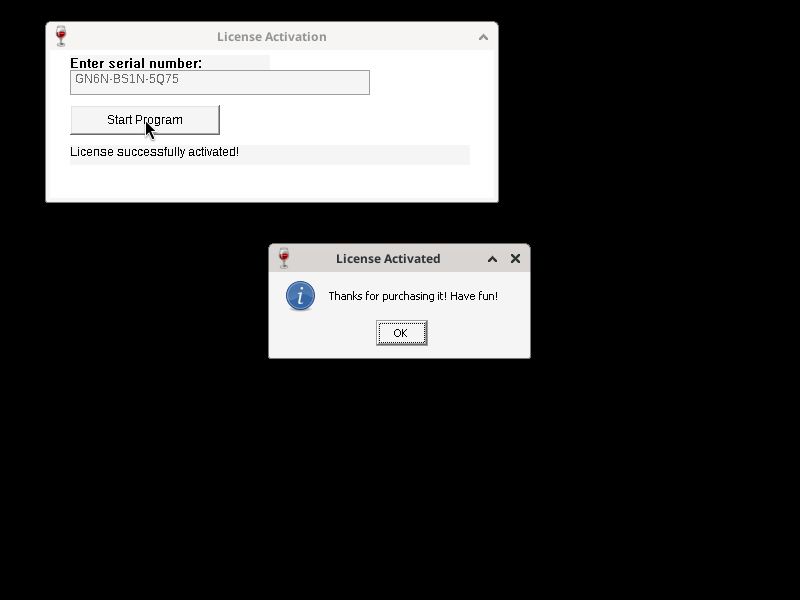
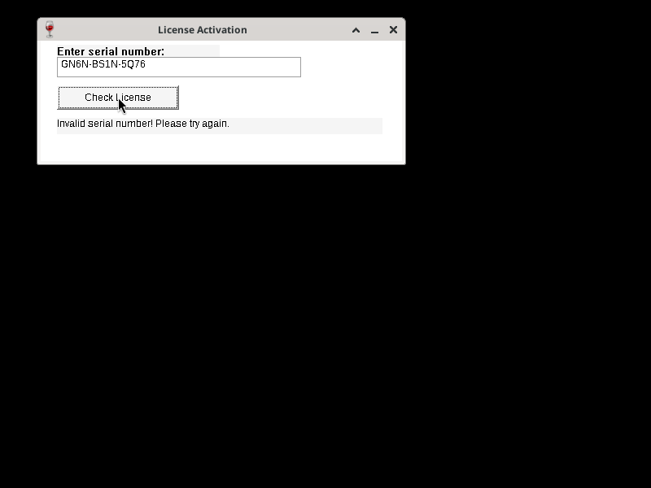

# janicious's WinAPI GUI Crackme

| | |
|---|---|
| **ID** | [`69470c4d523504d8c842eb93`](https://crackmes.one/crackme/69470c4d523504d8c842eb93) · [`ORIGIN.yml`](ORIGIN.yml) |
| **Auteur** | janicious |
| **Plateforme** | Windows PE64, MinGW C++, GUI WinAPI (fenêtre « License Activation ») |
| **SHA-256** (`download.bin`) | `64cced7fbc411b1bbd9535203de9ef2373a4c6fa701e38d88a987634033ed531` |

## Fichiers

| Chemin | Rôle |
|---|---|
| `original/download.bin` | ZIP d'origine (mot de passe `crackmes.one`) contenant `winapi-crackme.exe` — non modifié |
| `analysis/x/winapi-crackme.exe` | exe extrait du ZIP (copie de travail) |
| `analysis/screenshot-ok.png`, `analysis/screenshot-ko.png` | preuve Wine (cas OK / KO) |
| `tools/janicious-solve.py` | keygen / `--check` |
| `tools/verify-wine-gui.sh` | automatisation xvfb + xfwm4 + xdotool + capture ffmpeg |

## Réponse

Pas de username : un **serial seul**. Format `XXXX-XXXX-XXXX`, caractères alphanumériques, et **la somme des chiffres vaut 24** (les lettres comptent 0).

| Exemple (seed `petik`) | Serial |
|---|---|
| petik | **`GN6N-BS1N-5Q75`** (6+1+5+7+5 = 24) |

```bash
python3 tools/janicious-solve.py            # serial pour la seed petik
python3 tools/janicious-solve.py -q
python3 tools/janicious-solve.py --check GN6N-BS1N-5Q75
```

## Premier regard

- `download.bin` est un ZIP (pas un exe) : `python3 -I -c "import zipfile; zipfile.ZipFile('original/download.bin').extractall('analysis/x', pwd=b'crackmes.one')"`.
- `strings` : exe MinGW C++ non strippé, symbole `_Z14ValidateSerialRKNSt7__cxx1112basic_stringIcSt11char_traitsIcESaIcEEE` (= `ValidateSerial(const std::string&)`) ; textes `Enter serial number:`, `Check License`, `Invalid serial number! Please try again.`, `License successfully activated!`, `Thanks for purchasing it! Have fun!`.

## Flow

Clic sur « Check License » → lecture de l'EDIT → vide : « Please enter a serial number. » ; sinon `ValidateSerial` : faux → « Invalid serial number! », vrai → « License successfully activated! », bouton « Start Program » et MessageBox « License Activated ».

## Comment on trouve

Ancrage : `objdump -d -M intel --no-show-raw-insn analysis/x/winapi-crackme.exe`, fonction `ValidateSerial` en `0x140001e40` (grâce au symbole).

```asm
cmp  QWORD PTR [rcx+8], 0xe      ; std::string::size() == 14
cmp  BYTE PTR [rbp+4], 0x2d      ; s[4] == '-'
cmp  BYTE PTR [rbp+9], 0x2d      ; s[9] == '-'
mov  r12d, 0x210                 ; masque binaire 10_0001_0000 = bits 4 et 9
loop: bt r12, rbx ; jb skip      ; saute les positions 4 et 9 (les tirets)
  call isalnum ; test eax,eax ; je fail   ; autres positions : alnum obligatoire
  sub esi, 0x30                  ; c - '0'
  lea eax,[rdi+rsi] ; cmp esi,0xa ; cmovb edi,eax   ; si (c-'0') < 10 (unsigned) : sum += chiffre
skip: add rbx,1 ; cmp rbx,0xe ; jne loop
cmp  edi, 0x18 ; sete al         ; sum == 24
```

Décodage : `0x210` = `(1<<4)|(1<<9)` → positions des tirets. Le `cmovb` après `sub 0x30` est un test non signé « est-ce un chiffre ? » : les lettres (c-0x30 ≥ 10) ne modifient pas la somme. Donc : 14 car., tirets en 4 et 9, 12 alnum, somme des chiffres = 24.

Assemblage : chercher 12 caractères dont les chiffres somment à 24, par ex. `GN6N-BS1N-5Q75` → 6+1+5+7+5 = 24. Beaucoup de solutions, par ex. `AAAA-BBBB-9933` (9+9+3+3 = 24 ✓) ; le solveur en dérive une de façon déterministe.

Piège : `isalnum` est appelé avec un `char` signé étendu (`movsx`), sans conséquence ici (ASCII).

## Vérification (binaire d'origine sous Wine)

Wine 10 + Xvfb + xfwm4 (sans gestionnaire de fenêtres, l'EDIT ne reçoit pas le focus clavier) :

```bash
tools/verify-wine-gui.sh GN6N-BS1N-5Q75 /tmp/ok.png
tools/verify-wine-gui.sh GN6N-BS1N-5Q76 /tmp/ko.png   # somme 25
```

- OK :  — « License successfully activated! » + MessageBox « License Activated ».
- KO (`GN6N-BS1N-5Q76`, somme 25) :  — « Invalid serial number! Please try again. »

## Notes

- Aucun GDB / x64dbg / IDA MCP utilisé : reverse 100 % statique (objdump) + preuve live Wine.
- Pas de lien avec un nom : « petik » n'est que la seed du générateur déterministe.
